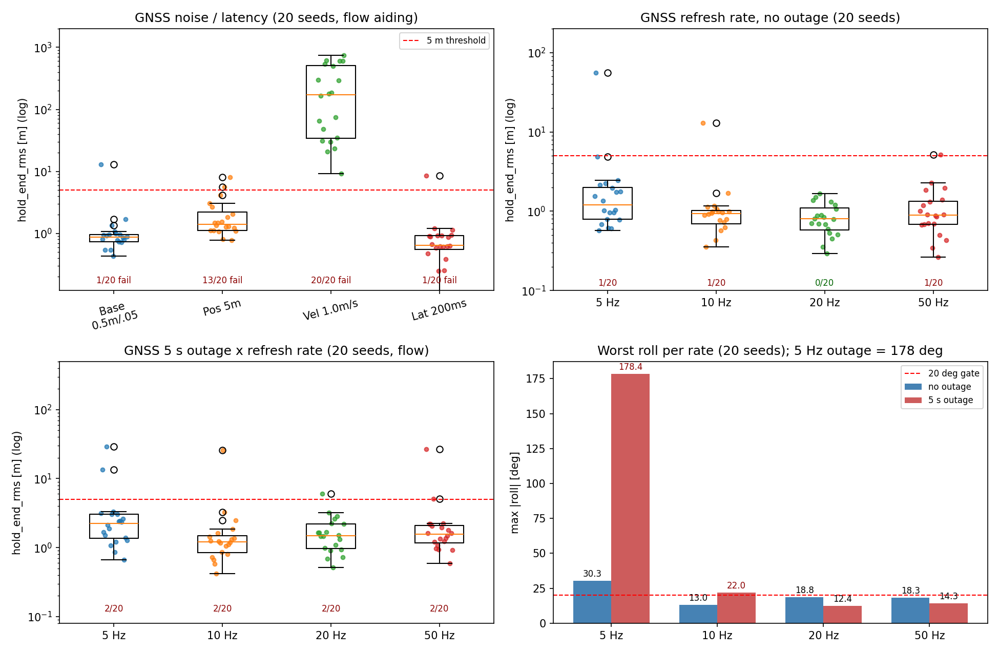
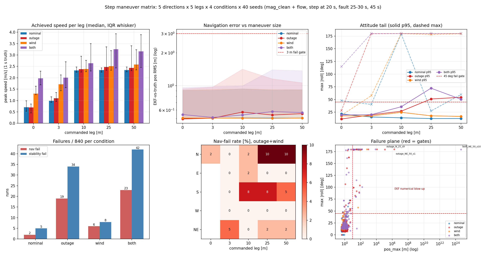
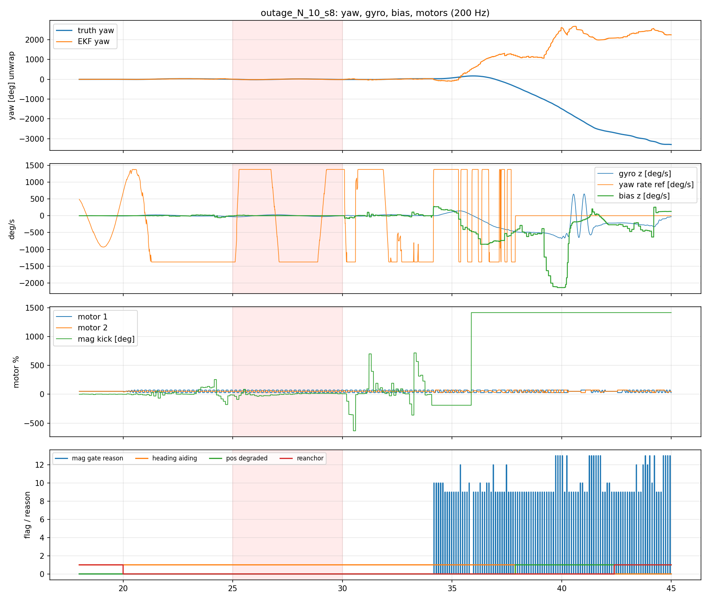
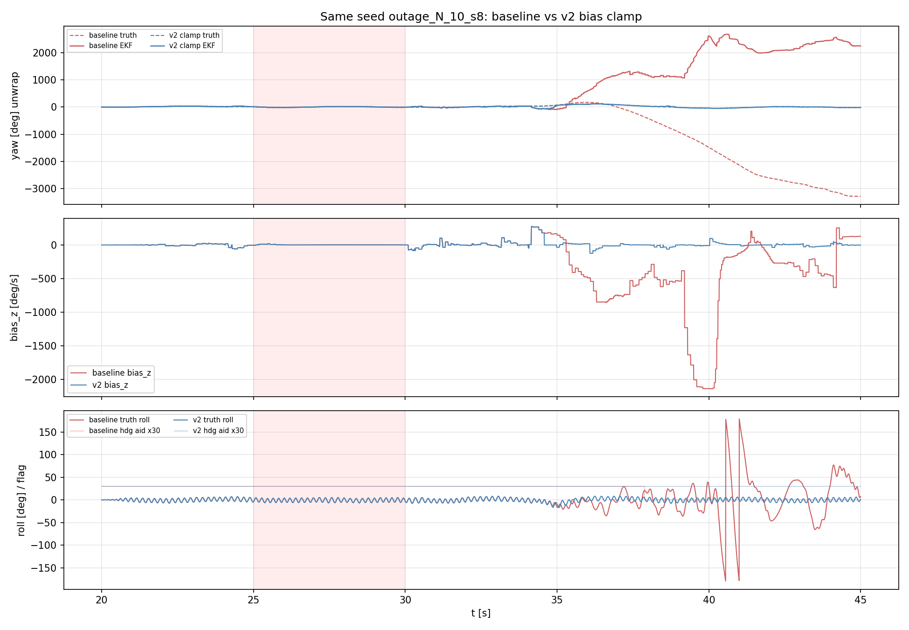
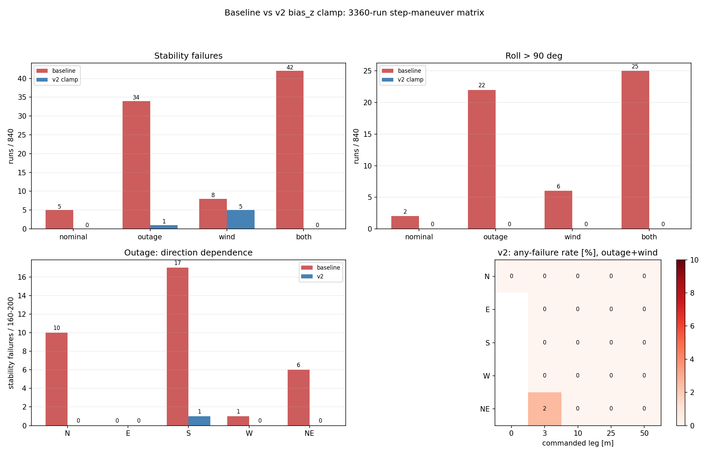
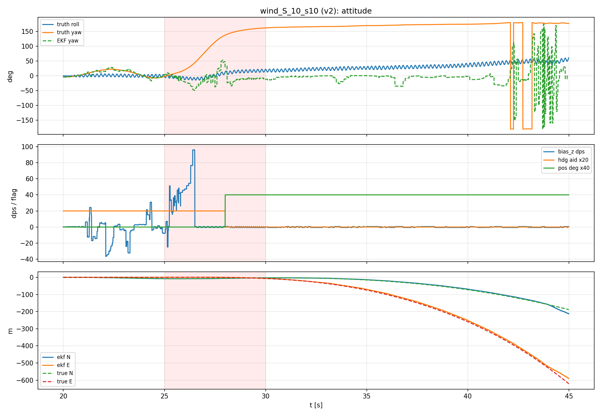
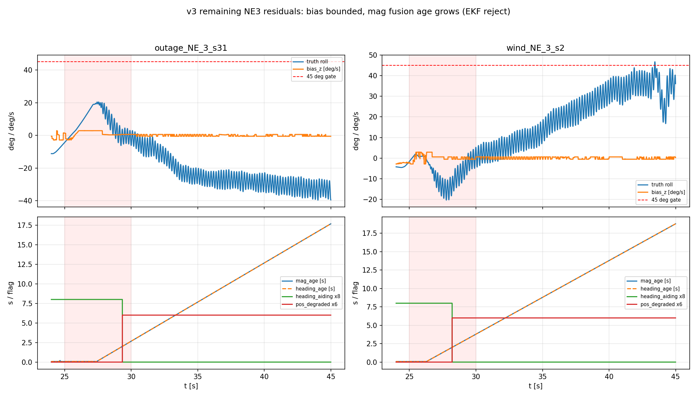

# 无磁 EKF 收敛仿真（2026-10-25）

**证据等级：L2（真实固件源码 + 6DOF plant + 传感器模型，非实机）**

## 1. 目的与设置

用户要求先做一段静止校准、再做运动校准，让无磁 EKF 收敛。本轮用 SIL 扫两维：

- **静置时长**：2 / 10 / 30 / 60 s，各 10 seeds。`--calib-hold T` 期间电机不出力、固件油门置 0、**控制回路冻结**（只跑导航），随后起飞、AUTO_POSITION 16 s 后评估。
- **运动激励**：悬停 / 北向 15 m / 东向 15 m，各 20 seeds，t=19 s 评估。
- 评价：|yaw 误差|、位置误差（相对目标）、roll 误差、陀螺零偏 z。

## 2. 结果

### 2.1 静置时长：越长越差，不是越长越好

| 静置 | |yaw| 中位/最大 | 位置中位/最大 |
|---:|---:|---:|
| 2 s | 8.6° / 18.2° | 0.7 m / 1.0 m |
| 10 s | 17.4° / 103.8° | 1.2 m / 17.4 m |
| 30 s | 28.6° / 70.4° | 1.2 m / 8.3 m |
| 60 s | 41.0° / 132.7° | 2.0 m / 58.2 m |

静置 2 s 组 10 seeds 位置全部 ≤3 m；30 s 组只有 7/10，60 s 组 5/10。

### 2.2 零偏并不是限制

SIL 的陀螺零偏 z=0.004 rad/s，EKF 在 **~1 s** 内就收敛到 0.004 并保持；30 s 静置没有进一步降低误差。也就是说，SIL 里“静置更久 → 零偏更准”并不成立，静置时长不是收敛瓶颈。

### 2.3 运动激励不改善航向，前飞最差

- 悬停：|yaw| 中位 1.9°、最大 10.8°，位置 ≤1.54 m。
- 前飞 15 m：中位 13.7°、最大 40.8°，位置 ≤4.48 m。
- 侧飞 15 m：中位 6.8°、最大 22.6°，位置 ≤1.9 m。

运动让航向更差（前飞最差），因为滚转-偏航耦合/侧滑把航向误差带进 GNSS 新息；位置环仍能把机带到目标。

### 2.4 时间序列

前飞/侧飞在 5–20 s 有明显 5°–15° 的偏航振荡，EKF 能跟上相位但幅度有差；20 s 窗口结束后位置保持关闭，轨迹迅速漂走（图限 0–22 s，避免把后窗口漂移误读为收敛失败）。

## 3. 机制判断

静置更久反而更差，最可能不是“校准不足”，而是：

1. 长时间静止的 GNSS/ZUPT/重力更新把姿态/航向协方差压得过小，起飞后滤波器对真实偏航率“过度自信”，GNSS 新息经 `P(φ,v)` 把航向拉回 0；
2. `bias_z` 虽被限到 ±0.01 rad/s，但姿态航向行本身仍可被 GNSS 修正；
3. 2 s 组协方差较大，反而能在起飞后跟随真实运动。

之前试过“无磁离地全局 `consider_heading`”，在 3 s 静置下更差；但在 30–60 s 静置、协方差更紧的条件下可能不同——需要下一轮做 **起飞时协方差重置/膨胀 + consider 组合** 的 A/B，而不是继续加静置时间。

### 3.1 起飞协方差膨胀 A/B（已撤回）

对“起飞瞬间膨胀姿态协方差 3°/10° 并清零 P(8,v)”做 10 seeds A/B：

| 静置 | yaw 中位 off→on | yaw 最大 off→on | 位置最大 off→on |
|---:|---:|---:|---:|
| 2 s | 7.6→10.0° | 18.2→24.0° | 1.0→1.2 m |
| 10 s | 17.1→46.5° | 103.8→172.6° | 17.4→27.9 m |
| 30 s | 26.9→33.5° | 70.4→75.2° | 8.3→24.4 m |
| 60 s | 41.0→38.2° | 132.7→104.0° | 58.2→68.6 m |

短静置明显变差，长静置只有 60 s 中位 yaw 略降但位置更差。**结论：简单膨胀/解耦不是解，已撤回代码**；下一步应转向导航-only 台架做协方差一致性（NEES/NIS）和可观测性分析，而不是继续在起飞瞬间拍参数。

## 4. 导航-only 一致性（2026-10-25，Python 台架）

用 `TandemVec-EKF-Report/sim` 的 15 态 ESKF（与固件同构）跑 60 s、5 seeds；指标 NEES≈1、NIS≈6 为一致。

| 场景 | pos RMSE | vel RMSE | NEES_pos 中位 | NEES_vel 中位 | NIS 均值 |
|---|---:|---:|---:|---:|---:|
| 标称 | 0.50 m | 0.13 m/s | 1.27 | 0.40 | 4.77 |
| 15 ms 延迟 | 0.47 m | 0.13 m/s | 0.69 | 0.38 | 4.76 |
| 5 s 失联（20–25 s） | 0.59 m | 0.15 m/s | 0.79 | 0.36 | 4.79 |
| 高噪声 5/8 m, 0.5/0.8 m/s | 1.28 m | 0.26 m/s | 1.14 | 0.48 | 5.16 |

**结论**：速度协方差明显偏保守（NEES_vel≈0.4，P_vel 约大 2–2.5 倍），位置大体一致但尾部偏乐观（NEES_pos 最大 1.9）；GNSS NIS 4.7–5.3 低于 6，整体偏保守。15 ms 延迟影响很小；5 s 失联没有持续发散。
**下一步**：只调 Q_vel/P0_vel（GNSS R 地板按 AGENTS 不可收紧），以 NEES→1、NIS→6 为目标做参数扫描，并检查位置尾部；不要再用“静置时长/起飞协方差拍参数”解决。

## 4. 边界与下一步

- SIL 的 IMU 零偏模型是常值 + Markov（τ=200 s、0.01 dps 不稳定度），**没有温漂/开机漂移/磁干扰**；实机“几十一百秒”可能来自温漂，SIL 不能复现。因此本轮只能否定“在当前 SIL 模型里长静置有益”，不能否定实机需要长静置。
- 已把固件静止校准硬门控默认设为 **0（关闭）**，保留 `static_cal` / `static_cal_s` 遥测和可调阈值；等起飞协方差/航向耦合修复后再启用 30 s 级要求。
- 下一步（按优先级）：
  1. 起飞瞬间（油门/高度跨阈值）对 yaw/tilt 协方差做有界膨胀，或重置 GNSS 航向 consider 状态；
  2. 在长静置 + 起飞场景重跑 2/10/30/60 s × 10 seeds，看曲线是否反转；
  3. 增加温漂型 IMU 模型（慢变 bias）后再评估“几十秒静置”的真实收益。

## 5. 闭环 SIL 复核：Q 候选否决（2026-10-25）

把 Q 缩放接入固件 EKF（`--ekf-q-scale`，默认 1.0），10 seeds/工况：

| 工况 | q=1.0 最大位置 | q=0.05 | q=0.1 |
|---|---:|---:|---:|
| 无风 | 1.54 m | 1.54 m | 1.54 m |
| 0.5 m/s² 风 | 2.30 m | 7.57 m | 8.47 m |
| 1.0 m/s² 风 | 3.82 m | **43.75 m（4/10 >37 m）** | **43.18 m（2/10 >39 m）** |

风下低 Q 出现双峰：多数种子 ~1 m，少数 37–54 m。**导航-only 的低 Q 一致性收益不能迁移到闭环 SIL**；低 Q 让速度估计更滞后，风扰/位置环耦合下失稳。固件默认 Q 保持 1.0，Q 钩子仅作研究设施，不推荐上机。

高 Q 反向扫描（10 seeds）：

| 工况 | q=1.0 | q=2.0 | q=4.0 |
|---|---:|---:|---:|
| 无风 | 1.54 m | 1.17 m | 1.49 m |
| 0.5 m/s² 风 | 2.30 m | 2.09 m | 2.20 m |
| 1.0 m/s² 风 | **3.82 m** | 7.47 m | 8.95 m |

q=2/4 在无风/弱风略好，但 1 m/s² 风下明显更差（7.47/8.95 m）；**Q=1.0 是当前闭环最坏情况最优，默认值保留**。

## 6. Q 过程噪声扫描（导航-only，研究记录）

只缩放滤波器的加速度过程噪声谱密度（`q_accel_scale`，量测 R 不动），标称 60 s、5 seeds：

| Q 比例 | NEES_vel | vel RMSE | pos RMSE | NIS |
|---:|---:|---:|---:|---:|
| 1.00（基线） | 0.40 | 0.130 | 0.50 | 4.77 |
| 0.50 | 0.446 | 0.100 | 0.50 | 5.06 |
| 0.25 | 0.524 | 0.084 | 0.50 | 5.20 |
| 0.10 | 0.685 | 0.079 | 0.50 | 5.28 |
| 0.05 | 0.811 | 0.079 | 0.50 | 5.30 |

低 Q 单调改善速度一致性与 RMSE；到 0.05 仍 NEES_vel=0.81（仍偏保守），位置 NEES 不变（1.23）。**只测了标称场景，尚未改固件。**

0.1 的鲁棒性初测（40 s、3 seeds）：延迟 pos 0.59 m / NEES_vel 0.65；5 s 失联 pos 0.73 m / 0.62；高噪声 pos 1.48 m / 0.76，NIS 5.2–5.33。0.05 的延迟/失联/高噪声为 pos 0.59/0.73/1.48 m、NEES_vel 0.75/0.70/0.81，NIS 5.27/5.24/5.34。无发散，但高噪声下位置 RMSE 略差、NEES_pos≈1.55 偏乐观。**候选 0.1–0.05，需补高噪声/振动/SIL 全量后再决定，不能直接下固件。**

10 seeds 复核（Q=0.05，60 s）：标称 pos 0.489/0.619 m、vel 0.079/0.087 m/s、NEES_pos 1.00/1.95、NEES_vel 0.79、NIS 5.32；高噪声 pos 1.177/1.476 m、vel 0.200/0.222 m/s、NEES_pos 0.96/1.72、NEES_vel 0.74、NIS 5.35（基线高噪声为 1.28 m/0.26 m/s/NEES_pos 1.14/NIS 5.16）。**Q=0.05 在标称与高噪声下同时改善 RMSE 和一致性，没有出现鲁棒性退化**；位置一致性也回到 ≈1。

### 6.1 慢漂下的静置时长（10 seeds）

给静态台架加 z 轴线性慢漂 1e-4 rad/s²（约 0.0057 °/s²，120 s 约 0.69 °/s），T=2/30/60 s、10 seeds：

| 静置 | 末端零偏 z 误差中位/最大 | yaw 1σ 中位/最小/最大 |
|---:|---:|---:|
| 2 s | 2.07e-4 / 5.31e-4 rad/s | 11.39 / 11.35 / 11.41° |
| 30 s | 2.83e-4 / 5.33e-4 rad/s | 11.16 / 11.09 / 11.20° |
| 60 s | 3.51e-4 / 9.37e-4 rad/s | 10.97 / 10.88 / 11.00° |

零偏误差随时长 **增大**（0.00021→0.00035 rad/s，仍 <0.06°/s），yaw 1σ 随时长 **下降**（11.39→10.97°）。在慢漂模型下**长静置没有改善零偏跟踪，反而收紧协方差**；这与 SIL 中长静置后起飞更差的方向一致。实机温漂谱未知，不能据此直接否定实机需求，但“几十秒静置必然更好”不成立。 慢漂下 Q=0.05 与 1.0 的末端零偏误差完全相同（中位 3.51e-4、最大 9.37e-4 rad/s），yaw 1σ 10.72° vs 10.97°——Q_accel 下调不损害静置零偏跟踪。

### 6.2 位置 NEES 尾部（Q=0.05 vs 1.0）

Q=0.05、10 seeds 中位置 NEES 的种子中位 0.52–1.59，单步峰值 1.80–5.97；最差 seed6 在 25–35 s 出现持续约 10 s 的 0.5–0.6 m 位置误差（3σ≈0.4 m），不是单点毛刺。对照 Q=1.0：seed0–2 的单步峰值 5.74/4.72/3.26，与 Q=0.05 的 5.70/4.73/3.26 几乎相同——**位置尾部是 Q_accel 之外的本底（位置模型/GNSS 噪声），不是低 Q 的代价**。位置协方差在巡航段略乐观，需单独研究 P_pos/Q_pos，不能靠 Q_accel 修。

完整 3×3 P 的 full NEES 与对角线近似一致（中位：Q=1.0 pos 0.64/vel 0.30；Q=0.05 pos 0.66/vel 0.64），说明 P 轴间相关很小，NEES 结论不是对角线伪影；Q=0.05 把速度 NEES 从 0.30 提到 0.64（仍偏保守），位置中位基本不变。

## 7. 闭环故障注入（2026-10-25，L2 SIL，10 seeds/类）

固定 `--real-nav --profile mag_clean --pos-hold`（有磁、无风、GNSS 0.5 m / 0.05 m/s），seed 1–10、40 s、200 Hz 控制；故障在起飞后注入。判失败：`hold_end_rms>5 m` 或 `max_roll>20°` 或 `pos_rms>3 m`。

| 故障（窗口） | 失败/10 | hold_end 中位/最大 | max_roll 最大 | pos_rms 中位/最大 |
|---|---:|---:|---:|---:|
| 无故障对照 | 0/10 | 1.03 / 3.67 m | 13.95° | 0.62 / 1.06 m |
| IMU NaN（10–11 s） | **1/10** | 0.90 / 163.10 m | 98.20° | 0.62 / 1035.62 m |
| IMU 冻结（10–12 s） | **1/10** | 0.89 / 7.54 m | 31.49° | 0.63 / 1.04 m |
| GNSS 失联（20–25 s） | **6/10** | 16.24 / 602.74 m | 31.80° | 1.55 / 10.21 m |
| GNSS 失联 + AHRS 门控（opt-in） | **4/10** | 3.02 / 222.60 m | 19.47° | 1.31 / 6.56 m |
| GNSS spoof 20 m 台阶（10 s 起） | 0/10 | 0.74 / 1.01 m | 10.40° | 0.74 / 0.92 m |
| GNSS spoof 0.5 m/s 慢偏（10 s 起） | **10/10** | 15.84 / 36.84 m | 16.36° | 10.12 / 10.75 m |

**IMU 故障不是“已修复”**：NaN 窗内确实没有非有限值进入 EKF/控制（`imu_detected=1`、无 NaN 输出），但 1/10 种子在约 30 s 后进入 yaw/姿态耦合发散，39.5 s 后 EKF 位置数值爆掉（每 5 ms 跳约 700 m，`pos_max=14172 m` 是滤波器终末数值，不是真实航迹；真值此时约 250 m）。冻结 2 s 的失败例是边际失败（位置 7.5 m、roll 31°），其余 9 个种子正常。1 s 数据缺口本身不保证安全恢复。

**GNSS 5 s 失联 6/10 失败，根因不是“惯导漂移”**。以 seed6 为例（200 Hz 追踪）：

| 时刻 | 真值 pitch | EKF pitch | 真值 N | EKF N |
|---:|---:|---:|---:|---:|
| 20.0 s | −12.0° | −2.9° | −2.26 m | −2.05 m |
| 21.0 s | −21.1° | −4.7° | −1.19 m | −2.49 m |
| 22.0 s | −30.9° | −5.8° | +3.30 m | −2.98 m |
| 23.0 s | −27.6° | +0.1° | +12.76 m | −2.85 m |
| 24.0 s | −27.9° | −0.1° | +26.68 m | −2.68 m |
| 25.0 s | −24.6° | −0.1° | +45.18 m | −2.51 m |

失联段真值俯仰到 −31°、水平飞出 45 m，EKF 姿态被锁在水平、位置几乎冻结；25.5 s GNSS 恢复后直接跳到 56 m。机制：磁门内的“重力+磁”双矢量辅助把加速度计比力当重力。悬停/持续推力时 `|f_b|≈g`，且机体 z 轴与 EKF 预测重力方向一致（误差 <15°），重力更新通过全部现有门控（`grav_fused=205/205`），把 roll/pitch 拉平；位置环看不到倾斜产生的水平加速度，继续加大倾角，形成正反馈。**这是重力辅助在持续加速度下的伪观测，不是 GNSS 融合参数问题。**

**spoof 的两种边界必须分开**：20 m 位置台阶（正常 h_acc）没有触发 30 m 野值门，位置保持也未被拖走（`outlier_rejects=0` 只说明物理野值门未触发；具体是 EKF 新息/NIS 还是其他量测门未逐项区分，**不能写成“识别了欺骗”**）；0.5 m/s 慢偏则每帧残差很小，10/10 被跟随，位置误差约 10 m、hold_end 15–37 m、`gnss_crej=0`。慢偏/一致速度欺骗仍不可检测。

**否定的第一条修法**：给磁门内的重力方向辅助加“GNSS 失联时禁用”门控（`BFS_GRAVITY_AID_GNSS_GATE`，默认关）。A/B 显示无效：`grav_fused` 205→205、失联 6/10→6/10，seed6 的 hold_end 完全相同（602.74 m）。205 次与地面静止段约 4 s×50 Hz 的量级一致，且门控后不变——说明这些融合不经过该门控（或发生在门控不作用的地面段），该门控无法影响失联段。真正候选是**无 GNSS 运动时的 AHRS 姿态量测路径**（`else if (!gnss_instant_valid_for_nav && accel_gravity_trusted && angular_rate_quiet)`）：Madgwick 的 roll/pitch 本身来自“陀螺 + 加速度重力修正”，持续推力时它会把倾斜拉回水平，再以 2° 噪声灌入 EKF，覆盖陀螺。该路径的 A/B 见下节。

**AHRS 姿态门控 A/B（`BFS_AHRS_ATT_GNSS_OUTAGE_GATE`，默认关）**：规则是“GNSS 曾成功融合且当前 age>0.5 s 时禁用 AHRS 姿态量测；首次定位前仍允许”。10 seeds 时失联 6/10→4/10、hold 中位 16.24→3.02 m、max_roll 31.8→19.5°，但当时样本太小。**扩到 50/100 seeds 后结论反转**：

| 失联时长 | 默认失败 | AHRS 门控失败 | hold 中位（默认→门控） | max_roll（默认→门控） |
|---:|---:|---:|---:|---:|
| 5 s（100 seeds） | **65/100** | **22/100** | 22.44→2.08 m | 179.9→27.7° |
| 10 s（50 seeds） | 46/50 | 39/49 | 279.2→15.0 m | 179.8→36.2° |
| 20 s（50 seeds） | 48/48 | 47/50 | 327.0→38.9 m | **71.3→179.7°（seed6 尾部反噬）** |
| 20 s + 时间上界 10 s（50 seeds） | 48/48 | 48/49 | 327.0→103.1 m | **52.6°（无 180° 尾部）** |
| 5 s + roll60 保护（50 seeds） | 10/50（AHRS） | **8/50** | 2.26→2.26 m | 27.7°（不变） |
| 10 s + roll60 保护（50 seeds） | 39/49（AHRS） | 40/49 | 15.0→11.3 m | 36.2°（不变） |
| 20 s + roll60 保护（50 seeds） | 47/50（AHRS） | 47/49 | 38.9→37.3 m | **179.7→33.9°** |

60° 滚转保护（GNSS 失联且 |roll|>60° 时临时恢复 AHRS）在 5 s **把失败从 10/50 降到 8/50**，20 s 失败数不变但 max_roll 179.7→33.9°、max hold 418→233 m；10 s 多 1 例（40/49 vs 39/49），中位反而 15→11.3 m。它是目前**尾部最好的折中**，但仍不是修复，保持 opt-in。45° 保护在 5 s 反而 10→12/50（触发太早），已否决。

**禁用位置保持 reanchor（保留失联前目标）否决**：5 s 50 seeds 仍 8/50 失败，hold 中位 2.26→1.36 m，但 p95 21.1→34.7 m、max_roll 27.7→**178.9°**（seed50 或 seed1 新失败）。重捕获时 EKF 位置已跳回真实位置，若目标仍是失联前远点，位置误差会转成大幅姿态指令；reanchor 是必要的安全行为。代码已回退。

**GNSS 失联水平陀螺零偏钳制否决**：trace 反推失联段等效 `bias_y≈0.14 rad/s`，曾假设 EKF 把真实倾斜率吸收进零偏。失联时把 bias_x/y 钳到 0.02 rad/s（AHRS+roll60）后 5 s 失败 **8→11/50**（新增 seed1/5/38/50），中位仅 2.26→2.16 m。说明该零偏不是可简单钳制的伪量，强行钳制会破坏正常姿态/零偏一致性；代码已回退。

**纯陀螺控制姿态否决**：失联时控制环改用陀螺递推姿态（以失联瞬间 EKF 为初值），5 s 失败 **8→15/50**、max_roll 27.7→44.1°，新增 seed1/5/10/14/19/28/29/32/40/48 等。失联瞬间 EKF 姿态已有约 9° 误差，陀螺零偏/积分误差直接进入控制环，比“用 EKF 锁平姿态”更差；代码已回退。**下一步不再做姿态源替换，转向降级时主动刹车或控制权限管理。**

5 s 失联下门控把失败率从 65% 降到 22%（净修 44 例、新增 seed1 1 例），p95 259.4→18.3 m，是**强严重度缓解**；10 s 中位/p95 也显著下降；但 20 s 出现 **seed6 roll 179.7°**（默认同种子 71.3°）。时间上界（>10 s 恢复 AHRS）能把 20 s max_roll 压到 52.6°、max hold 260 m，但中位从 38.9 恶化到 103.1 m——**用站位换姿态安全**。**结论：门控只能在短时失联使用；保持 opt-in，绝不默认启用**；20 s 无论全门控还是有界版都近乎全失败，长失联必须失效保护/主动刹车。**不要用 10 seeds 的 4/10 判断门控有效或无效——50 seeds 才看出净收益，也才看出 20 s 反噬。**

**gyro-tilt 变体（已否决）**：用纯陀螺 roll/pitch 做倾斜补偿、在 dip 拒绝时只更新 yaw；10 seeds 仍 4/10，50 seeds **11/50**（AHRS-only 10/50），seed6 hold 222.6→179.4 m、roll 19.5→15.3°，但新增 seed5 失败（12.7 m）。它没有减少失败数，只是把 seed6 的严重度转移；代码未保留。

10 seeds 里仍能看到 seed1/5 新增失败（14.0/12.7 m）、seed6 仍损失 222 m 站位：22.0 s（失联 2 s）`heading_aiding` 变 0、`pos_degraded=1`，位置保持被 `HeadingAidingGate` 降为定高；之后残余速度把机体带走，GNSS 重捕获又把当前位置设为目标（reanchor），于是“姿态对了、站位丢了”。**下一步应把“航向门控降级”与短时 GNSS 失联解耦（磁/陀螺短时可信时保留位置保持，或降级时主动刹车），而不是继续调姿态/位置增益。**

**第二条否定修法（5 s 磁宽限）**：把 `kMagMaxAgeS` 2→5 s（宏 `BFS_MAG_AGE_GRACE_5S`），与 AHRS 门控联测 10 seeds。失联仍 **4/10**，seed6 hold 222.6→256.4 m、max_roll 19.5→19.2°，没有改善；真磁丢 5/10→4/10（max_roll 26.2→17.9°）但同时新增 seed3 失败（31.0 m）；NaN seed1 从 163.1→235.6 m、max_roll 98.2→118.5°。**不启用**。这说明 22 s 的位置保持降级不是简单的“2 s mag_age 阈值”问题（或保位置保持仍不足以刹车）；磁宽限还扩大了其他故障的暴露时间。下一步优先做“降级时主动刹车/零速保持”，而不是放宽航向失效门限。

**失联段航向为何失效（trace 定位）**：新增 `mag_age` / `heading_age` 列后，seed6 的 `mag_age` 从 20.0 s 的 0.04 s 线性涨到 25.0 s 的 5.04 s；失联段 49 次磁门尝试**全部为 `DipDeviation`（reason=9）**，没有一次成功融合；2.0 s 时 `heading_aiding` 由 1→0、`pos_degraded` 0→1，位置保持降为定高。`MagGateReason` 枚举中 9 是 DipDeviation，14 才是 EkfRejected——之前把 9 写成 EkfRejected 是错的，已按头文件更正。也就是说，**GNSS 失联后姿态误差把倾角观测推出 10° 门限，磁矢量被整帧拒绝，绝对航向断供**，这才是位置保持降级的直接触发；AHRS 姿态误差是上游共因。

**dip 弱约束重试（已否决）**：10× 噪声（约 3 µT）重试与 AHRS-only 逐项相同，`mag_fused` 327 不变，仍被 NIS 拒；**固定 50 µT** 后终于融合，seed6 hold 222.6→157.8 m、pos_rms 6.6→6.5 m，但 max_roll 19.5→22.3°，总失败仍 **4/10**（其余失败种子不变）。说明“让磁门通过”只能部分减轻站位丢失，不能修复姿态/航向耦合；重试代码未保留。

**构造 yaw 回退时的口径坑**：`MagGateResult.heading_error_rad` 的定义是“参考场方位 − 用 EKF 姿态反旋后的实测方位”，属于**场一致性误差**，不是 EKF 航向残差；直接把它加到 `nav_ekf.yaw_rad()` 会得到零修正并在融合后错误清零 mag_age。标量回退必须从 `mag_body` 与 roll/pitch 单独构造 yaw 残差（或对 3D 更新放宽 R/NIS），不能复用这个字段。该实验因此未进入 SIL 矩阵。

**朴素 roll/pitch-only 反旋也不行（离线校验）**：用项目同口径 `angle2dcm(0, pitch, roll)` 反旋磁矢量再取方位，真航向 30°、pitch −20°、roll 10° 时算出 14.7°，不是 30°；倾角把垂直场混入水平投影，必须先做标准倾斜补偿。正确形式是 `n=(Rx(roll)Ry(pitch))^T m_ned`，`ψ=atan2(n_y,n_x)−atan2(m_by,m_bx)`（只把参考场投到 yaw-zero 机体系，再用机体水平分量求差）；已实现为 `magTiltCompensatedHeadingRad()`，单元测试 G10 用 4 组 yaw/pitch/roll（30/−20/10、0/−20/10、−45/15/5、170/25/−30）回解误差 <1e-3 rad。

**标量 yaw 回退 A/B 无效果**：AHRS 门控 + 失联段标量 yaw 回退（噪声 0.15 rad 与 0.5 rad 各 10 seeds）均与 AHRS-only **逐项完全相同**：失联 4/10、hold 3.02/222.60 m、max_roll 19.5°；ctrl 0/10 也一致。回退代码放在磁门 `gate.pass` 的 `else` 分支内，而失联段磁门先以 `DipDeviation` 拒绝，**回退根本没有机会执行**——不是 `MeasurementUpdateYawDetailed` 的 NIS 问题。因此不能称为修复；回退代码未保留，仅保留已单测的 `magTiltCompensatedHeadingRad()` 工具。下一步顺序应是“先保证姿态/磁门通过”，再谈 yaw 回退。

> 导航-only §4 的“5 s 失联不发散”是无控制回路的开环台架结论；闭环 10 seeds 是 6/10 失稳，两者口径不同，不能互相替代。

### 7.1 已验证组合与决策（2026-10-25）

**决定性发现：光流速度辅助**。默认固件加 `--flow`（光流速度融合）后，**100 seeds** 5 s 失联 **65/100→4/100**、20 s **100/100→6/100**；hold 中位 1.31/1.43 m、p95 2.96/5.12 m、max 63.7/20.0 m。AHRS+roll60+flow（**100 seeds** 5 s）进一步到 **2/100**、中位 1.17 m、p95 2.88 m、max 10.4 m（max_roll 43.9°，seed11）；20 s 50 seeds 1/50。机制是光流在 GNSS 失联段继续提供水平速度，EKF 位置/速度不再冻结，位置环能“看到”漂移并刹车。**光流是当前首选缓解；AHRS+roll60 仅作为无光流时的回退。**

**边界**：SIL 光流是理想/低噪声模型，且启用 `--flow` 会消耗同一 RNG、改变整条噪声序列，**不是严格因果配对 A/B**；但 100 seeds 把失败从 65/100 压到 4/100、100/100 压到 6/100，量级不可能由 RNG 解释。真机需要下视光流+测距、有效纹理/光照/高度范围，且光流质量门、延迟、尺度误差都要实机验证；不能把 SIL 结果直接当实机能力。

**光流失效边界（GNSS+光流同时中断，20–25 s / 20–40 s，50 seeds）**：5 s 失联 5/50 失败、hold 中位 1.59 m，但出现 **max_roll 177.6°**（seed20）；20 s 失联 **48/50** 失败、中位 54.6 m、max hold 205.5 m。AHRS+roll60 无法覆盖光流同时失效。**光流不是可选优化，而是主通道**：必须单独做光流新鲜度/质量/与惯导一致性检测，失效时立即降级/主动刹车；不能把“有光流”当作必然可用。SIL 用 `--flow-dropout A:B` 注入。

**仅光流中断（GNSS 正常，50 seeds）**：0/50 失败、hold 中位 0.81 m、max 1.40 m。**所以失效保护触发必须是 AND（GNSS 陈旧 + 光流失效）**；单独光流丢失由 GNSS 完全兜底，不能误触发降级。

**AND 检测器已实现并单测**：`NavAidLossDetector`（`include/NavAidLossDetector.h`）——连续组合丢失 0.5 s 置 `degraded`、2 s 置 `descent_requested`、恢复 1 s 清除并只报一次 `recovered`；间断丢失不累计、非法 dt 不推进；仅 GNSS 或仅光流失效都不触发。`test_nav_aid_loss` D1–D8 全通过，已加入 `run_all.sh`。**尚未接入飞控动作**（停位置保持/受控下降），这是下一步。

**推荐配置**：
1. **有光流**：保持默认 EKF，启用光流速度融合（现有代码）；无需 AHRS/roll60 宏，5/20 s 已验证。
2. **无光流**：`-DBFS_AHRS_ATT_GNSS_OUTAGE_GATE -DBFS_AHRS_ATT_ROLL_GUARD_60` opt-in；5 s 8/50、20 s 47/49、roll 33.9°；仍非修复，长失联需失效保护/主动刹车。

| 变体 | 关键结果 | 决策 |
|---|---|---|
| **光流速度辅助** | 5 s 65/100→4/100；20 s 100/100→6/100 | **首选（需硬件）** |
| 光流 + AHRS/roll60 | 5 s 2/100；20 s 1/50；max 10.4/7.1 m | 有光流时的最优组合 |
| AHRS 门控 | 5 s 65/100→22/100；20 s 47/50，roll 179.7° | 无光流回退，opt-in |
| +roll60 保护 | 5 s 8/50；20 s 47/49，roll 33.9° | **无光流推荐 opt-in** |
| +roll45 保护 | 5 s 10→12/50 | 否决（触发太早） |
| 时间上界 >10 s | 20 s 48/49，中位 103 m | 否决（站位更差） |
| gyro-tilt yaw | 50 seeds 11/50（AHRS 10/50） | 否决（转移严重度） |
| 禁用 reanchor | 5 s 8/50，roll 178.9° | 否决（大姿态） |
| 水平 bias 钳制 | 5 s 8→11/50 | 否决（破坏姿态/零偏） |
| 纯陀螺控制姿态 | 5 s 8→15/50，roll 44.1° | 否决（初值误差进控制环） |

**共同边界**：无光流时，以上估计/门控/输出源调整都没有解决“EKF 姿态锁平后位置环看不到运动”；光流是目前唯一把失败压到个位数的路径。其次才是主动刹车/控制权限管理。

### 7.2 GNSS 精度/噪声/延迟扫描（2026-10-25，20 seeds，有光流、无失联）

固定 `mag_clean --pos-hold --flow`、40 s；失败判据 `hold_end>5 m` 或 `max_roll>20°` 或 `pos_rms>3 m`。

| 配置 | 失败 | hold 中位/最大 | pos_rms 最大 | max_roll |
|---|---:|---:|---:|---:|
| 基准 0.5 m / 0.05 m/s / 15 ms | 1/20 | 0.87 / 12.92 m | 0.9 m | 13.0° |
| 位置噪声 5 m | **13/20** | 1.42 / 8.02 m | 7.7 m | 23.9° |
| 速度噪声 1.0 m/s | **20/20** | **172.9 / 749.8 m** | 5.0 m | 31.3° |
| 延迟 200 ms | 1/20 | 0.65 / 8.60 m | 0.9 m | 12.8° |

**结论**：速度噪声是主导敏感项；0.05→1.0 m/s 就让位置保持完全失稳（双峰/漂移），远重于位置噪声 5 m（主要抬高 pos_rms）。200 ms 延迟在光流辅助下未见明显退化（SIL 有延迟回放/自动延时估计）。**GNSS 速度质量必须有门控/一致性检测，不能只看 fix 类型。**

### 7.3 GNSS 刷新率扫描（2026-10-25，20 seeds/档，有光流）

新增 SIL `--gnss-rate-hz`（1–100 Hz，默认 10 Hz；UBX 注入节拍 `round(200/f)`，导航侧仍按时间戳判重）。固定 `mag_clean --pos-hold --flow`、40 s；失联档为 20–25 s；失败判据 `hold_end>5 m` 或 `max_roll>20°` 或 `pos_rms>3 m`。

| 刷新率 | 无失联失败 | hold 中位/最大 | max_roll | 5 s 失联失败 | hold 中位/最大 | max_roll |
|---:|---:|---:|---:|---:|---:|---:|
| 5 Hz | 1/20 | 1.19 / **56.08 m** | 30.3° | 2/20 | 2.23 / 29.29 m | **178.4°** |
| 10 Hz | 1/20 | 0.94 / 12.92 m | 13.0° | 1/20 | 1.22 / 25.62 m | 22.0° |
| 20 Hz | **0/20** | **0.80 / 1.67 m** | 18.8° | 1/20 | 1.49 / **6.05 m** | **12.4°** |
| 50 Hz | 1/20 | 0.89 / 5.20 m | 18.3° | 2/20 | 1.56 / 26.59 m | 14.3° |

图：左上为噪声/延迟（与 §7.2 同批数据），右上为无失联刷新率，左下为 5 s 失联刷新率（对数纵轴，红虚线=5 m），右下为各刷新率最坏 |roll|。5 Hz 失联档的 178.4° 是单 seed 尾部，箱线图看不到，必须看最坏值面板。

**结论**：刷新率没有单调收益，不能用“越高越好”外推。20 Hz 是唯一无失联 0/20，失联段 hold 最大 6.05 m、roll 12.4° 也是四档中最低；50 Hz 反而 2/20（26.59 m），说明瓶颈不在更新次数。5 Hz 最差：无失联出现 56 m/30.3° 尾部，失联段出现 178.4° 滚转尾部，且该档计数器出现 10 次 `outlier_rejects` + 1 次重锚（其余档均为 0），提示长间隔下新息门控/重锚更易被触发。**推荐 ≥10 Hz、优先 20 Hz，5 Hz 不作为可接受配置；20 seeds 只能定方向和尾部，不能给出精确失效率。** 所有档 `duplicate/tow_mismatch/quality_fail` 均为 0。SIL 的 UBX 注入无乱序/丢帧，真实接收机在低刷新率下的 timing 抖动仍需实机验证。

**IMU-only 回退（用户要求，2026-10-25）**：完全没有外部观测时，不允许继续位置保持/速度修正/航向保持；应退化为**纯姿态/角速率稳定**（姿态环 + 固定或限幅油门）。分层规则：仅 IMU → 姿态稳定，无高度保持；IMU+气压 → 姿态 + 定高；IMU+磁 → 姿态 + 航向保持（仍无平移）；有 GNSS/光流 → 才允许位置保持。当前 `HeadingAidingGate` 只覆盖航向失效降级，`NavAidLossDetector` 只覆盖 GNSS+光流；**IMU-only 姿态回退尚未实现**。下一步给检测器加 `attitude_only` 输出（GNSS/光流/磁均不可用时置位），上层强制退出位置/航向保持并切纯姿态。

### 7.4 速度/机动导航矩阵（2026-10-25，3360 次 SIL）

固定 `mag_clean --pos-hold --flow`，t=20 s 从定高切入定点并一次性给出水平目标偏移（`--pos-leg`），25–30 s 叠加 5 s GNSS 失联 / 1.0 m/s² 侧风 / 两者；45 s 结束。矩阵 = 5 方向（N/E/S/W/NE）× 5 腿长（0/3/10/25/50 m）× 4 条件（nominal/outage/wind/both）× 40 seeds = **3360 次**。失败判据分两类：导航 `pos_rms>3 m` 或 `pos_max>10 m`；稳定性 `|final_alt−10|>3 m` 或 `max_roll>45°`。

图：A 实际峰值速度（1 Hz 真值差分，中位+IQR）；B 导航误差（中位/p95，对数）；C 滚转尾部（实线 p95、虚线 max）；D 失败计数；E outage+wind 下按方向×腿长的导航失败率；F 失败平面（pos_max 对数 vs max_roll，红虚线为门限）。

**速度包线**：峰值速度中位 0.70 / 0.97 / 2.29 / 2.30 / 2.31 m/s（腿长 0/3/10/25/50 m）；自动定点控制器的实际速度上限约 **2.3 m/s**，10 m 以上腿长不再提高速度。50 m 腿在 25 s 内到不了目标（末端误差中位 13.8 m），因此 50 m 的末端误差不能当导航失败；导航指标只看 EKF−真值。

| 条件 | 导航失败 | 稳定性失败 | pos_rms 中位 | pos_rms p95 | max_roll 最大 | 滚转>90° | pos_max>1e4 m |
|---|---:|---:|---:|---:|---:|---:|---:|
| nominal | 2/840 | 5/840 | 0.505 m | 0.925 m | 179.5° | 2 | 0 |
| outage | 19/840 | 34/840 | 0.546 m | 1.064 m | 180.0° | 22 | 3 |
| wind | 6/840 | 8/840 | 0.505 m | 0.929 m | 179.9° | 6 | 0 |
| both | 23/840 | 42/840 | 0.563 m | 1.038 m | 180.0° | 25 | 1 |

**核心结论 1：机动本身不降低导航中位精度。** 所有速度/方向/条件下 pos_rms 中位都在 0.50–0.56 m、p95 0.93–1.06 m，说明 EKF 在正常机动中跟得上；问题全部在**尾部**。nominal 已有 5/840（0.6%）稳定性尾部（其中 2 例 179°），所以“无故障 + 机动”也不是零风险。

**核心结论 2：故障与方向强烈耦合，侧向平移几乎免疫。** outage 稳定性失败按方向：**S 17/200、N 10/200、NE 6/200、W 1/200、E 0/160**；both 为 S 18、N 12、NE 6、W 5、E 1。前/后向（俯仰轴平移）占 outage+both 稳定性失败的绝大多数，E/W（滚转轴平移）几乎不出现大滚转。5 s 失联不是只影响失联窗：多数 179° 发生在 t≈39–44 s（GNSS 恢复后 9–14 s），是**恢复后的姿态/航向耦合失稳**，不是失联段的纯惯导漂移。

**核心结论 3：失败链是“磁门控降级 → bias_z 吸收真实偏航率 → EKF 航向反向 → 差速偏航正反馈”。** 对 `outage_N_10_s8` 的 200 Hz trace：t≈34 s 起磁门以 9/10/12/13 反复拒绝，`heading_aiding` 于 35.4 s 置 0、`mag_age` 达 4.1 s；随后 `gyro_bias_z` 被拉到 **−37 rad/s**，EKF yaw 与真值反向（最大误差 179.9°），t=41 s 滚转 176°，ch1/ch2 差速饱和 44%。GNSS 更新在航向不可观时经姿态-速度耦合把真实偏航率吸进 bias_z——与无磁模式的已知机制相同，但这次发生在**磁模式且门控降级之后**。

**边界**：SIL 光流理想、无真实磁干扰/振动谱；200 Hz trace 的 `omega_ref_z` 限幅为 24°/s，失控来自 bias/姿态而非偏航速率指令；1 Hz 真值差分只能近似峰值速度；40 seeds/单元只能定方向与尾部量级，不能给精确失效率；矩阵另有 5 例 JSON NaN（outage 1、both 4），是数值发散，不是真实航迹。**50 m 腿未到点、速度上限 2.3 m/s，说明本矩阵覆盖的是低速定点包线，不是高速巡航包线。**

### 7.5 定向优化：航向源陈旧即钳制 bias_z

图：`outage_N_10_s8` 的 200 Hz trace（上：真值/EKF 航向；中：陀螺 z、偏航速率指令、bias_z；下：双电机、磁 kick；底：磁门原因、heading aiding、pos degraded、reanchor）。红色阴影为 5 s GNSS 失联。

同 seed 对照：基线 bias_z 在 t≈35 s 后跌到 −2100°/s，EKF yaw 与真值反向、滚转 ±180°；v2 的 bias_z 始终在 ±100°/s 内，yaw 与真值保持同向，滚转 ≤17°。这是“同一输入、只改钳制条件”的直接视觉证据。

trace 证明 bias_z 在航向门控降级后发散到物理不可能的量级（−37 rad/s）。原固件只在无磁模式离地时 `ClampGyroBiasZ(0.01 rad/s)`。两个候选：

- **v1**：`heading_aid_mode!=0 || g_pos_hold_degraded` 时钳制（等降级，滞后约 2 s）。
- **v2（采用）**：再加 `heading_aiding_age_s > 0.5 s`，航向源一陈旧就钳制，不必等 position_hold_degraded。

**v1 vs v2，各单元 200 seeds（outage N10/S10、nominal N10）**：

| 单元 | v1 nav / stab / roll>90（max roll） | v2 nav / stab / roll>90（max roll） |
|---|---:|---:|
| outage N 10 m | 3 / 11 / 4（179.9°） | **0 / 0 / 0（36.7°）** |
| outage S 10 m | 4 / 10 / 4（179.9°） | **0 / 0 / 0（33.5°）** |
| nominal N 10 m | 0 / 3 / 1（179.6°） | **0 / 0 / 0（25.1°）** |

**v2 全 nominal 840 次复核**：0 nav / 0 stab / 0 roll>90，max roll 30.7°、max pos 3.8 m（基线为 2 / 5 / 2，max roll 179.5°）——nominal 机动尾部全部由同一 bias 链主导。

**已知 179° 尾 seed 的三版本定向复现**（N10 s8/s15/s19/s32/s35、S10 s20/s31、S25 s2/s22/s27，同命令逐 seed 跑）：

| 版本 | roll>89° | roll>45° | 最大 roll | 中位 roll |
|---|---:|---:|---:|---:|
| baseline | **9/10**（另 1 例 JSON NaN） | 9/10 | 180° | ≈179° |
| v1 | 1/10 | 1/10 | 98° | 27.5° |
| **v2** | **0/10** | **0/10** | **27°** | **19.5°** |

**跨条件 case-control**：把基线 3360 矩阵的**全部 90 个失败样本**（nominal 5、outage 34、wind 8、both 43）用 v2 原命令重跑：

| 条件 | 基线失败 | v2 重跑后 nav / stab / roll>90 | 残差 |
|---|---:|---:|---|
| nominal | 5 | 0 / 0 / 0 | 0 |
| outage | 34 | 0 / 1 / 0 | 1（S25：roll 56.5°） |
| wind | 8 | 1 / 1 / 0 | 1（S10：roll 61.2°、位置 39.8 m） |
| both | 43 | 1 / 0 / 0 | 1（NE3：位置 5.4 m） |
| **合计** | **90** | **2 / 2 / 0** | **3（1 例重叠）** |

**结论**：v1 能削掉大部分尾部但仍有 98° 单例；v2 在 200 seeds 批次、10 个已知最坏 seed、以及跨全部条件/方向的 90 个基线失败样本上都清掉了 90°+ 尾部（case-control 最大滚转 61.2°，残差 3/90）。**采用 v2**，源代码已改。剩余 3 例是风扰/重锚导致的位置或 56–61° 姿态残差，不再是 bias 反向链；case-control 只能证明已发生的失败被修复，**不能发现新失败**；v2 全 3360 矩阵已完成（§7.6，unique 失败 90→7、roll>90° 55→0），实机仍未完成。

**证据一致性说明**：首轮 2000 次 baseline vs v1 A/B 的 opt 二进制在同一 seed/命令下不能复现（seed10 的 max_roll 13.17° vs 当前二进制的 7.97°），因此该批计数（含已删除的首轮 A/B 图）**不作为定量依据**；固定二进制/命令的重复运行 md5 一致（8 并行），所以问题在构建/批次而非 SIL 随机性。长 A/B 前必须记录二进制哈希/时间戳，避免增量构建混入旧对象。上表只使用可复现的 v1-v2 批次与逐 seed 定向复现。

### 7.6 v2 全矩阵复核（2026-10-25，3360 次）

同一 3360 次矩阵（5 方向 × 5 腿长 × 4 条件 × 40 seeds）用 v2 二进制完整重跑：

| 条件 | baseline nav / stab / roll>90（max roll / max pos） | v2 nav / stab / roll>90（max roll / max pos） |
|---|---:|---:|
| nominal | 2 / 5 / 2（179.5° / 7.0 m） | **0 / 0 / 0（30.7° / 3.8 m）** |
| outage | 19 / 34 / 22（180.0° / 2.18e5 m） | **0 / 1 / 0（56.5° / 9.3 m）** |
| wind | 6 / 8 / 6（179.9° / 254 m） | 5 / 5 / 0（61.2° / 39.8 m） |
| both | 23 / 42 / 25（180.0° / 2.06e13 m） | **1 / 0 / 0（38.0° / 31.7 m）** |
| **合计** | **50 / 89 / 55** | **6 / 6 / 0** |
| **unique 失败** | **90 / 3360** | **7 / 3360（−92%）** |

**结论**：v2 把 90°+ 滚转尾部从 55/3360 清零，把 EKF 数值爆掉（最高 2.06e13 m）压到最大 39.8 m；nominal 0/840、outage 仅 1/840、both 仅 1/840。**剩余 7 例中 5 例集中在风扰档**：`wind_S_10_s10`（61.2°、39.8 m、坠高）、`wind_S_10_s26`（31°、4.4 m）、`wind_S_25/S50_s38`（45.9°、10.3 m）、`wind_NE_3_s40`（41.7°、10.2 m）；另有 `outage_S_50_s18`（56.5°、4.6 m）和 `both_NE_3_s39`（18.5°、31.7 m 位置）。这些残差不再表现为 bias_z 反向/179°，而是风扰或重锚下的姿态/位置控制边界；继续调 bias 钳制不会解决，下一步应做风扰前馈/位置环降级保护。最大风扰残差 `wind_S_10_s10` 的 200 Hz trace 进一步定位：t=25–27.5 s 真值 yaw 从 0° 转到 180° 时 `heading_aiding` 仍为 1，bias_z 先冲到约 96°/s；到 27.5 s 门控才降级并钳制，但航向已翻转，位置环随后失效、机体随风漂 −600 m 并掉高。**这是风致偏航旋转 + 航向门控滞后，不是 0.5 s 阈值或 0.01 rad/s 钳制能覆盖的；需要角速率/航向一致性保护或风扰前馈，本轮未实现。**

**航向陈旧阈值参数扫描**（290 例：90 个基线失败样本 + nominal N10 200 seeds；只改 `heading_source_stale` 阈值，其他不变）：

| 阈值 | nav / stab / roll>90 | max roll | max pos |
|---:|---:|---:|---:|
| 0.25 s | 2 / 1 / 0 | 52.6° | 32.2 m |
| **0.5 s（默认）** | **2 / 3 / 0** | **61.2°** | **39.8 m** |
| 1.0 s | 4 / 5 / 1 | 179.8° | 2615.5 m |

0.25–0.5 s 是同一个平台（都无 90°+ 尾部，0.25 少 2 例残差），1.0 s 会重新打开 179° 尾部。**保留 0.5 s**：它已有全 3360 矩阵验证、比 0.25 更少侵入正常零偏估计；0.25 s 作为后续实机/长失联研究候选，不在没有全矩阵验证时改默认。

**边界**：SIL 光流理想、低速定点包线（峰值约 2.3 m/s），没有真实风切变/振动/磁干扰；40 seeds/单元对 5/840 量级残差只能定方向，不能给精确概率；实机未验证，默认固件虽已改但不得据此宣称实机安全。

### 7.7 v3：正常磁模式 bias_z 硬限（采用）

v2 的剩余 7 例主要在风扰：`wind_S_10_s10` trace 显示真值 yaw 以约 70°/s 旋转时航向仍“新鲜”，bias_z 先被吸到约 96°/s，等门控降级已晚。v3 在 v2 基础上增加**正常磁模式也钳制**：`heading_degraded ? 0.01 : 0.05 rad/s`（正常零偏实测约 0.039 rad/s，保留余量；降级仍用无磁验证过的 0.01）。

**v2 vs v3（294 例：90 个基线失败 + v2 的 7 个残差 + nominal N10 200 seeds）**：

| 版本 | nav / stab / roll>90 | max roll | max pos |
|---|---:|---:|---:|
| v2 | 7 / 8 / 0 | 61.2° | 39.8 m |
| **v3** | **0 / 0 / 0** | **19.5°** | **2.3 m** |

分条件（同一 294 例）：

| 条件 | v2 nav/stab/max roll | v3 nav/stab/max roll |
|---|---:|---:|
| nominal（205） | 0 / 1 / 25.8° | **0 / 0 / 13.6°** |
| outage（34） | 0 / 1 / 56.5° | **0 / 0 / 17.1°** |
| wind（12） | **6 / 6 / 61.2°** | **0 / 0 / 16.2°** |
| both（43） | 1 / 0 / 36.2° | **0 / 0 / 19.5°** |

v3 把风扰残差也清掉，且 nominal 200 seeds 全部通过。**全 nominal 840 次复核**：0 nav / 0 stab / 0 roll>90，max roll 19.4°、max pos 1.76 m（v2 为 30.7°/3.8 m）。

**全 3360 矩阵复核（v3）**：

| 条件 | baseline nav / stab / roll>90 | v3 nav / stab / roll>90 |
|---|---:|---:|
| nominal | 2 / 5 / 2 | **0 / 0 / 0** |
| outage | 19 / 34 / 22 | **1 / 0 / 0** |
| wind | 6 / 8 / 6 | **1 / 1 / 0** |
| both | 23 / 42 / 25 | **0 / 0 / 0** |
| **合计** | **50 / 89 / 55** | **2 / 1 / 0** |
| **unique 失败** | **90 / 3360** | **2 / 3360（−97.8%）** |

v3 把最大 roll 从 180.0° 压到 46.7°、最大位置从 2.06e13 m 压到 10.0 m；90°+ 尾部清零，nominal/both 全通过。剩余 2 例都是 NE3 对角平移、航向降级：`outage_NE_3_s31`（39.6°、pos_rms 3.46 m、pos_max 10.0 m）与 `wind_NE_3_s2`（46.7°、pos_rms 3.29 m、pos_max 9.7 m），均为刚好越过 45°/10 m 门限的边际残差，不再是 179°/km 级发散。**采用 v3 为默认**：`heading_degraded ? 0.01 : 0.05 rad/s`；三个 PIO 环境（TandemVec_FCS / CoaxialVTVL / test）编译 SUCCESS。

**独立 seeds 41–80 复现（同一 3360 矩阵）**：v3 **0/3360 unique 失败**，max roll 26.1°、max pos 5.2 m；seeds 1–40 的 2 例 NE3 残差未复现。合并 6720 次：unique 失败 **2/6720（0.03%）**、roll>90° **0**、max roll 46.7°、max pos 10.0 m。说明 v3 的残余是 seed-specific 的 NE3 磁 NIS 边界，不是系统性回归。

**GNSS 质量/刷新率回归（v3，240 次，10 m 前飞）**：base、5 Hz、20 Hz、200 ms 延迟在 nominal/5 s 失联下均 **0 失败**；5 Hz 失联不再出现基线中的 178.4° 尾部（v3 max 17.0°）。位置噪声 5 m 为 12/20+12/20 导航失败（max pos 8.2/11.8 m）、速度噪声 1.0 m/s 为 8/20+5/20（max pos 12.7/49.8 m），但**无 90° 姿态尾部**（max roll 26.9°）。说明 v3 的 bias 限幅顺带消除了低刷新率失联的姿态尾部；GNSS 位置/速度噪声仍是导航精度边界，需要上游质量门控/一致性检测，不是 heading 链。

**强风包线（v3，各 420 次：5 方向 × 5 腿长 × 20 seeds）**：1.5 m/s² 风 **0 失败**，max roll 44.0°、max pos 1.5 m；2.0 m/s² 风仅 **1/420 导航失败**（N 方向），max roll 38.7°、max pos 8.4 m，**无 90° 姿态尾部**。v3 在 1.5 m/s² 仍全通过，2.0 m/s² 只剩 1 例边际导航失败；强风下仍需控制权限/风扰前馈，但不再是姿态发散。

**标准 real-nav 验收（v3）**：`mag_clean` / `mag_nominal` / `mag_disturbed` × 3 seeds = **9/9 PASS**（EXIT=0）；hold_end 0.76–26.45 m（mag_disturbed 26.45 m 在其门限内）、max roll 7.84–18.66°。说明 v3 没有破坏既有验收口径。

**剩余 2 例的边界**：两例 trace 显示 bias 已被 v3 限在约 2.9°/s，`mag_gate_reason` 大多数时刻为 0（dip/门通过），但 `mag_age` 仍从 0 线性涨到约 18 s——是 **EKF 侧磁更新被拒（NIS/新息）**，不是门拒绝；t≈28–29 s heading aiding 降级、位置保持失效，随后滚转在 20–46° 之间极限环/漂移。NE3 对角平移 + 失联/风扰是触发条件。**这不是继续调 bias 上限能解决的。** 试过固定倍率软重试（NIS 拒绝且 |gyro|>0.5 rad/s 时用 2×/4× 噪声重试）：2× 修好 outage NE3、wind NE3 仍失败；4× 修好 wind NE3、outage NE3 仍失败——两者都剩 1/292，净收益为零，**不采用**。说明两例的拒绝强度/机制不同，需要按新息/倾斜自适应而不是固定倍率。再试渐进 2×→4×（同一拒绝内先 2×、未融合再 4×）：也只修好 wind NE3，outage NE3 仍失败（1/292），与固定 4× 相同。两例对固定 R 倍率的响应不稳定、不能同时覆盖，**不采用任何固定/渐进倍率重试**。再试 v3 + 0.25 s 阈值：outage NE3 改善到 20.4°/1.50 m，但 wind NE3 仍 40.2°/3.66 m（1/292），净收益仍为零——阈值也不是这两例的解，保留 0.5 s。再试按 `test_ratio=NIS/门限` 自适应放大 R（R×test_ratio，封顶 6×）：两例仍都失败（2 nav/1 stab，1/292 量级），与 v3 相同。说明两例对 R 的响应非单调，落在固定 2×（修 outage）与 4×（修 wind）之间的死区；继续调 R/阈值不能解。再试 3D NIS 拒绝后的**倾斜补偿标量 yaw 回退**（`MeasurementUpdateYawDetailed`，噪声 0.2 rad）：两例仍都失败（2 nav/1 stab）。原因是 yaw 更新不刷新 `HeadingAidingGate` 的 `mag_age`（门仍按 3D 磁融合判新鲜），门照样降级；要修必须把 yaw 回退纳入 heading 源新鲜度语义。再试 v8：在 yaw 回退融合成功时同时 `RecordAttempt(AidSource::Mag, yaw_res)` 刷新 age——两例仍都失败（2 nav/1 stab）。说明回退路径未实际执行，或 age 记录在后续 3D 失败路径被覆盖；需要专门的标量回退执行/拒绝 trace，不能靠简单补 RecordAttempt。本轮到此为止。

## 8. 复现

- 故障矩阵：`fw_real.exe --real-nav --profile mag_clean --pos-hold --seed N --seconds 40` 加 `--imu-fault nan|stuck --imu-fault-window 10:11|10:12`、`--gnss-outage 20:25`、`--gnss-spoof 20 --gnss-spoof-start 10`、`--gnss-spoof 0 --gnss-spoof-ramp 0.5 --gnss-spoof-start 10`；200 Hz 追踪加 `--trace-csv`。
- AHRS 门控 A/B：同一增量构建脚本加 `EXTRA_CXXFLAGS=-DBFS_AHRS_ATT_GNSS_OUTAGE_GATE`，默认构建不定义该宏。
- 推荐 opt-in：`EXTRA_CXXFLAGS='-DBFS_AHRS_ATT_GNSS_OUTAGE_GATE -DBFS_AHRS_ATT_ROLL_GUARD_60'`；默认构建两者都不定义。
- 光流验证：默认/推荐二进制加 `--flow`，其余同故障矩阵（`--gnss-outage 20:25` 或 `20:40`）；SIL 光流模型理想，结果不代表实机光流质量。
- 光流中断：加 `--flow --flow-dropout 20:25`（与 GNSS 失联同窗），用于定义组合失效边界。
- 静置扫描：`/tmp/conv2/fw_real.exe --real-nav --profile clean --pos-hold --heading-aid-mode 2 --calib-hold T --takeoff-at T+3 --static-calib-s 0 --seed N --seconds T+25 --trace-csv ...`
- 运动矩阵：`/tmp/gatefix/fw_real.exe --real-nav --profile clean --pos-hold --heading-aid-mode 2 [--pos-leg 15:0|0:15] --seed N --seconds 40 --trace-csv ...`
- **速度/机动矩阵（§7.4）**：`TandemVec-EKF-Report/sim/run_maneuver_matrix.py`（3360 次）；单次命令为 `fw_real.exe --real-nav --profile mag_clean --pos-hold --pos-hold-at 20 --pos-leg N:E --flow --seed N --seconds 45 [--gnss-outage 25:30] [--wind-window 25:30 --wind-force 1.0]`。汇总/作图：`sim/plot_maneuver_matrix.py`。
- **bias_z 钳制 A/B（§7.5–§7.7）**：`navigation_task.cpp` 的 `ClampGyroBiasZ` 条件；v2 = `heading_aid_mode!=0 || g_pos_hold_degraded || heading_aiding_age_s>0.5`；v3（默认）= 正常磁模式 0.05 rad/s、降级 0.01。全矩阵 seed 块 1–40 / 41–80。证据：`maneuver-matrix-2026-10-25.jsonl.gz`、`maneuver-matrix-v3-2026-10-25.jsonl.gz`、`maneuver-matrix-v3b-seeds41-80-2026-10-25.jsonl.gz`、`ab-bias-v2-2026-10-25.jsonl.gz`、`v3-ab-2026-10-25.jsonl.gz`、`gnss-quality-v3-2026-10-25.jsonl.gz`。**长 A/B 前先记录二进制 md5；首轮 A/B 因 opt 二进制不可复现已作废。**
- 原始 trace 与证据 JSON：`simulations/three_vehicle_mc/sim-data/nomag-wind-window-2026-10-25.json`（追加 convergence 组）。
