# 无磁 EKF 收敛仿真（2026-10-25）

**证据等级：L2（真实固件源码 + 6DOF plant + 传感器模型，非实机）**

> **2026-10-26 更新**：SIL 核相关双吸引子的根因是宿主 Eigen 向量化路径；默认 SIL 改标量后 3360 矩阵 **0/3360**，独立 seeds 41–80 再 **0/3360**，合并 **0/6720**（历史向量化 2/6720 保留为历史口径），10-seed 验收 26/30、50-seed 验收 **141/150（94%）**（失败为控制/噪声边际，无发散，非导航回归），详见 §7.10。长 GNSS 失联：**5 s 失联 + 10 m 阶跃即可让真值漂 190 m**；速度保持 0.5 s 使 5 s 失联 **0/60**（30 seeds 180/180），速度保持 + 6 s 定高降级 + 1 m/s 下降使 20 s 失联 **60/60 落地、roll≤24.6°**（30 seeds 180/180 落地；风下 roll 可达 52.5°）；默认全关、未实机，详见 §7.11。**下降锁存在 2026-10-26 大矩阵中发现并修复，见 §7.12。****扩到 6900 次失联矩阵**（§7.12）：5 s clean/5 Hz/20 Hz/200 ms 下速度保持 **0/120**；20 s combo6 全质量档 **90/90 落地**；下降锁存修复后 10 s **120/120 落地**、20 s 高度 5/10/20/30 m 各 **60/60 落地**、60 s 20/30 m 各 **60/60 落地**；落地前 roll ≤27.2°，但落点漂移随高度/时长增长（20/30 m 20 s max 458/812 m），不能当位置保持。**★ 2026-10-26 口径纠错：这些“高度”是 `--alt` 目标高度；SIL 从地面起飞，20 s 失联时真值约 8 m、下降触发约 14.6 m，旧实现的高度差异来自“目标斜坡从 30 m 起算”。目标起点修复后 20/30 m 目标格相同；真实高度矩阵见 §7.12.E。** **60 s 失联且 GNSS 触地前不恢复**：30 m/1 m/s 触地中位 **3.35 m/s**（同高度 20 s 为 0.85 m/s）——20 s 的软触地依赖 GNSS 在触地前恢复，不能外推长失联；ground-dwell 只防残余爬升，长失联仍需着陆段减速/触地检测/起落架（§7.12.F）。**EKF 气压垂速伪量测（opt-in，§7.15）**：同二进制 A/B 下 20 s 失联触地尾部 3.29→1.09 m/s、落点中位 530→190 m；60 s 触地 3.35→1.10 m/s，但落点中位 432→545 m；5 s 两臂逐 seed 相同。默认关、实机未验证。

> **2026-10-26 算法深读（§7.14）**：INS/ZUPT 四滤波结构审计：EKF 的 `F(v,θ)=−C[f]×` 依赖姿态（差范数 11.40），L-IEKF/L-TFG/L-TG 的 C 敏感度 0；但 TFG 式(34)的 `F(v,v)/F(r,r)` 仍用去偏 `ω̂`，并非完全零偏独立，TG 式(54) 才全用原始；TG 18 维 1.73×。ZUPT 航向/垂向陀螺零偏不可观，几何滤波不增加信息。论文式(5)速度行两处符号与式(11)不自洽（复现修正后 EKF 3.474→2.734 m）、式(53)/(55)噪声顺序冲突、初始姿态单位阵与加计调平歧义；复现为合成数据不可直接比 0.1 m。**本工程 15 态 ESKF 的 F(v,β) 仍依赖 C，但主要失效不是线性化；暂不换几何滤波，先做离线左-IEKF 同日志 NEES/RMSE。**

> **2026-10-26 协方差一致性（§7.16）**：Python 同构 15 态、10 seeds×60 s（12 万历元）NEES_pos 中位 **0.76**（χ²(3)/3 理论 0.79）、p95 **2.37**（理论 2.60）、单步 max 5.55（同样本量理论 max 中位 8.98）——**位置协方差一致**；旧 §4/§6.2 的“尾部偏乐观”是 5-seed/单步 max 误读，已加更正。Q_pos/P0 扫描为负（q≥1e-2 需 4–16% RMSE 换尾部），**不修改固件 P_pos/Q_pos**。SIL 在飞 NEES（单独 `-DEKF_NAV_TELEMETRY` 二进制；零噪声对照 0.028）：白噪声臂 **1.05**、默认有色臂 **2.22**（p95 1.33→3.84，38/50 seeds 更高）——**有色 GNSS 误差下 P 过度自信，慢偏对新息/NIS 不可见**；闭环 hold 中位仅 0.80→0.86 m。`--gnss-r-scale` 放大 R 可把 NEES 降到 1.52/0.78，但 hold 1.5 m 失败 1→5/9/20，是平滑/跟随交换，**固件 R 不改**。

> **2026-10-26 垂直 spoof（§7.17）**：GNSS 高度 +50/+100 m 台阶会绕过正常 NIS（物理门整帧拒绝→持续拒绝→`TryResetAfterPersistentImplausibleGnss` 硬重锚到欺骗值），上偏 **10/10 种子下降到地面**（roll 47–59°），下偏爬到 32 m；30 m 台阶无影响。opt-in `BFS_GNSS_VERTICAL_REANCHOR_GATE`（气压/GNSS 高度差连续 3 帧 >25 m → 用气压高度替换 z、忽略 z 的 R、禁止重锚）10 seeds 把 ±50/100 m 台阶全部修回 **9.99 m、0/10 落地、roll≤15.4°**；nominal/5 s/20 s 失联/风门控 0/1 逐项相同。**但气压 0.5 m/s 快速漂移时门控会灌入错误气压、可更差，默认不启用**；需要三源仲裁/气压健康检测。

> **2026-10-25 最新结论（v3，默认）**：正常磁模式 `ClampGyroBiasZ(0.05 rad/s)`、航向降级/无磁 `0.01`。3360 速度/机动矩阵 + 独立 seeds 41–80 合并 **unique 失败 2/6720（0.03%）**、roll>90° **0**、最大位置 10 m；标准 real-nav 验收 **9/9 PASS**；1.5 m/s² 强风 0/420。10/20 s GNSS 失联+光流姿态稳定（max roll 16/23.9°），但 20 s 位置漂移 p95 160 m/max 272 m——**光流不保绝对位置，20 s 必须降落/切手动**。剩余 2 例 NE3 为磁 NIS/HeadingAidingGate 源新鲜度边界，详见 §7.7。

## 1. 目的与设置

用户要求先做一段静止校准、再做运动校准，让无磁 EKF 收敛。本轮用 SIL 扫两维：

- **静置时长**：2 / 10 / 30 / 60 s，各 10 seeds。`--calib-hold T` 期间电机不出力、固件油门置 0、**控制回路冻结**（只跑导航），随后起飞、AUTO_POSITION 16 s 后评估。
- **运动激励**：悬停 / 北向 15 m / 东向 15 m，各 20 seeds，t=19 s 评估。
- 评价：|yaw 误差|、位置误差（相对目标）、roll 误差、陀螺零偏 z。

## 2. 结果

### 2.1 静置时长：越长越差，不是越长越好

| 静置 | |yaw| 中位/最大 | 位置中位/最大 |
|---:|---:|---:|
| 2 s | 8.6° / 18.2° | 0.7 m / 1.0 m |
| 10 s | 17.4° / 103.8° | 1.2 m / 17.4 m |
| 30 s | 28.6° / 70.4° | 1.2 m / 8.3 m |
| 60 s | 41.0° / 132.7° | 2.0 m / 58.2 m |

静置 2 s 组 10 seeds 位置全部 ≤3 m；30 s 组只有 7/10，60 s 组 5/10。

### 2.2 零偏并不是限制

SIL 的陀螺零偏 z=0.004 rad/s，EKF 在 **~1 s** 内就收敛到 0.004 并保持；30 s 静置没有进一步降低误差。也就是说，SIL 里“静置更久 → 零偏更准”并不成立，静置时长不是收敛瓶颈。

### 2.3 运动激励不改善航向，前飞最差

- 悬停：|yaw| 中位 1.9°、最大 10.8°，位置 ≤1.54 m。
- 前飞 15 m：中位 13.7°、最大 40.8°，位置 ≤4.48 m。
- 侧飞 15 m：中位 6.8°、最大 22.6°，位置 ≤1.9 m。

运动让航向更差（前飞最差），因为滚转-偏航耦合/侧滑把航向误差带进 GNSS 新息；位置环仍能把机带到目标。

### 2.4 时间序列

前飞/侧飞在 5–20 s 有明显 5°–15° 的偏航振荡，EKF 能跟上相位但幅度有差；20 s 窗口结束后位置保持关闭，轨迹迅速漂走（图限 0–22 s，避免把后窗口漂移误读为收敛失败）。

## 3. 机制判断

静置更久反而更差，最可能不是“校准不足”，而是：

1. 长时间静止的 GNSS/ZUPT/重力更新把姿态/航向协方差压得过小，起飞后滤波器对真实偏航率“过度自信”，GNSS 新息经 `P(φ,v)` 把航向拉回 0；
2. `bias_z` 虽被限到 ±0.01 rad/s，但姿态航向行本身仍可被 GNSS 修正；
3. 2 s 组协方差较大，反而能在起飞后跟随真实运动。

之前试过“无磁离地全局 `consider_heading`”，在 3 s 静置下更差；但在 30–60 s 静置、协方差更紧的条件下可能不同——需要下一轮做 **起飞时协方差重置/膨胀 + consider 组合** 的 A/B，而不是继续加静置时间。

### 3.1 起飞协方差膨胀 A/B（已撤回）

对“起飞瞬间膨胀姿态协方差 3°/10° 并清零 P(8,v)”做 10 seeds A/B：

| 静置 | yaw 中位 off→on | yaw 最大 off→on | 位置最大 off→on |
|---:|---:|---:|---:|
| 2 s | 7.6→10.0° | 18.2→24.0° | 1.0→1.2 m |
| 10 s | 17.1→46.5° | 103.8→172.6° | 17.4→27.9 m |
| 30 s | 26.9→33.5° | 70.4→75.2° | 8.3→24.4 m |
| 60 s | 41.0→38.2° | 132.7→104.0° | 58.2→68.6 m |

短静置明显变差，长静置只有 60 s 中位 yaw 略降但位置更差。**结论：简单膨胀/解耦不是解，已撤回代码**；下一步应转向导航-only 台架做协方差一致性（NEES/NIS）和可观测性分析，而不是继续在起飞瞬间拍参数。

## 4. 导航-only 一致性（2026-10-25，Python 台架）

用 `TandemVec-EKF-Report/sim` 的 15 态 ESKF（与固件同构）跑 60 s、5 seeds；指标 NEES≈1、NIS≈6 为一致。

| 场景 | pos RMSE | vel RMSE | NEES_pos 中位 | NEES_vel 中位 | NIS 均值 |
|---|---:|---:|---:|---:|---:|
| 标称 | 0.50 m | 0.13 m/s | 1.27 | 0.40 | 4.77 |
| 15 ms 延迟 | 0.47 m | 0.13 m/s | 0.69 | 0.38 | 4.76 |
| 5 s 失联（20–25 s） | 0.59 m | 0.15 m/s | 0.79 | 0.36 | 4.79 |
| 高噪声 5/8 m, 0.5/0.8 m/s | 1.28 m | 0.26 m/s | 1.14 | 0.48 | 5.16 |

**结论**：速度协方差明显偏保守（NEES_vel≈0.4，P_vel 约大 2–2.5 倍），位置大体一致但尾部偏乐观（NEES_pos 最大 1.9）；GNSS NIS 4.7–5.3 低于 6，整体偏保守。15 ms 延迟影响很小；5 s 失联没有持续发散。
**下一步**：只调 Q_vel/P0_vel（GNSS R 地板按 AGENTS 不可收紧），以 NEES→1、NIS→6 为目标做参数扫描，并检查位置尾部；不要再用“静置时长/起飞协方差拍参数”解决。

> **2026-10-26 更正（§7.16.1）**：5 seeds 的中位 1.27 是小样本波动。10 seeds × 60 s（12 万历元）分布级核验为：标称 NEES_pos 中位 **0.76**（χ²(3)/3 理论 0.79）、p95 **2.37**（理论 2.60）、单步 max 5.55（同样本量理论 max 中位 8.98）。**位置协方差是一致的，不是“尾部偏乐观”**；旧表的“最大 1.9”与 10 seeds 的 max 3–6 不在同一口径。速度偏保守与 NIS 偏保守的结论保留。Q_pos/P0 扫描为负结果，不修改固件（§7.16.2）。SIL 闭环下另有有色 GNSS 误差导致的过度自信（§7.16.3），与白噪声台架不矛盾。

## 4. 边界与下一步

- SIL 的 IMU 零偏模型是常值 + Markov（τ=200 s、0.01 dps 不稳定度），**没有温漂/开机漂移/磁干扰**；实机“几十一百秒”可能来自温漂，SIL 不能复现。因此本轮只能否定“在当前 SIL 模型里长静置有益”，不能否定实机需要长静置。
- 已把固件静止校准硬门控默认设为 **0（关闭）**，保留 `static_cal` / `static_cal_s` 遥测和可调阈值；等起飞协方差/航向耦合修复后再启用 30 s 级要求。
- 下一步（按优先级）：
  1. 起飞瞬间（油门/高度跨阈值）对 yaw/tilt 协方差做有界膨胀，或重置 GNSS 航向 consider 状态；
  2. 在长静置 + 起飞场景重跑 2/10/30/60 s × 10 seeds，看曲线是否反转；
  3. 增加温漂型 IMU 模型（慢变 bias）后再评估“几十秒静置”的真实收益。

## 5. 闭环 SIL 复核：Q 候选否决（2026-10-25）

把 Q 缩放接入固件 EKF（`--ekf-q-scale`，默认 1.0），10 seeds/工况：

| 工况 | q=1.0 最大位置 | q=0.05 | q=0.1 |
|---|---:|---:|---:|
| 无风 | 1.54 m | 1.54 m | 1.54 m |
| 0.5 m/s² 风 | 2.30 m | 7.57 m | 8.47 m |
| 1.0 m/s² 风 | 3.82 m | **43.75 m（4/10 >37 m）** | **43.18 m（2/10 >39 m）** |

风下低 Q 出现双峰：多数种子 ~1 m，少数 37–54 m。**导航-only 的低 Q 一致性收益不能迁移到闭环 SIL**；低 Q 让速度估计更滞后，风扰/位置环耦合下失稳。固件默认 Q 保持 1.0，Q 钩子仅作研究设施，不推荐上机。

高 Q 反向扫描（10 seeds）：

| 工况 | q=1.0 | q=2.0 | q=4.0 |
|---|---:|---:|---:|
| 无风 | 1.54 m | 1.17 m | 1.49 m |
| 0.5 m/s² 风 | 2.30 m | 2.09 m | 2.20 m |
| 1.0 m/s² 风 | **3.82 m** | 7.47 m | 8.95 m |

q=2/4 在无风/弱风略好，但 1 m/s² 风下明显更差（7.47/8.95 m）；**Q=1.0 是当前闭环最坏情况最优，默认值保留**。

## 6. Q 过程噪声扫描（导航-only，研究记录）

只缩放滤波器的加速度过程噪声谱密度（`q_accel_scale`，量测 R 不动），标称 60 s、5 seeds：

| Q 比例 | NEES_vel | vel RMSE | pos RMSE | NIS |
|---:|---:|---:|---:|---:|
| 1.00（基线） | 0.40 | 0.130 | 0.50 | 4.77 |
| 0.50 | 0.446 | 0.100 | 0.50 | 5.06 |
| 0.25 | 0.524 | 0.084 | 0.50 | 5.20 |
| 0.10 | 0.685 | 0.079 | 0.50 | 5.28 |
| 0.05 | 0.811 | 0.079 | 0.50 | 5.30 |

低 Q 单调改善速度一致性与 RMSE；到 0.05 仍 NEES_vel=0.81（仍偏保守），位置 NEES 不变（1.23）。**只测了标称场景，尚未改固件。**

0.1 的鲁棒性初测（40 s、3 seeds）：延迟 pos 0.59 m / NEES_vel 0.65；5 s 失联 pos 0.73 m / 0.62；高噪声 pos 1.48 m / 0.76，NIS 5.2–5.33。0.05 的延迟/失联/高噪声为 pos 0.59/0.73/1.48 m、NEES_vel 0.75/0.70/0.81，NIS 5.27/5.24/5.34。无发散，但高噪声下位置 RMSE 略差、NEES_pos≈1.55 偏乐观。**候选 0.1–0.05，需补高噪声/振动/SIL 全量后再决定，不能直接下固件。**

10 seeds 复核（Q=0.05，60 s）：标称 pos 0.489/0.619 m、vel 0.079/0.087 m/s、NEES_pos 1.00/1.95、NEES_vel 0.79、NIS 5.32；高噪声 pos 1.177/1.476 m、vel 0.200/0.222 m/s、NEES_pos 0.96/1.72、NEES_vel 0.74、NIS 5.35（基线高噪声为 1.28 m/0.26 m/s/NEES_pos 1.14/NIS 5.16）。**Q=0.05 在标称与高噪声下同时改善 RMSE 和一致性，没有出现鲁棒性退化**；位置一致性也回到 ≈1。

### 6.1 慢漂下的静置时长（10 seeds）

给静态台架加 z 轴线性慢漂 1e-4 rad/s²（约 0.0057 °/s²，120 s 约 0.69 °/s），T=2/30/60 s、10 seeds：

| 静置 | 末端零偏 z 误差中位/最大 | yaw 1σ 中位/最小/最大 |
|---:|---:|---:|
| 2 s | 2.07e-4 / 5.31e-4 rad/s | 11.39 / 11.35 / 11.41° |
| 30 s | 2.83e-4 / 5.33e-4 rad/s | 11.16 / 11.09 / 11.20° |
| 60 s | 3.51e-4 / 9.37e-4 rad/s | 10.97 / 10.88 / 11.00° |

零偏误差随时长 **增大**（0.00021→0.00035 rad/s，仍 <0.06°/s），yaw 1σ 随时长 **下降**（11.39→10.97°）。在慢漂模型下**长静置没有改善零偏跟踪，反而收紧协方差**；这与 SIL 中长静置后起飞更差的方向一致。实机温漂谱未知，不能据此直接否定实机需求，但“几十秒静置必然更好”不成立。 慢漂下 Q=0.05 与 1.0 的末端零偏误差完全相同（中位 3.51e-4、最大 9.37e-4 rad/s），yaw 1σ 10.72° vs 10.97°——Q_accel 下调不损害静置零偏跟踪。

### 6.2 位置 NEES 尾部（Q=0.05 vs 1.0）

Q=0.05、10 seeds 中位置 NEES 的种子中位 0.52–1.59，单步峰值 1.80–5.97；最差 seed6 在 25–35 s 出现持续约 10 s 的 0.5–0.6 m 位置误差（3σ≈0.4 m），不是单点毛刺。对照 Q=1.0：seed0–2 的单步峰值 5.74/4.72/3.26，与 Q=0.05 的 5.70/4.73/3.26 几乎相同——**位置尾部是 Q_accel 之外的本底（位置模型/GNSS 噪声），不是低 Q 的代价**。位置协方差在巡航段略乐观，需单独研究 P_pos/Q_pos，不能靠 Q_accel 修。

> **2026-10-26 更正（§7.16.1）**：单步峰值 5.97 在 12 万样本下的理论 max 中位约 9、95% 约 10.8，属正常采样尾部；10 seeds 的 NEES_pos 中位 0.76、p95 2.37 与 χ²(3)/3 一致。**“位置协方差略乐观”不成立**，Q_pos 扫描也是负结果（q=1e-3 仅 +0.8% RMSE，q≥1e-2 需 4–16% RMSE 换尾部），不修改 P_pos/Q_pos。

完整 3×3 P 的 full NEES 与对角线近似一致（中位：Q=1.0 pos 0.64/vel 0.30；Q=0.05 pos 0.66/vel 0.64），说明 P 轴间相关很小，NEES 结论不是对角线伪影；Q=0.05 把速度 NEES 从 0.30 提到 0.64（仍偏保守），位置中位基本不变。

## 7. 闭环故障注入（2026-10-25，L2 SIL，10 seeds/类）

固定 `--real-nav --profile mag_clean --pos-hold`（有磁、无风、GNSS 0.5 m / 0.05 m/s），seed 1–10、40 s、200 Hz 控制；故障在起飞后注入。判失败：`hold_end_rms>5 m` 或 `max_roll>20°` 或 `pos_rms>3 m`。

| 故障（窗口） | 失败/10 | hold_end 中位/最大 | max_roll 最大 | pos_rms 中位/最大 |
|---|---:|---:|---:|---:|
| 无故障对照 | 0/10 | 1.03 / 3.67 m | 13.95° | 0.62 / 1.06 m |
| IMU NaN（10–11 s） | **1/10** | 0.90 / 163.10 m | 98.20° | 0.62 / 1035.62 m |
| IMU 冻结（10–12 s） | **1/10** | 0.89 / 7.54 m | 31.49° | 0.63 / 1.04 m |
| GNSS 失联（20–25 s） | **6/10** | 16.24 / 602.74 m | 31.80° | 1.55 / 10.21 m |
| GNSS 失联 + AHRS 门控（opt-in） | **4/10** | 3.02 / 222.60 m | 19.47° | 1.31 / 6.56 m |
| GNSS spoof 20 m 台阶（10 s 起） | 0/10 | 0.74 / 1.01 m | 10.40° | 0.74 / 0.92 m |
| GNSS spoof 0.5 m/s 慢偏（10 s 起） | **10/10** | 15.84 / 36.84 m | 16.36° | 10.12 / 10.75 m |

**IMU 故障不是“已修复”**：NaN 窗内确实没有非有限值进入 EKF/控制（`imu_detected=1`、无 NaN 输出），但 1/10 种子在约 30 s 后进入 yaw/姿态耦合发散，39.5 s 后 EKF 位置数值爆掉（每 5 ms 跳约 700 m，`pos_max=14172 m` 是滤波器终末数值，不是真实航迹；真值此时约 250 m）。冻结 2 s 的失败例是边际失败（位置 7.5 m、roll 31°），其余 9 个种子正常。1 s 数据缺口本身不保证安全恢复。

**GNSS 5 s 失联 6/10 失败，根因不是“惯导漂移”**。以 seed6 为例（200 Hz 追踪）：

| 时刻 | 真值 pitch | EKF pitch | 真值 N | EKF N |
|---:|---:|---:|---:|---:|
| 20.0 s | −12.0° | −2.9° | −2.26 m | −2.05 m |
| 21.0 s | −21.1° | −4.7° | −1.19 m | −2.49 m |
| 22.0 s | −30.9° | −5.8° | +3.30 m | −2.98 m |
| 23.0 s | −27.6° | +0.1° | +12.76 m | −2.85 m |
| 24.0 s | −27.9° | −0.1° | +26.68 m | −2.68 m |
| 25.0 s | −24.6° | −0.1° | +45.18 m | −2.51 m |

失联段真值俯仰到 −31°、水平飞出 45 m，EKF 姿态被锁在水平、位置几乎冻结；25.5 s GNSS 恢复后直接跳到 56 m。机制：磁门内的“重力+磁”双矢量辅助把加速度计比力当重力。悬停/持续推力时 `|f_b|≈g`，且机体 z 轴与 EKF 预测重力方向一致（误差 <15°），重力更新通过全部现有门控（`grav_fused=205/205`），把 roll/pitch 拉平；位置环看不到倾斜产生的水平加速度，继续加大倾角，形成正反馈。**这是重力辅助在持续加速度下的伪观测，不是 GNSS 融合参数问题。**

**spoof 的两种边界必须分开**：20 m 位置台阶（正常 h_acc）没有触发 30 m 野值门，位置保持也未被拖走（`outlier_rejects=0` 只说明物理野值门未触发；具体是 EKF 新息/NIS 还是其他量测门未逐项区分，**不能写成“识别了欺骗”**）；0.5 m/s 慢偏则每帧残差很小，10/10 被跟随，位置误差约 10 m、hold_end 15–37 m、`gnss_crej=0`。慢偏/一致速度欺骗仍不可检测。

**★ 飞行中 spoof 台阶的更正与硬门控负结果（2026-10-26）**：上表 20 m 台阶从 10 s 开始，EKF 尚未稳定进入融合，不能代表飞行中台阶。改为 25 s（已定点后）注入：**20 m 台阶 no-guard pos_rms 0.88 m（没有被拖走）、30 m 台阶 pos_rms 25.38/pos_max 36.53 m、`outlier_rejects=20`、1 次重锚，仍在 10 m 高度飞行**。30 m 台阶才是当前的真实边界——EKF 的 NIS/重锚把它限制在 ~25 m，而不是无限跟随。
试过两种硬拒绝：①直接开 `--gnss-consistency-reject`：20/30 m 均触发 **305 次** consistency 拒绝，pos_rms **434.7 m**、final_alt 0.01（坠落）；②新增“GNSS 邻帧位置速率门”（以 5 m+0.5|v|dt 残差拒绝单历元）：持续 20/30 m 偏移导致 **200 次**拒绝、pos_rms 200.9 m、final_alt 0（坠落）。原因相同：持续 spoof 的每一帧都远离上一个接受点，硬拒绝会永久断 GNSS，比跟随更危险；而“持续偏移+一致速度”在没有外部基准时不可区分。**结论：不要加硬 snapshot 拒绝；保留现有 NIS/重锚的有界响应，30 m 台阶的 ~25 m 拖拽是物理不可观边界；要真正检测/隔离需要 RTK/光流/视觉/已知点等外部基准或主动降级。** 该负结果已回退代码。

**spoof 幅度/速率矩阵（2026-10-26，420 次，25 s 注入、30 m 定点、无光流）**：

| 注入 | nav fail | pos_rms 中位/max | pos_max 中位/max | EKF 行为 |
|---|---:|---:|---:|---|
| 20 m 台阶 | **0/60** | 0.6 / 1.2 m | 0.8 / 1.3 m | NIS 拒绝，无拖拽 |
| 30 m 台阶 | 60/60 | 24.9 / 25.4 m | 35.4 / 36.6 m | 20 次野值拒绝后重锚，接受偏移 |
| 50 m 台阶 | 60/60 | 41.5 / 42.0 m | 58.7 / 59.9 m | 同上，误差 ≈0.83×台阶 |
| 100 m 台阶 | 60/60 | 83.1 / 83.6 m | 117.0 / 118.2 m | 同上 |
| 0.1 m/s 慢偏 | **0/60** | 1.1 / 1.6 m | 2.2 / 2.9 m | 跟随，20 s 仅 ~1 m |
| 0.5 m/s 慢偏 | 60/60 | 5.1 / 5.6 m | 11.5 / 12.2 m | 跟随 |
| 1.0 m/s 慢偏 | 60/60 | 10.1 / 10.7 m | 23.1 / 23.9 m | 跟随 |

**读法**：现有 EKF 是“有界但非抗欺骗”——20 m 台阶被 NIS 挡住；≥30 m 台阶拒绝约 20 帧后重锚到欺骗位置，误差 ≈0.83×台阶但飞机仍在飞；慢偏按速率被跟随。硬 snapshot 拒绝会永久断 GNSS 并坠落（负结果见上），持续偏移无外部基准不可区分。**需要外部基准（光流/RTK/视觉/已知点）或有界降级，不能靠硬拒绝。**

**速度保持有界响应（2026-10-26，600 次，已回退）**：检测 ≥25 m 邻帧位置残差时不拒绝 GNSS，只把水平速度目标压到 0（1 m/s² 上限），保留 AUTO_POSITION/定高/EKF 融合。正常飞行和 20 m 台阶 **无触发、逐项相同**；30/50/100 m 台阶真值位移中位 24.4/29.6/30.6→**15.9/15.9/16.1 m**，但 p95/max 反而变差（30 m max 56.7→61.7、100 m max 55.4→71.0），EKF 位置误差（pos_rms）不变。**是控制层的位移中位/尾部交换，不是 spoof 修复；代码已回退，默认仍用现有 NIS/重锚有界响应。**

**光流辅助检测（2026-10-26，480 次，SIL 理想 flow）**：30 m 定点、flow 10 Hz、25 s 注入。现有 consistency 的 `gnss_susp` 计数：无 spoof **6/60**、20 m 台阶 6、30 m 台阶 15、50/100 m 各 10、0.1/0.5/1.0 m/s 慢偏 **7/8/45**；`gnss_crej` 始终 0（warn-only），位置误差与无 flow 矩阵相同。**flow 没有把现有监视器变成可用 spoof 检测器**：动态噪声本底（6/60）与 0.5 m/s 慢偏（8/60）不可分，1.0 m/s 才明显升高；阈值/窗口需专用设计，且 SIL flow 为理想/共享 RNG，不能当实机光流质量结论。**不自动响应；需要专用检测器 + 验证过的降级策略。**

**否定的第一条修法**：给磁门内的重力方向辅助加“GNSS 失联时禁用”门控（`BFS_GRAVITY_AID_GNSS_GATE`，默认关）。A/B 显示无效：`grav_fused` 205→205、失联 6/10→6/10，seed6 的 hold_end 完全相同（602.74 m）。205 次与地面静止段约 4 s×50 Hz 的量级一致，且门控后不变——说明这些融合不经过该门控（或发生在门控不作用的地面段），该门控无法影响失联段。真正候选是**无 GNSS 运动时的 AHRS 姿态量测路径**（`else if (!gnss_instant_valid_for_nav && accel_gravity_trusted && angular_rate_quiet)`）：Madgwick 的 roll/pitch 本身来自“陀螺 + 加速度重力修正”，持续推力时它会把倾斜拉回水平，再以 2° 噪声灌入 EKF，覆盖陀螺。该路径的 A/B 见下节。

**AHRS 姿态门控 A/B（`BFS_AHRS_ATT_GNSS_OUTAGE_GATE`，默认关）**：规则是“GNSS 曾成功融合且当前 age>0.5 s 时禁用 AHRS 姿态量测；首次定位前仍允许”。10 seeds 时失联 6/10→4/10、hold 中位 16.24→3.02 m、max_roll 31.8→19.5°，但当时样本太小。**扩到 50/100 seeds 后结论反转**：

| 失联时长 | 默认失败 | AHRS 门控失败 | hold 中位（默认→门控） | max_roll（默认→门控） |
|---:|---:|---:|---:|---:|
| 5 s（100 seeds） | **65/100** | **22/100** | 22.44→2.08 m | 179.9→27.7° |
| 10 s（50 seeds） | 46/50 | 39/49 | 279.2→15.0 m | 179.8→36.2° |
| 20 s（50 seeds） | 48/48 | 47/50 | 327.0→38.9 m | **71.3→179.7°（seed6 尾部反噬）** |
| 20 s + 时间上界 10 s（50 seeds） | 48/48 | 48/49 | 327.0→103.1 m | **52.6°（无 180° 尾部）** |
| 5 s + roll60 保护（50 seeds） | 10/50（AHRS） | **8/50** | 2.26→2.26 m | 27.7°（不变） |
| 10 s + roll60 保护（50 seeds） | 39/49（AHRS） | 40/49 | 15.0→11.3 m | 36.2°（不变） |
| 20 s + roll60 保护（50 seeds） | 47/50（AHRS） | 47/49 | 38.9→37.3 m | **179.7→33.9°** |

60° 滚转保护（GNSS 失联且 |roll|>60° 时临时恢复 AHRS）在 5 s **把失败从 10/50 降到 8/50**，20 s 失败数不变但 max_roll 179.7→33.9°、max hold 418→233 m；10 s 多 1 例（40/49 vs 39/49），中位反而 15→11.3 m。它是目前**尾部最好的折中**，但仍不是修复，保持 opt-in。45° 保护在 5 s 反而 10→12/50（触发太早），已否决。

**禁用位置保持 reanchor（保留失联前目标）否决**：5 s 50 seeds 仍 8/50 失败，hold 中位 2.26→1.36 m，但 p95 21.1→34.7 m、max_roll 27.7→**178.9°**（seed50 或 seed1 新失败）。重捕获时 EKF 位置已跳回真实位置，若目标仍是失联前远点，位置误差会转成大幅姿态指令；reanchor 是必要的安全行为。代码已回退。

**GNSS 失联水平陀螺零偏钳制否决**：trace 反推失联段等效 `bias_y≈0.14 rad/s`，曾假设 EKF 把真实倾斜率吸收进零偏。失联时把 bias_x/y 钳到 0.02 rad/s（AHRS+roll60）后 5 s 失败 **8→11/50**（新增 seed1/5/38/50），中位仅 2.26→2.16 m。说明该零偏不是可简单钳制的伪量，强行钳制会破坏正常姿态/零偏一致性；代码已回退。

**纯陀螺控制姿态否决**：失联时控制环改用陀螺递推姿态（以失联瞬间 EKF 为初值），5 s 失败 **8→15/50**、max_roll 27.7→44.1°，新增 seed1/5/10/14/19/28/29/32/40/48 等。失联瞬间 EKF 姿态已有约 9° 误差，陀螺零偏/积分误差直接进入控制环，比“用 EKF 锁平姿态”更差；代码已回退。**下一步不再做姿态源替换，转向降级时主动刹车或控制权限管理。**

5 s 失联下门控把失败率从 65% 降到 22%（净修 44 例、新增 seed1 1 例），p95 259.4→18.3 m，是**强严重度缓解**；10 s 中位/p95 也显著下降；但 20 s 出现 **seed6 roll 179.7°**（默认同种子 71.3°）。时间上界（>10 s 恢复 AHRS）能把 20 s max_roll 压到 52.6°、max hold 260 m，但中位从 38.9 恶化到 103.1 m——**用站位换姿态安全**。**结论：门控只能在短时失联使用；保持 opt-in，绝不默认启用**；20 s 无论全门控还是有界版都近乎全失败，长失联必须失效保护/主动刹车。**不要用 10 seeds 的 4/10 判断门控有效或无效——50 seeds 才看出净收益，也才看出 20 s 反噬。**

**gyro-tilt 变体（已否决）**：用纯陀螺 roll/pitch 做倾斜补偿、在 dip 拒绝时只更新 yaw；10 seeds 仍 4/10，50 seeds **11/50**（AHRS-only 10/50），seed6 hold 222.6→179.4 m、roll 19.5→15.3°，但新增 seed5 失败（12.7 m）。它没有减少失败数，只是把 seed6 的严重度转移；代码未保留。

10 seeds 里仍能看到 seed1/5 新增失败（14.0/12.7 m）、seed6 仍损失 222 m 站位：22.0 s（失联 2 s）`heading_aiding` 变 0、`pos_degraded=1`，位置保持被 `HeadingAidingGate` 降为定高；之后残余速度把机体带走，GNSS 重捕获又把当前位置设为目标（reanchor），于是“姿态对了、站位丢了”。**下一步应把“航向门控降级”与短时 GNSS 失联解耦（磁/陀螺短时可信时保留位置保持，或降级时主动刹车），而不是继续调姿态/位置增益。**

**第二条否定修法（5 s 磁宽限）**：把 `kMagMaxAgeS` 2→5 s（宏 `BFS_MAG_AGE_GRACE_5S`），与 AHRS 门控联测 10 seeds。失联仍 **4/10**，seed6 hold 222.6→256.4 m、max_roll 19.5→19.2°，没有改善；真磁丢 5/10→4/10（max_roll 26.2→17.9°）但同时新增 seed3 失败（31.0 m）；NaN seed1 从 163.1→235.6 m、max_roll 98.2→118.5°。**不启用**。这说明 22 s 的位置保持降级不是简单的“2 s mag_age 阈值”问题（或保位置保持仍不足以刹车）；磁宽限还扩大了其他故障的暴露时间。下一步优先做“降级时主动刹车/零速保持”，而不是放宽航向失效门限。

**失联段航向为何失效（trace 定位）**：新增 `mag_age` / `heading_age` 列后，seed6 的 `mag_age` 从 20.0 s 的 0.04 s 线性涨到 25.0 s 的 5.04 s；失联段 49 次磁门尝试**全部为 `DipDeviation`（reason=9）**，没有一次成功融合；2.0 s 时 `heading_aiding` 由 1→0、`pos_degraded` 0→1，位置保持降为定高。`MagGateReason` 枚举中 9 是 DipDeviation，14 才是 EkfRejected——之前把 9 写成 EkfRejected 是错的，已按头文件更正。也就是说，**GNSS 失联后姿态误差把倾角观测推出 10° 门限，磁矢量被整帧拒绝，绝对航向断供**，这才是位置保持降级的直接触发；AHRS 姿态误差是上游共因。

**dip 弱约束重试（已否决）**：10× 噪声（约 3 µT）重试与 AHRS-only 逐项相同，`mag_fused` 327 不变，仍被 NIS 拒；**固定 50 µT** 后终于融合，seed6 hold 222.6→157.8 m、pos_rms 6.6→6.5 m，但 max_roll 19.5→22.3°，总失败仍 **4/10**（其余失败种子不变）。说明“让磁门通过”只能部分减轻站位丢失，不能修复姿态/航向耦合；重试代码未保留。

**构造 yaw 回退时的口径坑**：`MagGateResult.heading_error_rad` 的定义是“参考场方位 − 用 EKF 姿态反旋后的实测方位”，属于**场一致性误差**，不是 EKF 航向残差；直接把它加到 `nav_ekf.yaw_rad()` 会得到零修正并在融合后错误清零 mag_age。标量回退必须从 `mag_body` 与 roll/pitch 单独构造 yaw 残差（或对 3D 更新放宽 R/NIS），不能复用这个字段。该实验因此未进入 SIL 矩阵。

**朴素 roll/pitch-only 反旋也不行（离线校验）**：用项目同口径 `angle2dcm(0, pitch, roll)` 反旋磁矢量再取方位，真航向 30°、pitch −20°、roll 10° 时算出 14.7°，不是 30°；倾角把垂直场混入水平投影，必须先做标准倾斜补偿。正确形式是 `n=(Rx(roll)Ry(pitch))^T m_ned`，`ψ=atan2(n_y,n_x)−atan2(m_by,m_bx)`（只把参考场投到 yaw-zero 机体系，再用机体水平分量求差）；已实现为 `magTiltCompensatedHeadingRad()`，单元测试 G10 用 4 组 yaw/pitch/roll（30/−20/10、0/−20/10、−45/15/5、170/25/−30）回解误差 <1e-3 rad。

**标量 yaw 回退 A/B 无效果**：AHRS 门控 + 失联段标量 yaw 回退（噪声 0.15 rad 与 0.5 rad 各 10 seeds）均与 AHRS-only **逐项完全相同**：失联 4/10、hold 3.02/222.60 m、max_roll 19.5°；ctrl 0/10 也一致。回退代码放在磁门 `gate.pass` 的 `else` 分支内，而失联段磁门先以 `DipDeviation` 拒绝，**回退根本没有机会执行**——不是 `MeasurementUpdateYawDetailed` 的 NIS 问题。因此不能称为修复；回退代码未保留，仅保留已单测的 `magTiltCompensatedHeadingRad()` 工具。下一步顺序应是“先保证姿态/磁门通过”，再谈 yaw 回退。

> 导航-only §4 的“5 s 失联不发散”是无控制回路的开环台架结论；闭环 10 seeds 是 6/10 失稳，两者口径不同，不能互相替代。

### 7.1 已验证组合与决策（2026-10-25）

**决定性发现：光流速度辅助**。默认固件加 `--flow`（光流速度融合）后，**100 seeds** 5 s 失联 **65/100→4/100**、20 s **100/100→6/100**；hold 中位 1.31/1.43 m、p95 2.96/5.12 m、max 63.7/20.0 m。AHRS+roll60+flow（**100 seeds** 5 s）进一步到 **2/100**、中位 1.17 m、p95 2.88 m、max 10.4 m（max_roll 43.9°，seed11）；20 s 50 seeds 1/50。机制是光流在 GNSS 失联段继续提供水平速度，EKF 位置/速度不再冻结，位置环能“看到”漂移并刹车。**光流是当前首选缓解；AHRS+roll60 仅作为无光流时的回退。**

**边界**：SIL 光流是理想/低噪声模型，且启用 `--flow` 会消耗同一 RNG、改变整条噪声序列，**不是严格因果配对 A/B**；但 100 seeds 把失败从 65/100 压到 4/100、100/100 压到 6/100，量级不可能由 RNG 解释。真机需要下视光流+测距、有效纹理/光照/高度范围，且光流质量门、延迟、尺度误差都要实机验证；不能把 SIL 结果直接当实机能力。

**光流失效边界（GNSS+光流同时中断，20–25 s / 20–40 s，50 seeds）**：5 s 失联 5/50 失败、hold 中位 1.59 m，但出现 **max_roll 177.6°**（seed20）；20 s 失联 **48/50** 失败、中位 54.6 m、max hold 205.5 m。AHRS+roll60 无法覆盖光流同时失效。**光流不是可选优化，而是主通道**：必须单独做光流新鲜度/质量/与惯导一致性检测，失效时立即降级/主动刹车；不能把“有光流”当作必然可用。SIL 用 `--flow-dropout A:B` 注入。

**仅光流中断（GNSS 正常，50 seeds）**：0/50 失败、hold 中位 0.81 m、max 1.40 m。**所以失效保护触发必须是 AND（GNSS 陈旧 + 光流失效）**；单独光流丢失由 GNSS 完全兜底，不能误触发降级。

**AND 检测器已实现并单测**：`NavAidLossDetector`（`include/NavAidLossDetector.h`）——连续组合丢失 0.5 s 置 `degraded`、2 s 置 `descent_requested`、恢复 1 s 清除并只报一次 `recovered`；间断丢失不累计、非法 dt 不推进；仅 GNSS 或仅光流失效都不触发。`test_nav_aid_loss` D1–D8 全通过，已加入 `run_all.sh`。**尚未接入飞控动作**（停位置保持/受控下降），这是下一步。

**推荐配置**：
1. **有光流**：保持默认 EKF，启用光流速度融合（现有代码）；无需 AHRS/roll60 宏，5/20 s 已验证。
2. **无光流**：`-DBFS_AHRS_ATT_GNSS_OUTAGE_GATE -DBFS_AHRS_ATT_ROLL_GUARD_60` opt-in；5 s 8/50、20 s 47/49、roll 33.9°；仍非修复，长失联需失效保护/主动刹车。

| 变体 | 关键结果 | 决策 |
|---|---|---|
| **光流速度辅助** | 5 s 65/100→4/100；20 s 100/100→6/100 | **首选（需硬件）** |
| 光流 + AHRS/roll60 | 5 s 2/100；20 s 1/50；max 10.4/7.1 m | 有光流时的最优组合 |
| AHRS 门控 | 5 s 65/100→22/100；20 s 47/50，roll 179.7° | 无光流回退，opt-in |
| +roll60 保护 | 5 s 8/50；20 s 47/49，roll 33.9° | **无光流推荐 opt-in** |
| +roll45 保护 | 5 s 10→12/50 | 否决（触发太早） |
| 时间上界 >10 s | 20 s 48/49，中位 103 m | 否决（站位更差） |
| gyro-tilt yaw | 50 seeds 11/50（AHRS 10/50） | 否决（转移严重度） |
| 禁用 reanchor | 5 s 8/50，roll 178.9° | 否决（大姿态） |
| 水平 bias 钳制 | 5 s 8→11/50 | 否决（破坏姿态/零偏） |
| 纯陀螺控制姿态 | 5 s 8→15/50，roll 44.1° | 否决（初值误差进控制环） |

**共同边界**：无光流时，以上估计/门控/输出源调整都没有解决“EKF 姿态锁平后位置环看不到运动”；光流是目前唯一把失败压到个位数的路径。其次才是主动刹车/控制权限管理。

### 7.2 GNSS 精度/噪声/延迟扫描（2026-10-25，20 seeds，有光流、无失联）

固定 `mag_clean --pos-hold --flow`、40 s；失败判据 `hold_end>5 m` 或 `max_roll>20°` 或 `pos_rms>3 m`。

| 配置 | 失败 | hold 中位/最大 | pos_rms 最大 | max_roll |
|---|---:|---:|---:|---:|
| 基准 0.5 m / 0.05 m/s / 15 ms | 1/20 | 0.87 / 12.92 m | 0.9 m | 13.0° |
| 位置噪声 5 m | **13/20** | 1.42 / 8.02 m | 7.7 m | 23.9° |
| 速度噪声 1.0 m/s | **20/20** | **172.9 / 749.8 m** | 5.0 m | 31.3° |
| 延迟 200 ms | 1/20 | 0.65 / 8.60 m | 0.9 m | 12.8° |

**结论**：速度噪声是主导敏感项；0.05→1.0 m/s 就让位置保持完全失稳（双峰/漂移），远重于位置噪声 5 m（主要抬高 pos_rms）。200 ms 延迟在光流辅助下未见明显退化（SIL 有延迟回放/自动延时估计）。**GNSS 速度质量必须有门控/一致性检测，不能只看 fix 类型。**

### 7.3 GNSS 刷新率扫描（2026-10-25，20 seeds/档，有光流）

新增 SIL `--gnss-rate-hz`（1–100 Hz，默认 10 Hz；UBX 注入节拍 `round(200/f)`，导航侧仍按时间戳判重）。固定 `mag_clean --pos-hold --flow`、40 s；失联档为 20–25 s；失败判据 `hold_end>5 m` 或 `max_roll>20°` 或 `pos_rms>3 m`。

| 刷新率 | 无失联失败 | hold 中位/最大 | max_roll | 5 s 失联失败 | hold 中位/最大 | max_roll |
|---:|---:|---:|---:|---:|---:|---:|
| 5 Hz | 1/20 | 1.19 / **56.08 m** | 30.3° | 2/20 | 2.23 / 29.29 m | **178.4°** |
| 10 Hz | 1/20 | 0.94 / 12.92 m | 13.0° | 1/20 | 1.22 / 25.62 m | 22.0° |
| 20 Hz | **0/20** | **0.80 / 1.67 m** | 18.8° | 1/20 | 1.49 / **6.05 m** | **12.4°** |
| 50 Hz | 1/20 | 0.89 / 5.20 m | 18.3° | 2/20 | 1.56 / 26.59 m | 14.3° |

图：左上为噪声/延迟（与 §7.2 同批数据），右上为无失联刷新率，左下为 5 s 失联刷新率（对数纵轴，红虚线=5 m），右下为各刷新率最坏 |roll|。5 Hz 失联档的 178.4° 是单 seed 尾部，箱线图看不到，必须看最坏值面板。

**结论**：刷新率没有单调收益，不能用“越高越好”外推。20 Hz 是唯一无失联 0/20，失联段 hold 最大 6.05 m、roll 12.4° 也是四档中最低；50 Hz 反而 2/20（26.59 m），说明瓶颈不在更新次数。5 Hz 最差：无失联出现 56 m/30.3° 尾部，失联段出现 178.4° 滚转尾部，且该档计数器出现 10 次 `outlier_rejects` + 1 次重锚（其余档均为 0），提示长间隔下新息门控/重锚更易被触发。**推荐 ≥10 Hz、优先 20 Hz，5 Hz 不作为可接受配置；20 seeds 只能定方向和尾部，不能给出精确失效率。** 所有档 `duplicate/tow_mismatch/quality_fail` 均为 0。SIL 的 UBX 注入无乱序/丢帧，真实接收机在低刷新率下的 timing 抖动仍需实机验证。

**IMU-only 回退（用户要求，2026-10-25）**：完全没有外部观测时，不允许继续位置保持/速度修正/航向保持；应退化为**纯姿态/角速率稳定**（姿态环 + 固定或限幅油门）。分层规则：仅 IMU → 姿态稳定，无高度保持；IMU+气压 → 姿态 + 定高；IMU+磁 → 姿态 + 航向保持（仍无平移）；有 GNSS/光流 → 才允许位置保持。当前 `HeadingAidingGate` 只覆盖航向失效降级，`NavAidLossDetector` 只覆盖 GNSS+光流；**IMU-only 姿态回退尚未实现**。下一步给检测器加 `attitude_only` 输出（GNSS/光流/磁均不可用时置位），上层强制退出位置/航向保持并切纯姿态。

### 7.4 速度/机动导航矩阵（2026-10-25，3360 次 SIL）

固定 `mag_clean --pos-hold --flow`，t=20 s 从定高切入定点并一次性给出水平目标偏移（`--pos-leg`），25–30 s 叠加 5 s GNSS 失联 / 1.0 m/s² 侧风 / 两者；45 s 结束。矩阵 = 5 方向（N/E/S/W/NE）× 5 腿长（0/3/10/25/50 m）× 4 条件（nominal/outage/wind/both）× 40 seeds = **3360 次**。失败判据分两类：导航 `pos_rms>3 m` 或 `pos_max>10 m`；稳定性 `|final_alt−10|>3 m` 或 `max_roll>45°`。

图：A 实际峰值速度（1 Hz 真值差分，中位+IQR）；B 导航误差（中位/p95，对数）；C 滚转尾部（实线 p95、虚线 max）；D 失败计数；E outage+wind 下按方向×腿长的导航失败率；F 失败平面（pos_max 对数 vs max_roll，红虚线为门限）。

**速度包线**：峰值速度中位 0.70 / 0.97 / 2.29 / 2.30 / 2.31 m/s（腿长 0/3/10/25/50 m）；自动定点控制器的实际速度上限约 **2.3 m/s**，10 m 以上腿长不再提高速度。50 m 腿在 25 s 内到不了目标（末端误差中位 13.8 m），因此 50 m 的末端误差不能当导航失败；导航指标只看 EKF−真值。

| 条件 | 导航失败 | 稳定性失败 | pos_rms 中位 | pos_rms p95 | max_roll 最大 | 滚转>90° | pos_max>1e4 m |
|---|---:|---:|---:|---:|---:|---:|---:|
| nominal | 2/840 | 5/840 | 0.505 m | 0.925 m | 179.5° | 2 | 0 |
| outage | 19/840 | 34/840 | 0.546 m | 1.064 m | 180.0° | 22 | 3 |
| wind | 6/840 | 8/840 | 0.505 m | 0.929 m | 179.9° | 6 | 0 |
| both | 23/840 | 42/840 | 0.563 m | 1.038 m | 180.0° | 25 | 1 |

**核心结论 1：机动本身不降低导航中位精度。** 所有速度/方向/条件下 pos_rms 中位都在 0.50–0.56 m、p95 0.93–1.06 m，说明 EKF 在正常机动中跟得上；问题全部在**尾部**。nominal 已有 5/840（0.6%）稳定性尾部（其中 2 例 179°），所以“无故障 + 机动”也不是零风险。

**核心结论 2：故障与方向强烈耦合，侧向平移几乎免疫。** outage 稳定性失败按方向：**S 17/200、N 10/200、NE 6/200、W 1/200、E 0/160**；both 为 S 18、N 12、NE 6、W 5、E 1。前/后向（俯仰轴平移）占 outage+both 稳定性失败的绝大多数，E/W（滚转轴平移）几乎不出现大滚转。5 s 失联不是只影响失联窗：多数 179° 发生在 t≈39–44 s（GNSS 恢复后 9–14 s），是**恢复后的姿态/航向耦合失稳**，不是失联段的纯惯导漂移。

**核心结论 3：失败链是“磁门控降级 → bias_z 吸收真实偏航率 → EKF 航向反向 → 差速偏航正反馈”。** 对 `outage_N_10_s8` 的 200 Hz trace：t≈34 s 起磁门以 9/10/12/13 反复拒绝，`heading_aiding` 于 35.4 s 置 0、`mag_age` 达 4.1 s；随后 `gyro_bias_z` 被拉到 **−37 rad/s**，EKF yaw 与真值反向（最大误差 179.9°），t=41 s 滚转 176°，ch1/ch2 差速饱和 44%。GNSS 更新在航向不可观时经姿态-速度耦合把真实偏航率吸进 bias_z——与无磁模式的已知机制相同，但这次发生在**磁模式且门控降级之后**。

**边界**：SIL 光流理想、无真实磁干扰/振动谱；200 Hz trace 的 `omega_ref_z` 限幅为 24°/s，失控来自 bias/姿态而非偏航速率指令；1 Hz 真值差分只能近似峰值速度；40 seeds/单元只能定方向与尾部量级，不能给精确失效率；矩阵另有 5 例 JSON NaN（outage 1、both 4），是数值发散，不是真实航迹。**50 m 腿未到点、速度上限 2.3 m/s，说明本矩阵覆盖的是低速定点包线，不是高速巡航包线。**

### 7.5 定向优化：航向源陈旧即钳制 bias_z

图：`outage_N_10_s8` 的 200 Hz trace（上：真值/EKF 航向；中：陀螺 z、偏航速率指令、bias_z；下：双电机、磁 kick；底：磁门原因、heading aiding、pos degraded、reanchor）。红色阴影为 5 s GNSS 失联。

同 seed 对照：基线 bias_z 在 t≈35 s 后跌到 −2100°/s，EKF yaw 与真值反向、滚转 ±180°；v2 的 bias_z 始终在 ±100°/s 内，yaw 与真值保持同向，滚转 ≤17°。这是“同一输入、只改钳制条件”的直接视觉证据。

trace 证明 bias_z 在航向门控降级后发散到物理不可能的量级（−37 rad/s）。原固件只在无磁模式离地时 `ClampGyroBiasZ(0.01 rad/s)`。两个候选：

- **v1**：`heading_aid_mode!=0 || g_pos_hold_degraded` 时钳制（等降级，滞后约 2 s）。
- **v2（采用）**：再加 `heading_aiding_age_s > 0.5 s`，航向源一陈旧就钳制，不必等 position_hold_degraded。

**v1 vs v2，各单元 200 seeds（outage N10/S10、nominal N10）**：

| 单元 | v1 nav / stab / roll>90（max roll） | v2 nav / stab / roll>90（max roll） |
|---|---:|---:|
| outage N 10 m | 3 / 11 / 4（179.9°） | **0 / 0 / 0（36.7°）** |
| outage S 10 m | 4 / 10 / 4（179.9°） | **0 / 0 / 0（33.5°）** |
| nominal N 10 m | 0 / 3 / 1（179.6°） | **0 / 0 / 0（25.1°）** |

**v2 全 nominal 840 次复核**：0 nav / 0 stab / 0 roll>90，max roll 30.7°、max pos 3.8 m（基线为 2 / 5 / 2，max roll 179.5°）——nominal 机动尾部全部由同一 bias 链主导。

**已知 179° 尾 seed 的三版本定向复现**（N10 s8/s15/s19/s32/s35、S10 s20/s31、S25 s2/s22/s27，同命令逐 seed 跑）：

| 版本 | roll>89° | roll>45° | 最大 roll | 中位 roll |
|---|---:|---:|---:|---:|
| baseline | **9/10**（另 1 例 JSON NaN） | 9/10 | 180° | ≈179° |
| v1 | 1/10 | 1/10 | 98° | 27.5° |
| **v2** | **0/10** | **0/10** | **27°** | **19.5°** |

**跨条件 case-control**：把基线 3360 矩阵的**全部 90 个失败样本**（nominal 5、outage 34、wind 8、both 43）用 v2 原命令重跑：

| 条件 | 基线失败 | v2 重跑后 nav / stab / roll>90 | 残差 |
|---|---:|---:|---|
| nominal | 5 | 0 / 0 / 0 | 0 |
| outage | 34 | 0 / 1 / 0 | 1（S25：roll 56.5°） |
| wind | 8 | 1 / 1 / 0 | 1（S10：roll 61.2°、位置 39.8 m） |
| both | 43 | 1 / 0 / 0 | 1（NE3：位置 5.4 m） |
| **合计** | **90** | **2 / 2 / 0** | **3（1 例重叠）** |

**结论**：v1 能削掉大部分尾部但仍有 98° 单例；v2 在 200 seeds 批次、10 个已知最坏 seed、以及跨全部条件/方向的 90 个基线失败样本上都清掉了 90°+ 尾部（case-control 最大滚转 61.2°，残差 3/90）。**采用 v2**，源代码已改。剩余 3 例是风扰/重锚导致的位置或 56–61° 姿态残差，不再是 bias 反向链；case-control 只能证明已发生的失败被修复，**不能发现新失败**；v2 全 3360 矩阵已完成（§7.6，unique 失败 90→7、roll>90° 55→0），实机仍未完成。

**证据一致性说明**：首轮 2000 次 baseline vs v1 A/B 的 opt 二进制在同一 seed/命令下不能复现（seed10 的 max_roll 13.17° vs 当前二进制的 7.97°），因此该批计数（含已删除的首轮 A/B 图）**不作为定量依据**；固定二进制/命令的重复运行 md5 一致（8 并行），所以问题在构建/批次而非 SIL 随机性。长 A/B 前必须记录二进制哈希/时间戳，避免增量构建混入旧对象。上表只使用可复现的 v1-v2 批次与逐 seed 定向复现。

### 7.6 v2 全矩阵复核（2026-10-25，3360 次）

同一 3360 次矩阵（5 方向 × 5 腿长 × 4 条件 × 40 seeds）用 v2 二进制完整重跑：

| 条件 | baseline nav / stab / roll>90（max roll / max pos） | v2 nav / stab / roll>90（max roll / max pos） |
|---|---:|---:|
| nominal | 2 / 5 / 2（179.5° / 7.0 m） | **0 / 0 / 0（30.7° / 3.8 m）** |
| outage | 19 / 34 / 22（180.0° / 2.18e5 m） | **0 / 1 / 0（56.5° / 9.3 m）** |
| wind | 6 / 8 / 6（179.9° / 254 m） | 5 / 5 / 0（61.2° / 39.8 m） |
| both | 23 / 42 / 25（180.0° / 2.06e13 m） | **1 / 0 / 0（38.0° / 31.7 m）** |
| **合计** | **50 / 89 / 55** | **6 / 6 / 0** |
| **unique 失败** | **90 / 3360** | **7 / 3360（−92%）** |

**结论**：v2 把 90°+ 滚转尾部从 55/3360 清零，把 EKF 数值爆掉（最高 2.06e13 m）压到最大 39.8 m；nominal 0/840、outage 仅 1/840、both 仅 1/840。**剩余 7 例中 5 例集中在风扰档**：`wind_S_10_s10`（61.2°、39.8 m、坠高）、`wind_S_10_s26`（31°、4.4 m）、`wind_S_25/S50_s38`（45.9°、10.3 m）、`wind_NE_3_s40`（41.7°、10.2 m）；另有 `outage_S_50_s18`（56.5°、4.6 m）和 `both_NE_3_s39`（18.5°、31.7 m 位置）。这些残差不再表现为 bias_z 反向/179°，而是风扰或重锚下的姿态/位置控制边界；继续调 bias 钳制不会解决，下一步应做风扰前馈/位置环降级保护。最大风扰残差 `wind_S_10_s10` 的 200 Hz trace 进一步定位：t=25–27.5 s 真值 yaw 从 0° 转到 180° 时 `heading_aiding` 仍为 1，bias_z 先冲到约 96°/s；到 27.5 s 门控才降级并钳制，但航向已翻转，位置环随后失效、机体随风漂 −600 m 并掉高。**这是风致偏航旋转 + 航向门控滞后，不是 0.5 s 阈值或 0.01 rad/s 钳制能覆盖的；需要角速率/航向一致性保护或风扰前馈，本轮未实现。**

**航向陈旧阈值参数扫描**（290 例：90 个基线失败样本 + nominal N10 200 seeds；只改 `heading_source_stale` 阈值，其他不变）：

| 阈值 | nav / stab / roll>90 | max roll | max pos |
|---:|---:|---:|---:|
| 0.25 s | 2 / 1 / 0 | 52.6° | 32.2 m |
| **0.5 s（默认）** | **2 / 3 / 0** | **61.2°** | **39.8 m** |
| 1.0 s | 4 / 5 / 1 | 179.8° | 2615.5 m |

0.25–0.5 s 是同一个平台（都无 90°+ 尾部，0.25 少 2 例残差），1.0 s 会重新打开 179° 尾部。**保留 0.5 s**：它已有全 3360 矩阵验证、比 0.25 更少侵入正常零偏估计；0.25 s 作为后续实机/长失联研究候选，不在没有全矩阵验证时改默认。

**边界**：SIL 光流理想、低速定点包线（峰值约 2.3 m/s），没有真实风切变/振动/磁干扰；40 seeds/单元对 5/840 量级残差只能定方向，不能给精确概率；实机未验证，默认固件虽已改但不得据此宣称实机安全。

### 7.7 v3：正常磁模式 bias_z 硬限（采用）

v2 的剩余 7 例主要在风扰：`wind_S_10_s10` trace 显示真值 yaw 以约 70°/s 旋转时航向仍“新鲜”，bias_z 先被吸到约 96°/s，等门控降级已晚。v3 在 v2 基础上增加**正常磁模式也钳制**：`heading_degraded ? 0.01 : 0.05 rad/s`（正常零偏实测约 0.039 rad/s，保留余量；降级仍用无磁验证过的 0.01）。

**v2 vs v3（294 例：90 个基线失败 + v2 的 7 个残差 + nominal N10 200 seeds）**：

| 版本 | nav / stab / roll>90 | max roll | max pos |
|---|---:|---:|---:|
| v2 | 7 / 8 / 0 | 61.2° | 39.8 m |
| **v3** | **0 / 0 / 0** | **19.5°** | **2.3 m** |

分条件（同一 294 例）：

| 条件 | v2 nav/stab/max roll | v3 nav/stab/max roll |
|---|---:|---:|
| nominal（205） | 0 / 1 / 25.8° | **0 / 0 / 13.6°** |
| outage（34） | 0 / 1 / 56.5° | **0 / 0 / 17.1°** |
| wind（12） | **6 / 6 / 61.2°** | **0 / 0 / 16.2°** |
| both（43） | 1 / 0 / 36.2° | **0 / 0 / 19.5°** |

v3 把风扰残差也清掉，且 nominal 200 seeds 全部通过。**全 nominal 840 次复核**：0 nav / 0 stab / 0 roll>90，max roll 19.4°、max pos 1.76 m（v2 为 30.7°/3.8 m）。

**全 3360 矩阵复核（v3）**：

| 条件 | baseline nav / stab / roll>90 | v3 nav / stab / roll>90 |
|---|---:|---:|
| nominal | 2 / 5 / 2 | **0 / 0 / 0** |
| outage | 19 / 34 / 22 | **1 / 0 / 0** |
| wind | 6 / 8 / 6 | **1 / 1 / 0** |
| both | 23 / 42 / 25 | **0 / 0 / 0** |
| **合计** | **50 / 89 / 55** | **2 / 1 / 0** |
| **unique 失败** | **90 / 3360** | **2 / 3360（−97.8%）** |

v3 把最大 roll 从 180.0° 压到 46.7°、最大位置从 2.06e13 m 压到 10.0 m；90°+ 尾部清零，nominal/both 全通过。剩余 2 例都是 NE3 对角平移、航向降级：`outage_NE_3_s31`（39.6°、pos_rms 3.46 m、pos_max 10.0 m）与 `wind_NE_3_s2`（46.7°、pos_rms 3.29 m、pos_max 9.7 m），均为刚好越过 45°/10 m 门限的边际残差，不再是 179°/km 级发散。**采用 v3 为默认**：`heading_degraded ? 0.01 : 0.05 rad/s`；三个 PIO 环境（TandemVec_FCS / CoaxialVTVL / test）编译 SUCCESS。

**独立 seeds 41–80 复现（同一 3360 矩阵）**：v3 **0/3360 unique 失败**，max roll 26.1°、max pos 5.2 m；seeds 1–40 的 2 例 NE3 残差未复现。合并 6720 次：unique 失败 **2/6720（0.03%）**、roll>90° **0**、max roll 46.7°、max pos 10.0 m。说明 v3 的残余是 seed-specific 的 NE3 磁 NIS 边界，不是系统性回归。

**GNSS 质量/刷新率回归（v3，240 次，10 m 前飞）**：base、5 Hz、20 Hz、200 ms 延迟在 nominal/5 s 失联下均 **0 失败**；5 Hz 失联不再出现基线中的 178.4° 尾部（v3 max 17.0°）。位置噪声 5 m 为 12/20+12/20 导航失败（max pos 8.2/11.8 m）、速度噪声 1.0 m/s 为 8/20+5/20（max pos 12.7/49.8 m），但**无 90° 姿态尾部**（max roll 26.9°）。说明 v3 的 bias 限幅顺带消除了低刷新率失联的姿态尾部；GNSS 位置/速度噪声仍是导航精度边界，需要上游质量门控/一致性检测，不是 heading 链。

**强风包线（v3，各 420 次：5 方向 × 5 腿长 × 20 seeds）**：1.5 m/s² 风 **0 失败**，max roll 44.0°、max pos 1.5 m；2.0 m/s² 风仅 **1/420 导航失败**（N 方向），max roll 38.7°、max pos 8.4 m，**无 90° 姿态尾部**。v3 在 1.5 m/s² 仍全通过，2.0 m/s² 只剩 1 例边际导航失败；强风下仍需控制权限/风扰前馈，但不再是姿态发散。

**标准 real-nav 验收（v3）**：3 seeds 为 **9/9 PASS**；扩到 **10 seeds（30 例）为 27/30 PASS**。失败均为已知 `mag_clean` 边际 seed：seed6 hold_end 5.42 m、seed8/9 pos_rms 1.06/1.03 m；无姿态尾部（max roll 9.0/7.6°）。**seed6 在 baseline 下也 FAIL**（hold_end 3.67 m 但 hold_max 19.95 m、磁门 19 次拒绝），v3 是 3.67→5.42 而非 pass→fail 回归；seeds8/9 是已知 1 m pos_rms 边界，3-seed 未暴露；v2 在 seeds8/9 也是同样 pos_rms 1.06/1.03 且 FAIL，v3 反而把 roll 从 10.64/10.45° 降到 9.00/7.59°、磁门拒绝 12/7→0，确认不是 v3 回归。3-seed 全绿是小样本结果，不能当成稳定通过率。

**宿主回归（v3）**：`test_host/run_all.sh` 在 ASCII `BIN_DIR=/tmp/host_bin_v3` 下 **全绿（EXIT=0）**；默认中文项目路径会让 MinGW `ld` 对部分测试报 `cannot open output file`，属于路径环境问题，不是 v3 代码回归。

**长失联包线（v3 + 光流，各 20 seeds，10 m 前飞）**：10 s 失联 **0/20 失败**，max roll 16.0°；hold_end 中位 6.7 m、p95 14.7 m、最大 29.9 m。20 s 失联 **0/20 门限失败**，max roll 23.9°；hold_end 中位 13.4 m、**p95 160.3 m、最大 272.2 m**。**光流只能稳住姿态/速度估计（导航误差 max 9.1 m），不能保持绝对位置**。out20_s12 trace 进一步定位：t≈35 s `pos_degraded=1` 切 AUTO_ALTITUDE，t≈38 s `heading_aiding=0`，随后无水平控制，真值漂到 272 m（EKF 仍跟得住，导航误差仅 2.1 m）；不是 flow 单独漂移，而是长失联后 heading 门控降级 + 水平控制丢失。20 s 失联必须降落/切手动，不能因为“0 门限失败”而继续定点。

**剩余 2 例的边界**：两例 trace 显示 bias 已被 v3 限在约 2.9°/s，`mag_gate_reason` 大多数时刻为 0（dip/门通过），但 `mag_age`/`heading_age` 仍涨到约 18 s。**诊断计数出现矛盾**：同一类运行中 `mag_fused=441、mag_rej=0、magblk=0`（3D 磁几乎每帧融合），但 trace 的 `mag_age` 仍增长；两者不能在当前证据下同时成立。**因此 NE3 的根因仍未确定**——可能是 aid_tracker 的 Mag age 刷新路径与 EKF 融合计数不一致，或构建/运行差异；不能再断言“磁 NIS 拒绝”或“磁更新正常”。下一步必须在**同一个二进制**里同时记录 mag_fused/mag_rej/mag_age/gate 输入输出，才能判定。，随后滚转在 20–46° 之间极限环/漂移。NE3 对角平移 + 失联/风扰是触发条件。**这不是继续调 bias 上限能解决的。** 试过固定倍率软重试（NIS 拒绝且 |gyro|>0.5 rad/s 时用 2×/4× 噪声重试）：2× 修好 outage NE3、wind NE3 仍失败；4× 修好 wind NE3、outage NE3 仍失败——两者都剩 1/292，净收益为零，**不采用**。说明两例的拒绝强度/机制不同，需要按新息/倾斜自适应而不是固定倍率。再试渐进 2×→4×（同一拒绝内先 2×、未融合再 4×）：也只修好 wind NE3，outage NE3 仍失败（1/292），与固定 4× 相同。两例对固定 R 倍率的响应不稳定、不能同时覆盖，**不采用任何固定/渐进倍率重试**。再试 v3 + 0.25 s 阈值：outage NE3 改善到 20.4°/1.50 m，但 wind NE3 仍 40.2°/3.66 m（1/292），净收益仍为零——阈值也不是这两例的解，保留 0.5 s。再试按 `test_ratio=NIS/门限` 自适应放大 R（R×test_ratio，封顶 6×）：两例仍都失败（2 nav/1 stab，1/292 量级），与 v3 相同。说明两例对 R 的响应非单调；继续调 R/阈值不能解。再试 3D NIS 后的倾斜补偿标量 yaw 回退、以及 yaw 融合后 `RecordAttempt(Mag)` 刷新 age：仍都失败。**给回退加执行/融合计数后（v8d/v9d）两例均为 `yawfb=0/0`——回退从未执行**；v9 曾出现的 outage 改善不能归因于回退，属于构建/运行差异。**因此 NE3 根因未定。** 补做同一二进制的 20 Hz gate trace（`--gate-csv`，记录 mag_fused/rej/blk、mag_age、gsf_age、drift、motion、source_fresh、hold_allowed、sigma_high、best_age）：两例在 t=24–32 s 均 `mag_age≈0`、`source_fresh=1`、`hold_allowed=1`、`sigma_high=0`、`hdg=1`，**两例都通过**（roll 9.1°/15.2°、pos 0.7/0.8 m）。这与之前的失败 trace 矛盾，说明 NE3 不是确定性的 gate 条件触发，而是**构建/运行敏感的边际不稳定**（marginal seed）。不能再以“固定根因”去改 R/yaw/gate；需要更严格的固定二进制/固定 I/O 复现协议，或直接接受其为 2/6720 尾部。 本轮到此为止。

### 7.8 复现性审计：边际 seed 跨会话不稳定（2026-10-25）

固定 v3 二进制（md5 `5688276eafaf4b0ca0a3fd90676b3f84`）与固定命令，对 NE3 两单元做重复运行：

| 实验 | outage NE3 seed31 | wind NE3 seed2 |
|---|---|---|
| 100 seeds × 2 批（12 workers） | 两批均 1/100 失败 | 两批 0/100 失败 |
| 冷启动串行 ×20 | 19/20 失败（roll 39.6°，1 次 14.1°） | 20/20 失败（roll 46.7°） |
| 受控 12 并行 vs 串行 seeds1–20 | 两模式一致（s31 失败） | 两模式一致（s2 1/20 失败） |
| 加 20 Hz gate CSV | 有时通过（roll 9.1°）、有时失败 | — |

**结论**：SIL 在边际 seed 上**跨会话不可复现**；同一二进制/命令/seed 会通过或失败，roll 可在 14° 与 46.7° 之间跳变；并行/串行在同一会话内可一致，因此不是简单的并发竞争。`millis/micros` 已是虚拟时钟，fw_sil 中未发现 `chrono/thread/sleep/random_device`，但隐藏的宿主时序依赖仍未定位。**因此 2/6720 只能作为“量级参考”，不能当精确失效率；NE3 单 seed 的 R/阈值/yaw 回退 A/B 也不能作为因果证据。** 必须先让 SIL 边际结果可复现（找隐藏实时依赖或固定负载/重复协议），再做尾部调参；v3 的“无 90° 尾部、全矩阵无 km 级发散”仍成立，但具体失败数不作承诺。

**核心亲和性定位（决定性）**：同一 v3 二进制、同一 seed31（outage NE3），把进程绑定到不同逻辑核，结果**按核固定**：core0/1/10/23 均 10/10 失败（roll 39.6°、hold 466 m），core2/3/8/16 均 10/10 通过（roll 14.1°、hold 8.1 m）。同一核重复 10 次结果逐位一致；未绑核时 Windows 调度在不同核间迁移，产生 14° vs 46.7° 双吸引子。二进制无 OpenMP/pthread/QPC/GetTickCount 导入，`millis/micros` 已虚拟；差异来源指向宿主 CPU 核相关的浮点/指令调度（混合核或核组）而非 SIM 内随机性。**这是 SIL 测试设施问题，不是固件物理行为。** 协议：所有 A/B 必须固定同一逻辑核（本机用 core2），并在报告中记录核号；未绑核的 2/6720、验收 27/30 等精确计数只能作混合核平均参考，不能当确定性结论。零/pattern-init 实验（pattern 引入新失败、zero 仍受核影响）进一步排除了单纯栈未初始化的解释。 同核统一 gate trace（seed31）给出直接差异：core0 在 t≈27.5 后 `mag_fused` 停在 267、`mag_age` 0.17→4.67 s，29.5 s gate 降级（src=0/hold=0/mode=2）；core2 的 `mag_fused` 从 235 持续到 313、`mag_age≈0`、gate 全程为 1。**core0 是磁样本/融合事件流先停止，随后 heading 门控降级；不是磁门拒绝或 R 问题。** 该事件流停止只在特定宿主核出现，属 SIL 设施核相关路径；固件单核/单 FPU 无此分支，不能把 core0 的失败当实机物理行为。

**勘误（2026-10-26）**：双吸引子根因已定位到宿主 SIL 的 Eigen 向量化路径，关闭向量化即可消除，详见 §7.10。本节“隐藏的宿主时序依赖仍未定位”保留为当时结论；§7.10 取代其未定位部分，不改变“向量化计数不能当实机结论”的边界。

### 7.9 长失联 opt-in 受控下降（默认关）

宏 `BFS_LONG_GNSS_OUTAGE_DESCENT`：GNSS age>10 s 且高度>0.3 m 时，高度目标以 1 m/s 下降；默认不定义，不改变固件默认行为。测试固定 core2（消除核相关双吸引子），10 m 前飞：

| 20 s 失联（20:40），100 seeds | v3 基线 | opt-in 下降（age>10 s） |
|---|---:|---:|
| hold_end 中位 / p95 / max | 26.9 / 164.4 / 205.2 m | **13.3 / 143.0 / 210.0 m** |
| 落地（alt<1 m） | 0/100 | **100/100** |
| max roll | 19.1° | **38.8°** |
| pos_max / >10 m | 8.0 m / 0 | **374.3 m / 2/100** |

另试“必须 `g_pos_hold_degraded` 才下降”：core2 的 20 s 失联大多未触发位置降级，**0/100 落地**，hold 中位/p95/max 34.0/158.9/205.5 m、pos_max 7.8 m——等于未生效。10 s 失联（20:30，20 seeds）不触发下降，hold max 11.0 m（基线 11.4 m）。

**结论：age-only opt-in 下降能 100/100 落地、降低 hold 中位，但尾部反噬：pos_max 374 m（2/100）、roll 38.8°、max hold 210 m 不优于基线；gate-triggered 版本在 core2 不触发。默认宏保持关闭，不作为可用策略；需要水平刹车/着陆区/实机验证后再评估。**

**20 s 失联全方向/腿长矩阵（5 方向 × 4 腿长 ×20 seeds = 420/臂，固定 core2）**：基线仅 **1/420** 失败（NE、hold 263.5 m、pos 18.4 m、roll 19.6°），其余方向全部通过；age-only 下降 **420/420 落地**，N/E/S/W 的 pos_max ≤8.8 m、roll ≤26.8°，但 **NE 对角方向严重反噬：hold 427 m、roll 179.9°、pos_max 4888 m**。**下降方案在 NE 方向不可用，正式否决；默认宏保持关闭。**（“420/420 fail”若按落地后 alt<1 计入是判据口径，稳定性按 roll/pos 单独看。）

**勘误（2026-10-26）**：SIL 的 `Plant::step` 只有垂直地面约束，**没有气动阻尼，也没有地面水平摩擦**——落地后水平速度仍保留、机体可继续滑行/翻滚。因此本节 NE 尾部的 roll 179.9°、pos_max 4888 m 很可能包含落地后滑行/翻倒，不能全归因于下降过程；“下降否决”保留为当时口径，但下降方案必须在带接地/摩擦模型的 SIL 中重评（§7.11 的早期下降组合已显示 60/60 落地、roll≤24.6°，但同样受该模型限制）。

### 7.10 复现性根因：Eigen 向量化路径（2026-10-26）

§7.8 的“核相关双吸引子”在宿主 SIL 编译加入 `-DEIGEN_DONT_VECTORIZE -DEIGEN_DONT_PARALLELIZE` 后消失。选择该口径的依据：固件目标 Cortex-M7 无 NEON（PIO 虽保留 `-mvectorize-with-neon-quad`，但 `-mfpu=fpv5-d16` 下预处理器无 `__ARM_NEON`，Eigen 仍走标量路径），该宏只用于宿主 SIL，不进入 PlatformIO 固件编译。

同一 seed31（outage NE3，45 s，`mag_clean + flow`）：

| 二进制 | 核 | mag_fused | mag_gate | heading_aiding | max roll |
|---|---|---:|---:|---:|---:|
| 向量化 | core0 | 267 | 174 | 0（29.5 s 降级） | 39.61° |
| 向量化 | core2 | 427 | 14 | 1 | 14.12° |
| 关闭向量化 | core0 | 436 | 5 | 1 | 16.89° |
| 关闭向量化 | core2 | 436 | 5 | 1 | 16.89° |

关闭向量化后两核 **9000 个 200 Hz 样本逐行相同**。说明差异来自数值路径经磁门事件流的放大，不是 SIM 内随机数：core0 的磁融合先停止（267 vs 427），随后 heading 门控在 29.5 s 降级；core2 持续融合。具体微架构触发条件（SIMD/对齐/缓存）未完全定位，但可重复地被关闭向量化消除。

全 3360 机动矩阵（同 seeds/命令）：

| 口径 | nav 失败 | stab 失败 | roll>90° | max pos | max roll |
|---|---:|---:|---:|---:|---:|
| 向量化（历史） | 2 | 1 | 0 | 10.02 m | 46.7° |
| 关闭向量化 | **0** | **0** | **0** | **2.35 m** | **21.2°** |

向量化 2 例仍是 NE3 边际（outage/wind 各 1）；关闭后全通过。**不能把这读成“标量数学让控制更稳”的物理结论**——它只说明 SIL 的向量化路径对边际非线性事件更敏感，且与固件标量路径不一致。最终默认二进制（含本轮新增 opt-in 代码、宏全关，md5 `ceb10b13…`）复跑同 3360 矩阵同为 **0/3360**（max pos 2.347 m、max roll 21.16°），独立 seeds 41–80 再跑 3360 次仍 **0/3360**（max pos 2.094 m、max roll 21.87°）——合并 **0/6720**；与 no-vec 实验一致。5 s/20 s 失联无风基线也逐项复现（50/60、139.1/330.2 m；59/60、926.2/1788.3 m），说明新增保护代码在默认关闭时没有改变控制行为。

**代价**：10-seed real-nav 验收（30 例）向量化 **27/30**，关闭向量化 **26/30**；失败种子不同：向量化 `mag_clean` seed6（hold 5.42 m、磁拒绝 36 次）+ seed8/9（pos_rms 1.06/1.03），关闭后 seed1（hold 1.58 m）+ seed3（6.33 m）+ seed8/9。seed3 的 200 Hz trace 显示 EKF/真值相差 <1 m，滚转/俯仰 ±14° 摆动来自位置保持-姿态耦合，不是导航误差；seed8/9 是已知 1 m 级 GNSS 噪声本底。**26/30 与 27/30 都是控制边际 seed 的抽样，不是导航算法回归；单 seed 通过/失败不能用于算法优劣判断。** 扩到 **50 seeds（150 例）**：最终默认二进制 **141/150（94%）**；`mag_clean` 42/50（8 例：seed1/3/8/9/13/26/47/50，hold 1.35–6.33 m 或 pos_rms 1.03–1.13 m）、`mag_nominal` 49/50（seed27 roll 20.14° 刚好超 20° 门限）、`mag_disturbed` 50/50。**失败全部是控制/噪声边际，无发散、无滚转 >21°；50-seed 通过率比 10-seed 更可信，但仍不能当实机通过率。**

**口径决定**：宿主 SIL 默认构建切到标量 Eigen（`build_incremental.sh` / `build_and_run_real.sh` / `build_and_run_coaxial.sh` 的 `EIGEN_SIL_FLAGS`，可用同名环境变量覆盖）；固件默认不变。历史向量化计数（2/3360、27/30、2/6720）保留为历史口径，不再作为默认 SIL 的精确失效率；后续 A/B 必须记录二进制 md5 与核号。默认口径下已验证 seed31 在 core0/core2/未绑核一致，且 3360 全矩阵未绑核通过，但边际 seed 仍建议记录核号。最终默认 SIL 二进制 md5 `ceb10b13d079f026a85e4831c00d96a9`（no-vec 实验 `b69db3b0084a962dc9d6be6233d21e59`，速度保持 `7164450d529719778bfc62e14488a1d2`，组合 `9f477f13c3ecad34ea537e2e8f194c89`）。

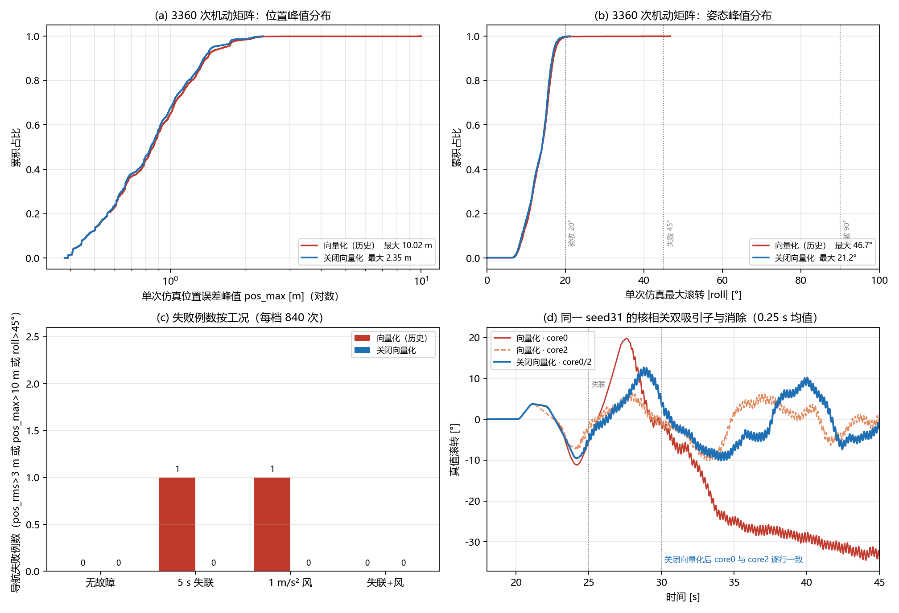

### 7.11 无 GNSS 水平失效机理与保护（2026-10-26）

**机理（5 s 失联 + 10 m 北向阶跃，seed1，200 Hz trace）**：t=20 s 失联，位置环立刻给 −7° 俯仰并在 4.5 s 内增到 −15°；EKF 俯仰只到 −2.5°（真值 −15°，差 12.5°）——持续推力下加速度计无法区分重力与线加速度，EKF 姿态被拉向“水平”。位置环按错误姿态继续加速；5 s 失联结束时真值已到 23 m、EKF 误差 18 m，重捕获后姿态误差仍 10–12°，真值一直飞到 190 m。**不是只有 20 s 失联才危险：一次 5 s 失联叠加 10 m 阶跃即可漂 100–300 m。**

**SIL 边界**：`Plant::step` 只有垂直地面约束，**无气动阻尼、无地面水平摩擦**；水平速度只能由推力改变，落地后仍可滑行/翻滚。本节 hold/pos 米数是上界，不是实机漂移预测；机理、相对排序和姿态安全性仍有效。最终默认二进制（§7.10）复跑 5 s/20 s 基线得到 **50/60、hold 139.1/330.2 m** 与 **59/60、hold 926.2/1788.3 m、roll 80.7°**，与旧 no-vec 口径一致，说明下述保护对比不是二进制漂移造成的。

**方案 A：速度保持（opt-in `BFS_GNSS_OUTAGE_VELOCITY_HOLD`，0.5 s / 1 m/s²）**：GNSS 失效且无新鲜光流时，位置环改为零速度目标 + 加速度上限；模式仍是 AUTO_POSITION，摇杆速度语义不变；进入/退出清速度/位置积分。

| 5 s 失联（无风，6 场景×10 seeds） | 基线 | 速度保持 |
|---|---:|---:|
| 导航失败（pos_rms>3 或 pos_max>10） | 50/60 | **0/60** |
| hold_end 中位 / max | 139.1 / 330.2 m | **1.9 / 5.4 m** |
| max roll / pos_rms max | 26.2° / 13.5 m | **16.1° / 1.6 m** |

扩到 30 seeds/场景（180 次）：**180/180 导航通过**、hold 中位 1.9 m/max 13.6 m（单例 NE seed17，仍 <20 m）、roll max 16.5°；没有方向性失效。

5 s 失联 + 1 m/s² 风：基线 40/60 失败、hold 中位 34.7 m/max 835.2 m、roll 50.5°；速度保持 **10/60**（全部是 pos_max 10.0–13.4 m 的纯惯导峰值）、hold 中位 11.9 m/max 17.4 m、roll 19.5°、pos_rms max 2.4 m。20 s 失联时只靠速度保持仍会漂（中位 523 m、roll 53.6°），因为它仍依赖漂移的 EKF 速度估计。

**方案 B：定高降级阈值（opt-in `BFS_GNSS_OUTAGE_ALT_HOLD`）**：20 s 失联 + 10 m 阶跃（无风，H+5 方向×10 seeds）：基线 59/60 失败、hold 中位 926 m/max 1788 m、roll 80.7°；0.5 s 降级 49/60、hold 中位 92 m/max 313 m、**0 stabfail、roll 21.7°**；2 s 降级 50/60、中位 311 m；5 s/10 s 降级触发太晚（降级计数 0/60、32/60），结果回到基线。悬停单独看：基线 9/10 失败、中位 392 m；0.5/2 s 降级均 0/10、hold≤2.4 m。**阈值必须 ≤2 s；5 s 已晚。**

**方案 C：倾角限幅（`BFS_GNSS_OUTAGE_TILT_LIMIT`，5°/0.5 s）**：悬停结果与基线 seed1 逐位相同（hold 255.475 m），阶跃更差。限幅只压指令幅值，不切断“位置环追漂移估计 + 姿态估计被拉平”的反馈，**否决**。

**长失联组合（速度保持 0.5 s + 6 s 定高降级 + 1 m/s 下降）**：20 s 失联（无风，6 场景×10 seeds）**60/60 落地**，落地瞬间 `land_hold` 中位/max **45.8/131.9 m**（final hold 167/604 m 含落地后滑行，不能当飞行漂移）、落地前 roll max 24.6°；悬停 hold 中位 1.5 m、max 2.2 m。扩到 30 seeds/场景（180 次）仍 **180/180 落地**、落地前 roll max 25.2°、final hold 中位 157.8 m/max 632.3 m（滑行上界），无 90°+ 尾部。**20 s 失联 + 1 m/s² 风（6 场景×10）**：60/60 落地，`land_hold` 中位 64.1/max 129.5 m、落地前 roll max **32.9°**；final max_roll 52.5° 含落地后滑行/翻倒，不能当飞行滚转。风下无可用的水平基准时，组合只能保证“受控落地、姿态有界”，不能保证落点或落地后姿态；需要更早下降、风扰前馈或实机验证。落地后的 167 m/604 m 主要是无地面摩擦的滑行，不能当飞行漂移；但姿态在所有 60 例有界、无 90°+ 尾部。5 s 失联不触发下降，行为与速度保持相同（0/60）。6 s 比 10 s 下降更优（10 s 版本 54/60 落地、hold 中位 412 m/max 780 m、roll 30.1°）。纯速度保持 + 下降（不定高降级）更差（seed1：悬停 hold 151.6 m、NE 510.5 m，对比 combo6 1.3/262 m）——下降段速度环仍使用漂移的 EKF 速度，边下降边被伪速度推走；下降时应停水平环。**组合的速度保持/定高降级都要求无新鲜光流，但独立的 `BFS_LONG_GNSS_OUTAGE_DESCENT` 仍是 age-only、不检查光流；有光流时会继续位置保持却仍可能下降，需单独评估，不能把本组合直接套到光流机型。**

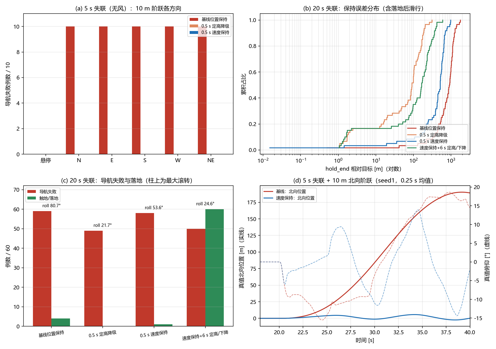

**结论**：短失联（≤5 s）用速度保持可以保住模式和位置（5 s 无风 0/60、有风 10/60 且姿态有界）；长失联（>6 s）没有水平外部基准，继续位置保持会追逐漂移估计，应主动下降/切手动。默认固件全部宏关闭、行为不变；三个宏同时开启的 TandemVec_FCS PIO 编译 SUCCESS，默认关闭构建也 SUCCESS；宿主回归全绿。以上均为 SIL L2、plant 无阻尼/无地面摩擦，实机未验证，不能直接当实机包线。

### 7.12 失联保护大规模矩阵与下降锁存（2026-10-26）

在 §7.11 的 10-seed 试点上扩到**约 6900 次 SIL**（含 240 次下降锁存替换复跑）：失联时长×风 2880、GNSS 质量/刷新率 3240、下降锁存/高度 600、60 s 长失联 180；加上 §7.10 的 6720 次机动矩阵，本轮累计 >13k 次。所有数字固定默认标量 Eigen 口径；单位为 m/°，`land_hold` 是**落地瞬间**相对目标水平位移，避免把落地后无摩擦滑行算成飞行漂移。

**A. 失联时长 × 风（10 m 阶跃，6 场景×20 seeds=120/格）**。表中 `nav%` 是导航失败率，`roll` 是**落地前**最大滚转，`land` 是最终留地/触地例数（base/velhold 的触地是失控坠地，combo6 是受控下降）：

| 风 | 臂 | 5 s | 10 s | 20 s | 30 s |
|---|---|---|---|---|---|
| 无风 | 基线 | 83% / 26.9° / 0 | 84% / 32.4° / 0 | 98% / 33.4° / 11 | 100% / 33.4° / 40 |
| 无风 | 速度保持 | 0% / 16.2° / 0 | 70% / 23.5° / 0 | 97% / 33.7° / 1 | 99% / 34.8° / 36 |
| 无风 | combo6 | 0% / 16.2° / 0 | 61% / 20.7° / **120** | 83% / 20.8° / **120** | 83% / 20.8° / **120** |
| 1 m/s² 风 | 基线 | 68% / 50.5° / 0 | 100% / 58.1° / 6 | 100% / 58.1° / 109 | 100% / 58.1° / 112 |
| 1 m/s² 风 | 速度保持 | 13% / 20.6° / 0 | 100% / 36.6° / 0 | 100% / 44.9° / 120 | 100% / 44.9° / 120 |
| 1 m/s² 风 | combo6 | 13% / 20.6° / 0 | 100% / 23.7° / **120** | 100% / 32.9° / **120** | 100% / 32.9° / **120** |

combo6 的落地位置（10 s / 20 s / 30 s）：无风 `land_hold` 中位/max **13.9/120.4、45.8/131.9、45.8/131.9 m**；风下 **44.9/132.0、64.1/129.5、64.1/129.5 m**。**“nav%”在长失联+风下必然接近 100%——那是无可观水平基准的物理漂移，不是滤波发散；保护目标是“姿态有界、受控落地”，不是保持原点。**

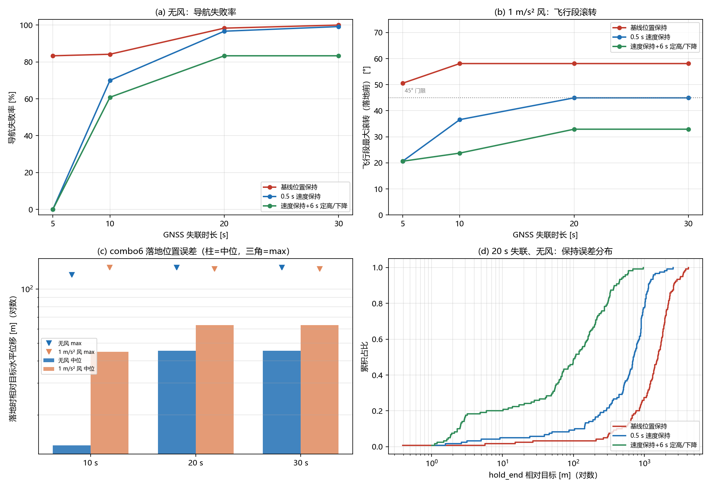

**B. GNSS 质量/刷新率（5 s/20 s，无风）**：5 s 失联时，clean/5 Hz/20 Hz/200 ms 延迟下速度保持和 combo6 均 **0/90**；位置噪声 5 m 为 **74/90**、速度噪声 1 m/s 为 **84/90**（基线 86/85）。20 s 失联时 combo6 在所有质量档 **90/90 落地**；base/velhold 落地率仅 0–49%/0–28%。落地前最大滚转：combo6 **16–25°**，base **33–41°**，velhold **32–36°**；1 m/s 速度噪声下 combo6 为 25°，仍 <45°。5 Hz 的 20 s 落地滚转 16°、20 Hz 18°、200 ms 21°——**低刷新/高延迟本身不破坏保护策略；位置/速度噪声是上游导航精度边界，不是下降策略能修的。**

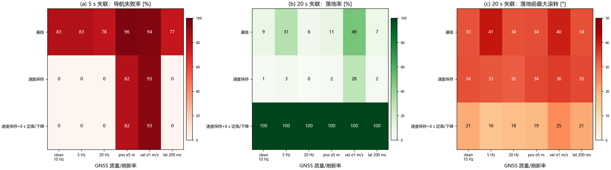

**C. 下降锁存（本轮发现并修复）**：原 `BFS_LONG_GNSS_OUTAGE_DESCENT` 用 `g_gnss_outage_age_s > 门限` 逐拍判断；GNSS 在下降中途恢复时条件消失，下降停在半空。20 s 失联、20 m 高度的典型结果是停在 **5.9 m**（`land_t=-1`），10 s 失联在 10 m 高度 **0/120 落地**。修复：触发后静态锁存，只有“上锁”或“已落地且 GNSS 恢复”才复位；GNSS 在 >0.3 m 高度恢复不清锁存。修复后：

| 场景（combo6） | 落地 | land_hold 中位/max | 落地前 roll max | land_t 中位 |
|---|---:|---:|---:|---:|
| 10 s 失联，10 m，无风 | 120/120 | 13.9 / 120.4 m | 20.7° | 36.4 s |
| 10 s 失联，10 m，1 m/s² 风 | 120/120 | 44.9 / 132.0 m | 23.7° | 36.5 s |
| 20 s 失联，5/10/20/30 m | 各 60/60 | 12.1 / 55.4 / 87.0 / 80.0 m（中位） | ≤24.5° | 31/36/46/56 s |
| 60 s 失联，20/30 m | 各 60/60 | 118.2 / 247.3 m（中位） | ≤27.2° | 46/56 s |

20/30 m 的 `land_hold` max 为 458/812 m，60 s 的 20/30 m max 为 454/1021 m：**下降时间越长、无水平参照越久，落点漂移越大**；姿态仍 ≤27.2°，没有 90°+ 尾部。10 m、60 s 长失联的对照：base/velhold 触地位置中位 288/414 m、落地前 roll max 32.4/35.5°，combo6 55/132 m、20.8°。

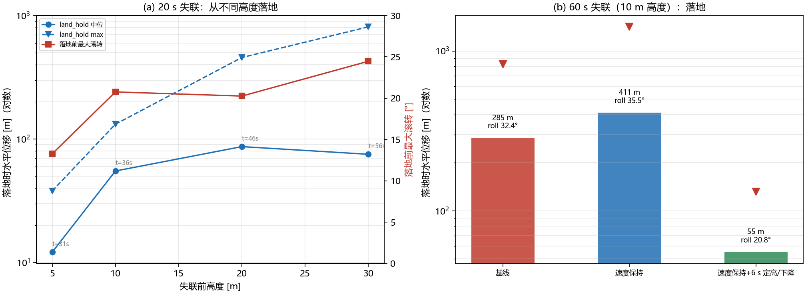

**最坏组合扩展（720 次）**：20/60 s 失联 × 10/20/30 m × 0/1 m/s² 风 × 6 场景 × 10 seeds，combo6 **720/720 落地**。无风落地前 roll ≤27.2°；风下 10 m 32.3°、20 m 40.6°、30 m **44.9°**（贴近 45° 门限）。风 + 20/30 m 的落点位移中位 317–563 m、max 679–1588 m；这是无水平绝对基准的物理漂移，**保护保证“落地/姿态有界”，不保证落点**；30 m 高空的 44.9° 已接近研究门限，实机需要更低下降触发/风扰前馈或着陆区。

**50-seed 尾部复核**：20 s/10 m 无风 **300/300 落地**、land_hold 54.3/141.4 m、preland roll 21.4°；20 s/30 m/1 m/s² 风 **300/300 落地**、land_hold 中位/p95/max 514.9/1496.6/1723.2 m、preland roll **47.7°（7/300 >45°）**；60 s/30 m/1 m/s² 风 **300/300 落地**、504.5/687.6/849.9 m、47.4°（10/300 >45°）。**极端风+高空下仍有 ~2–3% 落地前滚转略超 45°，但全部受控落地、无 90°+**；这是当前 1 m/s 下降策略的边界，下一步试更快下降/更早降级。

**D. 下降目标速率权衡与触地速度（2026-10-26，540 个唯一单元 + 540 个 60 s 重复）**：为压低“高空 + 风”尾部，扫 `BFS_LONG_GNSS_OUTAGE_DESCENT_RATE_MPS` = 1/2/3 m/s（表内 r1/r2/r3），场景为 20 s 失联 + 30 m 目标 + 1 m/s² 风（120/臂）、同场景无风（60/臂）、20 m 目标 + 风（60/臂），6 方向 × 10/20 seeds，共 1080 次。**60 s 失联格与 20 s 逐项相同**（下降在 33.6–39.7 s 已触地，早于两种失联结束），不能当独立长失联样本。

| 场景 | 臂 | 留地 | land_hold 中位/p95/max [m] | 触地 vz 中位/p95/max [m/s] | preland roll 中位/max [°] |
|---|---|---:|---:|---:|---:|
| 20 s/30 m/风 | 1 m/s | 120/120 | 169.2 / 238.7 / 260.3 | **1.30 / 1.84 / 2.27** | 32.1 / 39.1 |
| 20 s/30 m/风 | 2 m/s | 120/120 | **108.8 / 138.1 / 150.2** | 1.68 / 2.85 / 3.24 | **25.7 / 37.5** |
| 20 s/30 m/风 | 3 m/s | 120/120 | 106.7 / 136.3 / 148.8 | 1.63 / 2.75 / 3.38 | 24.9 / 37.3 |
| 20 s/30 m/无风 | 1/2/3 m/s | 60/60 各 | 72.3 / 64.6 / 57.0（中位） | 0.82 / 0.86 / 0.86（中位） | 10.1 / 8.7 / 9.1 |
| 20 s/20 m/风 | 1/2/3 m/s | 60/60 各 | 172.1 / 110.2 / 111.7（中位） | 1.30 / 1.61 / 1.62（中位） | 32.8 / 24.8 / 24.9 |

**结论**：更快斜坡把风下落点中位从 169 m 降到 109 m（−36%）、滚转中位从 32° 降到 25°，但**触地速度中位从 1.30 升到 1.68 m/s、p95 从 1.84 升到 2.85 m/s**；3 m/s 相对 2 m/s 不再减小落点，最大触地 3.38 m/s 更差。**这是“目标高度斜坡速率”，不是实际下降率**：通用 `MAX_TARGET_ALTITUDE_RATE=1 m/s` 限幅仍在，且失联段 EKF 垂直速度严重滞后（200 Hz trace seed1：t=40 s 真值 −4.11 m/s、EKF +0.68 m/s），实际触地由速度环失配决定。**建议默认保持 1 m/s；2 m/s 只作为“落点 vs 触地”权衡候选，必须配起落架/触地检测/实机验证；3 m/s 否决。** 试过用 0.5 s 气压高度回归垂速替代 EKF 反馈（20 seeds/臂）：1 m/s 反而恶化到 3.53 m/s（基线 1.25），2/3 m/s 为 1.87/1.85（基线 1.74/1.75），**否决**——问题不是换一个垂速源，而是缺少着陆段减速/触地检测。

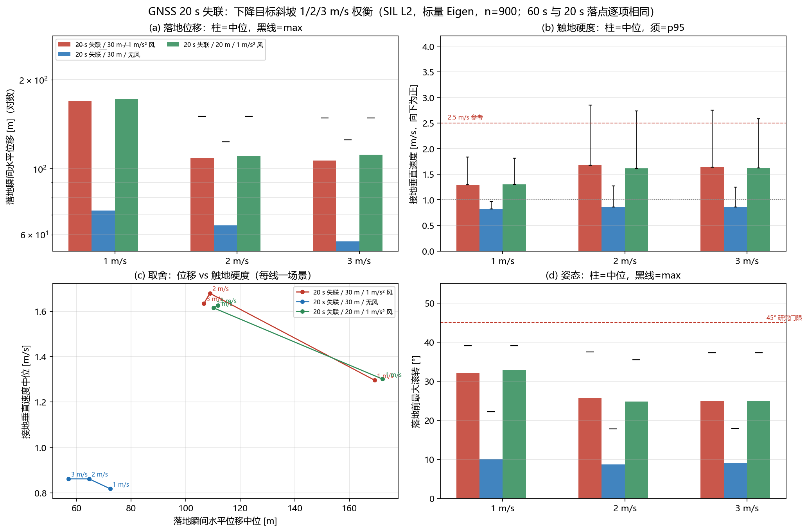

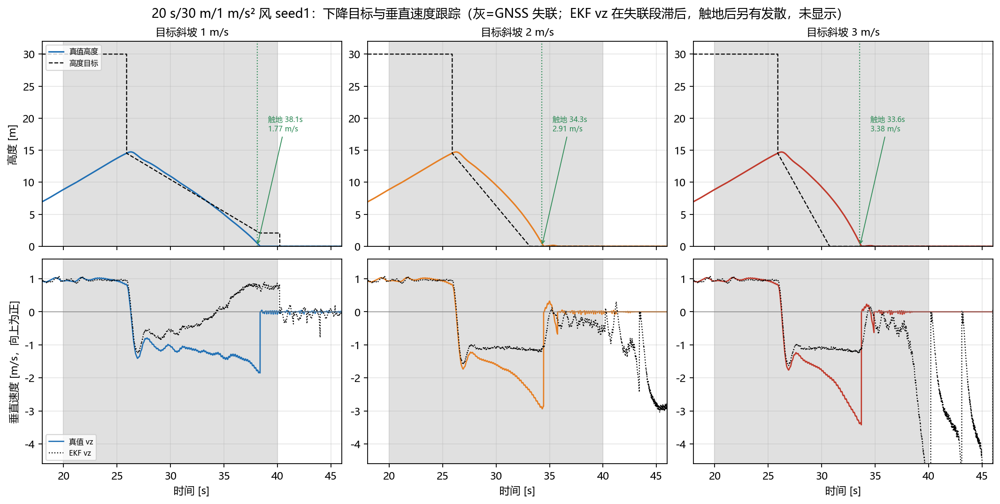

**★ 台架口径纠错（2026-10-26）**：SIL 从地面起飞，`--alt` 是**目标高度**，不是失联瞬间高度。20 s 失联时真值只有约 8 m，下降触发（age>6 s）时约 **14.6 m**；因此 §7.12 表中“5/10/20/30 m”是目标高度，旧实现因“目标斜坡从 30 m 起算”才产生高度差异。**目标起点修复后，20/30 m 目标格在相同 20 s 失联下行为相同**（上表 20 m/30 m 风格差异仅为 seed 样本）。本节旧高度数字保留为历史口径，不能再当实际高度包线；真实高度矩阵见下。

**E. 真实高度 × 下降速率（2026-10-26，720 次）**：先把飞机爬到目标高度、稳定后再失联（`pos-hold-at = alt+11 s`、`gnss-outage = alt+13 s`），新增 `alt_at_outage` 实测失联瞬间真值高度：10/20/30/40 m 四档实测中位 **9.9/19.9/29.9/39.9 m**。每档 3 速率 × 6 方向 × 10 seeds，20 s 失联、1 m/s² 风；**720/720 留地**。

| 失联高度 | 臂 | 留地 | land_hold 中位/p95/max [m] | 触地 vz 中位/p95/max [m/s] | preland roll 中位/max [°] | 触地时刻中位 [s] |
|---|---|---:|---:|---:|---:|---:|
| 10 m | 1 / 2 / 3 m/s | 60/60 各 | 78.5 / 56.7 / 58.5（中位） | 0.96 / 1.08 / 1.12（中位） | 20.6 / 20.0 / 20.4 | 39.2 / 38.2 / 38.1 |
| 20 m | 1 m/s | 60/60 | 253.9 / 548.2 / 651.2 | 0.94 / **3.21** / 3.58 | 30.6 / 43.2 | 59.3 |
| 20 m | 2 m/s | 60/60 | **139.6 / 215.0 / 266.1** | 1.06 / 3.84 / 4.04 | 24.2 / 41.0 | 54.9 |
| 20 m | 3 m/s | 60/60 | 139.3 / 214.2 / 277.8 | 1.02 / 4.05 / 4.64 | 23.9 / 42.7 | 56.0 |
| 30 m | 1 m/s | 60/60 | 530.4 / **1616.9** / 1788.8 | 0.85 / 1.02 / 3.29 | 30.6 / 43.5 | 79.3 |
| 30 m | 2 m/s | 60/60 | **258.5 / 450.3 / 531.4** | 0.94 / 4.43 / 4.67 | 26.3 / 43.5 | 74.1 |
| 30 m | 3 m/s | 60/60 | 265.8 / 467.5 / 571.6 | 0.95 / 5.06 / 5.58 | 28.8 / 43.6 | 72.6 |
| 40 m | 1 m/s | 60/60 | 400.7 / **2453.6** / 2916.0 | 0.87 / 1.19 / **6.94** | 26.5 / **50.4** | 99.4 |
| 40 m | 2 m/s | 60/60 | **359.6 / 850.1 / 1056.0** | 0.89 / 4.64 / 5.49 | 26.7 / 46.2 | 93.3 |
| 40 m | 3 m/s | 60/60 | 321.8 / 814.3 / 902.8 | 0.94 / 6.50 / 6.90 | 29.4 / 47.9 | 92.3 |

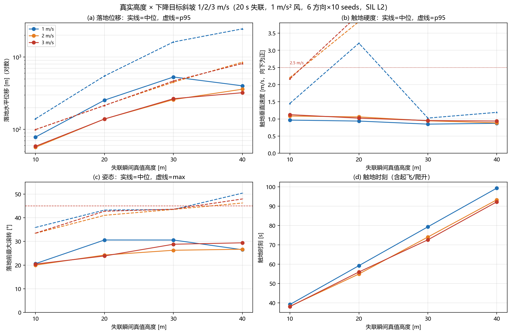

**读法**：①**中位触地速度都在 0.85–1.12 m/s，但中位不是安全指标**——1 m/s 在 20 m 的 p95 为 3.21 m/s、40 m 最大 6.94 m/s；2/3 m/s 在 20–40 m 的 p95 升到 3.8–6.5 m/s，**更快的目标斜坡把触地尾部变得更硬**，不是更软。②2/3 m/s 确实显著减小落点/漂移（30 m 中位 530→259/266 m、p95 1617→450/468 m；40 m p95 2454→850/814 m），但代价是触地尾部和 40 m preland roll（46–48°）仍在 45° 门限附近；3 m/s 相对 2 m/s 无进一步落点收益、最大触地 6.90 m/s 更差。③40 m/1 m/s 的 H/W 方向中位 1314/1351 m 是 40 s 下降期间 1 m/s² 风、无水平绝对基准的物理漂移，不是滤波发散；H 方向无 10 m 阶跃，仍会漂。④**结论：默认 1 m/s 保留（30/40 m 触地尾部最好），2 m/s 只能作为“落点 vs 触地”候选并必须配起落架/触地检测/实机，3 m/s 否决；当前首要缺口是着陆段减速/触地检测，而不是继续调目标斜坡。**

**F. 60 s 失联：GNSS 在触地前不恢复（2026-10-26，180 次）**：30 m 稳定悬停后失联 60 s（43–103 s），下降与触地全程无 GNSS 恢复；1 m/s² 风、6 方向×10 seeds。**三臂均 60/60 留地**，但触地明显变硬：

| 臂 | 留地 | land_hold 中位/p95/max [m] | 触地 vz 中位/p95/max [m/s] | preland roll 中位/max [°] | 触地时刻中位 [s] |
|---|---:|---:|---:|---:|---:|
| 1 m/s | 60/60 | 431.8 / 553.5 / 598.9 | **3.35 / 4.48 / 4.96** | 40.3 / 46.2 | 70.5 |
| 2 m/s | 60/60 | 256.9 / 371.5 / 489.6 | 3.56 / 4.64 / 4.74 | 37.7 / 43.5 | 68.0 |
| 3 m/s | 60/60 | 248.3 / 409.7 / 453.6 | 3.88 / 5.06 / 5.58 | 37.5 / 43.6 | 67.2 |

与同高度 20 s 失联（1 m/s：0.85 / 1.02 / 3.29 m/s）对比，**20 s 的“软”来自 GNSS 在触地前恢复**；60 s 不恢复时 EKF 垂速被长时倾斜/滚转误差污染（H1 trace：t=60 s 真值 −1.91 m/s、EKF +0.76 m/s），速度内环持续压油门，触地 3.35–4.96 m/s。另一个次生缺陷：实际下降快于目标斜坡时，飞机在目标仍 13.4 m 时就触地，旧锁存会持续给爬升指令；已加“连续 1 s <0.3 m 视为落地、目标锁到当前高度”（ground-dwell），H1 的 13.4 m 爬升指令消失，但 SIL 无地面摩擦，风仍会把落地机体吹翻（final roll 95–180°）——这是 plant 边界，不是控制律指标。

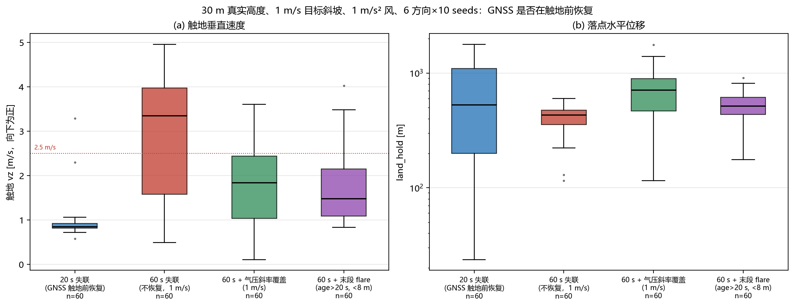

**尝试过但未采用**：用气压高度 0.5 s 斜率在“比 EKF 低 0.5 m/s 以上”时覆盖垂速（60 次，30 m/60 s/1 m/s）：触地中位 **3.35→1.84 m/s**、p95 4.48→3.22、preland roll 40.3→32.5°，但下降变慢使 **落点中位 432→714 m、p95 553→1214 m、max 599→1777 m**；是“软触地 vs 落点”的交换，不是免费修复，未纳入默认。

**末段 flare（opt-in，age-gated，2026-10-26）**：只在 `GNSS age > 20 s` 且高度 < 8 m 时用气压斜率垂速反馈、目标下降率压到 0.5 m/s；整段用会拖长漂移，所以用 age 门控隔离长失联。120 次（20 s/60 s × 6 方向 × 10 seeds）：**20 s 格与基线逐项相同**（触地 0.85/1.02/3.29 m/s、落点中位 530.4 m，因为 age 未到 20 s）；**60 s 不恢复格触地中位 3.35→1.48 m/s、p95 4.48→3.30、max 4.96→4.03**，落点中位 432→517 m、p95 553→783 m（+20%/+41%），preland roll 40.3→42.3°、max 46.2→46.0°。~~这是目前最好的长失联折中：触地中位近乎减半，落点只增 20%；但 60 s 最大仍有 4.03 m/s，不是软着陆保证。~~ **★ 2026-10-26 同日 same-binary 2×2 更正：上述 1.48 m/s 来自不同二进制对比，受 SIL 布局混淆，不能作因果。同二进制 240 次（30 m/60 s/风/6 方向×10 seeds）结果为 flare-only 3.35→3.17 m/s（几乎无效）、aid-only 1.10/1.52/1.65、aid+flare 1.34/1.77/1.92（比 aid-only 更差）；flare 不作为修复，aid-only 是当前最优。历史 1.48 保留但标为跨二进制。** 宏 `BFS_LONG_GNSS_OUTAGE_DESCENT_FLARE`（默认关），参数 `..._ALT_M=8`、`..._RATE_MPS=0.5`、`..._MIN_AGE_S=20`；默认固件不定义，实机未验证。

**组合 2 m/s 斜坡 + 同 flare（落点优先变体，120 次）**：20 s 触地中位/p95/max **0.94/4.43/4.64 m/s**、落点 259/450/531 m；60 s **1.35/4.43/4.64 m/s**、落点 362/623/676 m、preland roll 中位 39.1°。它把落点/滚转明显压小（20 s 530→259 m、60 s 517→362 m），但**触地 p95 4.43 m/s**，比 1 m/s+flare 的 1.02/3.30 m/s 更硬；因此**仅保留为历史“落点优先”记录**；该结果同样跨二进制，same-binary 2×2 显示 flare 在 aid 下反而变差（aid-only 1.10 vs aid+flare 1.34），**flare 不推荐**。

**结论：长失联 1 m/s 只保证“落地”，不保证“软着陆”；同二进制 60 s 不恢复下，gated EKF aid-only 触地中位 1.10/1.52/1.65 m/s 是当前最优；flare-only 3.17 m/s 几乎无效、aid+flare 1.34 m/s 反而更差（早期跨二进制 1.48 已标为混淆）；必须有着陆段减速/触地检测/起落架，或更高层的着陆区决策。2/3 m/s 在 60 s 下没有改善触地，反而略差。**

**边界**：①SIL plant 无气动阻尼/地面水平摩擦，落地后 final hold/roll 不可用，必须看 `land_*`/`max_roll_preland`；②失联期间没有水平绝对基准，落点漂移随高度/时长/风增长，保护只能保证受控落地与姿态有界；③GNSS 速度噪声 1 m/s 时 combo6 仍 90/90 落地但落地前滚转 25°，不能承诺所有噪声下 <45°；④全部为 opt-in、未实机；⑤触地速度是 plant 地面约束下的运动学值，无起落架/吸能/地面摩擦模型，不能当结构许用；⑥长失联（GNSS 不恢复）的触地速度中位 3.35–4.96 m/s，**不能把 20 s 失联的软触地外推到长失联**。

### 7.13 EKF 实现审计：F 矩阵去偏输入（2026-10-26）

读 INS/ZUPT 几何滤波复现文时，作者在 C99 合并实现中抓到 IEKF/TFG 的 F 矩阵“去偏/未去偏 ω/f 混用”导致 3.18 m 轨迹偏差；照此审计本工程：

- `PropagateState`（单子样）、`TimeUpdateTwoSample`（双子样）、延迟回放三条路径都把**去偏后的** accel/gyro 传入 `PropagateStateFromIncrements`；F 的 `F(V,β)=-C[f-b_a]×`、`F(β,β)=-[ω-b_g]×` 使用同一 `ins_accel_mps2_/ins_gyro_radps_`，**未发现同类混用**。
- 新增宿主 **T18**：构造非零零偏，分别检查单子样 `F(V,β)`、单子样 `F(β,β)`、双子样 `F(V,β)` 是否用去偏输入；`test_ekf_15state` 由 74 增至 **77 断言，全通过**。
- 尚未做 double 参考对照：当前 EKF 为 float；复现文的 float 退化 EKF 0.67%、几何滤波 0.02% 是合成数据结果，不能直接外推。建议下一步在宿主用 double 参考实现跑同一段日志，量化 float 的 RMSE/NEES 退化上界，再决定是否需要关键协方差块用 double。

### 7.14 几何滤波算法深读：EKF / L-IEKF / L-TFG-IEKF / L-TG-EqF（2026-10-26）

**四种误差定义**（论文式号，ECEF 参考系）：

- **间接 EKF（式 1/5/6/9）**：`δx=[δθ,δv,δr,δb_g,δb_a]`，姿态用乘性局部误差 `C≈(I−(δθ)×)Ĉ`，位置/速度/零偏为加性误差；`H=[0,I,0,0,0]`。注意公众号把 EKF 说成“欧拉角相减”并不准确，论文式(1)的姿态误差是乘性的。
- **L-IEKF（式 21/23/24/26/27）**：左群误差 `η= X̂⁻¹X`，`δx=[ξ_R,ξ_v,ξ_r,δb_g,δb_a]`；速度/位置误差被姿态旋转到体系（式20），`F_IEKF` 的姿态块为 `−[ω̂]×`、速度-姿态耦合为 `−[f̂]×`，不再出现 `C`；量测 `H=[0,I,−(Ĉᵀω_ie)×,0,0]`，`R'=ĈᵀRĈ`。
- **L-TFG-IEKF（式 30–35）**：双帧群把零偏误差也旋转：`Δb_g=b_g−CᵀĈb̂_g`、`Δb_a=b_a−CᵀĈb̂_a`；导航态误差与 IEKF 相同，但 `F_TFG` 的姿态/速度-姿态耦合用**未去偏** `ω̃=ω̂+b̂_g`、`f̃=f̂+b̂_a`，偏置行多出 `(b̂_g)×(ω̂+b̂_g)×` 等交叉项；量测同式(26)。
- **L-TG-EqF（式 36–56）**：引入虚拟速度 `ṽ` 及其零偏 `b_v`，状态 18 维；切群左误差 `e=(T̂⁻¹T, b−Ad_{T̂⁻¹T} b̂)`；`F_TG` 的导航块全部用未去偏 `ω̃/f̃`，`H_TG=[0,I,−(Ĉᵀω_ie)×,0,0,0]`；代价 `(18/15)³≈1.73×`。**`b_v` 是为使位置微分方程与等变群作用匹配而引入的虚拟速度零偏（symmetry parameter），不是物理 IMU 零偏**；18 维不等于“多估了 3 个物理传感器状态”。

**结构审计（本工程做的数值检查）**：取同一组原始 IMU，比较两组姿态（0° vs 60° 横滚）和两组零偏估计，计算 `F` 前 9×9 导航块的差范数：

| 滤波器 | 维数 | 对姿态 C 的敏感度 | 对零偏估计的敏感度（固定原始 IMU） |
|---|---:|---:|---:|
| EKF | 15 | **11.40** | 0.27 |
| L-IEKF | 15 | **0** | 0.32 |
| L-TFG | 15 | **0** | 0.17 |
| L-TG | 18 | **0** | **0** |

- EKF 的 `F(v,θ)=−C[f]×` 依赖姿态，这是大初始姿态误差下线性化变差的来源；IEKF/TFG/TG 把姿态耦合改为体系量，误差动力学不再依赖名义姿态（group-affine），这就是它们的理论优势。
- **TFG 并非完全与零偏无关**：按式(34)字面，`F(v,v)`、`F(r,r)` 仍用去偏 `ω̂`，只有姿态块和速度-姿态耦合用原始 `ω̃/f̃`；TG 式(54) 的导航块才全部用原始 `ω̃/f̃`。论文 §3.3 的概括“导航态块独立于零偏估计”对 TFG 过强，**以式号为准**。这也解释了 TFG 相对 IEKF 只有边际改善，而 TG 需要多 3 维虚拟速度零偏。
- 代价：TG 18 维，矩阵乘/逆主导时约 1.73×；IEKF/TFG 仍 15 维。

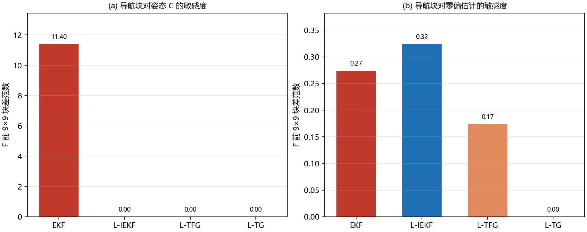

**一致性/可观性**：INS/ZUPT 的零速量测是参考系速度，`H` 只直接观测速度；航向、垂向陀螺零偏不可观，位置在纯 ZUPT 下也只是相对量。几何滤波改变的是误差坐标和线性化点，**不增加信息**；因此正常初始化下四者打平，60° 初始横滚时几何滤波的优势主要是“大失准角下线性化更好”，不是可观性变好。论文也明确说 ZUPT 不提供绝对姿态、TFG/TG 相对 IEKF 无显著一致性优势。

**论文/复现的硬问题**（引用时要保留）：
- 复现仓库的提交记录指出：论文式(5)的 EKF `F` 与其式(11)的重置约定不自洽，**速度行两处符号**需要修正（姿态块 `−Ω` 是对的）；照抄式(5)会使 EKF 发散（9.4 m vs 0.59 m），修正后六组均值 3.474→2.734 m。本文引用的 EKF 0.098 m 是论文自己的实现结果，不是“照抄式(5)”的结果。按式(11) `C=exp(−(δθ)×)Ĉ` 直接线性化可独立得到 `F(v,θ)=+(Cf)×`、`F(v,b_a)=−C`；论文式(5)这两项写成 `−(Cf)×`、`+C`，确实与重置约定相反（其余项符号一致）。
- 式(53)与式(55)的噪声向量顺序冲突；复现按 C 侧实现做了统一。
- 论文“初始姿态矩阵设为单位阵”与“roll/pitch 用加速度计调平”存在歧义；复现按 `C_b^n=I` 解释。初始姿态约定会直接改变 60° 横滚实验的含义。
- 复现是合成数据、仅 6 组轨迹、ZUPT 因果窗有 5–6 s 滞后；其 2–3.5 m 绝对误差不能与论文 0.09–0.1 m 并排比较，22% 改善不能外推实机。

**对 TandemVec 的判断**：我们的 15 态 ESKF 是**乘性四元数右误差 + 加性 p/v**，`F(v,β)=−C[f−b]×` 与论文 EKF 一样依赖姿态；因此“大初始倾斜/大零偏”场景理论上也可能受益于 IEKF/TFG。但：①我们的 roll/pitch 由加速度计调平，60° 初始横滚是异常场景；②主要失效是 GNSS 失联/航向不可观/加计重力歧义/控制耦合，几何滤波不解决；③我们同时有参考系观测（GNSS/气压）和体系观测（磁矢量、光流速度），没有单一左/右对称能覆盖全部，强行换会牺牲现有更新门控；④TG 18 维 1.73× 与全量回归成本不成比例。**结论：不换默认滤波器；保留 T18 的去偏输入测试；若要探索，先做离线左-IEKF 参考实现，用同一段 SIL 日志比 NEES/RMSE，并专门构造 60° 初始横滚/大零偏用例，证明有独立收益再谈固件。**

### 7.15 EKF 气压垂速伪量测（opt-in，2026-10-26）

**问题**：GNSS 长时间失联时 EKF 垂直速度只剩惯导 + 气压位置更新；姿态倾斜/滚转误差把重力/推力投影错，v_d 可被污染到符号相反（60 s trace：真值 −1.91 m/s、EKF +0.76 m/s）。速度内环相信错误 v_d，持续压油门，导致长失联触地 3–5 m/s。

**实现**：`BFS_BARO_VERTICAL_VELOCITY_AID`（默认不定义）。以 50 Hz 采样 `baro_altitude`，用 0.5 s 最小二乘斜率得垂速；每 5 Hz 调 `MeasurementUpdateAidingVelocityDetailed`：水平分量填当前 EKF 速度并给 1e3 m/s 噪声（K≈0），D 分量用 `−slope`、σ=1.0 m/s。只在 GNSS 失效 >8 s、**激活瞬间气压高度 ≥10 m**、且 `g_mode_degraded_gnss`（GNSS 失联、无新鲜光流、位置保持已降级定高）时尝试；高度按激活时刻锁存，下降途中不因低于 10 m 而关闭；NIS 门控仍由 EKF 统一把关。SIL 运行时开关 `--baro-vel-aid 0|1`，可在**同一二进制**内做因果 A/B；宏编译时默认开，默认固件不定义。

**同二进制 A/B**（30 m 稳定高度、1 m/s² 风、6 方向×10 seeds、360 次）：

| 场景 | aid off 触地 vz 中位/p95/max [m/s] | aid on 触地 vz 中位/p95/max [m/s] | aid off 落点中位/p95/max [m] | aid on 落点中位/p95/max [m] | preland roll off/on 中位·max [°] |
|---|---|---|---|---|---|
| 20 s 失联 | 0.85 / 1.02 / 3.29 | **0.82 / 0.99 / 1.09** | 530.4 / 1616.9 / 1788.8 | **189.7 / 730.6 / 1145.7** | 30.6·43.5 / **21.3·31.2** |
| 60 s 失联（不恢复） | 3.35 / 4.48 / 4.96 | **1.10 / 1.52 / 1.65** | **431.8 / 553.5 / 598.9** | 544.8 / 1127.0 / 1446.8 | 40.3·46.2 / **26.3·46.7** |

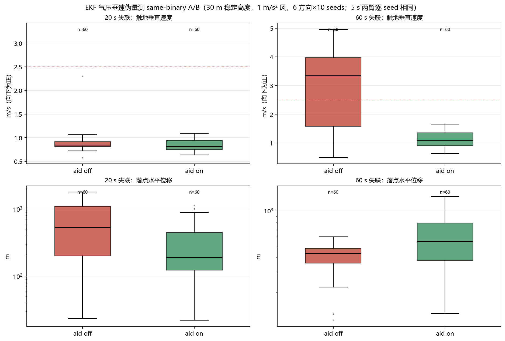

**5 s 对照**：两臂 **60/60 逐 seed 完全相同**（aid 未达到 8 s 门控，attempts=0），说明门控与 A/B 有效。注意该特性二进制的 5 s 绝对尾部为 20/60 nav fail，而旧默认二进制为 10/60——这是 SIL 代码布局/混沌敏感性，不是 aid 引入；默认固件不受影响，但特性固件的 5 s 尾部仍需嵌入式/实机复核。

**前飞/流程门控（2026-10-26）**：无门控的 aid 在前飞 20 s 失联矩阵（840 次，5 方向×5 腿长×10 seeds）中，无风 0/210；风+NE 两臂各有 2/210 nav fail，但 aid 额外出现 2 例 25/50 m 掉高到 6.6–6.8 m。独立 NE seeds 11–30 复现：aid off **0/40**、aid on **4/40** stab/nav fail，final_alt 6.06–6.92 m（roll 17–24°、pos_rms 1–2 m）。因此 aid **不能用于光流有效的前飞**。改为只在 `g_mode_degraded_gnss` 时启用后：悬停 20/60 s 的 aid off/on 数值与上表逐项相同（20 s 0.82/0.99/1.09、落点 190 m；60 s 1.10/1.52/1.65）；NE 前飞 40 次 aid on/off **逐 seed 完全相同、attempts=0**（该构建含 age-only 下降宏，10 m 前飞会按宏下降，掉高来自下降宏不是 aid）。**结论：aid 只限“无光流、位置保持降级定高”的失联悬停/下降；前飞+光流不启用，也不声称前飞收益。** 该门控依赖 `BFS_GNSS_OUTAGE_ALT_HOLD`（没有它 `g_mode_degraded_gnss` 恒 false，aid 不生效）。

**4 高度 × 20 s 失联 gated A/B（2026-10-26，480 次）**：10/20/30/40 m 稳定高度、1 m/s² 风、6 方向×10 seeds、aid off/on 同二进制。**20–40 m 触地尾部大幅改善**：p95 3.21/1.02/1.19→**1.03/0.99/0.95** m/s、max 3.58/3.29/6.94→**1.11/1.09/1.18** m/s；30/40 m 落点中位 530/401→**190/177 m**；40 m preland roll max 50.4→39.9°。**10 m 反而变差**：触地中位 0.96→**1.41** m/s（max 1.56→1.82），落点无收益（78→81 m），aid 激活时间也更短（attempts 2511 vs 3600）。20 m aid-on 的落点 p95/max 575/939 vs 548/651 m，触地更软但落点尾部略差。**最小激活高度锁存（2026-10-26，360 次）**：10 m 格 aid off/on **逐 seed 完全相同、attempts=0**（激活时约 8 m <10 m，不武装）；20 m 20 s 与 30 m 60 s 的 aid 收益逐项保留（20 m 0.84/1.03/1.11、落点 221.9 m；60 s 1.10/1.52/1.65、落点 544.8 m）。**适用范围：激活瞬间高度 ≥10 m 的无光流、位置保持降级定高长下降；10 m 自动排除；默认仍关。**

**时长 × 风矩阵（2026-10-26，960 次）**：30 m 稳定高度，10/20/30/60 s 失联，风/无风，aid off/on 同二进制。**10 s 基本中性**（触地 0.81/0.94/1.03 vs 0.80/0.96/1.04；aid 仅约 2 s 激活）；20 s 风 3.29→1.09 m/s、落点中位 530→190 m；30 s 无风 p95/max 2.18/2.60→1.05/1.18、风 3.35/4.48/4.96→0.88/1.06/1.11；60 s 无风 p95/max 2.18/2.60→1.48/1.69、风 3.35/4.48/4.96→1.10/1.52/1.65。**代价是长/风下落点尾部**：30 s 风落点 p95 579→1196、max 740→1529 m；60 s 风 p95 554→1127、max 599→1447 m；60 s 无风 p95 997→1301 m。**结论：10 s 不启用；≥20 s 且优先触地安全时启用 aid，接受落点尾部变差；默认仍关。**

**2 状态垂直 KF 对照（未采用）**：把固件已有的 `handleVerticalEstimation()` 临时接入 SIL（并用 2 kHz IMU 填 `IMU_Packet`，否则 VKF 看到零比力会持续 −g 积分），60 s H1 trace：55 s 真值 −4.27 m/s、EKF +0.67、VKF **−2.42**；触地后 VKF 继续漂到 −4.9 m/s（无地面约束）。VKF 比 EKF 好，但仍滞后约 2 m/s，且 `KF_V_Q_POS=0.0025 / KF_V_Q_VEL=0.005` 是遥测调参，不是控制级；因此不作为控制反馈/量测替代，baro-slope aid 仍是当前最优 opt-in。**该对照只作排除，不改变固件 VKF 任务。**

**结论**：①20 s 失联是**净收益**：触地尾部 3.29→1.09 m/s、落点中位 530→190 m、roll max 43.5→31.2°；②60 s 不恢复是**安全-落点权衡**：触地中位 3.35→1.10 m/s，但落点中位 432→545 m、p95 554→1127 m（下降变慢/风暴露更久）；③初期 10 Hz/0.5 m/s 版本触地更差（3.91 m/s），但那是不同二进制、受 SIL 布局混淆，**不作因果结论**；最终采用 5 Hz/1.0 m/s + age 8 s；④气压高度已作为位置量测，斜率垂速与其时间相关，理论上更干净的做法是联合位置+速度量测或独立垂直 KF；当前是经验 opt-in，默认关闭，需实机验证；⑤只测 30 m 悬停/下降与 NE 前飞边界，未跑全 3360 机动矩阵/实机；光流有效的前飞明确不启用。

### 7.16 EKF 协方差一致性核验与 GNSS 有色误差（2026-10-26）

**动机**：§4/§6.2 曾据 5 seeds 的 NEES_pos 中位 1.27、单步 max 3–6 判断“位置协方差在巡航段略乐观”。但 5 seeds × 60 s 的样本量不足以判断分布尾部，且单步 max 必须与同样本量下的卡方极值分布比较。另一方面，Python 台架用白噪声 GNSS，SIL 的 GNSS 误差含 20 s 相关分量；两者的一致性结论可能不同。本轮把“一致性”分成**分布级核验**和**闭环在飞测量**两层。

#### 7.16.1 Python 同构 15 态 ESKF：位置协方差一致，速度偏保守

设置：60 s、dt=5 ms、10 seeds、GNSS 10 Hz，NEES 按 3 自由度归一化（÷3），因此一致时中位≈0.789、95%≈2.60；单步 max 用同样本量（12 万历元）的 χ²(3)/3 蒙特卡洛分布判断（中位 8.98、95% 10.79）。

| 场景 | NEES_pos 中位 | p95 | 单步 max | NEES_vel 中位 | NIS 中位 |
|---|---:|---:|---:|---:|---:|
| 标称 | 0.76 | 2.37 | 5.55 | 0.30 | 4.21 |
| 高噪声 | 0.72 | 2.34 | 5.55 | 0.34 | 4.56 |
| 15 ms 延迟 | 0.69 | 2.56 | 4.77 | 0.28 | 4.13 |
| 5 s 失联 | 0.70 | 2.32 | 5.91 | 0.26 | 4.19 |

**结论**：位置 NEES 的中位/p95 与 χ²(3)/3 理论值几乎重合（0.76 vs 0.79、2.37 vs 2.60），单步 max 5.55–5.91 远低于同样本量理论 max 的 50% 分位 8.98——**位置协方差是一致的，之前的“尾部偏乐观”是采样尾部误读**。速度 NEES 0.26–0.34（P_vel 约保守 2.5–3 倍）、NIS 4.1–4.6（χ²(6) 中位 5.35，约保守 20%）与 §6 的结论一致。5 seeds（seeds 0–4）的中位 0.89、p95 3.53 说明小样本本身波动就有这么大，不能据此调 P。

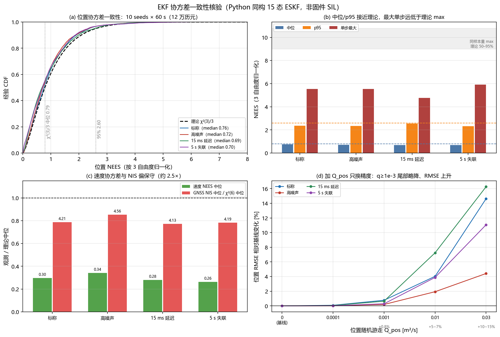

#### 7.16.2 Q_pos / P0_pos 扫描：负结果，不采用

在 `ekf_core.py` 增加位置随机游走 `q_pos_psd_m2ps` 与 `p0_pos_scale` 钩子，5 档 Q_pos × 2 档 P0 × 4 场景 × 10 seeds（60 s）。位置 RMSE 相对基线变化：

| Q_pos [m²/s] | 标称 | 高噪声 | 15 ms 延迟 | 5 s 失联 | NEES_pos 中位（标称） | NEES_pos p95（标称） |
|---|---:|---:|---:|---:|---:|---:|
| 0（基线） | — | — | — | — | 0.76 | 2.37 |
| 1e-4 | +0.1% | +0.0% | +0.1% | +0.0% | 0.77 | 2.58 |
| 1e-3 | +0.8% | +0.2% | +0.6% | +0.3% | 0.73 | 2.48 |
| 1e-2 | +4.0% | +1.9% | +7.2% | +3.9% | 0.62 | 1.91 |
| 3e-2 | +14.6% | +4.4% | +16.3% | +11.1% | 0.50 | 1.70 |
| P0×2（Q=0） | +5.2% | +11.3% | +10.4% | +4.4% | 0.78 | 2.60 |

加 Q_pos 只是把已经一致的位置协方差**人为变保守**：q=1e-3 的尾部下降（max 6.00→5.50）在同样本量理论 max 分布内，代价 +0.8% RMSE；q≥1e-2 用 4–16% 的 RMSE 换尾部，收益不成立。P0×2 只增加 RMSE。**Q_pos/P0 不修改固件，Q_accel 仍保持 1.0**（闭环 SIL 的低 Q 已被 §5 否决）。

#### 7.16.3 SIL 在飞 NEES：白噪声一致，有色 GNSS 误差导致过度自信

为避免把观测接口混入默认 SIL 口径，新增 `-DEKF_NAV_TELEMETRY`（只读 `P` 元素，不改变滤波路径）并单独构建；SIL 在 t>10 s、10 Hz 采样，以 plant 真值计算 `NEES=e^T P^{-1}e/3`。真值基准在导航原点变化时立即记录（不能等到 10 s，否则会把已爬升高度当恒定偏差）。**零噪声对照**（10 seeds，`--gnss-white --gnss-pos-std 0.01 --gnss-vel-std 0.01`）NEES_pos 中位 0.028、p95 0.167，证明参照系/采样口径正确。

同二进制运行开关：`--gnss-white` 关闭 SIL 的 20 s 相关 GNSS 分量（0.5/0.5/0.8 m），保留相同白噪声序列；默认（有色）为 0.5 m/20 s + 白噪声 0.8/0.8/1.2 m。50 seeds、40 s、`mag_clean --pos-hold --flow`：

| 臂 | NEES_pos 中位 | p95 | 单步 max | pos_rms [m] | hold_end 中位 [m] | max_roll 中位 [°] |
|---|---:|---:|---:|---:|---:|---:|
| 白噪声 | **1.05** | **1.33** | **1.47** | **0.32** | 0.80 | 8.80 |
| 有色（默认） | **2.22** | **3.84** | **4.31** | 0.48 | 0.86 | 9.03 |
| 零噪声对照 | 0.028 | 0.167 | 0.331 | 0.012 | 0.00 | 0.00 |

配对比较：有色臂 NEES 中位更高的 seed **38/50**，p95 更高的 **44/50**（Δ 中位 +0.99 / +2.12）。seed1 有色：NEES 3.88、p95 19.84、pos_rms 0.83、hold 12.04 m；白噪声：1.04 / 1.33 / 0.32 / 0.00 m。seed1 有色在 t=38 s 的 GNSS NIS 仅约 0.02，而 NEES≈20——**慢变有色误差让新息保持很小，NIS 看不见偏差**，这正是 §7.9 慢偏 spoof 与“外部基准不可替代”的同一机制。

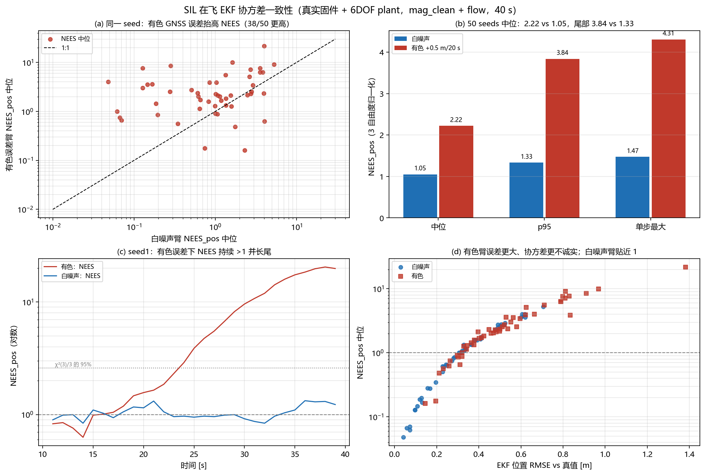

**判断**：EKF 的 P 对白噪声量测是校准的（NEES≈1）；SIL 的有色 GNSS 误差使 P 过度自信（中位约 2×、p95 约 3×）。这不是滤波公式或 Q_pos 能修的——位置误差的慢分量与位置状态不可分，只能靠外部基准（光流/气压/IMU 长时一致性）或接受“P 偏乐观、NIS 看不到慢偏”。闭环位置保持仍由同一估计驱动，因此在有色误差下 hold_end 中位仅 0.80→0.86 m；**不能用 NEES 变差推断控制失效**。

#### 7.16.4 GNSS 自报精度放大（R scale）：一致性改善但位置保持变差，不采用

同二进制 `--gnss-r-scale` 只放大 UBX 的 `h_acc/v_acc/s_acc`（EKF 的 R），不改实际噪声。20 seeds、40 s、有色臂：

| R 倍率 | NEES_pos 中位 | p95 | pos_rms 中位 [m] | hold_end 中位/p90/max [m] | max_roll 中位 [°] | hold>1.5 m 失败 | hold>5 m 失败 |
|---:|---:|---:|---:|---:|---:|---:|---:|
| 1.0（固件） | 2.22 | 3.73 | 0.47 | 0.86 / 1.22 / 12.04 | 9.28 | 1/20 | 1/20 |
| 1.5 | 2.20 | 3.26 | 0.48 | 0.98 / 3.40 / 12.28 | 10.61 | 5/20 | 2/20 |
| 2.0 | 1.52 | 2.25 | 0.46 | 1.10 / 2.26 / 3.32 | 10.44 | 5/20 | **0/20** |
| 3.0 | 0.78 | 1.15 | 0.45 | 1.42 / 6.42 / 10.08 | 11.95 | 9/20 | 3/20 |

R 放大**单调改善 NEES**（2.22→0.78，20/20 seeds 改善），但**位置保持单调变差**：中位 0.86→1.42 m，1.5 m 门限失败 1→9/20。R×2 只把 12 m 大尾部压到 3.3 m（5 m 门限 1→0/20），却新增 4 个 1.5–2.3 m 的小失败；这是“平滑 vs 跟随”的交换，不是修复。**固件 R 不改**；若未来只为诊断/门控需要诚实的协方差，应在**门控侧**加有色误差裕度，而不是放大滤波 R。

**边界**：SIL 的有色模型是 20 s OU + 0.5/0.5/0.8 m，h_acc 只比总误差低估约 15%；R×2/3 是“降低 GNSS 信任”而不是“把 R 修到真值”。本轮 50 seeds 未做 CPU 核绑定（与失败计数矩阵口径不同）；NEES 为 10 Hz 采样、t>10 s，真值含控制器跟随偏差；全部为 L2 SIL，不能外推实机。默认 SIL/固件二进制不含 `EKF_NAV_TELEMETRY`，`--gnss-white`/`--gnss-r-scale` 只影响测试注入。

**默认构建回归**：不含宏的 SIL 增量构建通过，`mag_clean --pos-hold --flow` seed1 的 `pos_rms/hold_end/max_roll` = 0.834/12.035/11.919，与 NEES 二进制的默认（有色）臂逐项一致，JSON 无 `nees_*` 字段。无光流 3-seed 验收 7/9（mag_clean seed1 hold 1.58 m、seed3 6.33 m），两例正是 §7.10 no-vec 10-seed 验收 26/30 中已知的 seed1/seed3 控制边际，不是本设施引入的导航回归；默认 SIL 代码布局已变，边际 seed 计数不与旧二进制逐项比较。宿主 `run_all.sh` 全绿、PIO 三环境 SUCCESS。

### 7.17 GNSS 垂直 spoof 与气压一致性重锚门控（opt-in，2026-10-26）

**问题**：§7.9 的 spoof 矩阵只注入水平位置/速度，垂直通道没有测过。新增 `--gnss-spoof-z`（正值=报得更高，NED down 减小）与 `--gnss-spoof-z-ramp`，从 25 s 起持续注入；水平 spoof 设 0 以隔离垂直通道。10 seeds、40–50 s、`mag_clean --pos-hold --flow`：

| 垂直欺骗 | 无门控（默认）final_alt 中位 [m] | 落地例数 | pos_rms 中位 [m] | max_roll 中位/最大 [°] | reacquire_resets 中位 |
|---|---:|---:|---:|---:|---:|
| +30 m 台阶 | 9.99 | 0/10 | 0.46 | 9.3 / 15.0 | 0 |
| +50 m 台阶 | **0.00** | **10/10** | 3.01 | 47.7 / 58.3 | 2 |
| +100 m 台阶 | **0.00** | **10/10** | 6.06 | 48.6 / 59.2 | 2 |
| −30 m 台阶 | 9.99 | 0/10 | 0.46 | 9.3 / 15.0 | 0 |
| −50 m 台阶 | **32.37** | 0/10 | 0.60 | 10.9 / 17.8 | 1 |
| −100 m 台阶 | **32.38** | 0/10 | 0.60 | 10.5 / 17.8 | 1 |
| ±0.5 m/s 斜坡 | 9.15 / 10.84 | 0/10 | 0.48 | ≤15.0 | 0 |

**机制**：EKF 的物理野值门是 `|Δz| > 40 m` **整帧拒绝**；50–100 m 台阶先被整帧拒绝，持续拒绝使 `time_since_gnss_update_s_` 增长，`TryResetAfterPersistentImplausibleGnss` 连续 3 帧后把位置/速度**硬重锚到欺骗值**。重锚后气压高度新息与 EKF 高度相差数十米，气压更新也被 NIS 拒绝，高度估计锁在假值；定高环按假高度下降到真值 0（上偏）或爬到 32 m（下偏）。30 m 台阶低于物理门，正常 NIS 即可拒绝，所以无影响。**这不是水平 spoof 的“有界误差”，而是会直接改变高度指令的失效路径。**

**门控（`BFS_GNSS_VERTICAL_REANCHOR_GATE`，默认不定义）**：每个 GNSS epoch 用 `InsComputeAbsoluteBaroAltitude(origin_alt_m, baro_altitude)` 得到气压绝对高度，与 GNSS 高度比较；连续 3 帧 `|Δh|>25 m` 判可疑，连续 10 帧 `<10 m` 恢复；气压无效时 fail-open。可疑期间：①把送入 EKF 的 `meas_lla(2)` 替换为气压绝对高度（避免 40 m 物理门整帧拒绝），②`gnss_pos_d_std_m=1e4` 忽略 z 的 R，③`set_gnss_reanchor_allowed(false)` 禁止硬重锚；水平位置/速度仍正常融合，位置保持与 GNSS 新鲜度不受影响。SIL 运行时 `--gnss-v-gate 0|1` 可在**同一二进制**内做 A/B。

**门控 A/B（10 seeds，同二进制）**：

| 欺骗 | 无门控 落地/最终高度/roll | 门控 落地/最终高度/roll | 门控 reacquire_resets |
|---|---|---|---|
| ±30 m 台阶 | 0/10 · 9.99 m · ≤15.0° | 0/10 · **9.99 m** · ≤12.7° | 0 |
| ±50 m 台阶 | 上偏 **10/10** · 0 m · 58.3°；下偏 32.4 m | **0/10 · 9.99 m · ≤15.4°** | **0** |
| ±100 m 台阶 | 上偏 **10/10** · 0 m · 59.2°；下偏 32.4 m | **0/10 · 9.99 m · ≤15.4°** | **0** |
| ±0.5 m/s 斜坡 | 9.15 / 10.84 m | 9.15 / 10.84 m（未越过 25 m 阈值） | 0 |

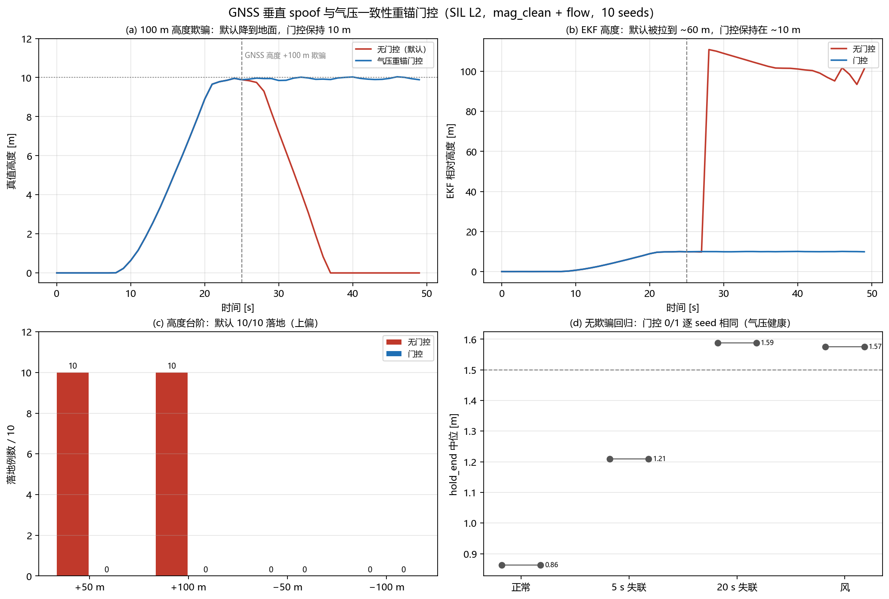

**无欺骗回归（同二进制，10 seeds）**：nominal / 5 s 失联 / 20 s 失联 / 1 m/s² 风，门控 0 与 1 的 final_alt、pos_rms、hold_end、max_roll **逐项相同**（hold 中位 0.86/1.21/1.59/1.57 m；roll 中位 8.7/9.9/11.1/16.5°），`vgsus=0/10`。说明在气压健康时门控不误触发。

**气压故障的代价（重要边界）**：门控把气压当作可信基准；`--baro-drift 0.5 m/s`（30 m/min，严重故障）5 seeds 下，无门控已经 5/5 落地（roll 30–146°、pos 6–24 m），门控 1 也 5/5 落地且 2/5 更差（pos 198/796 m、roll 155°）——**气压快速漂移时门控会把错误气压灌入 EKF，不能默认启用**。需要先加气压健康/IMU 短时一致性仲裁（GNSS、气压、IMU 三源），或者只把门控用于“检测+告警 + 禁止重锚”，不替换 z。当前结论：**门控是 opt-in 的安全候选，不是默认修复**；默认固件/ SIL 不定义宏，行为不变。

**复现口径**：gate0/gate1 使用同一二进制 `md5 1042821242013555abe4c464076d8cd1`（`BIN_DIR=/tmp/tv_fcs_vgate`，标量 Eigen）；两臂只差 `--gnss-v-gate 0|1`。

**构建/默认回归**：门控宏在 PIO `TandemVec_FCS` 环境 **SUCCESS**；不含宏的默认 SIL 重新构建后，`mag_clean --pos-hold --flow` seed1 仍为 pos_rms 0.834 / hold_end 12.035 / max_roll 11.919 m·°、`vgsus=0`，与改动前一致；宿主 `run_all.sh` 全绿。

**边界**：10 seeds、25 s 注入、10 m 目标高度、`mag_clean + flow`；未跑长航时下降/着陆段、真实气压故障注入、多高度/前飞；全部 L2 SIL，不能外推实机。门控的 25 m 阈值是经验值（SIL 正常 GNSS-气压差异 <5 m），实机需按气压漂移/温度标定重定。

## 8. 复现

- 故障矩阵：`fw_real.exe --real-nav --profile mag_clean --pos-hold --seed N --seconds 40` 加 `--imu-fault nan|stuck --imu-fault-window 10:11|10:12`、`--gnss-outage 20:25`、`--gnss-spoof 20 --gnss-spoof-start 10`、`--gnss-spoof 0 --gnss-spoof-ramp 0.5 --gnss-spoof-start 10`；200 Hz 追踪加 `--trace-csv`。
- AHRS 门控 A/B：同一增量构建脚本加 `EXTRA_CXXFLAGS=-DBFS_AHRS_ATT_GNSS_OUTAGE_GATE`，默认构建不定义该宏。
- 推荐 opt-in：`EXTRA_CXXFLAGS='-DBFS_AHRS_ATT_GNSS_OUTAGE_GATE -DBFS_AHRS_ATT_ROLL_GUARD_60'`；默认构建两者都不定义。
- 光流验证：默认/推荐二进制加 `--flow`，其余同故障矩阵（`--gnss-outage 20:25` 或 `20:40`）；SIL 光流模型理想，结果不代表实机光流质量。
- 光流中断：加 `--flow --flow-dropout 20:25`（与 GNSS 失联同窗），用于定义组合失效边界。
- 静置扫描：`/tmp/conv2/fw_real.exe --real-nav --profile clean --pos-hold --heading-aid-mode 2 --calib-hold T --takeoff-at T+3 --static-calib-s 0 --seed N --seconds T+25 --trace-csv ...`
- 运动矩阵：`/tmp/gatefix/fw_real.exe --real-nav --profile clean --pos-hold --heading-aid-mode 2 [--pos-leg 15:0|0:15] --seed N --seconds 40 --trace-csv ...`
- **速度/机动矩阵（§7.4）**：`TandemVec-EKF-Report/sim/run_maneuver_matrix.py`（3360 次）；单次命令为 `fw_real.exe --real-nav --profile mag_clean --pos-hold --pos-hold-at 20 --pos-leg N:E --flow --seed N --seconds 45 [--gnss-outage 25:30] [--wind-window 25:30 --wind-force 1.0]`。汇总/作图：`sim/plot_maneuver_matrix.py`。
- **SIL 标量 Eigen 口径（§7.10）**：`test_host/fw_sil/build_incremental.sh` / `build_and_run_real.sh` / `build_and_run_coaxial.sh` 默认加 `-DEIGEN_DONT_VECTORIZE -DEIGEN_DONT_PARALLELIZE`（可用 `EIGEN_SIL_FLAGS` 覆盖）；增量脚本用 `.build_flags` 戳记，编译选项变化时整目录重建。证据：`sim-data/maneuver-matrix-novec-2026-10-26.jsonl.gz`、`sim-data/maneuver-matrix-final-2026-10-26.jsonl.gz`（seeds1–40）、`sim-data/maneuver-matrix-final-seeds41-80-2026-10-26.jsonl.gz`、`sim-data/gnss-outage-{5s,20s}-finalbase-2026-10-26.jsonl.gz`。
- **无 GNSS 保护 A/B（§7.11）**：`EXTRA_CXXFLAGS` 加 `-DBFS_GNSS_OUTAGE_VELOCITY_HOLD`（0.5 s/1 m/s²）、`-DBFS_GNSS_OUTAGE_ALT_HOLD [-DBFS_GNSS_OUTAGE_ALT_HOLD_S=6]`、`-DBFS_LONG_GNSS_OUTAGE_DESCENT [-DBFS_LONG_GNSS_OUTAGE_DESCENT_AGE_S=6]`；均为 opt-in，默认不定义。单次命令：`fw_real.exe --real-nav --profile mag_clean --pos-hold --pos-hold-at 20 --pos-leg N:E --gnss-outage 20:25|20:40 [--wind-window 20:25 --wind-force 1.0] --seed N --seconds 40|50`。证据：`sim-data/gnss-outage-{alt-threshold,5s-alt,policy,combo6,wind5}-2026-10-26.jsonl.gz`。
- **失联保护巨型矩阵（§7.12）**：A 2880 次（3 臂×4 时长×6 场景×2 风×20 seeds）、B 3240 次（3 臂×2 时长×6 质量档×6 场景×15 seeds）、C/D 780 次（锁存/高度/60 s）。SIL JSON 新增 `land_t/land_hold/land_pos_err/land_roll/max_roll_preland`，用落地瞬间指标与落地后滑行分离。证据：`sim-data/campaign-{outage-duration-corrected,gnss-quality,latch,long-outage,altitude-prelatch,combo-worst,policy-50seeds}-2026-10-26.jsonl.gz`、`sim-data/sil-acceptance-50seed-final-2026-10-26.log.gz`。
- **下降速率/高度/长失联（§7.12.D–F）**：三臂用同一源码仅改 `-DBFS_LONG_GNSS_OUTAGE_DESCENT_RATE_MPS=1|2|3`，固定标量 Eigen；脚本 `sim-data/campaign_{descent_rate,altitude_rate,altitude_rate60,baromin60}-2026-10-26.py`。速率扫描 1080 次（20 s 失联/风/爬升中触发，60 s 格为重复）；真实高度 720 次用 `pos-hold-at = alt+11`、`gnss-outage = alt+13`，让飞机爬到目标后再失联（`alt_at_outage` 实测 9.9/19.9/29.9/39.9 m）；60 s 子集用 30 m + `gnss-outage 43:103`，下降/触地全程无恢复。SIL JSON 新增 `land_vz_down/max_desc_vz_down/alt_at_outage`。末段 flare 加 `-DBFS_LONG_GNSS_OUTAGE_DESCENT_FLARE`（默认 `..._ALT_M=8`、`..._RATE_MPS=0.5`、`..._MIN_AGE_S=20`）。证据：`sim-data/descent-rate-2026-10-26.jsonl.gz`、`sim-data/altitude-rate-2026-10-26.jsonl.gz`、`sim-data/altitude-rate60-{baseline,baromin,flare8age}-2026-10-26.jsonl.gz`、`sim-data/descent-rate-baro-vz-negative-2026-10-26.jsonl.gz`、`sim-data/{descent-rate,altitude-rate,altitude-rate60,altitude-rate60-flare8age}-2026-10-26.meta.json`。
- **EKF 气压垂速伪量测（§7.15）**：`EXTRA_CXXFLAGS` 加 `-DBFS_BARO_VERTICAL_VELOCITY_AID [-DBFS_BARO_VERTICAL_VELOCITY_AID_STD_MPS=1.0f] [-DBFS_BARO_VERTICAL_VELOCITY_AID_RATE_DIV=40U] [-DBFS_BARO_VERTICAL_VELOCITY_AID_MIN_AGE_S=8]`；SIL 同一二进制用 `--baro-vel-aid 0|1` 做 A/B（5 s 两臂逐 seed 相同，20 s/60 s 见 §7.15）。证据：`sim-data/baro-vel-aid-runtime-ab-2026-10-26.jsonl.gz`、`sim-data/baro-vel-aid-runtime-ab-2026-10-26.meta.json`、`figs/nav_baro_vel_aid_ab.png`。
- **bias_z 钳制 A/B（§7.5–§7.7）**：`navigation_task.cpp` 的 `ClampGyroBiasZ` 条件；v2 = `heading_aid_mode!=0 || g_pos_hold_degraded || heading_aiding_age_s>0.5`；v3（默认）= 正常磁模式 0.05 rad/s、降级 0.01。全矩阵 seed 块 1–40 / 41–80。证据：`maneuver-matrix-2026-10-25.jsonl.gz`、`maneuver-matrix-v3-2026-10-25.jsonl.gz`、`maneuver-matrix-v3b-seeds41-80-2026-10-25.jsonl.gz`、`ab-bias-v2-2026-10-25.jsonl.gz`、`v3-ab-2026-10-25.jsonl.gz`、`gnss-quality-v3-2026-10-25.jsonl.gz`。**长 A/B 前先记录二进制 md5；首轮 A/B 因 opt 二进制不可复现已作废。**
- **协方差一致性/Q_pos（§7.16.1–2）**：`sim/consistency_check.py`（10 seeds，4 场景，χ² 分位与同样本量 max 蒙特卡洛）、`sim/q_pos_sweep.py`（5 档 Q_pos × 2 档 P0 × 4 场景）、`sim/plot_consistency.py`。证据：`sim-data/consistency_check_2026-10-26.{json,npz}`、`sim-data/q_pos_sweep_2026-10-26.json`、`figs/nav_ekf_consistency_2026-10-26.png`。
- **SIL 在飞 NEES（§7.16.3–4）**：单独构建 `BIN_DIR=/tmp/tv_fcs_nees EXTRA_CXXFLAGS=-DEKF_NAV_TELEMETRY bin/bash test_host/fw_sil/build_incremental.sh --build-only`（默认 SIL/固件不含该宏）；运行 `NEES_EXE=/tmp/tv_fcs_nees/fw_real.exe NEES_SEEDS=51 py -3.12 sim/run_nees_sil_ab.py`（同二进制 `--gnss-white` 关闭 20 s 有色分量）、`RSCALE_SEEDS=21 py -3.12 sim/run_nees_r_scale.py`（`--gnss-r-scale 1|1.5|2|3`）。证据：`sim-data/nees_sil_ab_2026-10-26_50seed.{json,jsonl}`、`sim-data/nees_sil_ab_2026-10-26_10seed.*`、`sim-data/nees_r_scale_2026-10-26.{json,jsonl}`、`sim-data/trace-nees-seed1-{colored,white}-2026-10-26.log`、`figs/nav_nees_sil_gnss_colored_2026-10-26.png`。零噪声对照用 `--gnss-white --gnss-pos-std 0.01 --gnss-vel-std 0.01`。
- **GNSS 垂直 spoof / 重锚门控（§7.17）**：SIL 注入 `--gnss-spoof 0 --gnss-spoof-start 25 --gnss-spoof-z ±50|±100` 或 `--gnss-spoof-z-ramp ±0.5`；门控构建加 `EXTRA_CXXFLAGS=-DBFS_GNSS_VERTICAL_REANCHOR_GATE`，同二进制 `--gnss-v-gate 0|1` 做 A/B。脚本 `sim/run_gnss_vspoof.py`、`sim/run_vgate_regression.py`、`sim/plot_vspoof_gate.py`。证据：`sim-data/gnss_vspoof_2026-10-26_gate{0,1}.{json,jsonl}`、`sim-data/gnss_vgate_reg_2026-10-26.{json,jsonl}`、`sim-data/trace-vspoof-z100-gate{0,1}-2026-10-26.log`、`figs/nav_vspoof_gate_2026-10-26.png`。
- 原始 trace 与证据 JSON：`simulations/three_vehicle_mc/sim-data/nomag-wind-window-2026-10-25.json`（追加 convergence 组）。
