# 无磁 EKF 收敛仿真（2026-10-25）

**证据等级：L2（真实固件源码 + 6DOF plant + 传感器模型，非实机）**

## 1. 目的与设置

用户要求先做一段静止校准、再做运动校准，让无磁 EKF 收敛。本轮用 SIL 扫两维：

- **静置时长**：2 / 10 / 30 / 60 s，各 10 seeds。`--calib-hold T` 期间电机不出力、固件油门置 0、**控制回路冻结**（只跑导航），随后起飞、AUTO_POSITION 16 s 后评估。
- **运动激励**：悬停 / 北向 15 m / 东向 15 m，各 20 seeds，t=19 s 评估。
- 评价：|yaw 误差|、位置误差（相对目标）、roll 误差、陀螺零偏 z。

## 2. 结果

### 2.1 静置时长：越长越差，不是越长越好

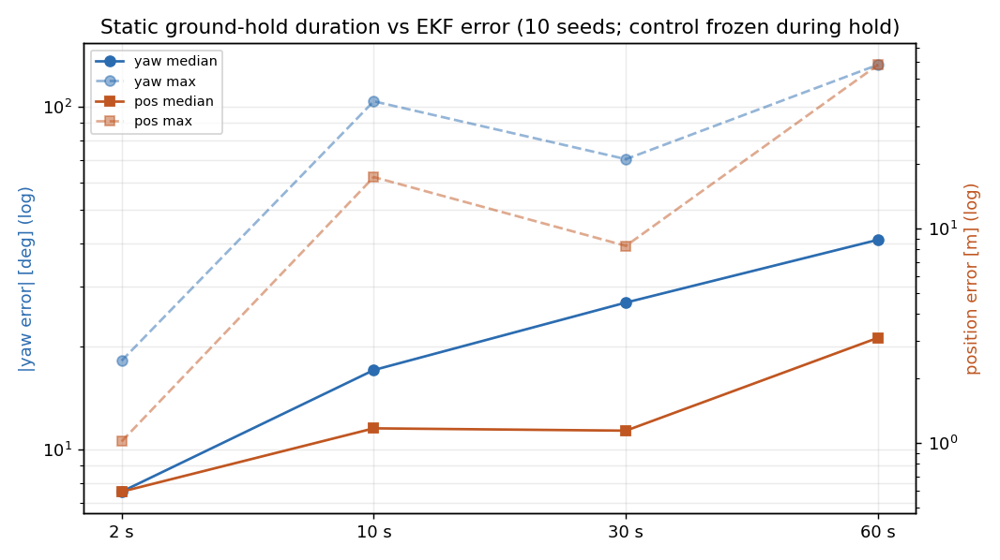

| 静置 | |yaw| 中位/最大 | 位置中位/最大 |
|---:|---:|---:|
| 2 s | 8.6° / 18.2° | 0.7 m / 1.0 m |
| 10 s | 17.4° / 103.8° | 1.2 m / 17.4 m |
| 30 s | 28.6° / 70.4° | 1.2 m / 8.3 m |
| 60 s | 41.0° / 132.7° | 2.0 m / 58.2 m |

静置 2 s 组 10 seeds 位置全部 ≤3 m；30 s 组只有 7/10，60 s 组 5/10。

### 2.2 零偏并不是限制

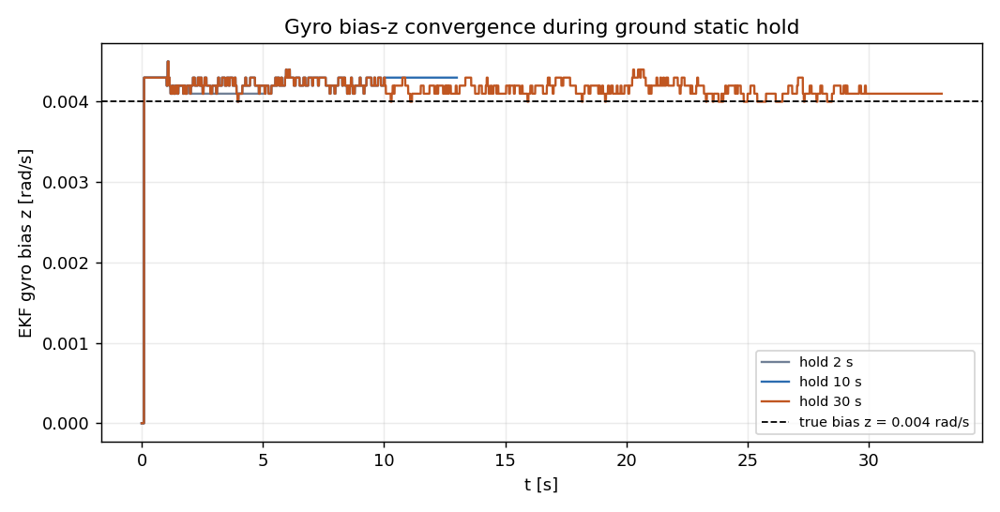

SIL 的陀螺零偏 z=0.004 rad/s，EKF 在 **~1 s** 内就收敛到 0.004 并保持；30 s 静置没有进一步降低误差。也就是说，SIL 里“静置更久 → 零偏更准”并不成立，静置时长不是收敛瓶颈。

### 2.3 运动激励不改善航向，前飞最差

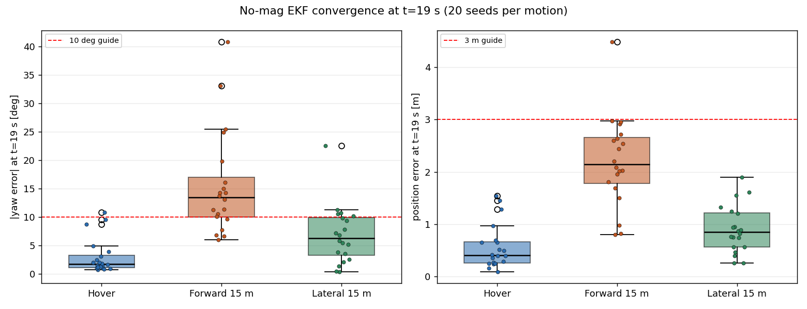

- 悬停：|yaw| 中位 1.9°、最大 10.8°，位置 ≤1.54 m。
- 前飞 15 m：中位 13.7°、最大 40.8°，位置 ≤4.48 m。
- 侧飞 15 m：中位 6.8°、最大 22.6°，位置 ≤1.9 m。

运动让航向更差（前飞最差），因为滚转-偏航耦合/侧滑把航向误差带进 GNSS 新息；位置环仍能把机带到目标。

### 2.4 时间序列

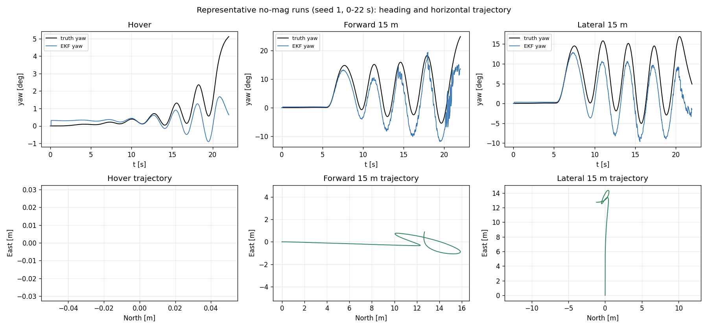

前飞/侧飞在 5–20 s 有明显 5°–15° 的偏航振荡，EKF 能跟上相位但幅度有差；20 s 窗口结束后位置保持关闭，轨迹迅速漂走（图限 0–22 s，避免把后窗口漂移误读为收敛失败）。

## 3. 机制判断

静置更久反而更差，最可能不是“校准不足”，而是：

1. 长时间静止的 GNSS/ZUPT/重力更新把姿态/航向协方差压得过小，起飞后滤波器对真实偏航率“过度自信”，GNSS 新息经 `P(φ,v)` 把航向拉回 0；
2. `bias_z` 虽被限到 ±0.01 rad/s，但姿态航向行本身仍可被 GNSS 修正；
3. 2 s 组协方差较大，反而能在起飞后跟随真实运动。

之前试过“无磁离地全局 `consider_heading`”，在 3 s 静置下更差；但在 30–60 s 静置、协方差更紧的条件下可能不同——需要下一轮做 **起飞时协方差重置/膨胀 + consider 组合** 的 A/B，而不是继续加静置时间。

### 3.1 起飞协方差膨胀 A/B（已撤回）

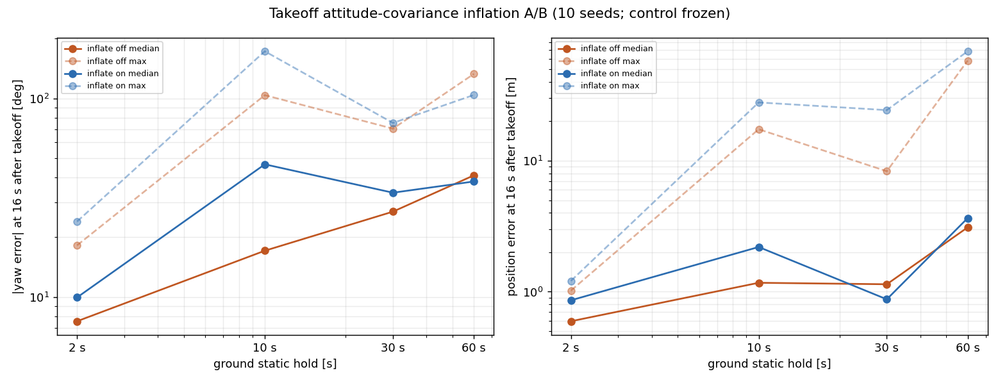

对“起飞瞬间膨胀姿态协方差 3°/10° 并清零 P(8,v)”做 10 seeds A/B：

| 静置 | yaw 中位 off→on | yaw 最大 off→on | 位置最大 off→on |
|---:|---:|---:|---:|
| 2 s | 7.6→10.0° | 18.2→24.0° | 1.0→1.2 m |
| 10 s | 17.1→46.5° | 103.8→172.6° | 17.4→27.9 m |
| 30 s | 26.9→33.5° | 70.4→75.2° | 8.3→24.4 m |
| 60 s | 41.0→38.2° | 132.7→104.0° | 58.2→68.6 m |

短静置明显变差，长静置只有 60 s 中位 yaw 略降但位置更差。**结论：简单膨胀/解耦不是解，已撤回代码**；下一步应转向导航-only 台架做协方差一致性（NEES/NIS）和可观测性分析，而不是继续在起飞瞬间拍参数。

## 4. 导航-only 一致性（2026-10-25，Python 台架）

用 `TandemVec-EKF-Report/sim` 的 15 态 ESKF（与固件同构）跑 60 s、5 seeds；指标 NEES≈1、NIS≈6 为一致。

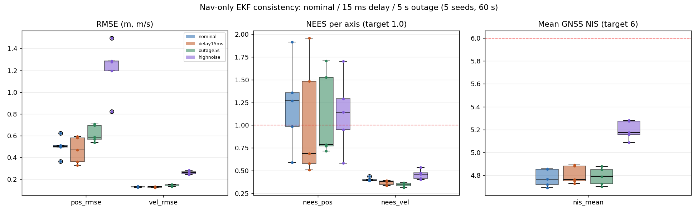

| 场景 | pos RMSE | vel RMSE | NEES_pos 中位 | NEES_vel 中位 | NIS 均值 |
|---|---:|---:|---:|---:|---:|
| 标称 | 0.50 m | 0.13 m/s | 1.27 | 0.40 | 4.77 |
| 15 ms 延迟 | 0.47 m | 0.13 m/s | 0.69 | 0.38 | 4.76 |
| 5 s 失联（20–25 s） | 0.59 m | 0.15 m/s | 0.79 | 0.36 | 4.79 |
| 高噪声 5/8 m, 0.5/0.8 m/s | 1.28 m | 0.26 m/s | 1.14 | 0.48 | 5.16 |

**结论**：速度协方差明显偏保守（NEES_vel≈0.4，P_vel 约大 2–2.5 倍），位置大体一致但尾部偏乐观（NEES_pos 最大 1.9）；GNSS NIS 4.7–5.3 低于 6，整体偏保守。15 ms 延迟影响很小；5 s 失联没有持续发散。
**下一步**：只调 Q_vel/P0_vel（GNSS R 地板按 AGENTS 不可收紧），以 NEES→1、NIS→6 为目标做参数扫描，并检查位置尾部；不要再用“静置时长/起飞协方差拍参数”解决。

## 4. 边界与下一步

- SIL 的 IMU 零偏模型是常值 + Markov（τ=200 s、0.01 dps 不稳定度），**没有温漂/开机漂移/磁干扰**；实机“几十一百秒”可能来自温漂，SIL 不能复现。因此本轮只能否定“在当前 SIL 模型里长静置有益”，不能否定实机需要长静置。
- 已把固件静止校准硬门控默认设为 **0（关闭）**，保留 `static_cal` / `static_cal_s` 遥测和可调阈值；等起飞协方差/航向耦合修复后再启用 30 s 级要求。
- 下一步（按优先级）：
  1. 起飞瞬间（油门/高度跨阈值）对 yaw/tilt 协方差做有界膨胀，或重置 GNSS 航向 consider 状态；
  2. 在长静置 + 起飞场景重跑 2/10/30/60 s × 10 seeds，看曲线是否反转；
  3. 增加温漂型 IMU 模型（慢变 bias）后再评估“几十秒静置”的真实收益。

## 5. 闭环 SIL 复核：Q 候选否决（2026-10-25）

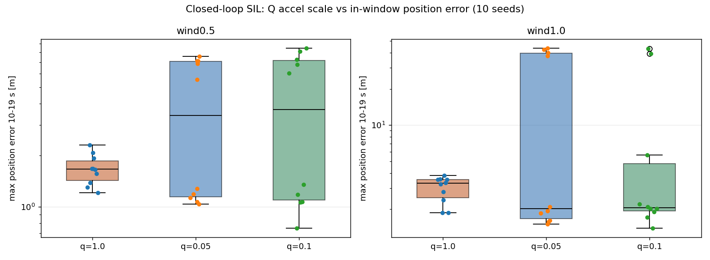

把 Q 缩放接入固件 EKF（`--ekf-q-scale`，默认 1.0），10 seeds/工况：

| 工况 | q=1.0 最大位置 | q=0.05 | q=0.1 |
|---|---:|---:|---:|
| 无风 | 1.54 m | 1.54 m | 1.54 m |
| 0.5 m/s² 风 | 2.30 m | 7.57 m | 8.47 m |
| 1.0 m/s² 风 | 3.82 m | **43.75 m（4/10 >37 m）** | **43.18 m（2/10 >39 m）** |

风下低 Q 出现双峰：多数种子 ~1 m，少数 37–54 m。**导航-only 的低 Q 一致性收益不能迁移到闭环 SIL**；低 Q 让速度估计更滞后，风扰/位置环耦合下失稳。固件默认 Q 保持 1.0，Q 钩子仅作研究设施，不推荐上机。

高 Q 反向扫描（10 seeds）：

| 工况 | q=1.0 | q=2.0 | q=4.0 |
|---|---:|---:|---:|
| 无风 | 1.54 m | 1.17 m | 1.49 m |
| 0.5 m/s² 风 | 2.30 m | 2.09 m | 2.20 m |
| 1.0 m/s² 风 | **3.82 m** | 7.47 m | 8.95 m |

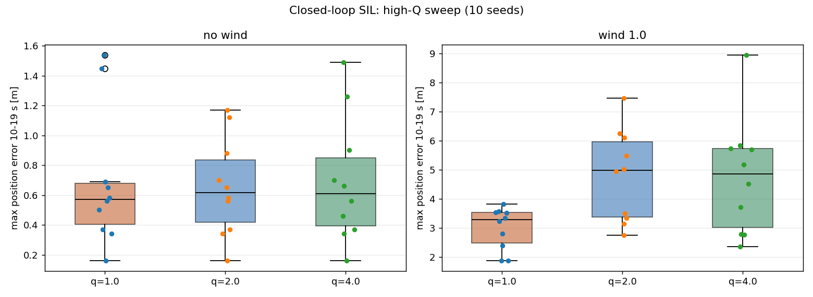

q=2/4 在无风/弱风略好，但 1 m/s² 风下明显更差（7.47/8.95 m）；**Q=1.0 是当前闭环最坏情况最优，默认值保留**。

## 6. Q 过程噪声扫描（导航-only，研究记录）

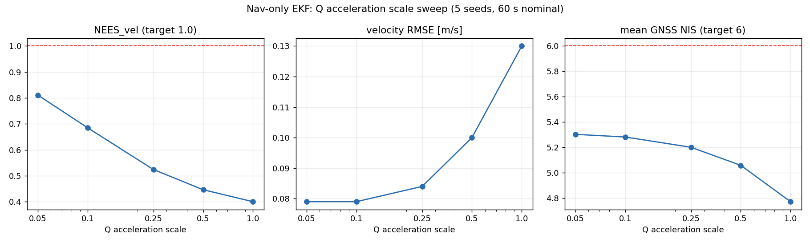

只缩放滤波器的加速度过程噪声谱密度（`q_accel_scale`，量测 R 不动），标称 60 s、5 seeds：

| Q 比例 | NEES_vel | vel RMSE | pos RMSE | NIS |
|---:|---:|---:|---:|---:|
| 1.00（基线） | 0.40 | 0.130 | 0.50 | 4.77 |
| 0.50 | 0.446 | 0.100 | 0.50 | 5.06 |
| 0.25 | 0.524 | 0.084 | 0.50 | 5.20 |
| 0.10 | 0.685 | 0.079 | 0.50 | 5.28 |
| 0.05 | 0.811 | 0.079 | 0.50 | 5.30 |

低 Q 单调改善速度一致性与 RMSE；到 0.05 仍 NEES_vel=0.81（仍偏保守），位置 NEES 不变（1.23）。**只测了标称场景，尚未改固件。**

0.1 的鲁棒性初测（40 s、3 seeds）：延迟 pos 0.59 m / NEES_vel 0.65；5 s 失联 pos 0.73 m / 0.62；高噪声 pos 1.48 m / 0.76，NIS 5.2–5.33。0.05 的延迟/失联/高噪声为 pos 0.59/0.73/1.48 m、NEES_vel 0.75/0.70/0.81，NIS 5.27/5.24/5.34。无发散，但高噪声下位置 RMSE 略差、NEES_pos≈1.55 偏乐观。**候选 0.1–0.05，需补高噪声/振动/SIL 全量后再决定，不能直接下固件。**

10 seeds 复核（Q=0.05，60 s）：标称 pos 0.489/0.619 m、vel 0.079/0.087 m/s、NEES_pos 1.00/1.95、NEES_vel 0.79、NIS 5.32；高噪声 pos 1.177/1.476 m、vel 0.200/0.222 m/s、NEES_pos 0.96/1.72、NEES_vel 0.74、NIS 5.35（基线高噪声为 1.28 m/0.26 m/s/NEES_pos 1.14/NIS 5.16）。**Q=0.05 在标称与高噪声下同时改善 RMSE 和一致性，没有出现鲁棒性退化**；位置一致性也回到 ≈1。

### 6.1 慢漂下的静置时长（10 seeds）

给静态台架加 z 轴线性慢漂 1e-4 rad/s²（约 0.0057 °/s²，120 s 约 0.69 °/s），T=2/30/60 s、10 seeds：

| 静置 | 末端零偏 z 误差中位/最大 | yaw 1σ 中位/最小/最大 |
|---:|---:|---:|
| 2 s | 2.07e-4 / 5.31e-4 rad/s | 11.39 / 11.35 / 11.41° |
| 30 s | 2.83e-4 / 5.33e-4 rad/s | 11.16 / 11.09 / 11.20° |
| 60 s | 3.51e-4 / 9.37e-4 rad/s | 10.97 / 10.88 / 11.00° |

零偏误差随时长 **增大**（0.00021→0.00035 rad/s，仍 <0.06°/s），yaw 1σ 随时长 **下降**（11.39→10.97°）。在慢漂模型下**长静置没有改善零偏跟踪，反而收紧协方差**；这与 SIL 中长静置后起飞更差的方向一致。实机温漂谱未知，不能据此直接否定实机需求，但“几十秒静置必然更好”不成立。 慢漂下 Q=0.05 与 1.0 的末端零偏误差完全相同（中位 3.51e-4、最大 9.37e-4 rad/s），yaw 1σ 10.72° vs 10.97°——Q_accel 下调不损害静置零偏跟踪。

### 6.2 位置 NEES 尾部（Q=0.05 vs 1.0）

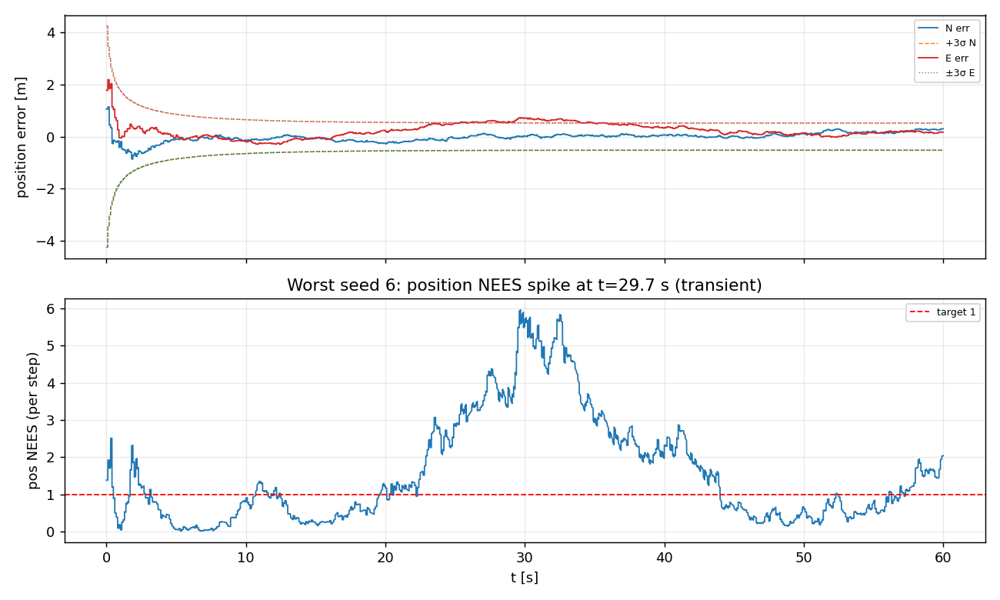

Q=0.05、10 seeds 中位置 NEES 的种子中位 0.52–1.59，单步峰值 1.80–5.97；最差 seed6 在 25–35 s 出现持续约 10 s 的 0.5–0.6 m 位置误差（3σ≈0.4 m），不是单点毛刺。对照 Q=1.0：seed0–2 的单步峰值 5.74/4.72/3.26，与 Q=0.05 的 5.70/4.73/3.26 几乎相同——**位置尾部是 Q_accel 之外的本底（位置模型/GNSS 噪声），不是低 Q 的代价**。位置协方差在巡航段略乐观，需单独研究 P_pos/Q_pos，不能靠 Q_accel 修。

完整 3×3 P 的 full NEES 与对角线近似一致（中位：Q=1.0 pos 0.64/vel 0.30；Q=0.05 pos 0.66/vel 0.64），说明 P 轴间相关很小，NEES 结论不是对角线伪影；Q=0.05 把速度 NEES 从 0.30 提到 0.64（仍偏保守），位置中位基本不变。

## 7. 闭环故障注入（2026-10-25，L2 SIL，10 seeds/类）

固定 `--real-nav --profile mag_clean --pos-hold`（有磁、无风、GNSS 0.5 m / 0.05 m/s），seed 1–10、40 s、200 Hz 控制；故障在起飞后注入。判失败：`hold_end_rms>5 m` 或 `max_roll>20°` 或 `pos_rms>3 m`。

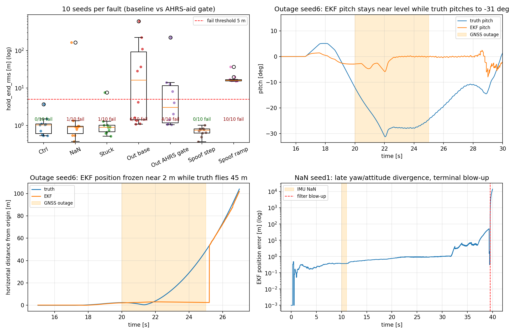

| 故障（窗口） | 失败/10 | hold_end 中位/最大 | max_roll 最大 | pos_rms 中位/最大 |
|---|---:|---:|---:|---:|
| 无故障对照 | 0/10 | 1.03 / 3.67 m | 13.95° | 0.62 / 1.06 m |
| IMU NaN（10–11 s） | **1/10** | 0.90 / 163.10 m | 98.20° | 0.62 / 1035.62 m |
| IMU 冻结（10–12 s） | **1/10** | 0.89 / 7.54 m | 31.49° | 0.63 / 1.04 m |
| GNSS 失联（20–25 s） | **6/10** | 16.24 / 602.74 m | 31.80° | 1.55 / 10.21 m |
| GNSS 失联 + AHRS 门控（opt-in） | **4/10** | 3.02 / 222.60 m | 19.47° | 1.31 / 6.56 m |
| GNSS spoof 20 m 台阶（10 s 起） | 0/10 | 0.74 / 1.01 m | 10.40° | 0.74 / 0.92 m |
| GNSS spoof 0.5 m/s 慢偏（10 s 起） | **10/10** | 15.84 / 36.84 m | 16.36° | 10.12 / 10.75 m |

**IMU 故障不是“已修复”**：NaN 窗内确实没有非有限值进入 EKF/控制（`imu_detected=1`、无 NaN 输出），但 1/10 种子在约 30 s 后进入 yaw/姿态耦合发散，39.5 s 后 EKF 位置数值爆掉（每 5 ms 跳约 700 m，`pos_max=14172 m` 是滤波器终末数值，不是真实航迹；真值此时约 250 m）。冻结 2 s 的失败例是边际失败（位置 7.5 m、roll 31°），其余 9 个种子正常。1 s 数据缺口本身不保证安全恢复。

**GNSS 5 s 失联 6/10 失败，根因不是“惯导漂移”**。以 seed6 为例（200 Hz 追踪）：

| 时刻 | 真值 pitch | EKF pitch | 真值 N | EKF N |
|---:|---:|---:|---:|---:|
| 20.0 s | −12.0° | −2.9° | −2.26 m | −2.05 m |
| 21.0 s | −21.1° | −4.7° | −1.19 m | −2.49 m |
| 22.0 s | −30.9° | −5.8° | +3.30 m | −2.98 m |
| 23.0 s | −27.6° | +0.1° | +12.76 m | −2.85 m |
| 24.0 s | −27.9° | −0.1° | +26.68 m | −2.68 m |
| 25.0 s | −24.6° | −0.1° | +45.18 m | −2.51 m |

失联段真值俯仰到 −31°、水平飞出 45 m，EKF 姿态被锁在水平、位置几乎冻结；25.5 s GNSS 恢复后直接跳到 56 m。机制：磁门内的“重力+磁”双矢量辅助把加速度计比力当重力。悬停/持续推力时 `|f_b|≈g`，且机体 z 轴与 EKF 预测重力方向一致（误差 <15°），重力更新通过全部现有门控（`grav_fused=205/205`），把 roll/pitch 拉平；位置环看不到倾斜产生的水平加速度，继续加大倾角，形成正反馈。**这是重力辅助在持续加速度下的伪观测，不是 GNSS 融合参数问题。**

**spoof 的两种边界必须分开**：20 m 位置台阶（正常 h_acc）没有触发 30 m 野值门，位置保持也未被拖走（`outlier_rejects=0` 只说明物理野值门未触发；具体是 EKF 新息/NIS 还是其他量测门未逐项区分，**不能写成“识别了欺骗”**）；0.5 m/s 慢偏则每帧残差很小，10/10 被跟随，位置误差约 10 m、hold_end 15–37 m、`gnss_crej=0`。慢偏/一致速度欺骗仍不可检测。

**否定的第一条修法**：给磁门内的重力方向辅助加“GNSS 失联时禁用”门控（`BFS_GRAVITY_AID_GNSS_GATE`，默认关）。A/B 显示无效：`grav_fused` 205→205、失联 6/10→6/10，seed6 的 hold_end 完全相同（602.74 m）。205 次与地面静止段约 4 s×50 Hz 的量级一致，且门控后不变——说明这些融合不经过该门控（或发生在门控不作用的地面段），该门控无法影响失联段。真正候选是**无 GNSS 运动时的 AHRS 姿态量测路径**（`else if (!gnss_instant_valid_for_nav && accel_gravity_trusted && angular_rate_quiet)`）：Madgwick 的 roll/pitch 本身来自“陀螺 + 加速度重力修正”，持续推力时它会把倾斜拉回水平，再以 2° 噪声灌入 EKF，覆盖陀螺。该路径的 A/B 见下节。

**AHRS 姿态门控 A/B（`BFS_AHRS_ATT_GNSS_OUTAGE_GATE`，默认关）**：规则是“GNSS 曾成功融合且当前 age>0.5 s 时禁用 AHRS 姿态量测；首次定位前仍允许”。10 seeds 时失联 6/10→4/10、hold 中位 16.24→3.02 m、max_roll 31.8→19.5°，但当时样本太小。**扩到 50/100 seeds 后结论反转**：

| 失联时长 | 默认失败 | AHRS 门控失败 | hold 中位（默认→门控） | max_roll（默认→门控） |
|---:|---:|---:|---:|---:|
| 5 s（100 seeds） | **65/100** | **22/100** | 22.44→2.08 m | 179.9→27.7° |
| 10 s（50 seeds） | 46/50 | 39/49 | 279.2→15.0 m | 179.8→36.2° |
| 20 s（50 seeds） | 48/48 | 47/50 | 327.0→38.9 m | **71.3→179.7°（seed6 尾部反噬）** |
| 20 s + 时间上界 10 s（50 seeds） | 48/48 | 48/49 | 327.0→103.1 m | **52.6°（无 180° 尾部）** |
| 5 s + roll60 保护（50 seeds） | 10/50（AHRS） | **8/50** | 2.26→2.26 m | 27.7°（不变） |
| 10 s + roll60 保护（50 seeds） | 39/49（AHRS） | 40/49 | 15.0→11.3 m | 36.2°（不变） |
| 20 s + roll60 保护（50 seeds） | 47/50（AHRS） | 47/49 | 38.9→37.3 m | **179.7→33.9°** |

60° 滚转保护（GNSS 失联且 |roll|>60° 时临时恢复 AHRS）在 5 s **把失败从 10/50 降到 8/50**，20 s 失败数不变但 max_roll 179.7→33.9°、max hold 418→233 m；10 s 多 1 例（40/49 vs 39/49），中位反而 15→11.3 m。它是目前**尾部最好的折中**，但仍不是修复，保持 opt-in。45° 保护在 5 s 反而 10→12/50（触发太早），已否决。

**禁用位置保持 reanchor（保留失联前目标）否决**：5 s 50 seeds 仍 8/50 失败，hold 中位 2.26→1.36 m，但 p95 21.1→34.7 m、max_roll 27.7→**178.9°**（seed50 或 seed1 新失败）。重捕获时 EKF 位置已跳回真实位置，若目标仍是失联前远点，位置误差会转成大幅姿态指令；reanchor 是必要的安全行为。代码已回退。

**GNSS 失联水平陀螺零偏钳制否决**：trace 反推失联段等效 `bias_y≈0.14 rad/s`，曾假设 EKF 把真实倾斜率吸收进零偏。失联时把 bias_x/y 钳到 0.02 rad/s（AHRS+roll60）后 5 s 失败 **8→11/50**（新增 seed1/5/38/50），中位仅 2.26→2.16 m。说明该零偏不是可简单钳制的伪量，强行钳制会破坏正常姿态/零偏一致性；代码已回退。

**纯陀螺控制姿态否决**：失联时控制环改用陀螺递推姿态（以失联瞬间 EKF 为初值），5 s 失败 **8→15/50**、max_roll 27.7→44.1°，新增 seed1/5/10/14/19/28/29/32/40/48 等。失联瞬间 EKF 姿态已有约 9° 误差，陀螺零偏/积分误差直接进入控制环，比“用 EKF 锁平姿态”更差；代码已回退。**下一步不再做姿态源替换，转向降级时主动刹车或控制权限管理。**

5 s 失联下门控把失败率从 65% 降到 22%（净修 44 例、新增 seed1 1 例），p95 259.4→18.3 m，是**强严重度缓解**；10 s 中位/p95 也显著下降；但 20 s 出现 **seed6 roll 179.7°**（默认同种子 71.3°）。时间上界（>10 s 恢复 AHRS）能把 20 s max_roll 压到 52.6°、max hold 260 m，但中位从 38.9 恶化到 103.1 m——**用站位换姿态安全**。**结论：门控只能在短时失联使用；保持 opt-in，绝不默认启用**；20 s 无论全门控还是有界版都近乎全失败，长失联必须失效保护/主动刹车。**不要用 10 seeds 的 4/10 判断门控有效或无效——50 seeds 才看出净收益，也才看出 20 s 反噬。**

**gyro-tilt 变体（已否决）**：用纯陀螺 roll/pitch 做倾斜补偿、在 dip 拒绝时只更新 yaw；10 seeds 仍 4/10，50 seeds **11/50**（AHRS-only 10/50），seed6 hold 222.6→179.4 m、roll 19.5→15.3°，但新增 seed5 失败（12.7 m）。它没有减少失败数，只是把 seed6 的严重度转移；代码未保留。

10 seeds 里仍能看到 seed1/5 新增失败（14.0/12.7 m）、seed6 仍损失 222 m 站位：22.0 s（失联 2 s）`heading_aiding` 变 0、`pos_degraded=1`，位置保持被 `HeadingAidingGate` 降为定高；之后残余速度把机体带走，GNSS 重捕获又把当前位置设为目标（reanchor），于是“姿态对了、站位丢了”。**下一步应把“航向门控降级”与短时 GNSS 失联解耦（磁/陀螺短时可信时保留位置保持，或降级时主动刹车），而不是继续调姿态/位置增益。**

**第二条否定修法（5 s 磁宽限）**：把 `kMagMaxAgeS` 2→5 s（宏 `BFS_MAG_AGE_GRACE_5S`），与 AHRS 门控联测 10 seeds。失联仍 **4/10**，seed6 hold 222.6→256.4 m、max_roll 19.5→19.2°，没有改善；真磁丢 5/10→4/10（max_roll 26.2→17.9°）但同时新增 seed3 失败（31.0 m）；NaN seed1 从 163.1→235.6 m、max_roll 98.2→118.5°。**不启用**。这说明 22 s 的位置保持降级不是简单的“2 s mag_age 阈值”问题（或保位置保持仍不足以刹车）；磁宽限还扩大了其他故障的暴露时间。下一步优先做“降级时主动刹车/零速保持”，而不是放宽航向失效门限。

**失联段航向为何失效（trace 定位）**：新增 `mag_age` / `heading_age` 列后，seed6 的 `mag_age` 从 20.0 s 的 0.04 s 线性涨到 25.0 s 的 5.04 s；失联段 49 次磁门尝试**全部为 `DipDeviation`（reason=9）**，没有一次成功融合；2.0 s 时 `heading_aiding` 由 1→0、`pos_degraded` 0→1，位置保持降为定高。`MagGateReason` 枚举中 9 是 DipDeviation，14 才是 EkfRejected——之前把 9 写成 EkfRejected 是错的，已按头文件更正。也就是说，**GNSS 失联后姿态误差把倾角观测推出 10° 门限，磁矢量被整帧拒绝，绝对航向断供**，这才是位置保持降级的直接触发；AHRS 姿态误差是上游共因。

**dip 弱约束重试（已否决）**：10× 噪声（约 3 µT）重试与 AHRS-only 逐项相同，`mag_fused` 327 不变，仍被 NIS 拒；**固定 50 µT** 后终于融合，seed6 hold 222.6→157.8 m、pos_rms 6.6→6.5 m，但 max_roll 19.5→22.3°，总失败仍 **4/10**（其余失败种子不变）。说明“让磁门通过”只能部分减轻站位丢失，不能修复姿态/航向耦合；重试代码未保留。

**构造 yaw 回退时的口径坑**：`MagGateResult.heading_error_rad` 的定义是“参考场方位 − 用 EKF 姿态反旋后的实测方位”，属于**场一致性误差**，不是 EKF 航向残差；直接把它加到 `nav_ekf.yaw_rad()` 会得到零修正并在融合后错误清零 mag_age。标量回退必须从 `mag_body` 与 roll/pitch 单独构造 yaw 残差（或对 3D 更新放宽 R/NIS），不能复用这个字段。该实验因此未进入 SIL 矩阵。

**朴素 roll/pitch-only 反旋也不行（离线校验）**：用项目同口径 `angle2dcm(0, pitch, roll)` 反旋磁矢量再取方位，真航向 30°、pitch −20°、roll 10° 时算出 14.7°，不是 30°；倾角把垂直场混入水平投影，必须先做标准倾斜补偿。正确形式是 `n=(Rx(roll)Ry(pitch))^T m_ned`，`ψ=atan2(n_y,n_x)−atan2(m_by,m_bx)`（只把参考场投到 yaw-zero 机体系，再用机体水平分量求差）；已实现为 `magTiltCompensatedHeadingRad()`，单元测试 G10 用 4 组 yaw/pitch/roll（30/−20/10、0/−20/10、−45/15/5、170/25/−30）回解误差 <1e-3 rad。

**标量 yaw 回退 A/B 无效果**：AHRS 门控 + 失联段标量 yaw 回退（噪声 0.15 rad 与 0.5 rad 各 10 seeds）均与 AHRS-only **逐项完全相同**：失联 4/10、hold 3.02/222.60 m、max_roll 19.5°；ctrl 0/10 也一致。回退代码放在磁门 `gate.pass` 的 `else` 分支内，而失联段磁门先以 `DipDeviation` 拒绝，**回退根本没有机会执行**——不是 `MeasurementUpdateYawDetailed` 的 NIS 问题。因此不能称为修复；回退代码未保留，仅保留已单测的 `magTiltCompensatedHeadingRad()` 工具。下一步顺序应是“先保证姿态/磁门通过”，再谈 yaw 回退。

> 导航-only §4 的“5 s 失联不发散”是无控制回路的开环台架结论；闭环 10 seeds 是 6/10 失稳，两者口径不同，不能互相替代。

### 7.1 已验证组合与决策（2026-10-25）

**当前推荐 opt-in**：`-DBFS_AHRS_ATT_GNSS_OUTAGE_GATE -DBFS_AHRS_ATT_ROLL_GUARD_60`。5 s 8/50、10 s 40/49、20 s 47/49，20 s max_roll 33.9°；它降低短时失联严重度并消掉 180° 滚转尾部，但**不是修复**，不默认启用，也不适用于 >20 s 长失联（仍需失效保护/主动刹车）。

| 变体 | 关键结果 | 决策 |
|---|---|---|
| AHRS 门控 | 5 s 65/100→22/100；20 s 47/50，roll 179.7° | 基础缓解，opt-in |
| +roll60 保护 | 5 s 8/50；20 s 47/49，roll 33.9° | **推荐 opt-in** |
| +roll45 保护 | 5 s 10→12/50 | 否决（触发太早） |
| 时间上界 >10 s | 20 s 48/49，中位 103 m | 否决（站位更差） |
| gyro-tilt yaw | 50 seeds 11/50（AHRS 10/50） | 否决（转移严重度） |
| 禁用 reanchor | 5 s 8/50，roll 178.9° | 否决（大姿态） |
| 水平 bias 钳制 | 5 s 8→11/50 | 否决（破坏姿态/零偏） |
| 纯陀螺控制姿态 | 5 s 8→15/50，roll 44.1° | 否决（初值误差进控制环） |

**共同边界**：以上都只改估计/门控/输出源，没有解决“EKF 姿态锁平后位置环看不到运动”。剩余 8/50（roll60）需主动刹车或控制权限管理；在此之前不要默认启用任何变体。

## 8. 复现

- 故障矩阵：`fw_real.exe --real-nav --profile mag_clean --pos-hold --seed N --seconds 40` 加 `--imu-fault nan|stuck --imu-fault-window 10:11|10:12`、`--gnss-outage 20:25`、`--gnss-spoof 20 --gnss-spoof-start 10`、`--gnss-spoof 0 --gnss-spoof-ramp 0.5 --gnss-spoof-start 10`；200 Hz 追踪加 `--trace-csv`。
- AHRS 门控 A/B：同一增量构建脚本加 `EXTRA_CXXFLAGS=-DBFS_AHRS_ATT_GNSS_OUTAGE_GATE`，默认构建不定义该宏。
- 推荐 opt-in：`EXTRA_CXXFLAGS='-DBFS_AHRS_ATT_GNSS_OUTAGE_GATE -DBFS_AHRS_ATT_ROLL_GUARD_60'`；默认构建两者都不定义。
- 静置扫描：`/tmp/conv2/fw_real.exe --real-nav --profile clean --pos-hold --heading-aid-mode 2 --calib-hold T --takeoff-at T+3 --static-calib-s 0 --seed N --seconds T+25 --trace-csv ...`
- 运动矩阵：`/tmp/gatefix/fw_real.exe --real-nav --profile clean --pos-hold --heading-aid-mode 2 [--pos-leg 15:0|0:15] --seed N --seconds 40 --trace-csv ...`
- 原始 trace 与证据 JSON：`simulations/three_vehicle_mc/sim-data/nomag-wind-window-2026-10-25.json`（追加 convergence 组）。
