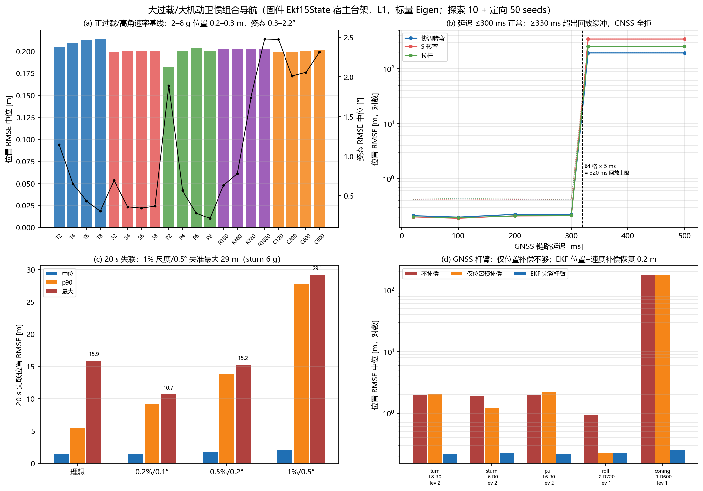

# 大过载/大机动卫惯组合导航（2026-10-26）

**证据等级：L1（真实固件 `Ekf15State` 宿主台架 + 解析高动态轨迹 + 传感器误差模型；不是 SIL/HIL/实机）**

## 1. 结论摘要

1. **正过载包线内导航精度好**：2–8 g 协调转弯、S 转弯、纯正拉杆（80/150 m/s）、连续滚转 180–1080°/s、圆锥 120–900°/s，GNSS 10 Hz/20 ms 延迟、理想 IMU 时，位置 RMSE 中位 **0.20–0.25 m**、姿态 0.3–2.2°，NEES 0.5–0.7；10 seeds 探索 + 50 seeds 定向均无发散。
2. **硬边界一：传感器量程**。IMU 配置 ±8 g/±2000 dps；9/10/12 g 指令使加速度计饱和，EKF 位置 RMSE 139–391 m、226–244/399 帧 GNSS 被拒。**>8 g 不是算法能修的，必须换 ±16 g 以上 IMU 或限制机动**。
3. **硬边界二：GNSS 延迟回放缓冲 320 ms**。延迟 ≤300 ms 正常（0.22 m）；≥330 ms 超出 `BUFFER_SIZE=64 × 5 ms`，`GetDelayedSnapshotIndexByAge` 返回最旧快照但量测仍按旧时标，**399/399 帧全拒**，位置 244–296 m。500 ms 与 330 ms 同结果。
4. **20 s GNSS 失联**（50 seeds/组）：理想 IMU 位置 RMSE 中位 1.57 m / p90 5.50 / max 8.63 m、姿态 max 7.14°；1% 加计尺度 + 0.5° 失准中位 2.61 / p90 28.17 / max 29.84 m（S 转弯 6 g 尾部 104.4 m），姿态 max 10.16°（圆锥 600°/s）。5 s 失联位置 <0.6 m。量级远小于 SIL 闭环的失联漂移（无控制/无光流），但仍是纯惯导边界。
5. **负 g 是姿态可观测性边界**：正负 g 交替（`negg`）20 ms 延迟时姿态峰 7.7°、位置仍 0.4 m；20 s 失联姿态 7.14°。无磁时加速度计无法区分“正 g 倒飞”和“负 g 正飞”，不能承诺大负 g 姿态可靠。
6. **固件改进（已实现）：GNSS 杆臂补偿**。高角速率下天线位置/速度与 IMU 不同；50 seeds 不补偿时 8 g 转弯 + 2 m 杆臂位置中位/最大 2.00/2.71 m、10-seed 速度 1.96 m/s、NEES_pos 62、NEES_vel 171；仅位置预补偿 2.01/2.95 m、速度 1.96 m/s；**EKF 位置+速度完整杆臂补偿 0.25/0.96 m、速度 0.07 m/s、NEES 0.86/0.17**。圆锥 600°/s + 1 m 杆臂 50 seeds 从 **309.4 m 修回 0.26 m（max 2.73）**。新增运行时参数 `gnss_lever_x/y/z`（默认 0，不改旧行为）。



## 2. 台架与矩阵

### 2.1 台架

`TandemVec_FCS/test_host/test_ekf_high_dynamic.cpp`（直接链接固件 `lib/navigation-main/src/ekf_15_state.h`）：

- **真值**：2 kHz 积分 q/v/LLA；比力方程 `a^n=C_b^n f^b+g^n−(2ω_ie+ω_en)×v^n`，重力用 WGS-84 `normalgravity_mps2`，地球自转/运输率用 `earthrate/navrate`，与 EKF 同式。
- **IMU**：400 Hz、200 Hz 导航；双子样 `TimeUpdateTwoSample` 或单子样 `TimeUpdate`；ICM-42688 量级噪声、常值零偏、尺度因子、安装失准、80 Hz 振动、±8 g/±2000 dps 饱和。
- **GNSS**：10 Hz、可配延迟/位置速度噪声/失联/杆臂；量测在天线处，已实现天线位置 `p+C_b^n r` 与速度 `v+C_b^n(ω×r)` 注入；`--lever-comp 2` 让 EKF 内部补偿。
- **轨迹**：协调转弯（恒定 bank/load）、S 转弯（bank 反转）、纯正拉杆（1→load→1 g）、负 g 专项、连续滚转、圆锥。
- **指标**：位置/速度/姿态 RMSE 与 max、NEES_pos/vel（`EKF_HOST_REGRESSION`，3×3 P 求逆）、融合/拒绝帧数；t>10 s 统计。

### 2.2 矩阵

`sim/run_high_dynamic_mc.py` 探索矩阵 **1420 次运行（10 seeds/组）**；`sim/run_high_dynamic_validate.py` 定向验证 **4250 次（50 seeds/组）**（正过载/滚转/圆锥/负 g/失联/尺度失准/杆臂/饱和）；`sim/run_lever_ab.py` **150 次**杆臂 A/B（10 seeds）。

| 组 | 范围 |
|---|---|
| 正过载 | turn/sturn/pull 2/4/6/8 g × 80/150 m/s |
| 连续滚转 | 2/4 g × 180/360/720/1080°/s |
| 圆锥 | 120/300/600/900°/s |
| 负 g | 2/4/6 g 正负交替 |
| 失联 | 5 s / 20 s |
| IMU 误差 | 理想 / 0.2%+0.1° / 0.5%+0.2% / 1%+0.5° |
| GNSS 延迟 | 20/100/200/300/330/500 ms |
| 杆臂 | 0.5/1/2 m，0=不补偿 / 1=仅位置 / 2=EKF 完整 |
| 振动 | 1/2 g @80 Hz |
| 饱和 | 9/10/12 g（±8 g 量程） |

## 3. 正过载/高角速率基线

理想 IMU、GNSS 10 Hz/20 ms、无失联、10/50 seeds，位置/姿态 RMSE 中位：

| 机动 | 位置 RMSE | 姿态 RMSE | 备注 |
|---|---:|---:|---|
| 协调转弯 2–8 g | 0.20–0.23 m | 0.3–0.9° | 8 g bank 82.8° |
| S 转弯 2–8 g | 0.20–0.22 m | 0.4–1.2° | 8 s 反转 |
| 纯正拉杆 2–8 g | 0.20–0.21 m | 0.2–0.8° | 不进入负 g |
| 连续滚转 180–1080°/s | 0.20 m | 0.6–2.5° | 2–4 g |
| 圆锥 120–900°/s | 0.20 m | 2.2–3.6° | 1 g |
| 负 g 2–6 g | 0.20 m | 1.4–7.7°（max） | 姿态二义性 |

**说明**：正过载 8 g 时加速度已在 ±8 g 量程边缘，噪声可使个别样本饱和；9 g 起系统性饱和，见 §5。连续滚转/圆锥的姿态误差大于转弯，主要来自高角速率下的陀螺尺度/失准与圆锥残差；位置仍由 GNSS 约束在 0.2 m。

## 4. 失联与 IMU 尺度/失准

### 4.1 20 s 失联

| IMU 误差档（50 seeds/组，350 例/档） | 位置 RMSE 中位/p90/max [m] | 姿态 RMSE 中位/p90/max [°] |
|---|---:|---:|
| 理想 | 1.57 / 5.50 / 8.63 | 0.64 / 4.10 / 7.14 |
| 0.2% / 0.1° | 1.62 / 9.57 / 11.54 | 0.74 / 2.99 / 7.25 |
| 0.5% / 0.2° | 1.91 / 14.23 / 16.04 | 1.04 / 3.28 / 7.35 |
| 1% / 0.5° | 2.61 / 28.17 / 29.84 | 2.34 / 8.53 / 10.16 |

分机动（1% 档，50 seeds）：S 转弯 6 g 位置中位/p90/max **28.45/29.28/104.38 m**、姿态 2.36°；纯正拉杆 6 g 3.49/5.82/24.77 m；负 g 4 g 2.66/3.84/19.95 m、姿态 7.68°；圆锥 600°/s 5.43/6.72/26.15 m、姿态 10.16°；连续滚转 720°/s 0.84/1.28/7.89 m、姿态 5.33°；协调转弯 1.60/3.03/22.15 m。5 s 失联全档位置 <0.6 m。

### 4.2 解释

- 20 s 纯惯导的位置误差由**加计尺度/失准 × 持续比力**主导（S 转弯持续横向比力最大），陀螺尺度/失准决定姿态漂移；1% 尺度属低端 MEMS 未标定水平，不能外推已标定实机。
- 台架没有光流/气压/磁，也没有控制闭环；这些数字是**导航-only 上界**，不是 SIL 闭环失败率。
- 负 g 档的姿态峰来自重力方向二义性；有磁/已知姿态时可消歧，无磁运动 EKF 不能承诺。

## 5. 硬边界

### 5.1 传感器饱和（±8 g / ±2000 dps）

| 指令 | 位置 RMSE 中位 [m] | GNSS 拒绝帧（中位） | 说明 |
|---|---:|---:|---|
| 8 g | 0.20 | 0 | 量程边缘 |
| 9 g | 139–196 | 226–228 | 加计饱和 |
| 10 g | 332–391 | 243–244 | 加计饱和 |
| 12 g | — | — | 饱和更深 |

**不是算法问题**：ICM42688 配置 ±8 g（`sensor_imu.cpp`），EKF 的 `MAX_PLAUSIBLE_ACCEL_MPS2=120`（12.2 g）只是坏帧门限；饱和样本本身丢失加速度，任何滤波都无法恢复。要飞 >8 g 必须换量程/减振/限幅。

### 5.2 GNSS 延迟 >320 ms

| 延迟 | 位置 RMSE 中位 [m] | 拒绝帧（中位） |
|---|---:|---:|
| 20–300 ms | 0.19–0.22 | 0–3 |
| 330 ms | 244 | 399/399 |
| 500 ms | 244 | 399/399 |

`BUFFER_SIZE=64`、导航 200 Hz → 320 ms；`GetDelayedSnapshotIndexByAge` 在超窗时返回最旧快照，但量测仍按真实旧时标，回放错位，NIS 全拒。**≤300 ms 可用；≥330 ms 必须拒绝/降级或扩缓冲，不能当“补偿有效”。**

### 5.3 负 g / 倒飞

正负 g 交替使加速度计比力反向，单靠重力无法区分正飞/倒飞；无磁时姿态可能翻到等价分支（本台架姿态峰 7.7°，未触发位置发散；SIL 闭环可能更差）。**无磁运动 EKF 不承诺倒飞/大负 g；需磁/已知姿态或限制负 g。**

## 6. 固件优化：GNSS 杆臂补偿（已实现）

### 6.1 问题

GNSS 天线通常不在 IMU 处。高角速率下：
- 天线位置 `p_ant = p_imu + C_b^n r`；
- 天线速度 `v_ant = v_imu + C_b^n(ω×r)`。

原固件没有杆臂参数（`grep lever` 无实现），把天线量测当 IMU：8 g 转弯 + 2 m 杆臂 50 seeds 位置中位 2.00 m（10-seed 速度 1.96 m/s、NEES_pos/vel **62/171**，P 严重过度自信）。圆锥 600°/s + 1 m 杆臂更极端：50 seeds 位置中位 **309.4 m**、10-seed 速度 24 m/s。

### 6.2 实现

- `Ekf15State::gnss_lever_arm_body_m(Eigen::Vector3f)`（默认 0）。
- 在 `MeasurementUpdateDetailed` 中，**先回溯到量测时刻快照**，用该时刻的 `t_b2ned` 与 `gyro_input−b_g`：
  - 位置新息减去 `t_b2ned·r`；
  - 速度新息减去 `t_b2ned·((ω−b_g)×r)`。
- 运行时参数 `gnss_lever_x/y/z`（机体系 [m]，默认 0）加入 `FlightCtrlParams`、`ano_params` 注册表（ID 131–133）、GCS `expected_names`/元数据；导航初始化写入 EKF。
- 宿主回归 `test_host/run_all.sh` 增加 highdyn 杆臂门：8 g/2 m 杆臂补偿后必须 <1 m，关闭补偿必须 >1 m。

### 6.3 A/B（同二进制；位置 50 seeds，速度/NEES 10 seeds）

下表位置为 **50 seeds 中位/最大**；速度与 NEES 为 10 seeds 同二进制 A/B（括号内）。

| 机动/杆臂 | 不补偿 | 仅位置预补偿 | EKF 完整杆臂 |
|---|---|---|---|
| 协调转弯 8 g / 2 m | 2.00/2.71 m（v 1.96，NEES 62/171） | 2.01/2.95 m（v 1.96，NEES 62/171） | **0.25/0.96 m（v 0.07，NEES 0.86/0.17）** |
| S 转弯 6 g / 2 m | 2.00/2.49 m（v 1.04，NEES 87/57） | 1.22/2.28 m（v 1.04，NEES 25/57） | **0.24/1.01 m（v 0.07，NEES 0.99/0.18）** |
| 纯正拉杆 6 g / 2 m | 1.99/2.61 m（v 0.74，NEES 60/17） | 2.12/3.20 m（v 0.74，NEES 65/17） | **0.26/0.96 m（v 0.07，NEES 0.85/0.21）** |
| 连续滚转 720°/s / 1 m | 1.03/1.51 m（NEES 23） | 0.25/0.95 m（NEES 0.91） | **0.25/0.95 m（NEES 0.91）** |
| 圆锥 600°/s / 1 m | **309.4/1301.8 m（v 24.3，NEES 28/1.4）** | 295.7/1295.5 m（v 19.6，NEES 0/0） | **0.26/2.73 m（v 0.17，NEES 1.03/1.25）** |

**结论**：仅位置预补偿不够——速度杆臂在高角速率/圆锥下是主项；必须在 EKF 量测模型里同时做位置+速度补偿，并用**量测时刻的延迟姿态**，否则当前姿态在 20 ms/720°/s 下已有 14° 残差。默认参数 0 时行为与旧固件一致。

## 7. 验证与边界

- **2026-10-27 追加**：6DOF 导弹 SIL（`导弹6DOF-导航SIL-2026-10-27.md`）在 6.4 g/451 m/s 弹道发现并修复 AHRS 重力方向缺陷——GNSS 10 Hz 帧间 AHRS 持续把无坡度转弯的升力当重力，姿态 RMSE 6.6–7.6°；`ins_ahrs_gravity_gate.h`（默认启用、VTOL 15°/1.5 g 包线内例外）降到 0.57–1.31°，速度 0.49→0.16 m/s，位置不变。本报告的宿主台架结论仍是 EKF 本体口径；SIL 端到端见新报告。
- `test_host/run_all.sh` 全绿（含 highdyn 杆臂门，标量 Eigen）；PIO `TandemVec_FCS/CoaxialVTVL/test` 三环境 SUCCESS；GCS 35 项 pytest 通过；`check-code-comments` 无 error；链接检查通过。
- 默认 SIL（不含杆臂参数，0）重建后 seed1 `mag_clean --pos-hold --flow` 仍为 pos_rms 0.834/hold 12.035/max_roll 11.919，行为不变。
- **宿主 Eigen 口径（必须）**：高动态台架必须用 `-DEIGEN_DONT_VECTORIZE -DEIGEN_DONT_PARALLELIZE` 编译，与固件（Cortex-M7 标量）和 SIL 默认口径一致。实测同一源码向量化构建在 20 s 失联 + 杆臂表达式下会从 0.84 m 伪发散到 **750 m**，标量构建恢复；该差异不是固件行为。所有本报告数字均为标量构建。

**L1 边界**：解析轨迹不是飞行动力学/气动；无磁、无光流/气压辅助；50 seeds 只给方向与尾部；IMU 误差档为假设，实机需标定；杆臂需实测安装位置，符号/坐标必须按机体系填写。
- **未完成**：延迟超 320 ms 的守卫/扩缓冲；IMU 尺度/失准在线估计；负 g/磁融合；SIL 端到端杆臂注入（当前仅宿主 EKF）；实机杆臂标定与飞行验证。

## 8. 复现

```bash
# 编译台架（宿主，直接链接固件 EKF）
g++ -std=c++17 -O2 -DEKF_HOST_REGRESSION -D_USE_MATH_DEFINES \
  -Ilib/navigation-main/src -Ilib/units/src -Ilib/eigen/src -Iinclude -Isrc \
  test_host/test_ekf_high_dynamic.cpp \
  lib/units/src/convang.cpp lib/units/src/convangacc.cpp lib/units/src/convangvel.cpp \
  -o /tmp/highdyn.exe

# 单例
/tmp/highdyn.exe --profile turn --load 8 --speed 80 --duration 30 \
  --latency-ms 20 --lever-m 2 --lever-comp 2 --seed 1 --json

# 矩阵 / 杆臂 A/B / 作图
HIGHDYN_EXE=/tmp/highdyn.exe py -3.12 sim/run_high_dynamic_mc.py
HIGHDYN_EXE=/tmp/highdyn.exe py -3.12 sim/run_lever_ab.py
py -3.12 sim/plot_high_dynamic.py
```

证据：`sim-data/high-dyn-mc-2026-10-26-v2-scalar.{json,jsonl}`（1420 次）、`sim-data/high-dyn-validate-2026-10-26-scalar.{json,jsonl}`（4250 次，50 seeds）、`sim-data/high-dyn-lever-ab-2026-10-26.{json,jsonl}`（150 次，标量）、`figs/nav_high_dynamic_2026-10-26.png`。向量化构建的 v2/lever 数据保留为 `*-vectorized.*` 仅作反例；旧版 v1（pull 含负 g）保留为 `*_v1_negativepull.*`，本文不使用其 pull/lever 数字。
