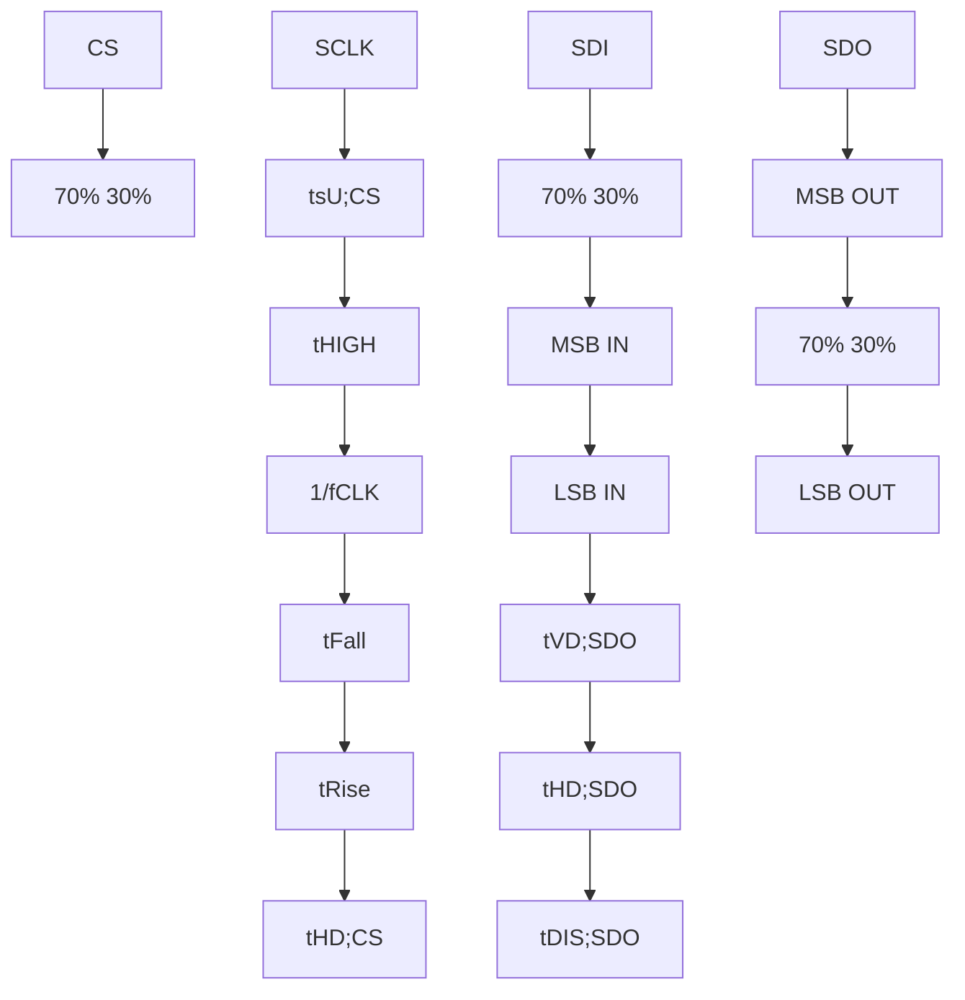
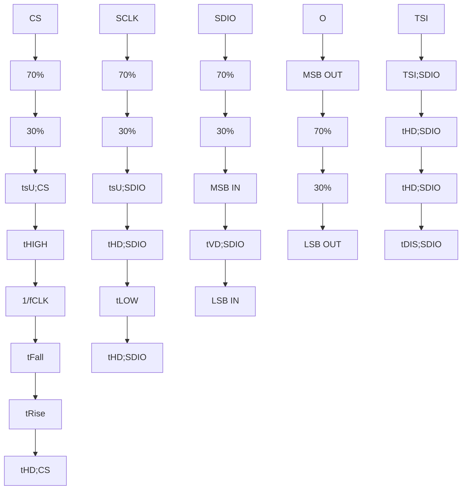
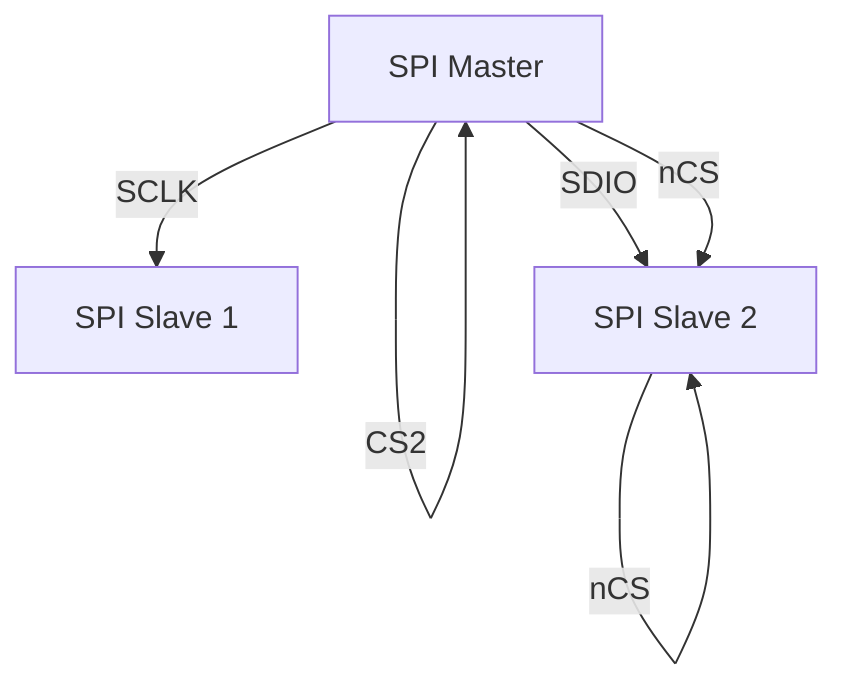

# ICM-45686 HIGHLIGHTS

The ICM-45686 is a high-performance dual interface (UI + AUX) 6-axis MEMS MotionTracking device. It has a configurable host interface that supports I3CSM, I2C and SPI serial communication, and an AUX interface that supports SPI slave mode for connection to OIS controllers or I2C master mode for connection to external sensors. The device features up to 8Kbytes FIFO and 2 programmable interrupts.

The ICM-45686 supports the lowest gyro and accel sensor noise in this IMU class, and has the highest stability against temperature, shock (up to 20,000g) or SMT/bend induced offset as well as immunity against out-of-band vibration induced noise. Other industryleading features include InvenSense on-chip APEX Motion Processing engine for gesture recognition, activity classification, and pedometer, along with programmable digital filters, and an embedded temperature sensor.

# FEATURES

Gyroscope Noise: 3.8 mdps/Hz & Accelerometer Noise: 70 µg/Hz
o Low-Noise mode 6-axis current consumption of 0.42 mA at 1600Hz
User selectable Gyro Full-scale range (dps): ±15.625/31.25/62.5/125/250/500/1000/2000 /4000
User selectable Accelerometer Full-scale range (g): ±2/4/8/16/32
User configurable internal pull-up/pull-downs included on I/O interfaces to reduce system costs associated with external pull-ups/pulldowns
User configurable Output Data Rate (ODR) and FIFO Data Rate (FDR)
User-programmable digital filters for gyro, accel, and temp sensor
• APEX Motion Functions:

o Pedometer, Tilt Detection, Single/Double Tap Detection, Raise to Wake, Wake on Motion

o Free-Fall Detection, Significant Motion Detection, Low-G Detection, High-G Detection

Host interface: 12.9 MHz I3CSM, 1 MHz I2C, 24 MHz SPI

# APPLICATIONS

Head Mounted Displays; AR/VR Controllers; Wearables; IoT Applications

BLOCK DIAGRAM

flowchart

ORDERING INFORMATION

<table><tr><td>PART</td><td>TEMP RANGE</td><td>PACKAGE</td></tr><tr><td>ICM-45686†</td><td>-40°C to +85°C</td><td>2.5x3mm14-Pin LGA</td></tr></table>

†Denotes RoHS and Green-Compliant Package

# TABLE OF CONTENTS

ICM-45686 Highlights

Features...

Applications ....

Block Diagram..

Ordering Information

1 Introduction...... .. 15

1.1 Purpose and Scope . .15

1.2 Product Overview . .15

1.3 Applications . .15

2 Features ...... .... 16

2.1 Gyroscope Features . .16

2.2 Accelerometer Features . .16

2.3 Motion Features . .16

2.4 Additional Features..... .17

3 Electrical Characteristics.. . 18

3.1 Gyroscope Specifications .... .. 18

3.2 Accelerometer Specifications ..... .19

3.3 Electrical Specifications . .20

3.4 I2C Timing Characterization .... .22

3.5 SPI Timing Characterization – 4-Wire SPI Mode .. .. 24

3.6 SPI Timing Characterization – 3-Wire SPI Mode . . 25

3.7 Absolute Maximum Ratings ..... .. 26

4 Applications Information.. .27

4.1 Pin Out Diagram and Signal Description ...... .27

4.2 Typical Operating Circuit (Dual Interface OIS Mode).. .. 31

4.3 Typical Operating Circuit (Dual Interface I2C Master Mode) . . 32

4.4 Typical Operating Circuit (Single Interface Mode). .. 33

4.5 Bill of Materials for External Components.... ..34

4.6 System Block Diagram .... .. 35

4.7 Overview.. .35

4.8 Three-Axis MEMS Gyroscope with 16-bit ADCs and Signal Conditioning .. .. 36

4.9 Three-Axis MEMS Accelerometer with 16-bit ADCs and Signal Conditioning . .. 36

4.10 I3CSM, I2C and SPI Host Interface . .36

4.11 I2C Master Interface for Connection To External Sensors ..... .. 36

4.12 SPI Auxiliary Interface for Connection to OIS Controllers ..... .. 36

4.13 Self-Test .... ..37

4.14 Clocking ........ ..37
4.15 Sensor Data Registers..... ..37
4.16 Interrupts.. . 37
4.17 Digital-Output Temperature Sensor.. .37
4.18 Bias and LDOs . . 37
4.19 Charge Pump .. . 38
4.20 Standard Power Modes .. .38
5 FIFO.... .. 39
5.1 Packet Structure . ..39
5.2 FIFO Header .... ..40
6 Programmable Interrupts .... ..42
7 EDMP . .... 43
8 APEX Motion Functions ...... ..44
9 Digital Interface ........ ...... 45
9.1 I3CSM, I2C and SPI Serial Interfaces ...... ... 45
9.2 I3CSM Interface .... ..45
9.3 I2C Interface ..... ..48
9.4 I2C Master Interface ... ..48
9.5 SPI Interface. .49
10 Assembly..... .. 50
10.1 Orientation of Axes ... .. 50
10.2 Package Dimensions.. . 51
11 Device Package In Tape And Reel .. . 53
12 Part Number Package Marking...... .54
13 Indirect Register Access..... . 55
13.1 Host Indirect Access Register (IREG) . . 55
13.2 General Rules for Accessing IREG.. . 55
13.3 Minimum Wait Time-Gap ..... .55
13.4 IREG Write . . 55
13.5 IREG READ . .56
14 Device Configuration for Data Endianness ...... . 57
15 Register Map .. .58
15.1 User Bank 0 Register Map ... .58
15.2 User Bank IMEM\_SRAM Register Map... .. 60
15.3 User Bank IPREG\_BAR Register Map ..... .. 63
15.4 User Bank IPREG\_TOP1 Register Map ..... .. 63
15.5 User Bank IPREG\_SYS1 Register Map . ..65

15.6 User Bank IPREG\_SYS2 Register Map ... .... 66

16 User Bank 0 Register Map – Descriptions...... .. 67

16.1 ACCEL\_DATA\_X1\_UI . ..67

16.2 ACCEL\_DATA\_X0\_UI . ..67

16.3 ACCEL\_DATA\_Y1\_UI . ..67

16.4 ACCEL\_DATA\_Y0\_UI . .. 67

16.5 ACCEL\_DATA\_Z1\_UI . ..67

16.6 ACCEL\_DATA\_Z0\_UI . .. 68

16.7 GYRO\_DATA\_X1\_UI . .. 68

16.8 GYRO\_DATA\_X0\_UI .. .. 68

16.9 GYRO\_DATA\_Y1\_UI . .. 68

16.10 GYRO\_DATA\_Y0\_UI . .. 68

16.11 GYRO\_DATA\_Z1\_UI . ..69

16.12 GYRO\_DATA\_Z0\_UI ... .. 69

16.13 TEMP\_DATA1\_UI .. ..69

16.14 TEMP\_DATA0\_UI .... .. 69

16.15 TMST\_FSYNCH .. .. 70

16.16 TMST\_FSYNCL. ..70

16.17 PWR\_MGMT0. .. 70

16.18 FIFO\_COUNT\_0... ..71

16.19 FIFO\_COUNT\_1. ..71

16.20 FIFO\_DATA.. .. 71

16.21 INT1\_CONFIG0.. ..72

16.22 INT1\_CONFIG1. ..74

16.23 INT1\_CONFIG2.. .. 75

16.24 INT1\_STATUS0. .. 76

16.25 INT1\_STATUS1. ..77

16.26 ACCEL\_CONFIG0 . ..78

16.27 GYRO\_CONFIG0. .. 79

16.28 FIFO\_CONFIG0. ..80

16.29 FIFO\_CONFIG1\_0. .. 80

16.30 FIFO\_CONFIG1\_1.. .. 81

16.31 FIFO\_CONFIG2. ..81

16.32 FIFO\_CONFIG3. .82

16.33 FIFO\_CONFIG4.. .. 83

16.34 TMST\_WOM\_CONFIG... ..84

16.35 FSYNC\_CONFIG0. .85

16.36 FSYNC\_CONFIG1.. .. 85

16.37 RTC\_CONFIG... .. 86

16.38 DMP\_EXT\_SEN\_ODR\_CFG . .. 86

16.39 ODR\_DECIMATE\_CONFIG. .. 87

16.40 EDMP\_APEX\_EN0 .. .. 88

16.41 EDMP\_APEX\_EN1 . .. 88

16.42 APEX\_BUFFER\_MGMT.. .. 89

16.43 INTF\_CONFIG0... .. 90

16.44 INTF\_CONFIG1\_OVRD . ..91

16.45 INTF\_AUX\_CONFIG... .. 91

16.46 IOC\_PAD\_SCENARIO. .. 92

16.47 IOC\_PAD\_SCENARIO\_AUX\_OVRD . .. 92

16.48 DRIVE\_CONFIG0 . ..93

16.49 DRIVE\_CONFIG1 . .. 94

16.50 DRIVE\_CONFIG2 . .94

16.51 REG\_MISC1. . 95

16.52 INT\_APEX\_CONFIG0 . . 95

16.53 INT\_APEX\_CONFIG1 . .. 96

16.54 INT\_APEX\_STATUS0.. .. 97

16.55 INT\_APEX\_STATUS1.. .97

16.56 ACCEL\_DATA\_X1\_AUX1. .. 98

16.57 ACCEL\_DATA\_X0\_AUX1. .. 98

16.58 ACCEL\_DATA\_Y1\_AUX1. .. 98

16.59 ACCEL\_DATA\_Y0\_AUX1. ..98

16.60 ACCEL\_DATA\_Z1\_AUX1. .. 98

16.61 ACCEL\_DATA\_Z0\_AUX1.. .. 99

16.62 GYRO\_DATA\_X1\_AUX1.. .. 99

16.63 GYRO\_DATA\_X0\_AUX1.. ..99

16.64 GYRO\_DATA\_Y1\_AUX1. . 99

16.65 GYRO\_DATA\_Y0\_AUX1.. .. 99

16.66 GYRO\_DATA\_Z1\_AUX1.. ..100

16.67 GYRO\_DATA\_Z0\_AUX1. .100

16.68 TEMP\_DATA1\_AUX1. ..100

16.69 TEMP\_DATA0\_AUX1. ..100

16.70 TMST\_FSYNCH\_AUX1 . .100

16.71 TMST\_FSYNCL\_AUX1.... .101

16.72 PWR\_MGMT\_AUX1.. ..101

16.73 FS\_SEL\_AUX1. ..101
16.74 INT2\_CONFIG0.. .102
16.75 INT2\_CONFIG1.. ..104
16.76 INT2\_CONFIG2.. ..105
16.77 INT2\_STATUS0... ..106
16.78 INT2\_STATUS1. ..107
16.79 WHO\_AM\_I ... .107
16.80 REG\_HOST\_MSG... .. 108
16.81 IREG\_ADDR\_15\_8... .108
16.82 IREG\_ADDR\_7\_0... .108
16.83 IREG\_DATA ... ..108
16.84 REG\_MISC2. .109

17 User Bank IMEM\_SRAM Register Map – Descriptions ....... ....110

17.1 IMEM\_SRAM\_REG\_0... .110

17.2 IMEM\_SRAM\_REG\_1... .110

17.3 IMEM\_SRAM\_REG\_2... .110

17.4 IMEM\_SRAM\_REG\_3.... .110

17.5 IMEM\_SRAM\_REG\_4.. .111

17.6 IMEM\_SRAM\_REG\_5... .111

17.7 IMEM\_SRAM\_REG\_6... .111

17.8 IMEM\_SRAM\_REG\_7... .111

17.9 IMEM\_SRAM\_REG\_8.. .112

17.10 IMEM\_SRAM\_REG\_9... .112

17.11 IMEM\_SRAM\_REG\_10... .112

17.12 IMEM\_SRAM\_REG\_11. .112

17.13 IMEM\_SRAM\_REG\_56. .113

17.14 IMEM\_SRAM\_REG\_57.... .113

17.15 IMEM\_SRAM\_REG\_64... .114

17.16 IMEM\_SRAM\_REG\_68. .114

17.17 IMEM\_SRAM\_REG\_92. .115

17.18 IMEM\_SRAM\_REG\_96.. .115

17.19 IMEM\_SRAM\_REG\_97. .115

17.20 IMEM\_SRAM\_REG\_98.. .115

17.21 IMEM\_SRAM\_REG\_99.. ..116

17.22 IMEM\_SRAM\_REG\_100.. .116

17.23 IMEM\_SRAM\_REG\_101. .116

17.24 IMEM\_SRAM\_REG\_102.. ..116

17.25 IMEM\_SRAM\_REG\_103.. ..116

17.26 IMEM\_SRAM\_REG\_104.. .117

17.27 IMEM\_SRAM\_REG\_105.. .117

17.28 IMEM\_SRAM\_REG\_106.. .117

17.29 IMEM\_SRAM\_REG\_107.. .117

17.30 IMEM\_SRAM\_REG\_136.. ..118

17.31 IMEM\_SRAM\_REG\_137.. .118

17.32 IMEM\_SRAM\_REG\_138.. .118

17.33 IMEM\_SRAM\_REG\_139. .118

17.34 IMEM\_SRAM\_REG\_141. .119

17.35 IMEM\_SRAM\_REG\_142.. .119

17.36 IMEM\_SRAM\_REG\_143.. .119

17.37 IMEM\_SRAM\_REG\_144.. .119

17.38 IMEM\_SRAM\_REG\_146.. ..120

17.39 IMEM\_SRAM\_REG\_154.. .120

17.40 IMEM\_SRAM\_REG\_155.. .120

17.41 IMEM\_SRAM\_REG\_156.. .120

17.42 IMEM\_SRAM\_REG\_157.. .121

17.43 IMEM\_SRAM\_REG\_159.. .121

17.44 IMEM\_SRAM\_REG\_160.. .121

17.45 IMEM\_SRAM\_REG\_182. .121

17.46 IMEM\_SRAM\_REG\_185.. .122

17.47 IMEM\_SRAM\_REG\_186.. .122

17.48 IMEM\_SRAM\_REG\_196.. .122

17.49 IMEM\_SRAM\_REG\_197.. .122

17.50 IMEM\_SRAM\_REG\_198.. .123

17.51 IMEM\_SRAM\_REG\_199. .123

17.52 IMEM\_SRAM\_REG\_288.. .123

17.53 IMEM\_SRAM\_REG\_289. .124

17.54 IMEM\_SRAM\_REG\_290.. .124

17.55 IMEM\_SRAM\_REG\_291. .124

17.56 IMEM\_SRAM\_REG\_292. .124

17.57 IMEM\_SRAM\_REG\_293.. .125

17.58 IMEM\_SRAM\_REG\_294.. .125

17.59 IMEM\_SRAM\_REG\_295. .125

17.60 IMEM\_SRAM\_REG\_296.. .125

17.61 IMEM\_SRAM\_REG\_297.. ..126

17.62 IMEM\_SRAM\_REG\_298.. ..126

17.63 IMEM\_SRAM\_REG\_299. .126

17.64 IMEM\_SRAM\_REG\_304.. .127

17.65 IMEM\_SRAM\_REG\_305. .127

17.66 IMEM\_SRAM\_REG\_306.. .127

17.67 IMEM\_SRAM\_REG\_307.. .127

17.68 IMEM\_SRAM\_REG\_308.. .128

17.69 IMEM\_SRAM\_REG\_309. .128

17.70 IMEM\_SRAM\_REG\_316.. .128

17.71 IMEM\_SRAM\_REG\_317. .128

17.72 IMEM\_SRAM\_REG\_318.. .129

17.73 IMEM\_SRAM\_REG\_319.. .129

17.74 IMEM\_SRAM\_REG\_320.. .129

17.75 IMEM\_SRAM\_REG\_321. .129

17.76 IMEM\_SRAM\_REG\_392. .130

17.77 IMEM\_SRAM\_REG\_393.. .130

17.78 IMEM\_SRAM\_REG\_400.. ..130

17.79 IMEM\_SRAM\_REG\_401. .131

17.80 IMEM\_SRAM\_REG\_402. .131

17.81 IMEM\_SRAM\_REG\_403.. .131

17.82 IMEM\_SRAM\_REG\_404.. .132

17.83 IMEM\_SRAM\_REG\_405. .132

17.84 IMEM\_SRAM\_REG\_406.. .132

17.85 IMEM\_SRAM\_REG\_540.. .133

17.86 IMEM\_SRAM\_REG\_541. .133

17.87 IMEM\_SRAM\_REG\_542. .133

17.88 IMEM\_SRAM\_REG\_543.. .134

17.89 IMEM\_SRAM\_REG\_544.. .134

17.90 IMEM\_SRAM\_REG\_545. .134

17.91 IMEM\_SRAM\_REG\_546.. .135

17.92 IMEM\_SRAM\_REG\_547.. .135

17.93 IMEM\_SRAM\_REG\_548.. .135

17.94 IMEM\_SRAM\_REG\_549. .136

17.95 IMEM\_SRAM\_REG\_550.. .136

17.96 IMEM\_SRAM\_REG\_551. .136

17.97 IMEM\_SRAM\_REG\_556.. .137

17.98 IMEM\_SRAM\_REG\_557.. .137

17.99 IMEM\_SRAM\_REG\_558.. ..137

17.100 IMEM\_SRAM\_REG\_559 . .138

17.101 IMEM\_SRAM\_REG\_560 .138

17.102 IMEM\_SRAM\_REG\_561 .138

17.103 IMEM\_SRAM\_REG\_562 .139

17.104 IMEM\_SRAM\_REG\_563 .139

17.105 IMEM\_SRAM\_REG\_564 .139

17.106 IMEM\_SRAM\_REG\_565 .140

17.107 IMEM\_SRAM\_REG\_566 .140

17.108 IMEM\_SRAM\_REG\_567 . .140

17.109 IMEM\_SRAM\_REG\_568 .141

17.110 IMEM\_SRAM\_REG\_569 .141

17.111 IMEM\_SRAM\_REG\_570 .141

17.112 IMEM\_SRAM\_REG\_571 .142

17.113 IMEM\_SRAM\_REG\_572 .142

17.114 IMEM\_SRAM\_REG\_573 .142

17.115 IMEM\_SRAM\_REG\_574 . ..143

17.116 IMEM\_SRAM\_REG\_575 .143

17.117 IMEM\_SRAM\_REG\_576 .143

17.118 IMEM\_SRAM\_REG\_577 .144

17.119 IMEM\_SRAM\_REG\_578 .144

17.120 IMEM\_SRAM\_REG\_579 .144

17.121 IMEM\_SRAM\_REG\_580 .145

17.122 IMEM\_SRAM\_REG\_581 .145

17.123 IMEM\_SRAM\_REG\_582 .145

17.124 IMEM\_SRAM\_REG\_583 .146

17.125 IMEM\_SRAM\_REG\_584 .146

17.126 IMEM\_SRAM\_REG\_585 . .146

17.127 IMEM\_SRAM\_REG\_586 .147

17.128 IMEM\_SRAM\_REG\_587 .147

17.129 IMEM\_SRAM\_REG\_988 .147

17.130 IMEM\_SRAM\_REG\_989 ..148

17.131 IMEM\_SRAM\_REG\_990 .148

17.132 IMEM\_SRAM\_REG\_991 .148

17.133 IMEM\_SRAM\_REG\_994 . .149

17.134 IMEM\_SRAM\_REG\_995 .149

17.135 IMEM\_SRAM\_REG\_1000 .149

17.136 IMEM\_SRAM\_REG\_1001 .. ..150

17.137 IMEM\_SRAM\_REG\_1002 . ..150

17.138 IMEM\_SRAM\_REG\_1003 . ..150

17.139 IMEM\_SRAM\_REG\_1004 .. .151

17.140 IMEM\_SRAM\_REG\_1008 .. .151

17.141 IMEM\_SRAM\_REG\_1009 . ..151

17.142 IMEM\_SRAM\_REG\_1010 .. .152

17.143 IMEM\_SRAM\_REG\_1011 .152

17.144 IMEM\_SRAM\_REG\_1016 .152

17.145 IMEM\_SRAM\_REG\_1017 .153

17.146 IMEM\_SRAM\_REG\_1018 . .153

17.147 IMEM\_SRAM\_REG\_1019 .153

17.148 IMEM\_SRAM\_REG\_1042 .154

17.149 IMEM\_SRAM\_REG\_1168 to IMEM\_SRAM\_REG\_1203 . .. 154

18 User Bank IPREG\_BAR Register Map – Descriptions ...... ..155

18.1 IPREG\_BAR\_REG\_57.. ..155

18.2 IPREG\_BAR\_REG\_58. ..156

18.3 IPREG\_BAR\_REG\_59. .157

18.4 IPREG\_BAR\_REG\_60. .158

18.5 IPREG\_BAR\_REG\_61. .159

18.6 IPREG\_BAR\_REG\_62. ..160

19 User Bank IPREG\_TOP1 Register Map – Descriptions ...... ...161

19.1 I2CM\_COMMAND\_0 ... ..161

19.2 I2CM\_COMMAND\_1 ... .162

19.3 I2CM\_COMMAND\_2 .. .163

19.4 I2CM\_COMMAND\_3 .. .164

19.5 I2CM\_DEV\_PROFILE0 . .165

19.6 I2CM\_DEV\_PROFILE1 . .165

19.7 I2CM\_DEV\_PROFILE2 .. ..165

19.8 I2CM\_DEV\_PROFILE3 . ..165

19.9 I2CM\_CONTROL. .. 166

19.10 I2CM\_STATUS. .166

19.11 I2CM\_EXT\_DEV\_STATUS . .167

19.12 I2CM\_RD\_DATA0.. .167

19.13 I2CM\_RD\_DATA1.. .168

19.14 I2CM\_RD\_DATA2.. .168

19.15 I2CM\_RD\_DATA3.. ..168

19.16 I2CM\_RD\_DATA4.. ..169

19.17 I2CM\_RD\_DATA5.. .169

19.18 I2CM\_RD\_DATA6.. .169

19.19 I2CM\_RD\_DATA7.. .170

19.20 I2CM\_RD\_DATA8.. .170

19.21 I2CM\_RD\_DATA9. .170

19.22 I2CM\_RD\_DATA10.. .171

19.23 I2CM\_RD\_DATA11. .171

19.24 I2CM\_RD\_DATA12.. .171

19.25 I2CM\_RD\_DATA13.. .172

19.26 I2CM\_RD\_DATA14.. .172

19.27 I2CM\_RD\_DATA15.. .172

19.28 I2CM\_RD\_DATA16.... .173

19.29 I2CM\_RD\_DATA17.... .173

19.30 I2CM\_RD\_DATA18.. .173

19.31 I2CM\_RD\_DATA19.. .174

19.32 I2CM\_RD\_STATUS20 .. ..174

19.33 I2CM\_WR\_DATA0.. .174

19.34 I2CM\_WR\_DATA1. .174

19.35 I2CM\_WR\_DATA2.. .175

19.36 I2CM\_WR\_DATA3.. .175

19.37 I2CM\_WR\_DATA4.. .175

19.38 I2CM\_WR\_DATA5.. .175

19.39 SIFS\_IXC\_ERROR\_STATUS. .176

19.40 EDMP\_PRGRM\_IRQ0\_0.. .176

19.41 EDMP\_PRGRM\_IRQ0\_1. .176

19.42 EDMP\_PRGRM\_IRQ1\_0... .177

19.43 EDMP\_PRGRM\_IRQ1\_1.. .177

19.44 EDMP\_PRGRM\_IRQ2\_0. .177

19.45 EDMP\_PRGRM\_IRQ2\_1. .177

19.46 EDMP\_SP\_START\_ADDR. .178

19.47 SMC\_CONTROL\_0. ..178

19.48 SMC\_CONTROL\_1. .179

19.49 STC\_CONFIG . .179

19.50 SREG\_CTRL . .180

19.51 SIFS\_I3C\_STC\_CFG. .180

19.52 INT\_PULSE\_MIN\_ON\_INTF0. .180

19.53 INT\_PULSE\_MIN\_ON\_INTF1.. ..181
19.54 INT\_PULSE\_MIN\_OFF\_INTF0.. .181
19.55 INT\_PULSE\_MIN\_OFF\_INTF1. ..181
19.56 ISR\_0\_7.... .182
19.57 ISR\_8\_15.. .182
19.58 ISR\_16\_23. .183
19.59 STATUS\_MASK\_PIN\_0\_7 .183
19.60 STATUS\_MASK\_PIN\_8\_15 . ..184
19.61 STATUS\_MASK\_PIN\_16\_23 . .185
19.62 INT\_I2CM\_SOURCE. .185
19.63 ACCEL\_WOM\_X\_THR.. ..185
19.64 ACCEL\_WOM\_Y\_THR.. .186
19.65 ACCEL\_WOM\_Z\_THR... .186
19.66 SELFTEST.. .187
19.67 IPREG\_MISC.. .187
19.68 SW\_PLL1\_TRIM... .188
19.69 FIFO\_SRAM\_SLEEP . .188

20 User Bank IPREG\_SYS1 Register Map – Descriptions ..... ...189

20.1 IPREG\_SYS1\_REG\_42 ... ..189

20.2 IPREG\_SYS1\_REG\_43 .... .189

20.3 IPREG\_SYS1\_REG\_56 ... ..189

20.4 IPREG\_SYS1\_REG\_57 ... ..189

20.5 IPREG\_SYS1\_REG\_70 ... ..190

20.6 IPREG\_SYS1\_REG\_71 .... .190

20.7 IPREG\_SYS1\_REG\_166 . .190

20.8 IPREG\_SYS1\_REG\_168 . .190

20.9 IPREG\_SYS1\_REG\_170 . .191

20.10 IPREG\_SYS1\_REG\_171 . .192

20.11 IPREG\_SYS1\_REG\_172 . .192

21 User Bank IPREG\_SYS2 Register Map – Descriptions ..... ..193

21.1 IPREG\_SYS2\_REG\_24 ... ..193

21.2 IPREG\_SYS2\_REG\_25 . .193

21.3 IPREG\_SYS2\_REG\_32 ... ..193

21.4 IPREG\_SYS2\_REG\_33 ... ..193

21.5 IPREG\_SYS2\_REG\_40 ... .194

21.6 IPREG\_SYS2\_REG\_41 .... .194

21.7 IPREG\_SYS2\_REG\_123 . .194

21.8 IPREG\_SYS2\_REG\_129 .. ..195
21.9 IPREG\_SYS2\_REG\_130 . ..195
21.10 IPREG\_SYS2\_REG\_131 . ..196
21.11 IPREG\_SYS2\_REG\_132 .. ..196

22 Reference ..... .197
23 Revision History .... .198

# TABLE OF FIGURES

Figure 1. I2C Bus Timing Diagram...... .23
Figure 2. 4-Wire SPI Bus Timing Diagram ....... ..24
Figure 3. 3-Wire SPI Bus Timing Diagram . .25
Figure 4. Pin Out Diagram for ICM-45686 2.5x3.0x0.81 mm LGA .. .31
Figure 5. ICM-45686 Application Schematic Dual Interface OIS Mode (I3CSM / I2C Interface to Host)... ..31
Figure 6. ICM-45686 Application Schematic Dual Interface OIS Mode (SPI Interface to Host) .. .32
Figure 7. ICM-45686 Application Schematic Dual Interface I2C Master Mode (I3CSM / I2C Interface to Host) ............32
Figure 8. ICM-45686 Application Schematic Dual Interface I2C Master Mode (SPI Interface to Host).. .33
Figure 9. ICM-45686 Application Schematic Single Interface Mode (I3CSM / I2C Interface to Host).. .33
Figure 10. ICM-45686 Application Schematic Single Interface Mode (SPI Interface to Host) .. .34
Figure 11. ICM-45686 System Block Diagram. .35
Figure 12. Typical SPI Master/Slave Configuration......... .49
Figure 13. Orientation of Axes of Sensitivity and Polarity of Rotation .. ..50
Figure 14. ICM-45686 Device Package in Tape and Reel ..... .53
Figure 15. Tape Dimensions with ICM-45686 Device Package ........ .53

# TABLE OF TABLES

Table 1. Gyroscope Specifications . .18
Table 2. Accelerometer Specifications ...... .19
Table 3. D.C. Electrical Characteristics.. ..20
Table 4. A.C. Electrical Characteristics .... .21
Table 5. I2C Host Interface Timing Characteristics.. ..22
Table 6. I2C Master Interface Timing Characteristics..... .22
Table 7. 4-Wire SPI Timing Characteristics ...... ..24
Table 8. 3-Wire SPI Timing Characteristics ..... .25
Table 9. Absolute Maximum Ratings . .26
Table 10. Signal Descriptions ...... ..30
Table 11. Bill of Materials . ..34
Table 12. Standard Power Modes for ICM-45686 ..... ..38
Table 13. I3CSM CCC Commands.. ..48

# 1 INTRODUCTION

# 1.1 PURPOSE AND SCOPE

This document is a product specification, providing a description, specifications, and design related information on the ICM-45686 Dual-Interface MotionTracking device. The device is housed in a small 2.5x3x0.81 mm 14-pin LGA package.

# 1.2 PRODUCT OVERVIEW

The ICM-45686 is a 6-axis MotionTracking device with a main interface for UI and an AUX interface that supports SPI slave mode for connection to OIS controllers or I2C master mode for connection to external sensors. It combines a 3-axis gyroscope, and a 3-axis accelerometer in a small 2.5x3x0.81 mm (14-pin LGA) package. The device supports independent data paths for UI and the auxiliary interface, with independent control for full-scale range (FSR) and output data rate (ODR).

ICM-45686 also features up to 8Kbytes FIFO that can lower the traffic on the serial bus interface, and reduce power consumption by allowing the system processor to burst read sensor data and then go into a low-power mode. ICM-45686, with its 6-axis integration, enables manufacturers to eliminate the costly and complex selection, qualification, and system level integration of discrete devices, guaranteeing optimal motion performance for consumers.

The gyroscope supports eight independently programmable full-scale range settings from ±15.625dps to ±4000dps for the UI path and the auxiliary path, and the accelerometer supports four independently programmable full-scale range settings from ±2g to ±32g for the UI path and the auxiliary path.

Other industry-leading features include on-chip 16-bit ADCs, programmable digital filters, an embedded temperature sensor, and programmable interrupts. The device features I3CSM, I2C and SPI serial interfaces, a VDD operating range of 1.71V to 3.6V, and a separate VDDIO operating range of 1.08V to 3.6V.

The host interface can be configured to support I3CSM slave, I2C slave, or SPI slave modes. The I3CSM interface supports speeds up to 12.9MHz (data rates up to 12.9Mbps in SDR mode, 25.8Mbps in DDR mode), the I2C interface supports speeds up to 1MHz, and the SPI interface supports speeds up to 24MHz.

User configurable internal pull-up/pull-downs are included on I/O interfaces to reduce system costs associated with external pull-ups/pull-downs.

By leveraging its patented and volume-proven CMOS-MEMS fabrication platform, which integrates MEMS wafers with companion CMOS electronics through wafer-level bonding, TDK InvenSense has driven the package size down to a footprint and thickness of 2.5x3x0.81 mm (14-pin LGA), to provide a very small yet high performance low cost package. The device provides high robustness by supporting 20,000g shock reliability.

# 1.3 APPLICATIONS

Head Mounted Displays
AR/VR Controllers
• Wearables
IoT Applications

# 2 FEATURES

# 2.1 GYROSCOPE FEATURES

The triple-axis MEMS gyroscope in the ICM-45686 includes a wide range of features:

Digital-output X-, Y-, and Z-axis angular rate sensors (gyroscopes) with independently programmable fullscale range of ±15.625, ±31.25, ±62.5, ±125, ±250, ±500, ±1000, ±2000 and ±4000 degrees/sec c for UI and auxiliary path
Low Noise (LN) and Low Power (LP) power modes support
Digitally-programmable low-pass filters
Self-test

# 2.2 ACCELEROMETER FEATURES

The triple-axis MEMS accelerometer in ICM-45686 includes a wide range of features:

Digital-output X-, Y-, and Z-axis accelerometer with independently programmable full-scale range of ±2g, ±4g, ±8g, ±16g and ±32g for UI and auxiliary path
Low Noise (LN) and Low Power (LP) power modes support
User-programmable interrupts
Wake-on-motion interrupt for low power operation of applications processor
Self-test

# 2.3 MOTION FEATURES

ICM-45686 includes the following motion features, also known as APEX (Advanced Pedometer and Event Detection – neXt gen)

Pedometer: Tracks Step Count, also issues Step Detect interrupt.
• Tilt Detection: Issues an interrupt when the Tilt angle exceeds 35 for more than a programmable time.
Raise to Wake/Sleep: Gesture detection for wake and sleep events. Interrupt is issued when either of these two events are detected.
• Single Tap / Double Tap Detection: Issues an interrupt when a tap is detected, along with the tap type.
• Wake on Motion: Detects motion when accelerometer data exceeds a programmable threshold.
Freefall Detection: Triggers an interrupt when device freefall is detected and outputs freefall duration.
• Significant Motion Detection: Detects significant motion based on accelerometer data.
Low-G Detection: Triggers an interrupt when absolute value of accelerometer combined axis falls below a programmable threshold and stays below the threshold for a programmable time.
High-G Detection: Triggers an interrupt when absolute value of accelerometer goes above a programmable threshold and stays above the threshold for a programmable time.

# 2.4 ADDITIONAL FEATURES

ICM-45686 includes the following additional features:

External clock input supports highly accurate clock input from 20kHz to 40kHz, helps to reduce system level sensitivity error, improve orientation measurement from gyroscope data, reduce ODR sensitivity to temperature and device to device variation
Up to 8Kbytes FIFO buffer enables the applications processor to read the data in bursts, default FIFO size is 2Kbytes, user can extend it up to 8kByte by disabling APEX functions
EDMP Enhanced Digital Motion Processor for implementing motion algorithms
20-bits data format support in FIFO for high-data resolution
User-programmable digital filters for gyroscope, accelerometer, and temperature sensor
Main interface: 12.9MHz I3CSM (data rates up to 12.9Mbps in SDR mode, 25.8Mbps in DDR mode) / 1 MHz I2C / 24 MHz SPI slave host interface
Auxiliary interface: 400 kHz I2C master
User configurable internal pull-up/pull-downs included on I/O interfaces to reduce system costs associated with external pull-ups/pull-downs
User configurable Output Data Rate (ODR) and FIFO Data Rate (FDR)
Digital-output temperature sensor
• Smallest and thinnest LGA package for portable devices: 2.5x3x0.81 mm (14-pin LGA)
20,000 g shock tolerant
MEMS structure hermetically sealed and bonded at wafer level
RoHS and Green compliant

# 3 ELECTRICAL CHARACTERISTICS

# 3.1 GYROSCOPE SPECIFICATIONS

Typical Operating Circuit of section 4.2, VDD = 1.8 V, VDDIO = 1.8V, TA=25°C, unless otherwise noted.

<table><tr><td>PARAMETER</td><td>CONDITIONS</td><td>MIN</td><td>TYP</td><td>MAX</td><td>UNITS</td><td>NOTES</td></tr><tr><td colspan="7">GYROSCOPE SENSITIVITY</td></tr><tr><td rowspan="9">Full-Scale Range</td><td>GYRO_UI_FS_SEL =0; GYRO_AUX1_FS_SEL =0</td><td></td><td>±4000</td><td></td><td>o/s</td><td>3</td></tr><tr><td>GYRO_UI_FS_SEL =1; GYRO_AUX1_FS_SEL =1</td><td></td><td>±2000</td><td></td><td>o/s</td><td>3</td></tr><tr><td>GYRO_UI_FS_SEL =2; GYRO_AUX1_FS_SEL =2</td><td></td><td>±1000</td><td></td><td>o/s</td><td>3</td></tr><tr><td>GYRO_UI_FS_SEL =3; GYRO_AUX1_FS_SEL =3</td><td></td><td>±500</td><td></td><td>o/s</td><td>3</td></tr><tr><td>GYRO_UI_FS_SEL =4; GYRO_AUX1_FS_SEL =4</td><td></td><td>±250</td><td></td><td>o/s</td><td>3</td></tr><tr><td>GYRO_UI_FS_SEL =5; GYRO_AUX1_FS_SEL =5</td><td></td><td>±125</td><td></td><td>o/s</td><td>3</td></tr><tr><td>GYRO_UI_FS_SEL =6; GYRO_AUX1_FS_SEL =6</td><td></td><td>±62.5</td><td></td><td>o/s</td><td>3</td></tr><tr><td>GYRO_UI_FS_SEL =7; GYRO_AUX1_FS_SEL =7</td><td></td><td>±31.25</td><td></td><td>o/s</td><td>3</td></tr><tr><td>GYRO_UI_FS_SEL =8; GYRO_AUX1_FS_SEL =8</td><td></td><td>±15.625</td><td></td><td>o/s</td><td>3</td></tr><tr><td>Gyroscope ADC Word Length</td><td>Output in two&#x27;s complement format</td><td></td><td>16</td><td></td><td>bits</td><td>3, 6</td></tr><tr><td rowspan="9">Sensitivity Scale Factor</td><td>GYRO_UI_FS_SEL =0; GYRO_AUX1_FS_SEL =0</td><td></td><td>8.2</td><td></td><td>LSB/(o/s)</td><td>3</td></tr><tr><td>GYRO_UI_FS_SEL =1; GYRO_AUX1_FS_SEL =1</td><td></td><td>16.4</td><td></td><td>LSB/(o/s)</td><td>3</td></tr><tr><td>GYRO_UI_FS_SEL =2; GYRO_AUX1_FS_SEL =2</td><td></td><td>32.8</td><td></td><td>LSB/(o/s)</td><td>3</td></tr><tr><td>GYRO_UI_FS_SEL =3; GYRO_AUX1_FS_SEL =3</td><td></td><td>65.5</td><td></td><td>LSB/(o/s)</td><td>3</td></tr><tr><td>GYRO_UI_FS_SEL =4; GYRO_AUX1_FS_SEL =4</td><td></td><td>131</td><td></td><td>LSB/(o/s)</td><td>3</td></tr><tr><td>GYRO_UI_FS_SEL =5; GYRO_AUX1_FS_SEL =5</td><td></td><td>262</td><td></td><td>LSB/(o/s)</td><td>3</td></tr><tr><td>GYRO_UI_FS_SEL =6; GYRO_AUX1_FS_SEL =6</td><td></td><td>524.3</td><td></td><td>LSB/(o/s)</td><td>3</td></tr><tr><td>GYRO_UI_FS_SEL =7; GYRO_AUX1_FS_SEL =7</td><td></td><td>1048.6</td><td></td><td>LSB/(o/s)</td><td>3</td></tr><tr><td>GYRO_UI_FS_SEL =8; GYRO_AUX1_FS_SEL =8</td><td></td><td>2097.2</td><td></td><td>LSB/(o/s)</td><td>3</td></tr><tr><td rowspan="2">Sensitivity Scale Factor Initial Tolerance</td><td>Component-level, 25°C</td><td></td><td>±0.2</td><td></td><td>%</td><td>2</td></tr><tr><td>Board-level, 25°C</td><td></td><td>±0.8</td><td></td><td>%</td><td>1, 9</td></tr><tr><td>Sensitivity Change vs. Temperature</td><td>-40°C to +85°C, board-level</td><td></td><td>±0.01</td><td></td><td>%/°C</td><td>1, 9</td></tr><tr><td>Nonlinearity</td><td>Best fit straight line; board-level, 25°C</td><td></td><td>±0.05</td><td></td><td>%</td><td>1, 9</td></tr><tr><td>Cross-Axis Sensitivity</td><td>Board-level</td><td></td><td>±0.2</td><td></td><td>%</td><td>1, 9</td></tr><tr><td colspan="7">ZERO-RATE OUTPUT (ZRO)</td></tr><tr><td rowspan="2">Initial ZRO Tolerance</td><td>Component-level, 25°C</td><td></td><td>±0.3</td><td></td><td>o/s</td><td>2</td></tr><tr><td>Board-level, 25°C</td><td></td><td>±0.4</td><td></td><td>o/s</td><td>1, 9</td></tr><tr><td>ZRO Change vs. Temperature</td><td>-40°C to +85°C, board-level</td><td></td><td>±0.005</td><td></td><td>o/s/°C</td><td>1, 9</td></tr><tr><td colspan="7">OTHER PARAMETERS</td></tr><tr><td>Rate Noise Spectral Density</td><td>@ 10 Hz, 25°C</td><td></td><td>0.0038</td><td></td><td>o/s /VHz</td><td>2, 4</td></tr><tr><td>Total RMS Noise</td><td>Bandwidth = 100 Hz</td><td></td><td>0.038</td><td></td><td>o/s-rms</td><td>4, 5</td></tr><tr><td>Gyroscope Mechanical Frequencies</td><td></td><td></td><td>29.7</td><td></td><td>kHz</td><td>2</td></tr><tr><td>Gyroscope Start-Up Time</td><td>Time from gyro enable to gyro drive ready</td><td></td><td>35</td><td></td><td>ms</td><td>1, 7</td></tr><tr><td rowspan="2">Output Data Rate</td><td>Low Noise Mode (LNM)</td><td>12.5</td><td></td><td>6400</td><td>Hz</td><td>3</td></tr><tr><td>Low Power Mode (LPM)</td><td>1.5625</td><td></td><td>400</td><td>Hz</td><td>3</td></tr></table>

Table 1. Gyroscope Specifications

# Notes:

1. Derived from validation or characterization of parts, not tested in production.

2. Tested in production.

3. Guaranteed by design.

4. Noise specifications shown are for low-noise mode.

5. Calculated from Rate Noise Spectral Density.

6. 20-bits data format supported in FIFO, see section 5.

7. Measurement conditions: Gyroscope ODR = 6400Hz; Register field GYRO\_UI\_LPFBW\_SEL set to 000 (low pass filter bypassed.

8. AUX1 output is fixed at 6.4kHz ODR LNM.

9. Board-level specs performance depends on specific board design of TDK-InvenSense test boards and may not be directly reproducible with other board designs.

# 3.2 ACCELEROMETER SPECIFICATIONS

Typical Operating Circuit of section 4.2, VDD = 1.8 V, VDDIO = 1.8V, TA=25°C, unless otherwise noted.

<table><tr><td>PARAMETER</td><td>CONDITIONS</td><td>MIN</td><td>TYP</td><td>MAX</td><td>UNITS</td><td>NOTES</td></tr><tr><td colspan="7">ACCELEROMETER SENSITIVITY</td></tr><tr><td rowspan="5">Full-Scale Range</td><td>ACCEL_UI_FS_SEL = 0; ACCEL_AUX1_FS_SEL = 0</td><td></td><td>±32</td><td></td><td>g</td><td>3</td></tr><tr><td>ACCEL_UI_FS_SEL = 1; ACCEL_AUX1_FS_SEL = 1</td><td></td><td>±16</td><td></td><td>g</td><td>3</td></tr><tr><td>ACCEL_UI_FS_SEL = 2; ACCEL_AUX1_FS_SEL = 2</td><td></td><td>±8</td><td></td><td>g</td><td>3</td></tr><tr><td>ACCEL_UI_FS_SEL = 3; ACCEL_AUX1_FS_SEL = 3</td><td></td><td>±4</td><td></td><td>g</td><td>3</td></tr><tr><td>ACCEL_UI_FS_SEL = 4; ACCEL_AUX1_FS_SEL = 4</td><td></td><td>±2</td><td></td><td>g</td><td>3</td></tr><tr><td>ADC Word Length</td><td>Output in two&#x27;s complement format</td><td></td><td>16</td><td></td><td>bits</td><td>3, 6</td></tr><tr><td rowspan="5">Sensitivity Scale Factor</td><td>ACCEL_UI_FS_SEL = 0; ACCEL_AUX1_FS_SEL = 0</td><td></td><td>1,024</td><td></td><td>LSB/g</td><td>3</td></tr><tr><td>ACCEL_UI_FS_SEL = 1; ACCEL_AUX1_FS_SEL = 1</td><td></td><td>2,048</td><td></td><td>LSB/g</td><td>3</td></tr><tr><td>ACCEL_UI_FS_SEL = 2; ACCEL_AUX1_FS_SEL = 2</td><td></td><td>4,096</td><td></td><td>LSB/g</td><td>3</td></tr><tr><td>ACCEL_UI_FS_SEL = 3; ACCEL_AUX1_FS_SEL = 3</td><td></td><td>8,192</td><td></td><td>LSB/g</td><td>3</td></tr><tr><td>ACCEL_UI_FS_SEL = 4; ACCEL_AUX1_FS_SEL = 4</td><td></td><td>16,384</td><td></td><td>LSB/g</td><td>3</td></tr><tr><td rowspan="2">Sensitivity Scale Factor Initial Tolerance</td><td>Component-level, 25°C</td><td></td><td>±0.2</td><td></td><td>%</td><td>2</td></tr><tr><td>Board-level, 25°C</td><td></td><td>±0.2</td><td></td><td>%</td><td>1, 9</td></tr><tr><td>Sensitivity Change vs. Temperature</td><td>-40°C to +85°C, board-level</td><td></td><td>±0.01</td><td></td><td>%/°C</td><td>1, 9</td></tr><tr><td>Nonlinearity</td><td>Best fit straight line, ±2g; board-level, 25°C</td><td></td><td>±0.01</td><td></td><td>%</td><td>1, 9</td></tr><tr><td>Cross-Axis Sensitivity</td><td>Board-level</td><td></td><td>±0.2</td><td></td><td>%</td><td>1, 9</td></tr><tr><td colspan="7">ZERO-G OUTPUT</td></tr><tr><td rowspan="2">Initial Tolerance</td><td>Component-level, 25°C</td><td></td><td>±10</td><td></td><td>mg</td><td>2</td></tr><tr><td>Board-level, 25°C</td><td></td><td>±20</td><td></td><td>mg</td><td>1, 9</td></tr><tr><td>Zero-G Level Change vs. Temperature</td><td>-40°C to +85°C, board-level</td><td></td><td>±0.15</td><td></td><td>mg/°C</td><td>1, 9</td></tr><tr><td colspan="7">OTHER PARAMETERS</td></tr><tr><td rowspan="3">Noise Spectral Density</td><td>@ 10 Hz; Up to ±8g FSR</td><td></td><td>70</td><td></td><td>μg/VHz</td><td>2, 4</td></tr><tr><td>@ 10 Hz; ±16g FSR</td><td></td><td>80</td><td></td><td>μg/VHz</td><td>2, 4</td></tr><tr><td>@ 10 Hz; ±32g FSR</td><td></td><td>110</td><td></td><td>μg/VHz</td><td>2, 4</td></tr><tr><td rowspan="3">RMS Noise</td><td>Bandwidth = 100 Hz; Up to ±8g FSR</td><td></td><td>0.7</td><td></td><td>mg-rms</td><td>4, 5</td></tr><tr><td>Bandwidth = 100 Hz; ±16g FSR</td><td></td><td>0.8</td><td></td><td>mg-rms</td><td>4, 5</td></tr><tr><td>Bandwidth = 100 Hz; ±32g FSR</td><td></td><td>1.1</td><td></td><td>mg-rms</td><td>4, 5</td></tr><tr><td>Accelerometer Startup Time</td><td>From sleep mode to valid data</td><td></td><td>10</td><td></td><td>ms</td><td>1, 7</td></tr><tr><td rowspan="2">Output Data Rate</td><td>Low Noise Mode (LNM)</td><td>12.5</td><td></td><td>6400</td><td>12.5</td><td>3</td></tr><tr><td>Low Power Mode (LPM)</td><td>1.5625</td><td></td><td>400</td><td>1.5625</td><td>3</td></tr></table>

Table 2. Accelerometer Specifications

# Notes:

1. Derived from validation or characterization of parts, not tested in production.

2. Tested in production.

3. Guaranteed by design.

4. Noise specifications shown are for low-noise mode.

5. Calculated from Noise Spectral Density.

6. 20-bits data format supported in FIFO, see section 5.

7. Measurement conditions: Accelerometer ODR = 6400Hz; Register field ACCEL\_UI\_LPFBW\_SEL set to 000 (low pass filter bypassed).

8. AUX1 output is fixed at 6.4kHz ODR LNM.

9. Board-level specs performance depends on specific board design of TDK-InvenSense test boards and may not be directly reproducible with other board designs.

# 3.3 ELECTRICAL SPECIFICATIONS

# 3.3.1 D.C. Electrical Characteristics

Typical Operating Circuit of section 4.2, VDD = 1.8 V, VDDIO = 1.8V, TA=25°C, unless otherwise noted.

<table><tr><td>PARAMETER</td><td>CONDITIONS</td><td>MIN</td><td>TYP</td><td>MAX</td><td>UNITS</td><td>NOTES</td></tr><tr><td colspan="7">SUPPLY VOLTAGES</td></tr><tr><td>VDD</td><td></td><td>1.71</td><td>1.8</td><td>3.6</td><td>V</td><td>1</td></tr><tr><td>VDDIO</td><td></td><td>1.08*</td><td>1.8</td><td>3.6</td><td>V</td><td>1</td></tr><tr><td colspan="7">SUPPLY CURRENTS</td></tr><tr><td rowspan="6">Low-Noise Mode</td><td>6-Axis Gyroscope + Accelerometer (1600Hz ODR)</td><td></td><td>420</td><td></td><td>μA</td><td>2</td></tr><tr><td>6-Axis Gyroscope + Accelerometer (6400Hz ODR)</td><td></td><td>440</td><td></td><td>μA</td><td>2</td></tr><tr><td>3-Axis Accelerometer (1600Hz ODR)</td><td></td><td>120</td><td></td><td>μA</td><td>2</td></tr><tr><td>3-Axis Accelerometer (6400Hz ODR)</td><td></td><td>130</td><td></td><td>μA</td><td>2</td></tr><tr><td>3-Axis Gyroscope (1600Hz ODR)</td><td></td><td>360</td><td></td><td>μA</td><td>2</td></tr><tr><td>3-Axis Gyroscope (6400Hz ODR)</td><td></td><td>370</td><td></td><td>μA</td><td>2</td></tr><tr><td rowspan="4">Low-Power Mode</td><td>6-Axis Gyroscope + Accelerometer(50Hz ODR; Gyro 10x AVG; Accel 4x AVG)</td><td></td><td>220</td><td></td><td>μA</td><td>2</td></tr><tr><td>6-Axis Gyroscope + Accelerometer(200Hz ODR; Gyro 10x AVG; Accel 4x AVG)</td><td></td><td>325</td><td></td><td>μA</td><td>2</td></tr><tr><td>3-Axis Accelerometer (50Hz ODR; 4x AVG)</td><td></td><td>67</td><td></td><td>μA</td><td>2</td></tr><tr><td>3-Axis Gyroscope (50Hz ODR; 10x AVG)</td><td></td><td>210</td><td></td><td>μA</td><td>2</td></tr><tr><td>Ultra Low-Power Mode</td><td>3-Axis Accelerometer (50Hz ODR; 1x AVG)</td><td></td><td>15</td><td></td><td>μA</td><td>2</td></tr><tr><td>Full-Chip Sleep Mode</td><td>At 25°C</td><td></td><td>2.2</td><td></td><td>μA</td><td>2</td></tr><tr><td colspan="7">TEMPERATURE RANGE</td></tr><tr><td>Specified Temperature Range</td><td>Performance parameters are not applicable beyond Specified Temperature Range</td><td>-40</td><td></td><td>+85</td><td>°C</td><td>1</td></tr></table>

Table 3. D.C. Electrical Characteristics

# Notes:

1. Guaranteed by design.
2. Derived from validation or characterization of parts, not tested in production.

\* Important Note: When using I3CSM interface the minimum VDDIO value is 1.1V.

# 3.3.2 A.C. Electrical Characteristics

Typical Operating Circuit of section 4.2, VDD = 1.8 V, VDDIO = 1.8V, TA=25°C, unless otherwise noted.

<table><tr><td>PARAMETER</td><td>CONDITIONS</td><td>MIN</td><td>TYP</td><td>MAX</td><td>UNITS</td><td>NOTES</td></tr><tr><td colspan="7">SUPPLIES</td></tr><tr><td>Supply Ramp Time</td><td>Valid power-on RESET Monotonic ramp. Ramp rate is 10% to 90% of the final value</td><td>0.01</td><td></td><td>1</td><td>ms</td><td>1</td></tr><tr><td>Power Supply Noise</td><td> $V_{DD}=1.8V or 3.6V, up to 1MHz$ </td><td></td><td>10</td><td>50</td><td>mV peak-peak</td><td>1</td></tr><tr><td colspan="7">TEMPERATURE SENSOR</td></tr><tr><td>Operating Range</td><td>Ambient</td><td>-40</td><td></td><td>85</td><td>°C</td><td>1</td></tr><tr><td>25°C Output</td><td>Output in two&#x27;s complement format</td><td></td><td>0</td><td></td><td>LSB</td><td>3</td></tr><tr><td>ADC Resolution</td><td></td><td></td><td>16</td><td></td><td>bits</td><td>2</td></tr><tr><td>ODR</td><td>With Filter</td><td>1.5625</td><td></td><td>3200</td><td>Hz</td><td>2,4</td></tr><tr><td>Room Temperature Offset</td><td>25°C</td><td>-5</td><td></td><td>5</td><td>°C</td><td>3</td></tr><tr><td>Stabilization Time (fixed number of clock cycles)</td><td></td><td></td><td></td><td>0.014</td><td>sec</td><td>2</td></tr><tr><td>Sensitivity</td><td>Trimmed</td><td></td><td>128</td><td></td><td>LSB/°C</td><td>1</td></tr><tr><td>Sensitivity for FIFO data</td><td>Trimmed</td><td></td><td>2</td><td></td><td>LSB/°C</td><td>1</td></tr><tr><td colspan="7">POWER-ON RESET</td></tr><tr><td>Start-up time for register read/write</td><td>From power-up</td><td></td><td></td><td>1</td><td>ms</td><td>1</td></tr><tr><td colspan="7">I2C ADDRESS</td></tr><tr><td>I2C ADDRESS</td><td>AP_AD0 = 0AP_AD0 = 1</td><td></td><td>11010001101001</td><td></td><td></td><td></td></tr><tr><td colspan="7">DIGITAL INPUTS (FSYNC, SCLK, SDI, CS)</td></tr><tr><td> $V_{IH}$ , High Level Input Voltage</td><td></td><td>0.7*VDDIO</td><td></td><td>VDDIO + 0.5V</td><td>V</td><td rowspan="3">1</td></tr><tr><td> $V_{IL}$ , Low Level Input Voltage</td><td></td><td>-0.5V</td><td></td><td>0.3*VDDIO</td><td>V</td></tr><tr><td> $C_I$ , Input Capacitance</td><td></td><td></td><td>&lt;10</td><td></td><td>pF</td></tr><tr><td colspan="7">DIGITAL OUTPUT (SDO, INT1, INT2)</td></tr><tr><td> $V_{OH}$ , High Level Output Voltage</td><td> $R_{LOAD}=1 MΩ$ ;</td><td>0.9*VDDIO</td><td></td><td></td><td>V</td><td rowspan="5">1</td></tr><tr><td> $V_{OL1}$ , LOW-Level Output Voltage</td><td> $R_{LOAD}=1 MΩ$ ;</td><td></td><td></td><td>0.1*VDDIO</td><td>V</td></tr><tr><td> $V_{OLINT}$ , INT Low-Level Output Voltage</td><td>OPEN=1, 0.3 mA sink Current</td><td></td><td></td><td>0.1</td><td>V</td></tr><tr><td>Output Leakage Current</td><td>OPEN=1</td><td></td><td>100</td><td></td><td>nA</td></tr><tr><td> $t_{INT}$ , INT Pulse Width</td><td>int0_tpulse_duration= 0 , 1 (100μs, 8μs) int1_tpulse_duration= 0 , 1 (100μs, 8μs)</td><td></td><td>100 or 8</td><td>100</td><td>μs</td></tr><tr><td colspan="7">I2C I/O (SCL, SDA)</td></tr><tr><td> $V_{IL}$ , LOW-Level Input Voltage</td><td></td><td>-0.5V</td><td></td><td>0.3*VDDIO</td><td>V</td><td rowspan="7">1</td></tr><tr><td> $V_{IH}$ , HIGH-Level Input Voltage</td><td></td><td>0.7*VDDIO</td><td></td><td>VDDIO + 0.5V</td><td>V</td></tr><tr><td> $V_{Hys}$ , Hysteresis</td><td></td><td></td><td>0.1*VDDIO</td><td></td><td>V</td></tr><tr><td> $V_{OL}$ , LOW-Level Output Voltage</td><td>3 mA sink current</td><td>0</td><td></td><td>0.4</td><td>V</td></tr><tr><td> $I_{OL}$ , LOW-Level Output Current</td><td> $V_{OL}=0.4 V$  $V_{OL}=0.6 V$ </td><td></td><td>36</td><td></td><td>mA mA</td></tr><tr><td>Output Leakage Current</td><td></td><td></td><td>100</td><td></td><td>nA</td></tr><tr><td> $t_{of}$ , Output Fall Time from  $V_{IHmax}$  to  $V_{ILmax}$ </td><td> $C_b$  bus capacitance in pf</td><td>20+0.1 $C_b$ </td><td></td><td>300</td><td>ns</td></tr><tr><td colspan="7">INTERNAL CLOCK SOURCE</td></tr><tr><td rowspan="2">Clock Frequency Initial Tolerance</td><td>Gyro inactive; 25°C</td><td>-1.25</td><td></td><td>+1.25</td><td>%</td><td>1</td></tr><tr><td>Gyro active; 25°C</td><td>-1.25</td><td></td><td>+1.25</td><td>%</td><td>1</td></tr><tr><td rowspan="2">Frequency Variation over Temperature</td><td>Gyro inactive; -40°C to +85°C</td><td></td><td></td><td>±3</td><td>%</td><td>1</td></tr><tr><td>Gyro active; -40°C to +85°C</td><td></td><td></td><td>±1</td><td>%</td><td>1</td></tr></table>

Table 4. A.C. Electrical Characteristics

# Notes:

1. Based on design. Not tested in production.
2. Guaranteed by design.
3. Production tested.
4. Temperature sensor ODR is the higher value between gyroscope and accelerometer ODR.

# 3.4 I2C TIMING CHARACTERIZATION

Typical Operating Circuit of section 4.2, VDD = 1.8 V, VDDIO = 1.8V, TA=25°C, unless otherwise noted.

<table><tr><td>Parameters</td><td>Conditions</td><td>Min</td><td>Typical</td><td>Max</td><td>Units</td><td>Notes</td></tr><tr><td> $I^{2}C$  TIMING (Host Interface)</td><td> $I^{2}C$  FAST-MODE PLUS</td><td></td><td></td><td></td><td></td><td></td></tr><tr><td> $f_{SCL}$ , SCL Clock Frequency</td><td></td><td></td><td></td><td>1</td><td>MHz</td><td>1</td></tr><tr><td> $t_{HD.STA}$ , (Repeated) START Condition Hold Time</td><td></td><td>0.26</td><td></td><td></td><td>μs</td><td>1</td></tr><tr><td> $t_{LOW}$ , SCL Low Period</td><td></td><td>0.50</td><td></td><td></td><td>μs</td><td>1</td></tr><tr><td> $t_{HIGH}$ , SCL High Period</td><td></td><td>0.26</td><td></td><td></td><td>μs</td><td>1</td></tr><tr><td> $t_{SU.STA}$ , Repeated START Condition Setup Time</td><td></td><td>0.26</td><td></td><td></td><td>μs</td><td>1</td></tr><tr><td> $t_{HD.DAT}$ , SDA Data Hold Time</td><td></td><td>0</td><td></td><td></td><td>μs</td><td>1</td></tr><tr><td> $t_{SU.DAT}$ , SDA Data Setup Time</td><td></td><td>50</td><td></td><td></td><td>ns</td><td>1</td></tr><tr><td> $t_r$ , SDA and SCL Rise Time</td><td> $C_b$  bus cap. from 30 to 130 pF</td><td></td><td></td><td>120</td><td>ns</td><td>1, 2</td></tr><tr><td> $t_f$ , SDA and SCL Fall Time</td><td> $C_b$  bus cap. from 30 to 130 pF</td><td>20 x(VDD / 5.5 V)</td><td></td><td>120</td><td>ns</td><td>1, 2</td></tr><tr><td> $t_{SU.STO}$ , STOP Condition Setup Time</td><td></td><td>0.26</td><td></td><td></td><td>μs</td><td>1</td></tr><tr><td> $t_{BUF}$ , Bus Free Time Between STOP and START Condition</td><td></td><td>0.50</td><td></td><td></td><td>μs</td><td>1</td></tr><tr><td> $C_b$ , Capacitive Load for each Bus Line</td><td></td><td>30</td><td></td><td>130</td><td>pF</td><td>1</td></tr><tr><td> $t_{VD.DAT}$ , Data Valid Time</td><td></td><td></td><td></td><td>0.45</td><td>μs</td><td>1</td></tr><tr><td> $t_{VD.ACK}$ , Data Valid Acknowledge Time</td><td></td><td></td><td></td><td>0.45</td><td>μs</td><td>1</td></tr></table>

Table 5. I2C Host Interface Timing Characteristics

# Notes:

1. Based on characterization of 5 parts over temperature and voltage as mounted on evaluation board or in sockets.
2. Transition times are defined between thresholds: 0.3\*VDDIO, 0.7\*VDDIO.

Typical Operating Circuit of section 4.2, VDD = 1.8 V, VDDIO = 1.8V, TA=25°C, unless otherwise noted.

<table><tr><td>Parameters</td><td>Conditions</td><td>Min</td><td>Typical</td><td>Max</td><td>Units</td><td>Notes</td></tr><tr><td> $I^{2}C$  TIMING (Master Interface)</td><td> $I^{2}C$  FAST-MODE</td><td></td><td></td><td></td><td></td><td></td></tr><tr><td> $f_{SCL}$ , SCL Clock Frequency</td><td></td><td></td><td></td><td>400</td><td>kHz</td><td>1</td></tr><tr><td> $t_{HD.STA}$ , (Repeated) START Condition Hold Time</td><td></td><td>0.60</td><td></td><td></td><td>μs</td><td>1</td></tr><tr><td> $t_{LOW}$ , SCL Low Period</td><td></td><td>1.30</td><td></td><td></td><td>μs</td><td>1</td></tr><tr><td> $t_{HIGH}$ , SCL High Period</td><td></td><td>0.60</td><td></td><td></td><td>μs</td><td>1</td></tr><tr><td> $t_{SU.STA}$ , Repeated START Condition Setup Time</td><td></td><td>0.60</td><td></td><td></td><td>μs</td><td>1</td></tr><tr><td> $t_{HD.DAT}$ , SDA Data Hold Time</td><td></td><td>0</td><td></td><td></td><td>μs</td><td>1</td></tr><tr><td> $t_{SU.DAT}$ , SDA Data Setup Time</td><td></td><td>100</td><td></td><td></td><td>ns</td><td>1</td></tr><tr><td> $t_r$ , SDA and SCL Rise Time</td><td> $C_b$  bus cap. from 30 to 200 pF</td><td>20</td><td></td><td>300</td><td>ns</td><td>1, 2</td></tr><tr><td> $t_f$ , SDA and SCL Fall Time</td><td> $C_b$  bus cap. from 30 to 200 pF</td><td>20 x(VDD / 5.5 V)</td><td></td><td>300</td><td>ns</td><td>1, 2</td></tr><tr><td> $t_{SU.STO}$ , STOP Condition Setup Time</td><td></td><td></td><td></td><td>0.60</td><td>μs</td><td>1</td></tr><tr><td> $t_{BUF}$ , Bus Free Time Between STOP and START Condition</td><td></td><td>1.30</td><td></td><td></td><td>μs</td><td>1</td></tr><tr><td> $C_b$ , Capacitive Load for each Bus Line</td><td></td><td>30</td><td></td><td>200</td><td>pF</td><td>1</td></tr><tr><td> $t_{VD.DAT}$ , Data Valid Time</td><td></td><td></td><td></td><td>0.90</td><td>μs</td><td>1</td></tr><tr><td> $t_{VD.ACK}$ , Data Valid Acknowledge Time</td><td></td><td></td><td></td><td>0.90</td><td>μs</td><td>1</td></tr></table>

Table 6. I2C Master Interface Timing Characteristics

# Notes:

1. Based on characterization of 5 parts over temperature and voltage as mounted on evaluation board or in sockets.
2. Transition times are defined between thresholds: 0.3\*VDDIO, 0.7\*VDDIO.

other

| Signal | Phase | Value |
|--------|-------|-------|
| SDA    | tf    | 70%   |
| SDA    | tr    | 70%   |
| SDA    | tsU.DAT | 70%   |
| SCL    | tf    | 70%   |
| SCL    | tr    | 70%   |
| SCL    | tsU.STA | 70%   |
| SCL    | tHD.STA | 70%   |
| SCL    | tvD.ACK | 70%   |
| SCL    | tsU.STO | 70%   |
| SCL    | 9th clock cycle | 1/fSCL |
| SCL    | tLOW  | 1/fSCL |
| SCL    | tHIGH | 1/fSCL |
| SDA    | A     | 70%   |
| SDA    | B     | 70%   |
| SDA    | C     | 70%   |
| SCL    | Sr    | TsU.STA |
| SCL    | thd.STA | thd.STA |
| SCL    | tvD.ACK | tvd.ACK |
| SCL    | 9th clock cycle | 9th clock cycle |
| SCL    | P     | TsU.STO |
| SCL    | S     | TsU.STO |
| SCL    | continued below at A (continued below at) | A (continued below at) |

Figure 1. I2C Bus Timing Diagram

# 3.5 SPI TIMING CHARACTERIZATION – 4-WIRE SPI MODE

Typical Operating Circuit of section 4.2, VDD = 1.8 V, VDDIO = 1.8V, TA=25°C, unless otherwise noted.

<table><tr><td rowspan="2">PARAMETERS</td><td rowspan="2">CONDITIONS</td><td colspan="2">VDDIO &lt; 1.71V</td><td colspan="2">VDDIO ≥ 1.71V</td><td></td><td></td></tr><tr><td>MIN</td><td>MAX</td><td>MIN</td><td>MAX</td><td>UNITS</td><td>NOTES</td></tr><tr><td>SPI TIMING</td><td></td><td></td><td></td><td></td><td></td><td></td><td></td></tr><tr><td> $f_{SPC}$ , SCLK Clock Frequency</td><td>Default</td><td></td><td>20</td><td></td><td>24</td><td>MHz</td><td>1</td></tr><tr><td> $t_{LOW}$ , SCLK Low Period</td><td></td><td>23.5</td><td></td><td>17</td><td></td><td>ns</td><td>1</td></tr><tr><td> $t_{HIGH}$ , SCLK High Period</td><td></td><td>22.5</td><td></td><td>17</td><td></td><td>ns</td><td>1</td></tr><tr><td> $t_{SU.CS}$ , CS Setup Time</td><td></td><td>17</td><td></td><td>17</td><td></td><td>ns</td><td>1</td></tr><tr><td> $t_{HD.CS}$ , CS Hold Time</td><td></td><td>5</td><td></td><td>5</td><td></td><td>ns</td><td>1</td></tr><tr><td> $t_{SU.SDI}$ , SDI Setup Time</td><td></td><td>13</td><td></td><td>13</td><td></td><td>ns</td><td>1</td></tr><tr><td> $t_{HD.SDI}$ , SDI Hold Time</td><td></td><td>8</td><td></td><td>8</td><td></td><td>ns</td><td>1</td></tr><tr><td> $t_{VD.SDO}$ , SDO Valid Time</td><td> $C_{load}=20 pF$ </td><td></td><td>18.5</td><td></td><td>18.5</td><td>ns</td><td>1</td></tr><tr><td> $t_{HD.SDO}$ , SDO Hold Time</td><td> $C_{load}=20 pF$ </td><td>3.5</td><td></td><td>3.5</td><td></td><td>ns</td><td>1</td></tr><tr><td> $t_{DIS.SDO}$ , SDO Output Disable Time</td><td></td><td></td><td>28</td><td></td><td>28</td><td>ns</td><td>1</td></tr></table>

Table 7. 4-Wire SPI Timing Characteristics

# Notes:

1. Based on characterization of 5 parts over temperature and voltage as mounted on evaluation board or in sockets

flowchart

Figure 2. 4-Wire SPI Bus Timing Diagram

# 3.6 SPI TIMING CHARACTERIZATION – 3-WIRE SPI MODE

Typical Operating Circuit of section 4.2, VDD = 1.8 V, VDDIO = 1.8V, ${ \mathsf { T } } _ { \mathsf { A } } { = } 2 5 ^ { \circ } { \mathsf { C } } ,$ unless otherwise noted.

<table><tr><td rowspan="2">PARAMETERS</td><td rowspan="2">CONDITIONS</td><td colspan="2">VDDIO &lt; 1.71V</td><td colspan="2">VDDIO ≥ 1.71V</td><td></td><td></td></tr><tr><td>MIN</td><td>MAX</td><td>MIN</td><td>MAX</td><td>UNITS</td><td>NOTES</td></tr><tr><td>SPI TIMING</td><td></td><td></td><td></td><td></td><td></td><td></td><td></td></tr><tr><td> $f_{SPC}$ , SCLK Clock Frequency</td><td>Default</td><td></td><td>20</td><td></td><td>24</td><td>MHz</td><td>1</td></tr><tr><td> $t_{LOW}$ , SCLK Low Period</td><td></td><td>23.5</td><td></td><td>17</td><td></td><td>ns</td><td>1</td></tr><tr><td> $t_{HIGH}$ , SCLK High Period</td><td></td><td>22.5</td><td></td><td>17</td><td></td><td>ns</td><td>1</td></tr><tr><td> $t_{SU.CS}$ , CS Setup Time</td><td></td><td>17</td><td></td><td>17</td><td></td><td>ns</td><td>1</td></tr><tr><td> $t_{HD.CS}$ , CS Hold Time</td><td></td><td>5</td><td></td><td>5</td><td></td><td>ns</td><td>1</td></tr><tr><td> $t_{SU.SDIO}$ , SDIO Input Setup Time</td><td></td><td>13</td><td></td><td>13</td><td></td><td>ns</td><td>1</td></tr><tr><td> $t_{HD.SDIO}$ , SDIO Input Hold Time</td><td></td><td>8</td><td></td><td>8</td><td></td><td>ns</td><td>1</td></tr><tr><td> $t_{VD.SDIO}$ , SDIO Output Valid Time</td><td> $C_{load}=20 pF$ </td><td></td><td>18.5</td><td></td><td>18.5</td><td>ns</td><td>1</td></tr><tr><td> $t_{HD.SDIO}$ , SDIO Output Hold Time</td><td> $C_{load}=20 pF$ </td><td>3.5</td><td></td><td>3.5</td><td></td><td>ns</td><td>1</td></tr><tr><td> $t_{DIS.SDIO}$ , SDIO Output Disable Time</td><td></td><td></td><td>28</td><td></td><td>28</td><td>ns</td><td>1</td></tr></table>

Table 8. 3-Wire SPI Timing Characteristics

# Notes:

1. Based on characterization of 5 parts over temperature and voltage as mounted on evaluation board or in sockets

flowchart

Figure 3. 3-Wire SPI Bus Timing Diagram

# 3.7 ABSOLUTE MAXIMUM RATINGS

Stress above those listed as “Absolute Maximum Ratings” may cause permanent damage to the device. These are stress ratings only and functional operation of the device at these conditions is not implied. Exposure to the absolute maximum ratings conditions for extended periods may affect device reliability.

<table><tr><td>Parameter</td><td>Rating</td></tr><tr><td>Supply Voltage, VDD</td><td>-0.5 V to +4 V</td></tr><tr><td>Supply Voltage, VDDIO</td><td>-0.5 V to +4 V</td></tr><tr><td>Input Voltage Level (FSYNC, SCL, SDA)</td><td>-0.5 V to VDDIO + 0.5 V</td></tr><tr><td>Acceleration (Any Axis, unpowered)</td><td>20,000g for 0.2 ms</td></tr><tr><td>Operating Temperature Range</td><td>-40°C to +85°C</td></tr><tr><td>Storage Temperature Range</td><td>-40°C to +125°C</td></tr><tr><td>Electrostatic Discharge (ESD) Protection</td><td>2 kV (HBM);500 V (CDM)</td></tr><tr><td>Latch-up</td><td>JEDEC Class II (2) for VDDIO ≤ 1.98V, JEDEC Class I (1) for VDDIO &gt; 1.98V, ±100 mA</td></tr></table>

Table 9. Absolute Maximum Ratings

# 4 APPLICATIONS INFORMATION

# 4.1 PIN OUT DIAGRAM AND SIGNAL DESCRIPTION

<table><tr><td>Pin Number</td><td>Pin Name</td><td>Single Interface Mode</td><td>Dual Interface OIS Mode</td><td>Dual Interface  $I^{2}C$  Master Mode</td><td>Notes</td></tr><tr><td>1</td><td>AP_SDO / AP_ADO</td><td>AP_SDO: AP SPI serial data output (4-wire mode); AP_ADO: AP  $I3C^{SM}$  /  $I^{2}C$  slave address LSB</td><td>AP_SDO: AP SPI serial data output (4-wire mode); AP_ADO: AP  $I3C^{SM}$  /  $I^{2}C$  slave address LSB</td><td>AP_SDO: AP SPI serial data output (4-wire mode); AP_ADO: AP  $I3C^{SM}$  /  $I^{2}C$  slave address LSB</td><td>By default, internal pull-up is enabled. The internal weak pull-up is not strong enough to replace a pull-up resistor usually used on an open-drain bus. This pin supports both internal pull up and pull-down functionality. Internal pull up/down is controlled by two registers pads_ap_sdo_pe_trim_d2a[0] and pads_ap_sdo_pud_trim_d2a[0]. Internal pull-up can be disabled (enabled) by configuring pads_ap_sdo_pe_trim_d2a[0] = 0 (1) and internal pull direction down (up) can be set by pads_ap_sdo_pud_trim_d2a[0] = 0 (1). If the AP interface is active, the internal pull-up should be disabled by setting pads_ap_sdo_pe_trim_d2a[0] = 0.</td></tr><tr><td>2</td><td>RESV / AUX1_SDIO / AUX1_SDI / MAS_DA</td><td>RESV: No Connect or Connect to VDDIO or Connect to GND</td><td>AUX1_SDIO: AUX1 SPI serial data IO (3-wire mode); AUX1_SDI: AUX1 SPI serial data input (4-wire mode)</td><td>MAS_DA:  $I^{2}C$  serial master data</td><td>By default, internal pull-up is enabled. The internal weak pull-up is not strong enough to replace a pull-up resistor usually used on an open-drain bus. This pin supports both internal pull up and pull-down functionality. Internal pull up/down is controlled by two registers pads_aux_sdi_tp1_tp_pe_trim_d2a[0] and pads_aux_sdi_tp1_tp_pud_trim_d2a[0]. Internal pull-up can be disabled (enabled) by configuring pads_aux_sdi_tp1_tp_pe_trim_d2a[0] = 0 (1) and internal pull direction down (up) can be set by pads_aux_sdi_tp1_tp_pud_trim_d2a[0] = 0 (1). If the AUX1 interface is active, the internal pull-up should be disabled by setting pads_aux1_sdi_pe_trim_d2a[0] = 0. If pin2 is no connect, leave pads_aux1_sdi_pe_trim_d2a[0] = 1. If pin2 is connected to VDDIO or GND, disable internal pull-up by setting pads_aux1_sdi_pe_trim_d2a[0] = 0.</td></tr><tr><td>3</td><td>RESV AUX1_SCLK / MAS_CLK</td><td>RESV: No Connect or Connect to VDDIO or Connect to GND</td><td>AUX1_SCLK: AUX1 SPI serial clock</td><td>MAS_CLK:  $I^{2}C$  serial master clock</td><td>By default, internal pull-up is enabled. The internal weak pull-up is not strong enough to replace a pull-up resistor usually used on an open-drain bus. This pin supports both internal pull up and pull-down functionality. Internal pull up/down is controlled by two registers pads_aux_sclk_tp2_tp_pe_trim_d2a[0] and pads_aux_sclk_tp2_tp_pud_trim_d2a[0]. Internal pull-up can be disabled (enabled) by configuring pads_aux_sclk_tp2_tp_pe_trim_d2a[0] = 0 (1) and internal pull direction down(up) can be set by pads_aux_sclk_tp2_tp_pud_trim_d2a[0] = 0 (1).If the AUX1 interface is active, the internal pull-up should be disabled by setting pads_aux1_sclk_pe_trim_d2a[0] = 0. If pin3 is no connect, leave pads_aux1_sclk_pe_trim_d2a[0] = 1.If pin3 is connected to VDDIO or GND, disable internal pull-up by setting pads_aux1_sclk_pe_trim_d2a[0] = 0.</td></tr><tr><td>4</td><td>INT1 / INT</td><td>INT1: Interrupt 1 (Note: INT1 can be push-pull or open drain); INT: All interrupts mapped to pin 4</td><td>INT1: Interrupt 1 (Note: INT1 can be push-pull or open drain); INT: All interrupts mapped to pin 4</td><td>INT1: Interrupt 1 (Note: INT1 can be push-pull or open drain); INT: All interrupts mapped to pin 4</td><td>By default, internal pull-up is disabled. The internal weak pull-up is not strong enough to replace a pull-up resistor usually used on an open-drain bus. This pin supports both internal pull up and pull-down functionality. Internal pull up/down is controlled by two registers pads_int1_tp0_tp_pe_trim_d2a[0] and pads_int1_tp0_tp_pud_trim_d2a[0]. Internal pull can be disabled (enabled) by configuring pads_int1_tp0_tp_pe_trim_d2a[0] = 0 (1) and internal pull direction down (up) can be set by pads_int1_tp0_tp_pud_trim_d2a[0] = 0 (1).</td></tr><tr><td>5</td><td>VDDIO</td><td>VDDIO: IO power supply voltage</td><td>VDDIO: IO power supply voltage</td><td>VDDIO: IO power supply voltage</td><td></td></tr><tr><td>6</td><td>GND</td><td>GND: Power supply ground</td><td>GND: Power supply ground</td><td>GND: Power supply ground</td><td></td></tr><tr><td>7</td><td>RESV</td><td>RESV: No Connect or Connect to VDDIO or Connect to GND</td><td>RESV: No Connect or Connect to VDDIO or Connect to GND</td><td>RESV: No Connect or Connect to VDDIO or Connect to GND</td><td>By default, internal pull-up is enabled. The internal weak pull-up is not strong enough to replace a pull-up resistor usually used on an open-drain bus. This pin supports both internal pull up and pull-down functionality. Internal pull up/down is controlled by two registers pads_pin7_pe_trim_d2a[0] and pads_pin7_cs_pud_trim_d2a[0]. Internal pull can be disabled (enabled) by configuring pads_pin7_pe_trim_d2a[0] = 0 (1) and internal pull direction down (up) can be set by pads_pin7_cs_pud_trim_d2a[0] = 0 (1).If pin7 is no connect, leave pads_pin7_pe_trim_d2a[0] = 1. If pin7 is connected to VDDIO or GND, disable internal pull-up by setting pads_pin7_pe_trim_d2a[0] = 0.</td></tr><tr><td>8</td><td>VDD</td><td>VDD: Power supply voltage</td><td>VDD: Power supply voltage</td><td>VDD: Power supply voltage</td><td></td></tr><tr><td>9</td><td>INT2 / FSYNC/ CLKIN</td><td>INT2: Interrupt 2 (Note: INT2 can be push-pull or open drain); FSYNC: Frame sync input; CLKIN: External clock input; If pin not used, can be No Connect or Connect to VDDIO</td><td>INT2: Interrupt 2 (Note: INT2 can be push-pull or open drain); FSYNC: Frame sync input; CLKIN: External clock input; If pin not used, can be No Connect or Connect to VDDIO</td><td>INT2: Interrupt 2 (Note: INT2 can be push-pull or open drain); FSYNC: Frame sync input; CLKIN: External clock input; If pin not used, can be No Connect or Connect to VDDI</td><td>By default, internal pull-up is enabled. The internal weak pull-up is not strong enough to replace a pull-up resistor usually used on an open-drain bus. This pin supports both internal pull up and pull-down functionality. Internal pull up/down is controlled by two registers pads_int2_pe_trim_d2a[0] and pads_int2_pud_trim_d2a[0]. Internal pull-up can be disabled (enabled) by configuring pads_int2_pe_trim_d2a[0] = 0 (1) and internal pull direction down(up) can be set by pads_int2_pud_trim_d2a[0] = 0 (1). If pin9 is no connect, leave pads_int2_pe_trim_d2a[0] = 1. If pin9 is connected as an I/O, disable internal pull-up by setting pads_int2_pe_trim_d2a[0] = 0. Note: INT2 is available for AUX1 interrupt when AUX1 is enabled. INT2 is available for host interrupt only if AUX1 is disabled.</td></tr><tr><td>10</td><td>RESV / AUX1_CS</td><td>RESV: No Connect or Connect to VDDIO or Connect to GND</td><td>AUX1_CS: AUX1 SPI chip select</td><td>RESV: No Connect or Connect to VDDIO or Connect to GND</td><td>By default, internal pull-up is enabled. The internal weak pull-up is not strong enough to replace a pull-up resistor usually used on an open-drain bus. This pin supports both internal pull up and pull-down functionality. Internal pull up/down is controlled by two registers pads_aux_cs_tp3_tp_pe_trim_d2a[0] and pads_aux_cs_tp3_tp_pud_trim_d2a[0]. Internal pull-up can be disabled (enabled) by configuring pads_aux_cs_tp3_tp_pe_trim_d2a[0] = 0 (1) and internal pull direction down (up) can be set by pads_aux_cs_tp3_tp_pud_trim_d2a[0] = 0 (1). If the AUX1 interface is active, the internal pull-up should be disabled by setting pads_aux1_cs_pe_trim_d2a[0] = 0. If pin10 is no connect, leave pads_aux1_cs_pe_trim_d2a[0] = 1. If pin10 is connected to VDDIO or GND, disable internal pull-up by setting pads_aux1_cs_pe_trim_d2a[0] = 0.</td></tr><tr><td>11</td><td>RESV / AUX1_SDO</td><td>RESV: No Connect or Connect to VDDIO or Connect to GND</td><td>AUX1_SDO: AUX1 SPI serial data output (4-wire mode); No Connect if pin not used</td><td>RESV: No Connect or Connect to VDDIO or Connect to GND</td><td>By default, internal pull-up is enabled. The internal weak pull-up is not strong enough to replace a pull-up resistor usually used on an open-drain bus. This pin supports both internal pull up and pull-down functionality. Internal pull up/down is controlled by two registers pads_aux_sdo_pe_trim_d2a[0] and pads_aux_sdo_pud_trim_d2a[0]. Internal pull-up can be disabled (enabled) by configuring pads_aux_sdo_pe_trim_d2a[0] = 0 (1) and internal pull direction down (up) can be set by pads_aux_sdo_pud_trim_d2a[0] = 0 (1). If AUX1 interface is active, the internal pull-up should be disabled by setting pads_aux1_sdo_pe_trim_d2a[0] = 0. If pin11 is no connect, leave pads_aux1_sdo_pe_trim_d2a[0] = 1. If pin11 is connected to VDDIO or GND, disable internal pull-up by setting pads_aux1_sdo_pe_trim_d2a[0] = 0.</td></tr><tr><td>12</td><td>AP_CS</td><td>AP_CS: AP SPI Chip select (AP SPI interface); Connect to VDDIO if using  $AP\ I3C^{SM}$  /  $I^{2}C$  interface</td><td>AP_CS: AP SPI Chip select (AP SPI interface); Connect to VDDIO if using  $AP\ I3C^{SM}$  /  $I^{2}C$  interface</td><td>AP_CS: AP SPI Chip select (AP SPI interface); Connect to VDDIO if using  $AP\ I3C^{SM}$  /  $I^{2}C$  interface</td><td>By default, internal pull-up is enabled. The internal weak pull-up is not strong enough to replace a pull-up resistor usually used on an open-drain bus. This pin supports both internal pull up and pull-down functionality. Internal pull up/down is controlled by two registers pads_aux1_sdo_pud_trim_d2a[0] = 0 (1). If pin11 is no connect, leave pads_aux1_sdo_pud_trim_d2a[0] = 1. If pin11 is connected to VDDIO or GND, disable internal pull-up by setting pads_aux1_sdo_pud_trim_d2a[0] = 0.up/down is controlled by two registers pads_ap_cs_pe_trim_d2a[0] and pads_ap_cs_pud_trim_d2a[0]. Internal pull can be disabled (enabled) by configuring pads_ap_cs_pe_trim_d2a[0] = 0 (1) and internal pull direction down (up) can be set by pads_ap_cs_pud_trim_d2a[0] = 0 (1). If the AP interface is active, the internal pull-up should be disabled by setting pads_ap_cs_pe_trim_d2a[0] = 0.</td></tr><tr><td>13</td><td>AP_SCL / AP_SCLK</td><td>AP_SCL: AP I3CSM / I2C serial clock; AP_SCLK: AP SPI serial clock</td><td>AP_SCL: AP I3CSM / I2C serial clock; AP_SCLK: AP SPI serial clock</td><td>AP_SCL: AP I3CSM / I2C serial clock; AP_SCLK: AP SPI serial clock</td><td>By default, internal pull-up is enabled. The internal weak pull-up is not strong enough to replace a pull-up resistor usually used on an open-drain bus. This pin supports both internal pull up and pull-down functionality. Internal pull up/down is controlled by two registers pads_ap_sclk_pe_trim_d2a[0] and pads_ap_sclk_pud_trim_d2a[0]. Internal pull can be disabled (enabled) by configuring pads_ap_sclk_pe_trim_d2a[0] = 0 (1) and internal pull direction down (up) can be set by pads_ap_sclk_pud_trim_d2a[0] = 0 (1). If the AP interface is active, the internal pull-up should be disabled by setting pads_ap_sclk_pe_trim_d2a[0] = 0.</td></tr><tr><td>14</td><td>AP_SDA / AP_SDIO / AP_SDI</td><td>AP_SDA: AP I3CSM / I2C serial data; AP_SDIO: AP SPI serial data I/O (3-wire mode); AP_SDI: AP SPI serial data input (4-wire mode)</td><td>AP_SDA: AP I3CSM / I2C serial data; AP_SDIO: AP SPI serial data I/O (3-wire mode); AP_SDI: AP SPI serial data input (4-wire mode)</td><td>AP_SDA: AP I3CSM / I2C serial data; AP_SDIO: AP SPI serial data I/O (3-wire mode); AP_SDI: AP SPI serial data input (4-wire mode)</td><td>By default, internal pull-up is enabled. The internal weak pull-up is not strong enough to replace a pull-up resistor usually used on an open-drain bus. This pin supports both internal pull up and pull-down functionality. Internal pull up/down is controlled by two registers pads_ap_sdi_pe_trim_d2a[0] and pads_ap_sdi_pud_trim_d2a[0]. Internal pull can be disabled (enabled) by configuring pads_ap_sdi_pe_trim_d2a[0] = 0 (1) and internal pull direction down (up) can be set by pads_ap_sdi_pud_trim_d2a[0] = 0 (1). If the AP interface is active, the internal pull-up should be disabled by setting pads_ap_sdi_pe_trim_d2a[0] = 0.</td></tr></table>

Table 10. Signal Descriptions

text_image

AP_SDA/AP_SDIO/AP_SDI
AP_SCL/AP_SCLK
AP_CS
AP_SDO/AP_ADO 1 13 12
RESV/AUX1_SDIO/AUX1_SDI/MAS_DA 2 10 RESV/AUX1_CS
RESV/AUX1_SCLK/MAS_CLK 3 9 INT2/FSYNC/CLKIN
INT1/INT 4 8 VDD
ICM-45686
VDDIO GND RESV
+Z +Z +Y
ICM-45686 +X +X
11 RESV/AUX1_SDO

Figure 4. Pin Out Diagram for ICM-45686 2.5x3.0x0.81 mm LGA

# 4.2 TYPICAL OPERATING CIRCUIT (DUAL INTERFACE OIS MODE)

text_image

AP_SDA
VDDIO
AP_SCL
14 13 12
11 AUX1_SDO
10 AUX1_CS
ICM-45686
INT2 / FSYNC / CLKIN
VDD
1.71 - 3.6VDC
AUX1_SDIO
AUX1_SDI
AUX1_SCLK
INT1 / INT
4
5 6 7
GND RESV
VDDIO
C2, 0.1 μF
1.08* - 3.6VDC
C1, 0.1 μF

\*Important Note: When using I3CM interface the minimum VDDlO value is 1.1V.

Figure 5. ICM-45686 Application Schematic Dual Interface OIS Mode (I3CSM / I2C Interface to Host)

Note: I2C lines are open drain and pull-up resistors (e.g. 10 kΩ) are required.

text_image

AP_SDIO/
AP_SD1
AP_SD1
AP_SD1
ICM-45686
14
13
12
11
AUX1_SD0
10
AUX1_CS
9
INT2 / FSYNC / CLKIN
8
VDD
1.71 - 3.6VDC
C1, 0.1 μF
GND
RESV
5
6
7
INT1 / INT
4
AUX1_SDIO / AUX1_SD1
2
AUX1_SCLK
3
1.08* - 3.6VDC
C2, 0.1 μF

\* Important Note: When using I3CSM interface the minimum VDDIO value is 1.1V.

Figure 6. ICM-45686 Application Schematic Dual Interface OIS Mode (SPI Interface to Host)

# 4.3 TYPICAL OPERATING CIRCUIT (DUAL INTERFACE I2C MASTER MODE)

text_image

AP_SDA
VDDIO
AP_SCL
AP_ADO
14 13 12
MAS_DA
11 RESV
MAS_CLK
2 RESV
INT1 / INT
3 9
4 8 VDD
ICM-45686
INT2 / FSYNC / CLKIN
1.71 - 3.6VDC
C1, 0.1 μF
GND RESV
VDDIO
C2, 0.1 μF
1.08* - 3.6VDC

\* Important Note: When using I3CM interface the minimum VDDIO value is 1.1V.

Figure 7. ICM-45686 Application Schematic Dual Interface I2C Master Mode (I3CSM / I2C Interface to Host)

Note: I2C lines are open drain and pull-up resistors (e.g. 10 kΩ) are required.

text_image

AP_SDIO/
AP_SD1
AP_SD0
MAS_DA
MAS_CLK
INT1 / INT
ICM-45686
14
13
12
11 RESV
10 RESV
9 INT2 / FSYNC / CLKIN
8 VDD
1.71 - 3.6VDC
C1, 0.1 μF
GND
RESV
5
6
7
VDDIO
C2, 0.1 μF
1.08* - 3.6VDC

\* Important Note: When using I3CSM interface the minimum VDDlO value is 1.1V.

Figure 8. ICM-45686 Application Schematic Dual Interface I2C Master Mode (SPI Interface to Host)

# 4.4 TYPICAL OPERATING CIRCUIT (SINGLE INTERFACE MODE)

text_image

AP_SDA
VDDIO
AP_SCL
AP_AD0
14
13
12
RESV
11
RESV
2
10
RESV
3
INT2 / FSYNC / CLKIN
4
INT1 / INT
9
8
VDD
1.71 - 3.6VDC
C1, 0.1 μF
ICM-45686
GND
RESV
5
6
7
VDDIO
C2, 0.1 μF
1.08* - 3.6VDC

\* Important Note: When using I3CSM interface the minimum VDDlO value is 1.1V.

Figure 9. ICM-45686 Application Schematic Single Interface Mode (I3CSM / I2C Interface to Host)

Note: I2C lines are open drain and pull-up resistors (e.g. 10 kΩ) are required.

text_image

AP_SDO
AP_SDIO/
AP_SD1
AP_CS
AP_SCLK
14 13 12
11 RESV
RESV
10 RESV
INT2 / FSYNC / CLKIN
INT1 / INT
9
8 VDD
ICM-45686
1.71 - 3.6VDC
C1, 0.1 μF
VDDIO GND RESV
C2, 0.1 μF
1.08* - 3.6VDC

\* Important Note: When using I3CSM interface the minimum VDDlO value is 1.1V.

Figure 10. ICM-45686 Application Schematic Single Interface Mode (SPI Interface to Host)

# 4.5 BILL OF MATERIALS FOR EXTERNAL COMPONENTS

<table><tr><td>Component</td><td>Label</td><td>Specification</td><td>Quantity</td></tr><tr><td>VDD Bypass Capacitor</td><td>C1</td><td>X7R, 0.1μF ±10%</td><td>1</td></tr><tr><td>VDDIO Bypass Capacitor</td><td>C2</td><td>X7R, 0.1μF ±10%</td><td>1</td></tr></table>

Table 11. Bill of Materials

Note: Use larger bypass capacitor than 0.1µF if power supply ripple exceeds 50mV peak-to-peak.

# 4.6 SYSTEM BLOCK DIAGRAM

flowchart

Figure 11. ICM-45686 System Block Diagram

Note: The above block diagram is an example. Please refer to the pin-out (section 4.1) for other configuration options.

# 4.7 OVERVIEW

The ICM-45686 is comprised of the following key blocks and functions:

• Three-axis MEMS rate gyroscope sensor with 16-bit ADCs and signal conditioning
o 20-bits data format support in FIFO for high-data resolution (see section 5 for details)
• Three-axis MEMS accelerometer sensor with 16-bit ADCs and signal conditioning
o 20-bits data format support in FIFO for high-data resolution (see section 5 for details)
$1 3 C ^ { \mathsf { S M } }$ , I2C and SPI Host Interface
I2C Master Interface for connection to external sensors
SPI Auxiliary Interface for connection to OIS controllers
• Self-Test
• Clocking
• Sensor Data Registers
• FIFO
• Interrupts
Digital-Output Temperature Sensor
• Bias and LDOs
• Charge Pump
• Standard Power Modes

# 4.8 THREE-AXIS MEMS GYROSCOPE WITH 16-BIT ADCS AND SIGNAL CONDITIONING

The ICM-45686 includes a vibratory MEMS rate gyroscope, which detects rotation about the X-, Y-, and Z- Axes. When the gyroscope is rotated about any of the sense axes, the Coriolis Effect causes a vibration that is detected by a capacitive pickoff. The resulting signal is amplified, demodulated, and filtered to produce a voltage that is proportional to the angular rate. This voltage is digitized using on-chip Analog-to-Digital Converters (ADCs) to sample each axis. The full-scale range of the gyro sensors may be digitally programmed to ±15.625, ±31.25, ±62.5, ±125, ±250, ±500, ±1000, ±2000 and ±4000degrees per second (dps).

# 4.9 THREE-AXIS MEMS ACCELEROMETER WITH 16-BIT ADCS AND SIGNAL CONDITIONING

The ICM-45686 includes a 3-Axis MEMS accelerometer. Acceleration along a particular axis induces displacement of a proof mass in the MEMS structure, and capacitive sensors detect the displacement. The ICM-45686 architecture reduces the accelerometers’ susceptibility to fabrication variations as well as to thermal drift. When the device is placed on a flat surface, it will measure 0g on the X- and Y-axes and +1g on the Z-axis. The accelerometers’ scale factor is calibrated at the factory and is nominally independent of supply voltage. The fullscale range of the digital output can be adjusted to ±2g, ±4g, ±8g, ±16g and ±32g.

# 4.10 I3CSM, I2C AND SPI HOST INTERFACE

The ICM-45686 communicates to the application processor using an I3CSM, I2C, or SPI serial interface. The ICM-45686 always acts as a slave when communicating to the application processor.

# 4.11 I2C MASTER INTERFACE FOR CONNECTION TO EXTERNAL SENSORS

The ICM-45686 has an I2C master interface for connection to external sensors. I2C master pins are muxed with some of the pins used for SPI Auxiliary OIS interface, as described in section 4, so the device can be configured to support I2C master mode or OIS mode.

Up to 2 external sensors can be connected on this interface and their data read into the ICM-45686. I2C speed up to 400kHz is supported on the master interface. After I2C master finishes reading sensor data from the external sensor(s), the received sensor data is then reformatted by the internal processor (eDMP). The reformatted external sensor data is then moved into FIFO along with other internal sensor data. The external host reads the FIFO to retrieve both the external sensor data and the internal sensor data.

Independent of the number of external devices on the I2C bus, the I2C master automatically executes up to 4 I2C transactions per trigger.
The 4 I2C transactions are fully independent to each other.
• Each I2C transaction can be targeting any external I2C device (capped at 2 external I2C devices).
Each I2C transaction can be a read or a write access transaction.
Each I2C transaction can be a burst or a non-burst access transaction.
• A read transaction can be from an auto-incremented address location, or from a new address location.
• A read operation with a new address location consumes one of the 4 I2C transactions per trigger.

# 4.12 SPI AUXILIARY INTERFACE FOR CONNECTION TO OIS CONTROLLERS

The ICM-45686 supports SPI slave and I3CSM slave for connection to OIS controllers. Some pins of the SPI Auxiliary OIS interface are muxed with I2C master pins, as described in Section 4. So the device can be configured to support I2C master mode or OIS mode. The ICM-45686 always acts as a slave when communicating with OIS controller over this interface. The interface cannot access FIFO data.

The AUX1 interface default configuration can be checked by read only register IOC\_PAD\_SCENARIO through host interface. By default, AUX1 interface is enabled, and default interface for AUX1 is SPI3W or I3CSM.

To change the auxiliary interface configuration, user must read/write register IOC\_PAD\_SCENARIO\_AUX\_OVRD through host interface. Note that such changes will not be reflected in the read only register IOC\_PAD\_SCENARIO.

# 4.13 SELF-TEST

Self-test allows for the testing of the mechanical and electrical portions of the sensors. The self-test for each measurement axis can be activated by means of the gyroscope and accelerometer self-test registers.

When the self-test is activated, the electronics cause the sensors to be actuated and produce an output signal. The output signal is used to observe the self-test response.

The self-test response is defined as follows:

Self-test response = Sensor output with self-test enabled – Sensor output with self-test disabled

When the value of the self-test response is within the specified min/max limits of the product specification, the part has passed self-test. When the self-test response exceeds the min/max values, the part is deemed to have failed self-test.

# 4.14 CLOCKING

The ICM-45686 has a flexible clocking scheme, allowing external or internal clock sources to be used for the internal synchronous circuitry. This synchronous circuitry includes the signal conditioning and ADCs, and various control circuits and registers.

The CLKIN pin on ICM-45686 provides the ability to input an external clock. A highly accurate external clock may be used rather than the internal clocks sources, if greater clock accuracy is desired. External clock input supports highly accurate clock input from 20kHz to 40kHz.

Allowable internal sources for generating the internal clock are:

a) An internal relaxation oscillator
b) Auto-select between internal relaxation oscillator and gyroscope MEMS oscillator to use the best available source

For internal sources, the only setting supporting specified performance in all modes is option b). It is recommended that option b) be used when using internal clock source.

# 4.15 SENSOR DATA REGISTERS

The sensor data registers contain the latest gyroscope, accelerometer, and temperature measurement data. They are read-only registers and are accessed via the serial interface. Data from these registers may be read anytime.

# 4.16 INTERRUPTS

Interrupt functionality is configured via the Interrupt Configuration register. Items that are configurable include the interrupt pins configuration, the interrupt latching and clearing method, and triggers for the interrupt. Items that can trigger an interrupt are (1) Clock generator locked to new reference oscillator (used when switching clock sources); (2) new data is available to be read (from the FIFO and Data registers); (3) accelerometer event interrupts; (4) FIFO watermark; (5) FIFO overflow. The interrupt status can be read from the Interrupt Status register.

# 4.17 DIGITAL-OUTPUT TEMPERATURE SENSOR

An on-chip temperature sensor and ADC are used to measure the ICM-45686 die temperature. The readings from the ADC can be read from the FIFO or the Sensor Data registers.

Temperature sensor register data TEMP\_DATA is updated with new data at max (Accelerometer ODR, Gyroscope ODR).

# 4.18 BIAS AND LDOS

The bias and LDO section generates the internal supply and the reference voltages and currents required by the ICM-45686.

# 4.19 CHARGE PUMP

An on-chip charge pump generates the high voltage required for the MEMS oscillator.

# 4.20 STANDARD POWER MODES

The following table lists the user-accessible power modes for ICM-45686.

<table><tr><td>Name</td><td>Gyro</td><td>Accel</td></tr><tr><td>Sleep Mode</td><td>Off</td><td>Off</td></tr><tr><td>Standby Mode</td><td>Drive On</td><td>Off</td></tr><tr><td>Accelerometer Low-Power Mode</td><td>Off</td><td>Duty-Cycled</td></tr><tr><td>Accelerometer Ultra Low-Power Mode</td><td>Off</td><td>Duty-Cycled</td></tr><tr><td>Gyroscope Low-Power Mode</td><td>Duty-Cycled</td><td>Off</td></tr><tr><td>6-Axis Low-Power Mode</td><td>Duty-Cycled</td><td>Duty-Cycled</td></tr><tr><td>Accelerometer Low-Noise Mode</td><td>Off</td><td>On</td></tr><tr><td>Gyroscope Low-Noise Mode</td><td>On</td><td>Off</td></tr><tr><td>6-Axis Low-Noise Mode</td><td>On</td><td>On</td></tr></table>

Table 12. Standard Power Modes for ICM-45686

# 5 FIFO

The ICM-45686 contains up to 8Kbytes FIFO (default FIFO size is 2Kbytes, user can extend it up to 8Kbytes by disabling APEX functions) that is accessible via the serial interface. The FIFO configuration register determines which data is written into the FIFO. Possible choices include gyroscope data, accelerometer data, temperature readings, and FSYNC input. A FIFO counter keeps track of how many bytes of valid data are contained in the FIFO.

ICM-45686 includes FIFO Compression algorithm that allows storing compressed sensor data in FIFO frames, thus virtually providing more FIFO space. It allows to store up to 4 times the number of frames with respect to noncompressed data. Frame decompression must be performed on the Host which reads the FIFO. Compression algorithm uses a hardware lossless algorithm, based on data variation analysis of each axis. Compression ratios x2, x3, x4 are supported, providing up to 32kByte data storage capability.

A 20-bit data format support is included in one of the FIFO packets structures. When the 20-bit data format is used, the gyroscope data consists of 20-bit of actual data, the accelerometer data consists of 19-bit of actual data and the LSB is always set to 0. Irrespective of the user-full scale selection, this high-resolution 20-bit data format is always scaled to ±4000dps (131.1 LSB/dps) for gyroscope and ±32g (16384 LSB/g) for accelerometer.

FIFO packet decimation capability is provided for additional storage optimization. User can configure the FIFO Data Rate (FDR) to control the decimation rate for writing packets to the FIFO. User must disable sensors when initializing FDR control value or making changes to it.

# 5.1 PACKET STRUCTURE

FIFO packets are assembled in different packet sizes based on the enabled sensors. When internal sensors Accel and Gyro are enabled, the following packets are available:

• 8 bytes packet: Contains Accel-only or Gyro-only data and Temperature data (1 byte)
• 16 bytes packet: Contains Accel data, Gyro data, Temperature data (1 byte), Timestamp
20 bytes packet: Contains high-resolution Accel data, Gyro data, Temperature data (2 bytes), Timestamp

The following figure shows packets organization for each format (big endian mode).

When external sensors ES0 and ES1 are enabled, the following packets are available:

16 bytes packet: Contains 6/9 bytes ES0-only or ES1-only data
20 bytes frame: Contains 6/9 bytes ES0 data and ES1 data
32 bytes frame: Contains Accel data, Gyro data, 6/9 bytes ES0 data, ES1 data, Temperature data (1 byte), Timestamp. The 32 bytes format is always selected when at least one internal sensor and one external sensor are enabled

The following figure shows packets organization for each format (big endian mode).

text_image

6b Ext Sensor 0
(16 bytes)
Header
Header 2
ES0_B0
ES0_B1
ES0_B2
ES0_B3
ES0_B4
ES0_B5
Reserved
Reserved
Reserved
Reserved
Reserved
Reserved

text_image

Ext Sensor 1
(16 bytes)
0 Header
1 Header 2
2 ES1_B0
3 ES1_B1
4 ES1_B2
5 ES1_B3
6 ES1_B4
7 ES1_B5
8 Reserved
9 Reserved
10 Reserved
11 Reserved
12 Reserved
13 Reserved
14 Reserved
15 Reserved

text_image

6b Ext Sensor 0 +
Ext Sensor 1
(20 bytes)
Header
Header 2
ES0_B0
ES0_B1
ES0_B2
ES0_B3
ES0_B4
ES0_B5
Reserved
Reserved
ES1_B0
ES1_B1
ES1_B2
ES1_B3
ES1_B4
ES1_B5
Reserved
Reserved
Reserved

text_image

9b Ext Sensor 0 +
Ext Sensor 1
(20 bytes)
0 Header
1 Header 2
2 ES0_B0
3 ES0_B1
4 ES0_B2
5 ES0_B3
6 ES0_B4
7 ES0_B5
8 ES0_B6
9 ES0_B7
10 ES0_B8
11 ES1_B0
12 ES1_B1
13 ES1_B2
14 ES1_B3
15 ES1_B4
16 ES1_B5
17 Reserved
18 Reserved
19 Reserved

bar_stacked

| Address | Header | Header 2 | Ax H | Ax L | Ay H | Ay L | Az H | Az L | Gx H | Gx L | Gy H | Gy L | Gz H | Gz L |
| :--- | :--- | :--- | :--- | :--- | :--- | :--- | :--- | :--- | :--- | :--- | :--- | :--- | :--- | :--- |
| 0 | 7 | 0 | 0 | 0 | 0 | 0 | 0 | 0 | 0 | 0 | 0 | 0 | 0 | 0 |
| 1 | 7 | 0 | 0 | 0 | 0 | 0 | 0 | 0 | 0 | 0 | 0 | 0 | 0 | 0 |
| 2 | 7 | 0 | 0 | 0 | 0 | 0 | 0 | 0 | 0 | 0 | 0 | 0 | 0 | 0 |
| 3 | 7 | 0 | 0 | 0 | 0 | 0 | 0 | 0 | 0 | 0 | 0 | 0 | 0 | 0 |
| 4 | 7 | 0 | 0 | 0 | 0 | 0 | 0 | 0 | 0 | 0 | 0 | 0 | 0 | 0 |
| 5 | 7 | 0 | 0 | 0 | 0 | 0 | 0 | 0 | 0 | 0 | 0 | 0 | 0 | 0 |
| 6 | 7 | 0 | 0 | 0 | 0 | 0 | 0 | 0 | 0 | 0 | 0 | 0 | 0 | 0 |
| 7 | 7 | 0 | 0 | 0 | 0 | 0 | 0 | 0 | 0 | 0 | 0 | 0 | 0 | 0 |
| 8 | 7 | 0 | 0 | 0 | 0 | 0 | 0 | 0 | 0 | 0 | 0 | 0 | 0 | 0 |
| 9 | 7 | 0 | 0 | 0 | 0 | 0 | 0 | 0 | 0 | 0 | 0 | 0 | 0 | 0 |
|10 | 7 | 0 | 0 | 0 | 0 | 0 | 0 | 0 | 0 | 0 | 0 | 0 | 0 | 0 |
|11 | 7 | 0 | 0 | 0 | 0 | 0 | 0 | 0 | 0 | 0 | 0 | 0 | 0 | 0 |
|12 | 7 | 0 | 0 | 0 | 0 | 0 | 0 | 0 | 0 | 0 | 0 | 0 | 0 | 0 |
|13 | 7 | 0 | 0 | 0 | 0 | 0 | 0 | 0 | 0 | 0 | 0 | 0 | 0 | 0 |
|14: ESO_BO, ESO_B1, ESO_B2, ESO_B3, ESO_B4, ESO_B5, Reserved, Reserved (1 byte) Temp (1 byte) Timestamp H Timestamp L<lcel><lcel><lcel><lcel><lcel><lcel><lcel><lcel><lcel><lcel><lcel><lcel><lcel><lcel><lcel><lcel><nl>

# 5.2 FIFO HEADER

The following table shows the structure of the first byte of the FIFO header.

<table><tr><td>Bit Field</td><td>Item</td><td>Description</td></tr><tr><td>7</td><td>EXT_HEADER</td><td>1: FIFO header length is extended to 2 bytes. The second byte is used for compressed frame decoding fields or external sensors information0: FIFO header length is 1 byte</td></tr><tr><td>6</td><td>ACCEL_EN</td><td>1: Accel is enabled or high resolution is enabled0: Accel is not enabled and high resolution is not enabled</td></tr><tr><td>5</td><td>GYRO_EN</td><td>1: Gyro is enabled or high resolution is enabled0: Gyro is not enabled and high resolution is not enabled</td></tr><tr><td>4</td><td>HIRES_EN</td><td>1: High-resolution is enabled (20-bytes format)0: High-resolution is not enabled</td></tr><tr><td>3</td><td>TMST_FIELD_EN</td><td>1: Timestamp field is included in the packet. This requires that: a) high-resolution is enabled, or b) both Accel and Gyro are enabled, or c) either Accel or Gyro are enabled, and either ES0 or ES1 are enabledThe timestamp field contains the timestamp value or FSYNC-ODR delay depending on configuration0: Timestamp field is not included in the packet</td></tr><tr><td>2</td><td>FSYNC_TAG_EN</td><td>1: FSYNC is triggered and the Timestamp field contains the FSYNC-ODR delay0: FSYNC is not triggered and the Timestamp field does not contain the FSYNC-ODR delay</td></tr><tr><td>1</td><td>ACCEL_ODR</td><td>1: The ODR for accel is different for this accel data packet compared to the previous accel packet0: The ODR for accel is the same as the previous packet with accel</td></tr><tr><td>0</td><td>GYRO_ODR</td><td>1: The ODR for gyro is different for this gyro data packet compared to the previous gyro packet0: The ODR for gyro is the same as the previous packet with gyro</td></tr></table>

When External Sensors are enabled, an additional header byte is used. The second byte of the header is described below.

<table><tr><td>Bit Field</td><td>Item</td><td>Description</td></tr><tr><td>7:5</td><td>-</td><td>Reserved</td></tr><tr><td>4</td><td>ES0_6b_9b</td><td>Indicates how many bytes sensor ES0 provides1: Sensor ES0 provides 9 bytes data0: Sensor ES0 provides 6 bytes data</td></tr><tr><td>3</td><td>ES1_VLD</td><td>1: ES1 data is valid0: ES1 data is not valid</td></tr><tr><td>2</td><td>ES0_VLD</td><td>1: ES0 data is valid0: ES0 data is not valid</td></tr><tr><td>1</td><td>ES1_EN</td><td>1: Sensor ES1 is enabled0: Sensor ES1 is not enabled</td></tr><tr><td>0</td><td>ES0_EN</td><td>1: Sensor ES0 is enabled0: Sensor ES0 is not enabled</td></tr></table>

# 6 PROGRAMMABLE INTERRUPTS

The ICM-45686 has a programmable interrupt system that can generate an interrupt signal on the INT pins. Status flags indicate the source of an interrupt. Interrupt sources may be enabled and disabled individually. There are two interrupt outputs. Any interrupt may be mapped to either interrupt pin as explained in the register section. The following configuration options are available for the interrupts:

INT1 and INT2 can be push-pull or open drain
• Level or pulse mode
Active high or active low

Additionally, ICM-45686 includes In-band Interrupt (IBI) support for the I3CSM interface.

# 7 EDMP

The on-chip Enhanced Digital Motion Processor (EDMP) is designed for motion processing of next-gen sensor products. It enables ultra-low power run-time and offloads computation of motion processing and sensor fusion algorithms from the host processor. It enables the host system to execute custom algorithms and issue software interrupts to the external environment. The EDMP can be deployed in the system to minimize system level power, simplify the software architecture, and save valuable MIPS on the host processor. The EDMP implements a motion sensor optimized custom ISA with special motion processing instructions.

# 8 APEX MOTION FUNCTIONS

The APEX (Advanced Pedometer and Event Detection – neXt gen) features of ICM-45686 consist of:

Pedometer: Tracks Step Count, also issues Step Detect interrupt.
• Tilt Detection: Issues an interrupt when the Tilt angle exceeds 35 for more than a programmable time.
Raise to Wake/Sleep: Gesture detection for wake and sleep events. Interrupt is issued when either of these two events are detected.
• Single Tap / Double Tap Detection: Issues an interrupt when a tap is detected, along with the tap type.
Wake on Motion: Detects motion when accelerometer data exceeds a programmable threshold. This motion event can be used to enable chip operation from sleep mode.
Freefall Detection: Triggers an interrupt when device freefall is detected and outputs freefall duration.
Significant Motion Detection: Detects significant motion based on accelerometer data.
Low-G Detection: Triggers an interrupt when absolute value of accelerometer combined axis falls below a programmable threshold and stays below the threshold for a programmable time.
High-G Detection: Triggers an interrupt when absolute value of accelerometer goes above a programmable threshold and stays above the threshold for a programmable time.

These functions are run as software on EDMP.

# 9 DIGITAL INTERFACE

# 9.1 I3CSM, I2C AND SPI SERIAL INTERFACES

The internal registers and memory of the ICM-45686 can be accessed using I3CSM at 12.9 MHz (data rates up to 12.9 Mbps in SDR mode, 25.8 Mbps in DDR mode), I2C at 1 MHz or SPI at 24 MHz. SPI operates in 3-wire or 4-wire mode. Pin assignments for serial interfaces are described in section 4.

When the device is not in SPI mode, the default bus protocol is I2C with the internal 50ns glitch filter enabled. The 1st transaction seen by the device with 0x7E as the device ID automatically turns off the internal 50ns glitch filter. This first 0x7E on the SCL/SDA bus can be at up to 2.5MHz in open-drain mode. Once the internal 50ns glitch filter is off, the device supports up to 12.9MHz bus speed.

# 9.2 I3CSM INTERFACE

I3CSM is a new 2-wire digital interface comprised of the signals serial data (SDA) and serial clock (SCLK). I3CSM is intended to improve upon the I2C interface, while preserving backward compatibility. The I3CSM capability of this device is compliant with Version 1.0 of the MIPI Alliance Specification for I3CSM. Please refer to the corresponding MIPI I3CSM specification for I3CSM timing information for this device.

I3CSM carries the advantages of I²C in simplicity, low pin count, easy board design, and multi-drop (vs. point to point), but provides the higher data rates, simpler pads, and lower power of SPI. I3CSM adds higher throughput for a given frequency, in-band interrupts (from slave to master), dynamic addressing.

ICM-45686 supports the following features of I3CSM:

SDR data rate up to 12.9 Mbps
DDR data rate up to 25.8 Mbps
• Dynamic address allocation
• In-band Interrupt (IBI) support
Support for asynchronous timing control mode 0
Error detection (CRC and/or Parity)
• Common Command Code (CCC)

The ICM-45686 always operates as an I3CSM slave device when communicating to the system processor, which thus acts as the I3CSM master. I3CSM master controls an active pullup resistance on SDA, which it can enable and disable. The pullup resistance may be a board level resistor controlled by a pin, or it may be internal to the I3CSM master.

The following table shows I3CSM Common Command Code (CCC) commands supported by the device.

<table><tr><td colspan="3">CCC Description</td><td>Required or Optional per I3C v1.0</td><td colspan="2">Supported by ICM-45686 Host Interface</td></tr><tr><td></td><td>1</td><td colspan="2">ENEC, broadcast mode. (Enable Events).</td><td>Required</td><td>Yes</td></tr><tr><td></td><td>2</td><td colspan="2">DISEC, broadcast mode. (Disable Events)</td><td>Required</td><td>Yes</td></tr><tr><td></td><td>3</td><td colspan="2">ENTAS0, broadcast mode. (Enter Activity State 0)</td><td>Required</td><td>Yes</td></tr><tr><td></td><td>4</td><td colspan="2">ENTAS1, broadcast mode. (Enter Activity State 1)</td><td>Optional</td><td>No</td></tr><tr><td></td><td>5</td><td colspan="2">ENTAS2, broadcast mode. (Enter Activity State 0)</td><td>Optional</td><td>No</td></tr><tr><td></td><td>6</td><td colspan="2">ENTAS3, broadcast mode. (Enter Activity State 0)</td><td>Optional</td><td>No</td></tr><tr><td></td><td>7</td><td colspan="2">RSTDAA, broadcast mode. (Reset dynamic address assignment).</td><td>Required</td><td>Yes</td></tr><tr><td></td><td>8</td><td colspan="2">ENTDAA, broadcast mode. (Enter dynamic address assignment).</td><td>Required</td><td>Yes</td></tr><tr><td></td><td>9</td><td colspan="2">DEFSLVS, broadcast mode. (Define list of slaves).</td><td>Optional</td><td>No</td></tr><tr><td></td><td>10</td><td colspan="2">SETMWL, broadcast mode. (Set Max Write Length).</td><td>Required</td><td>Yes</td></tr><tr><td></td><td>11</td><td colspan="2">SETMRL, broadcast mode. (Set Max Read Length).</td><td>Required</td><td>Yes</td></tr><tr><td></td><td>12</td><td colspan="2">ENTTM, broadcast mode. (Enter Test Mode).</td><td>Optional</td><td>No</td></tr><tr><td></td><td>13</td><td colspan="2">ENTHDR0, broadcast mode. (Enter HDR DDR mode)</td><td>Optional</td><td>Yes</td></tr><tr><td></td><td>14</td><td colspan="2">ENTHDR1, broadcast mode. (Enter HDR TSP mode)</td><td>Optional</td><td>No</td></tr><tr><td></td><td>15</td><td colspan="2">ENTHDR2, broadcast mode. (Enter HDR TSL mode)</td><td>Optional</td><td>No</td></tr><tr><td></td><td>16</td><td colspan="4">SETXTIME, broadcast mode. (Exchange Timing Information).</td></tr><tr><td></td><td></td><td>16.1</td><td>Defining byte = 0x7F (ST)</td><td>Optional</td><td>Yes</td></tr><tr><td></td><td></td><td>16.2</td><td>Defining byte = 0xBF (DT)</td><td>Optional</td><td>Yes</td></tr><tr><td></td><td></td><td>16.3</td><td>Defining byte = 0xDF (Enter Async Mode 0)</td><td>Optional</td><td>Yes</td></tr><tr><td></td><td></td><td>16.4</td><td>Defining byte = 0xEF (Enter Async Mode 1)</td><td>Optional</td><td>No</td></tr><tr><td></td><td></td><td>16.5</td><td>Defining byte = 0xF7 (Enter Async Mode 2)</td><td>Optional</td><td>No</td></tr><tr><td></td><td></td><td>16.6</td><td>Defining byte = 0xFB (Enter Async Mode 3)</td><td>Optional</td><td>No</td></tr><tr><td></td><td></td><td>16.7</td><td>Defining byte = 0xFD (Async Trigger for Async Mode 3).</td><td>Optional</td><td>No</td></tr><tr><td></td><td></td><td>16.8</td><td>Defining byte = 0x3F (TPH)</td><td>Optional</td><td>Yes</td></tr><tr><td></td><td></td><td>16.9</td><td>Defining byte = 0x9f (TU)</td><td>Optional</td><td>Yes</td></tr><tr><td></td><td></td><td>16.10</td><td>Defining byte = 0x8F (ODR)</td><td>Optional</td><td>Yes</td></tr><tr><td></td><td>17</td><td colspan="2">ENEC, direct mode. (Enable Events).</td><td>Required</td><td>Yes</td></tr><tr><td></td><td>18</td><td colspan="2">DISEC, direct mode. (Disable Events).</td><td>Required</td><td>Yes</td></tr><tr><td></td><td>19</td><td colspan="2">ENTAS0, direct mode. (Enter Activity State 0).</td><td>Required</td><td>Yes</td></tr><tr><td></td><td>20</td><td colspan="2">ENTAS1, direct mode. (Enter Activity State 1).</td><td>Optional</td><td>No</td></tr><tr><td></td><td>21</td><td colspan="2">ENTAS2, direct mode. (Enter Activity State 2).</td><td>Optional</td><td>No</td></tr><tr><td></td><td>22</td><td colspan="2">ENTAS3, direct mode. (Enter Activity State 3).</td><td>Optional</td><td>No</td></tr><tr><td></td><td>23</td><td colspan="2">RSTDAA, direct mode. (Reset dynamic address assignment).</td><td>Required</td><td>Yes</td></tr><tr><td></td><td>24</td><td colspan="2">SETDASA, direct mode. (Set Dynamic address from static address).</td><td>Optional</td><td>Yes</td></tr><tr><td></td><td>25</td><td colspan="2">SETNEWDA, direct mode. (Set new dynamic address)</td><td>Required</td><td>Yes</td></tr><tr><td></td><td>26</td><td colspan="2">SETMWL, direct mode. (Set Max Write Length).</td><td>Required / Conditional</td><td>Yes</td></tr><tr><td></td><td>27</td><td colspan="2">SETMRL, direct mode. (Set Max Read length).</td><td>Required / Conditional</td><td>Yes</td></tr><tr><td></td><td>28</td><td colspan="2">GETMWL, direct mode. (Get Max write length).</td><td>Required / Conditional</td><td>Yes</td></tr><tr><td></td><td>29</td><td colspan="2">GETMRL, direct mode. (Get Max Read length).</td><td>Required / Conditional</td><td>Yes</td></tr><tr><td></td><td>30</td><td colspan="2">GETPID, direct mode. (Get provisional ID).</td><td>Required</td><td>Yes</td></tr><tr><td></td><td>31</td><td colspan="2">GETBCR, direct mode. (Get Bus Characteristics Register).</td><td>Required</td><td>Yes</td></tr><tr><td></td><td>32</td><td colspan="2">GETDCR, direct mode. (Get Device Characteristics Register).</td><td>Required</td><td>Yes</td></tr><tr><td></td><td>33</td><td colspan="2">GETSTATUS, direct mode. (Get Device Status).</td><td>Required</td><td>Yes</td></tr><tr><td></td><td>34</td><td colspan="2">GETACCMST, direct mode. (Get Accept Mastership).</td><td>Optional</td><td>No</td></tr><tr><td></td><td>35</td><td colspan="2">SETBRGTGT, direct mode. (Set Bridge Targets).</td><td>Optional</td><td>No</td></tr><tr><td></td><td>36</td><td colspan="2">GETMXDS, direct mod. (Get Max Data Speed).</td><td>Optional</td><td>Yes</td></tr><tr><td></td><td>37</td><td colspan="2">GETHDRCAP, direct mode. (Get HDR capability).</td><td>Optional</td><td>Yes</td></tr><tr><td></td><td>38</td><td colspan="4">SETXTIME, direct mode. (Set Exchange Timing information).</td></tr><tr><td></td><td></td><td>38.1</td><td>Defining byte = 0x7F (ST)</td><td>Optional</td><td>Yes</td></tr><tr><td></td><td></td><td>38.2</td><td>Defining byte = 0xBF (DT)</td><td>Optional</td><td>Yes</td></tr><tr><td></td><td></td><td>38.3</td><td>Defining byte = 0xDF (Enter Async Mode 0)</td><td>Optional</td><td>Yes</td></tr><tr><td></td><td></td><td>38.4</td><td>Defining byte = 0xEF (Enter Async Mode 1)</td><td>Optional</td><td>No</td></tr><tr><td></td><td></td><td>38.5</td><td>Defining byte = 0xF7 (Enter Async Mode 2)</td><td>Optional</td><td>No</td></tr><tr><td></td><td></td><td>38.6</td><td>Defining byte = 0xFB (Enter Async Mode 3)</td><td>Optional</td><td>No</td></tr><tr><td></td><td></td><td>38.7</td><td>Defining byte = 0xFD (Async Trigger for Async Mode 3).</td><td>Optional</td><td>No</td></tr><tr><td></td><td></td><td>38.8</td><td>Defining byte = 0x3F (TPH)</td><td>Optional</td><td>Yes</td></tr><tr><td></td><td></td><td>38.9</td><td>Defining byte = 0x9f (TU)</td><td>Optional</td><td>Yes</td></tr><tr><td></td><td></td><td>38.10</td><td>Defining byte = 0x8F (ODR)</td><td>Optional</td><td>Yes</td></tr><tr><td></td><td>39</td><td colspan="2">GETXTIME, direct mode. (Get Exchange Timing Information).</td><td>Optional</td><td>Yes</td></tr></table>

Table 13. I3CSM CCC Commands

# 9.3 I2C INTERFACE

I2C is a two-wire interface comprised of the signals serial data (SDA) and serial clock (SCL). In general, the lines are open-drain and bi-directional. In a generalized I2C interface implementation, attached devices can be a master or a slave. The master device puts the slave address on the bus, and the slave device with the matching address acknowledges the master.

The ICM-45686 always operates as a slave device when communicating to the system processor, which thus acts as the master. SDA and SCL lines typically need pull-up resistors to VDDIO. The maximum bus speed is 1 MHz.

The slave address of the ICM-45686 is b110100X, which is 7 bits long. The LSB bit of the 7-bit address is determined by the logic level on pin AP\_AD0. This allows two ICM-45686s to be connected to the same I2C bus. When used in this configuration, the address of one of the devices should be b1101000 (pin AP\_AD0 is logic low) and the address of the other should be b1101001 (pin AP\_AD0 is logic high).

# 9.4 I2C MASTER INTERFACE

I2C master is compliant with the I2C standard-Mode (max 100kbps), and I2C Fast-Mode (max 400kbps). It supports 8-bit I2C static address. It does not support multi-master on the I2C bus. Clock-stretching by external I2C devices is not supported.

# 9.5 SPI INTERFACE

The ICM-45686 supports 3-wire or 4-wire SPI for the host interface. The ICM-45686 always operates as a Slave device during standard Master-Slave SPI operation.

With respect to the Master, the Serial Clock output (SCLK), the Serial Data Output (SDO), the Serial Data Input (SDI), and the Serial Data IO (SDIO) are shared among the Slave devices. Each SPI slave device requires its own Chip Select (CS) line from the master.

CS goes low (active) at the start of transmission and goes back high (inactive) at the end. Only one CS line is active at a time, ensuring that only one slave is selected at any given time. The CS lines of the non-selected slave devices are held high, causing their SDO lines to remain in a high-impedance (high-z) state so that they do not interfere with any active devices.

# SPI Operational Features

1. Data is delivered MSB first and LSB last
2. Data is latched on the rising edge of SCLK
3. Data should be transitioned on the falling edge of SCLK
4. The maximum frequency of SCLK is 24 MHz (it is 20MHz at VDDIO 1.2V)
5. SPI read and write operations are completed in 16 or more clock cycles (two or more bytes). The first byte contains the Register Address, and the following byte(s) contain(s) the SPI data. The first bit of the first byte contains the Read/Write bit and indicates the Read (1) operation. The following 7 bits contain the Register Address. In cases of multiple-byte Reads, data is two or more bytes:

Register Address format

<table><tr><td>MSB</td><td></td><td></td><td></td><td></td><td></td><td></td><td>LSB</td></tr><tr><td>R/W</td><td>A6</td><td>A5</td><td>A4</td><td>A3</td><td>A2</td><td>A1</td><td>A0</td></tr></table>

SPI Data format

<table><tr><td>MSB</td><td></td><td></td><td></td><td></td><td></td><td></td><td>LSB</td></tr><tr><td>D7</td><td>D6</td><td>D5</td><td>D4</td><td>D3</td><td>D2</td><td>D1</td><td>D0</td></tr></table>

6. Supports Single or Burst Read/Writes.

flowchart

Figure 12. Typical SPI Master/Slave Configuration

# 10 ASSEMBLY

This section provides general guidelines for assembling InvenSense Micro Electro-Mechanical Systems (MEMS) devices packaged in LGA package.

# 10.1 ORIENTATION OF AXES

The diagram below shows the orientation of the axes of sensitivity and the polarity of rotation. Note the pin 1 identifier (•) in the figure.

text_image

+Z
+Z
ICM-456.86
+Y
+Y
+X
+X

Figure 13. Orientation of Axes of Sensitivity and Polarity of Rotation

# 10.2 PACKAGE DIMENSIONS

14 Lead LGA (2.5x3x0.81) mm NiAu pad finish

<table><tr><td rowspan="2"></td><td rowspan="2">SYMBOLS</td><td colspan="3">DIMENSIONS IN MILLIMETERS</td></tr><tr><td>MIN</td><td>NOM</td><td>MAX</td></tr><tr><td>Total Thickness</td><td>A</td><td>0.76</td><td>0.81</td><td>0.86</td></tr><tr><td>Substrate Thickness</td><td>A1</td><td colspan="2">0.105</td><td>REF</td></tr><tr><td>Mold Thickness</td><td>A2</td><td colspan="2">0.7</td><td>REF</td></tr><tr><td rowspan="2">Body Size</td><td>D</td><td></td><td>2.5</td><td>BSC</td></tr><tr><td>E</td><td></td><td>3</td><td>BSC</td></tr><tr><td>Lead Width</td><td>W</td><td>0.2</td><td>0.25</td><td>0.3</td></tr><tr><td>Lead Length</td><td>L</td><td>0.425</td><td>0.475</td><td>0.525</td></tr><tr><td>Lead Pitch</td><td>e</td><td colspan="2">0.5</td><td>BSC</td></tr><tr><td>Lead Count</td><td>n</td><td colspan="3">14</td></tr><tr><td rowspan="2">Edge Ball Center to Center</td><td>D1</td><td colspan="2">1.5</td><td>BSC</td></tr><tr><td>E1</td><td colspan="2">1</td><td>BSC</td></tr><tr><td rowspan="2">Body Center to Contact Ball</td><td>SD</td><td colspan="2">0.25</td><td>BSC</td></tr><tr><td>SE</td><td colspan="2">---</td><td>BSC</td></tr><tr><td>Package Edge Tolerance</td><td>aaa</td><td colspan="3">0.1</td></tr><tr><td>Mold Flatness</td><td>bbb</td><td colspan="3">0.2</td></tr><tr><td>Coplanarity</td><td>ddd</td><td colspan="3">0.08</td></tr></table>

# 11 DEVICE PACKAGE IN TAPE AND REEL

ICM-45686 devices are packaged in the tape and reel as shown in the figures below.

text_image

Package Orientation
Pin 1
Rectangle Package

Figure 14. ICM-45686 Device Package in Tape and Reel

text_image

1.75±0.10
4.00±0.10
8.00±0.10
2.00±0.05
Ø1.50+0.10
-0.00
12.00±0.30
5.50±0.05
2.70±0.05
1.13±0.10
Ø0.76MIN
3.20 ±0.05

Figure 15. Tape Dimensions with ICM-45686 Device Package

# 12 PART NUMBER PACKAGE MARKING

The part number package marking for ICM-45686 devices is summarized below:

<table><tr><td>Part Number</td><td>Part Number Package Marking</td></tr><tr><td>ICM-45686</td><td>I4586</td></tr></table>

text_image

TOP VIEW
Part Number I4586
Lot Traceability Code XXXXXX
YYWW
YY = Year Code
WW = Work Week

# 13 INDIRECT REGISTER ACCESS

# 13.1 HOST INDIRECT ACCESS REGISTER (IREG)

An IREG is a register or a memory storage element that is not addressed directly by a 7-bit address. IREGs can only be addressed using an internal 16-bit address. Indirect register access procedures described in this section must be used to access all IREGs.

The host configures the internal 16-bit address by programming following registers: {ireg\_addr\_15\_8[7:0], ireg\_addr\_7\_0[7:0]}.

# 13.2 GENERAL RULES FOR ACCESSING IREG

1. Burst-write and burst-read operations are not supported when accessing IREGs from the host.
2. Reading of an IREG is done on a read-pre-fetch basis (details in IREG READ section below).
3. A minimum wait time (refer to section MINIMUM WAIT TIME GAP below for details) is required between two consecutive read/write access to an IREG.

# 13.3 MINIMUM WAIT TIME-GAP

The minimum time gap between two consecutive IREG accesses for various IREG components is 4µs.

# 13.4 IREG WRITE

Procedure for writing to an IREG.

1. The host specifies the destination address of an IREG by programming IREG\_ADDR\_7\_0, IREG\_ADDR\_15\_8.

a. If host wants to access a register in IMEM\_SRAM, it should add base address 0x0000 to the address of that register shown in the IMEM\_SRAM registers section, and then use that resulting value in registers IREG\_ADDR\_7\_0, IREG\_ADDR\_15\_8.
b. If host wants to access a register in IPREG\_BAR, it should add base address 0xA000 to the address of that register shown in the IPREG\_BAR registers section, and then use that resulting value in registers IREG\_ADDR\_7\_0, IREG\_ADDR\_15\_8.
c. If host wants to access a register in IPREG\_SYS1, it should add base address 0xA400 to the address of that register shown in the IPREG\_SYS1 registers section, and then use that resulting value in registers IREG\_ADDR\_7\_0, IREG\_ADDR\_15\_8.
d. If host wants to access a register in IPREG\_SYS2, it should add base address 0xA500 to the address of that register shown in the IPREG\_SYS2 registers section, and then use that resulting value in registers IREG\_ADDR\_7\_0, IREG\_ADDR\_15\_8.
e. If host wants to access a register in IPREG\_TOP1, it should add base address 0xA200 to the address of that register shown in the IPREG\_TOP1 registers section, and then use that resulting value in registers IREG\_ADDR\_7\_0, IREG\_ADDR\_15\_8.

2. The host programs the write data to the IREG\_DATA register.

3. The above programming steps must be performed in a single burst-write transaction to prevent an unintended read-pre-fetch operation.

4. After the IREG\_DATA register is written, an internal operation is triggered to pass the contents from the IREG\_DATA register to a register pointed by {IREG\_ADDR\_7\_0, IREG\_ADDR\_15\_8}.

5. After the contents from the IREG\_DATA register is written to the selected register, the internal 16-bit address is auto-incremented.

6. After a minimum wait time-gap, the host can write to the IREG\_DATA register again, which is effectively writing to the register pointed by the post-auto-incremented address.

7. Or, after a minimum wait time-gap, the host can program a new destination address for the next write operation.

# 13.5 IREG READ

Procedure for reading from an IREG.

1. The host specifies the destination address of an IREG by programming IREG\_ADDR\_7\_0, IREG\_ADDR\_15\_8.

a. If host wants to access a register in IMEM\_SRAM, it should add base address 0x0000 to the address of that register shown in the IMEM\_SRAM registers section, and then use that resulting value in registers IREG\_ADDR\_7\_0, IREG\_ADDR\_15\_8.
b. If host wants to access a register in IPREG\_BAR, it should add base address 0xA000 to the address of that register shown in the IPREG\_BAR registers section, and then use that resulting value in registers IREG\_ADDR\_7\_0, IREG\_ADDR\_15\_8.
c. If host wants to access a register in IPREG\_SYS1, it should add base address 0xA400 to the address of that register shown in the IPREG\_SYS1 registers section, and then use that resulting value in registers IREG\_ADDR\_7\_0, IREG\_ADDR\_15\_8.
d. If host wants to access a register in IPREG\_SYS2, it should add base address 0xA500 to the address of that register shown in the IPREG\_SYS2 registers section, and then use that resulting value in registers IREG\_ADDR\_7\_0, IREG\_ADDR\_15\_8.
e. If host wants to access a register in IPREG\_TOP1, it should add base address 0xA200 to the address of that register shown in the IPREG\_TOP1 registers section, and then use that resulting value in registers IREG\_ADDR\_7\_0, IREG\_ADDR\_15\_8.

2. Upon the CSB=1 (SPI) or STOP (I2C) after the above programming, an internal read-pre-fetch operation is triggered.

3. The internal read-pre-fetch operation returns the desired data, which is saved to the IREG\_DATA register.

4. After a minimum wait time-gap, the host reads the IREG\_DATA register to retrieve the read-data.

5. After the host reads the IREG\_DATA register, the internal 16-bit address is auto-incremented, and another internal read-pre-fetch is automatically triggered, to fetch data from the IREG register pointed to by the post-auto-incremented address.

6. After a minimum wait time-gap, the host can either read the IREG\_DATA register to get the read-data from the next address location, or it can program a new read address.

# 14 DEVICE CONFIGURATION FOR DATA ENDIANNESS

By default the device data endianness is Little Endian, for data in Sensor Data Registers and FIFO, and for FIFO Count. User must set register field SREG\_DATA\_ENDIAN\_SEL in register SREG\_CTRL to 1, to enable Big Endian data format for data in Sensor Data Registers and FIFO, and for FIFO Count.

Data descriptions in the register map for Sensor Data Registers, FIFO data, and FIFO Count are for the commonly used Big Endian format.

# 15 REGISTER MAP

This section lists the register map for the ICM-45686, for user bank 0, IMEM\_SRAM, IPREG\_BAR, IPREG\_TOP1, IPREG\_SYS1, IPREG\_SYS2.

Please refer to the procedure in Section 14 for configuring device data endianness before using the register map.

15.1 USER BANK 0 REGISTER MAP

<table><tr><td>Addr (Hex)</td><td>Addr (Dec.)</td><td>Register Name</td><td>Serial I/F</td><td>Bit7</td><td>Bit6</td><td>Bit5</td><td>Bit4</td><td>Bit3</td><td>Bit2</td><td>Bit1</td><td>Bit0</td></tr><tr><td>00</td><td>00</td><td>ACCEL_DATA_X1_UI</td><td>SYNCR</td><td colspan="8">ACCEL_DATA_X_UI[15:8]</td></tr><tr><td>01</td><td>01</td><td>ACCEL_DATA_X0_UI</td><td>SYNCR</td><td colspan="8">ACCEL_DATA_X_UI[7:0]</td></tr><tr><td>02</td><td>02</td><td>ACCEL_DATA_Y1_UI</td><td>SYNCR</td><td colspan="8">ACCEL_DATA_Y_UI[15:8]</td></tr><tr><td>03</td><td>03</td><td>ACCEL_DATA_Y0_UI</td><td>SYNCR</td><td colspan="8">ACCEL_DATA_Y_UI[7:0]</td></tr><tr><td>04</td><td>04</td><td>ACCEL_DATA_Z1_UI</td><td>SYNCR</td><td colspan="8">ACCEL_DATA_Z_UI[15:8]</td></tr><tr><td>05</td><td>05</td><td>ACCEL_DATA_Z0_UI</td><td>SYNCR</td><td colspan="8">ACCEL_DATA_Z_UI[7:0]</td></tr><tr><td>06</td><td>06</td><td>GYRO_DATA_X1_UI</td><td>SYNCR</td><td colspan="8">GYRO_DATA_X_UI[15:8]</td></tr><tr><td>07</td><td>07</td><td>GYRO_DATA_X0_UI</td><td>SYNCR</td><td colspan="8">GYRO_DATA_X_UI[7:0]</td></tr><tr><td>08</td><td>08</td><td>GYRO_DATA_Y1_UI</td><td>SYNCR</td><td colspan="8">GYRO_DATA_Y_UI[15:8]</td></tr><tr><td>09</td><td>09</td><td>GYRO_DATA_Y0_UI</td><td>SYNCR</td><td colspan="8">GYRO_DATA_Y_UI[7:0]</td></tr><tr><td>0A</td><td>10</td><td>GYRO_DATA_Z1_UI</td><td>SYNCR</td><td colspan="8">GYRO_DATA_Z_UI[15:8]</td></tr><tr><td>0B</td><td>11</td><td>GYRO_DATA_Z0_UI</td><td>SYNCR</td><td colspan="8">GYRO_DATA_Z_UI[7:0]</td></tr><tr><td>0C</td><td>12</td><td>TEMP_DATA1_UI</td><td>SYNCR</td><td colspan="8">TEMP_DATA_UI[15:8]</td></tr><tr><td>0D</td><td>13</td><td>TEMP_DATA0_UI</td><td>SYNCR</td><td colspan="8">TEMP_DATA_UI[7:0]</td></tr><tr><td>0E</td><td>14</td><td>TMST_FSYNCH</td><td>SYNCR</td><td colspan="8">TMST_FSYNC_DATA_UI[15:8]</td></tr><tr><td>0F</td><td>15</td><td>TMST_FSYNCL</td><td>SYNCR</td><td colspan="8">TMST_FSYNC_DATA_UI[7:0]</td></tr><tr><td>10</td><td>16</td><td>PWR_MGMT0</td><td>R/W</td><td colspan="4">-</td><td colspan="2">GYRO_MODE</td><td colspan="2">ACCEL_MODE</td></tr><tr><td>12</td><td>18</td><td>FIFO_COUNT_0</td><td>R</td><td colspan="8">FIFO_DATA_CNT[15:8]</td></tr><tr><td>13</td><td>19</td><td>FIFO_COUNT_1</td><td>R</td><td colspan="8">FIFO_DATA_CNT[7:0]</td></tr><tr><td>14</td><td>20</td><td>FIFO_DATA</td><td>R</td><td colspan="8">FIFO_DATA</td></tr><tr><td>16</td><td>22</td><td>INT1_CONFIG0</td><td>R/W</td><td>INT1_STATUS_EN_RESET_DONE</td><td>INT1_STATUS_EN_AUX1_AGC_RDY</td><td>INT1_STATUS_EN_AP_AGC_RDY</td><td>INT1_STATUS_EN_AP_FSYNC</td><td>INT1_STATUS_EN_AUX1_DRDY</td><td>INT1_STATUS_EN_DRDY</td><td>INT1_STATUS_EN_FIFO_THS</td><td>INT1_STATUS_EN_FIFO_FULL</td></tr><tr><td>17</td><td>23</td><td>INT1_CONFIG1</td><td>R/W</td><td>-</td><td>INT1_STATUS_EN_APEX_EVENT</td><td>INT1_STATUS_EN_I2CM_DONE</td><td>INT1_STATUS_EN_I3C_PROTOCOL_ERR</td><td>INT1_STATUS_EN_WOM_Z</td><td>INT1_STATUS_EN_WOM_Y</td><td>INT1_STATUS_EN_WOM_X</td><td>INT1_STATUS_EN_PLL_RDY</td></tr><tr><td>18</td><td>24</td><td>INT1_CONFIG2</td><td>R/W</td><td colspan="5">-</td><td>INT1_DRIVE</td><td>INT1_MODE</td><td>INT1_POLARITY</td></tr><tr><td>19</td><td>25</td><td>INT1_STATUS0</td><td>R/C</td><td>INT1_STATUS_RESET_DONE</td><td>INT1_STATUS_AUX1_AGC_RDY</td><td>INT1_STATUS_AP_AGC_RDY</td><td>INT1_STATUS_AP_FSYNC</td><td>INT1_STATUS_AUX1_DRDY</td><td>INT1_STATUS_DRDY</td><td>INT1_STATUS_FIFO_THS</td><td>INT1_STATUS_FIFO_FULL</td></tr><tr><td>1A</td><td>26</td><td>INT1_STATUS1</td><td>R/C</td><td>-</td><td>INT1_STATUS_APEX_EVENT</td><td>INT1_STATUS_I2CM_DONE</td><td>INT1_STATUS_I3C_PROTOCOL_ERR</td><td>INT1_STATUS_WOM_Z</td><td>INT1_STATUS_WOM_Y</td><td>INT1_STATUS_WOM_X</td><td>INT1_STATUS_PLL_RDY</td></tr><tr><td>1B</td><td>27</td><td>ACCEL_CONFIG0</td><td>R/W</td><td>-</td><td colspan="3">ACCEL_UI_FS_SEL</td><td colspan="4">ACCEL_ODR</td></tr><tr><td>1C</td><td>28</td><td>GYRO_CONFIG0</td><td>R/W</td><td colspan="4">GYRO_UI_FS_SEL</td><td colspan="4">GYRO_ODR</td></tr><tr><td>1D</td><td>29</td><td>FIFO_CONFIG0</td><td>R/W</td><td colspan="2">FIFO_MODE</td><td colspan="6">FIFO_DEPTH</td></tr><tr><td>1E</td><td>30</td><td>FIFO_CONFIG1_0</td><td>R/W</td><td colspan="8">FIFO_WM_TH[7:0]</td></tr><tr><td>1F</td><td>31</td><td>FIFO_CONFIG1_1</td><td>R/W</td><td colspan="8">FIFO_WM_TH[15:8]</td></tr><tr><td>20</td><td>32</td><td>FIFO_CONFIG2</td><td>R/W</td><td>FIFO_FLUSH</td><td colspan="3">-</td><td>FIFO_WR_WM_GT_TH</td><td colspan="3">-</td></tr><tr><td>21</td><td>33</td><td>FIFO_CONFIG3</td><td>R/W</td><td colspan="2">-</td><td>FIFO_ES1_EN</td><td>FIFO_ESO_EN</td><td>FIFO_HIRES_EN</td><td>FIFO_GYRO_EN</td><td>FIFO_ACCEL_EN</td><td>FIFO_IF_EN</td></tr><tr><td>22</td><td>34</td><td>FIFO_CONFIG4</td><td>R/W</td><td colspan="2">-</td><td colspan="3">FIFO_COMP_NC_FLOW_CFG</td><td>FIFO_COMP_EN</td><td>FIFO_TMST_FSYNC_EN</td><td>FIFO_ESO_6B_9B</td></tr><tr><td>23</td><td>35</td><td>TMST_WOM_CONFIG</td><td>R/W</td><td>-</td><td>TMST_DELTA_EN</td><td>TMST_RESOL</td><td>WOM_EN</td><td>WOM_MODE</td><td>WOM_INT_MODE</td><td colspan="2">WOM_INT_DUR</td></tr><tr><td>24</td><td>36</td><td>FSYNC_CONFIG0</td><td>R/W</td><td colspan="4">-</td><td>AP_FSYNC_FLAG_CLEAR_SEL</td><td colspan="3">AP_FSYNC_SEL</td></tr><tr><td>25</td><td>37</td><td>FSYNC_CONFIG1</td><td>R/W</td><td colspan="4">-</td><td>AUX1_FSYNC_FLAG_CLEAR_SEL</td><td colspan="3">AUX1_FSYNC_SEL</td></tr><tr><td>26</td><td>38</td><td>RTC_CONFIG</td><td>R/W</td><td>-</td><td>RTC_ALIGN</td><td>RTC_MODE</td><td></td><td colspan="4">-</td></tr><tr><td>27</td><td>39</td><td>DMP_EXT_SEN_ODR_CFG</td><td>R/W</td><td>-</td><td>EXT_SENSOR_EN</td><td colspan="3">EXT_ODR</td><td colspan="3">APEX_ODR</td></tr><tr><td>28</td><td>40</td><td>ODR_DECIMATE_CONFIG</td><td>R/W</td><td colspan="4">GYRO_FIFO_ODR_DEC</td><td colspan="4">ACCEL_FIFO_ODR_DEC</td></tr><tr><td>29</td><td>41</td><td>EDMP_APEX_EN0</td><td>R/W</td><td>SMD_EN</td><td>R2W_EN</td><td>FF_EN</td><td>PEDO_EN</td><td>TILT_EN</td><td colspan="2">-</td><td>TAP_EN</td></tr><tr><td>2A</td><td>42</td><td>EDMP_APEX_EN1</td><td>R/W</td><td>-</td><td>EDMP_ENABLE</td><td>FEATURE3_EN</td><td colspan="2">-</td><td>POWER_SAVE_EN</td><td>INIT_EN</td><td>SOFT_HARD_IRON_CORR_EN</td></tr><tr><td>2B</td><td>43</td><td>APEX_BUFFER_MGMT</td><td>R/W</td><td colspan="2">FF_DURATION_HOST_RPTR</td><td colspan="2">FF_DURATION_EDMP_WPTR</td><td colspan="2">STEP_COUNT_HOST_RPTR</td><td colspan="2">STEP_COUNT_EDMP_WPTR</td></tr><tr><td>2C</td><td>44</td><td>INTF_CONFIG0</td><td>R/W</td><td colspan="2">-</td><td>VIRTUAL_ACCESS_AUX1_EN</td><td colspan="3">-</td><td>AP_SPI_34_MODE</td><td>AP_SPI_MODE</td></tr><tr><td>2D</td><td>45</td><td>INTF_CONFIG1_OVRD</td><td>R/W</td><td colspan="4">-</td><td>AP_SPI_34_MODE_OVRD</td><td>AP_SPI_MODE_OVRD_VAL</td><td>AP_SPI_MODE_OVRD</td><td>AP_SPI_MODE_OVRD_VAL</td></tr><tr><td>2E</td><td>46</td><td>INTF_AUX_CONFIG</td><td>R/W</td><td colspan="6">-</td><td>AUX1_SPI_34_MODE</td><td>AUX1_SPI_MODE</td></tr><tr><td>2F</td><td>47</td><td>IOC_PAD_SCENARIO</td><td>R</td><td colspan="5">-</td><td colspan="2">AUX1_MODE</td><td>AUX1_ENABLE</td></tr><tr><td>30</td><td>48</td><td>IOC_PAD_SCENARIO_AUX_OVRD</td><td>R/W</td><td colspan="3">-</td><td>AUX1_MODE_OVRD</td><td colspan="2">AUX1_ENABLE_OVRD_VAL</td><td>AUX1_ENABLE_OVRD</td><td>AUX1_ENABLE_OVRD_VAL</td></tr><tr><td>32</td><td>50</td><td>DRIVE_CONFIG0</td><td>R/W</td><td>-</td><td colspan="3">PADS_I2C_SLEW</td><td colspan="3">PADS_SPI_SLEW</td><td>-</td></tr><tr><td>33</td><td>51</td><td>DRIVE_CONFIG1</td><td>R/W</td><td colspan="2">-</td><td colspan="3">PADS_I3C_DDR_SLEW</td><td colspan="3">PADS_I3C_SDR_SLEW</td></tr><tr><td>34</td><td>52</td><td>DRIVE_CONFIG2</td><td>R/W</td><td colspan="5">-</td><td colspan="3">PADS_SLEW</td></tr><tr><td>39</td><td>57</td><td>INT_APEX_CONFIG0</td><td>R/W</td><td>INT_STATUS_MASK_PIN_R2W_WAKE_DET</td><td>INT_STATUS_MASK_PIN_FDET</td><td>INT_STATUS_MASK_PIN_STEP_DET</td><td>INT_STATUS_MASK_PIN_STEP_CNT_OV_FL</td><td>INT_STATUS_MASK_PIN_TILT_DET</td><td>INT_STATUS_MASK_PIN_LOW_G_DET</td><td>INT_STATUS_MASK_PIN_HIGH_G_DET</td><td>INT_STATUS_MASK_PIN_TAP_DET</td></tr><tr><td>3A</td><td>58</td><td>INT_APEX_CONFIG1</td><td>R/W</td><td colspan="3">-</td><td>INT_STATUS_MASK_PIN_SA_DONE</td><td>-</td><td>INT_STATUS_MASK_PIN_SELFTEST_DO_NE</td><td>INT_STATUS_MASK_PIN_SMD_DET</td><td>INT_STATUS_MASK_PIN_R2W_SLEEP_DET</td></tr><tr><td>3B</td><td>59</td><td>INT_APEX_STATUS0</td><td>R/C</td><td>INT_STATUS_R2W_WAKE_DET</td><td>INT_STATUS_FF_DET</td><td>INT_STATUS_STEP_DET</td><td>INT_STATUS_STEP_CNT_OV_FL</td><td>INT_STATUS_TILT_DET</td><td>INT_STATUS_LOW_G_DET</td><td>INT_STATUS_HIGH_G_DET</td><td>INT_STATUS_TAP_DET</td></tr><tr><td>3C</td><td>60</td><td>INT_APEX_STATUS1</td><td>R/C</td><td colspan="3">-</td><td>INT_STATUS_SA_DONE</td><td>-</td><td>INT_STATUS_SELFTEST_DO_NE</td><td>INT_STATUS_SMD_DET</td><td>INT_STATUS_R2W_SLEEP_DET</td></tr><tr><td>44</td><td>68</td><td>ACCEL_DATA_X1_AUX1</td><td>SYNCR</td><td colspan="8">ACCEL_DATA_X_AUX1[15:8]</td></tr><tr><td>45</td><td>69</td><td>ACCEL_DATA_X0_AUX1</td><td>SYNCR</td><td colspan="8">ACCEL_DATA_X_AUX1[7:0]</td></tr><tr><td>46</td><td>70</td><td>ACCEL_DATA_Y1_AUX1</td><td>SYNCR</td><td colspan="8">ACCEL_DATA_Y_AUX1[15:8]</td></tr><tr><td>47</td><td>71</td><td>ACCEL_DATA_Y0_AUX1</td><td>SYNCR</td><td colspan="8">ACCEL_DATA_Y_AUX1[7:0]</td></tr><tr><td>48</td><td>72</td><td>ACCEL_DATA_Z1_AUX1</td><td>SYNCR</td><td colspan="8">ACCEL_DATA_Z_AUX1[15:8]</td></tr><tr><td>49</td><td>73</td><td>ACCEL_DATA_Z0_AUX1</td><td>SYNCR</td><td colspan="8">ACCEL_DATA_Z_AUX1[7:0]</td></tr><tr><td>4A</td><td>74</td><td>GYRO_DATA_X1_AUX1</td><td>SYNCR</td><td colspan="8">GYRO_DATA_X_AUX1[15:8]</td></tr><tr><td>4B</td><td>75</td><td>GYRO_DATA_X0_AUX1</td><td>SYNCR</td><td colspan="8">GYRO_DATA_X_AUX1[7:0]</td></tr><tr><td>4C</td><td>76</td><td>GYRO_DATA_Y1_AUX1</td><td>SYNCR</td><td colspan="8">GYRO_DATA_Y_AUX1[15:8]</td></tr><tr><td>4D</td><td>77</td><td>GYRO_DATA_Y0_AUX1</td><td>SYNCR</td><td colspan="8">GYRO_DATA_Y_AUX1[7:0]</td></tr><tr><td>4E</td><td>78</td><td>GYRO_DATA_Z1_AUX1</td><td>SYNCR</td><td colspan="8">GYRO_DATA_Z_AUX1[15:8]</td></tr><tr><td>4F</td><td>79</td><td>GYRO_DATA_Z0_AUX1</td><td>SYNCR</td><td colspan="8">GYRO_DATA_Z_AUX1[7:0]</td></tr><tr><td>50</td><td>80</td><td>TEMP_DATA1_AUX1</td><td>SYNCR</td><td colspan="8">TEMP_DATA_AUX1[15:8]</td></tr><tr><td>51</td><td>81</td><td>TEMP_DATA0_AUX1</td><td>SYNCR</td><td colspan="8">TEMP_DATA_AUX1[7:0]</td></tr><tr><td>52</td><td>82</td><td>TMST_FSYNCH_AUX1</td><td>SYNCR</td><td colspan="8">TMST_FSYNC_DATA_AUX1[15:8]</td></tr><tr><td>53</td><td>83</td><td>TMST_FSYNCL_AUX1</td><td>SYNCR</td><td colspan="8">TMST_FSYNC_DATA_AUX1[7:0]</td></tr><tr><td>54</td><td>84</td><td>PWR_MGMT_AUX1</td><td>R/W</td><td colspan="6">-</td><td>GYRO_AUX1_EN</td><td>ACCEL_AUX1_EN</td></tr><tr><td>55</td><td>85</td><td>FS_SEL_AUX1</td><td>R/W</td><td>-</td><td colspan="4">GYRO_AUX1_FS_SEL</td><td colspan="3">ACCEL_AUX1_FS_SEL</td></tr><tr><td>56</td><td>86</td><td>INT2_CONFIG0</td><td>R/W</td><td>INT2_STATUS_EN_RESET_DONE</td><td>INT2_STATUS_EN_AUX1_A GC_RDY</td><td>INT2_STATUS_EN_AP_AGC_RDY</td><td>INT2_STATUS_EN_AP_FSY NC</td><td>INT2_STATUS_EN_AUX1_D RDY</td><td>INT2_STATUS_EN_DRDY</td><td>INT2_STATUS_EN_FIFO_TH S</td><td>INT2_STATUS_EN_FIFO_FU LL</td></tr><tr><td>57</td><td>87</td><td>INT2_CONFIG1</td><td>R/W</td><td>-</td><td>INT2_STATUS_EN_APEX_E VENT</td><td>INT2_STATUS_EN_I2CM_D ONE</td><td>INT2_STATUS_EN_I3C_PR OTOCOL_ERR</td><td>INT2_STATUS_EN_WOM_Z</td><td>INT2_STATUS_EN_WOM_Y</td><td>INT2_STATUS_EN_WOM_X</td><td>INT2_STATUS_EN_PLL_RD Y</td></tr><tr><td>58</td><td>88</td><td>INT2_CONFIG2</td><td>R/W</td><td colspan="5">-</td><td>INT2_DRIVE</td><td>INT2_MODE</td><td>INT2_POLARI TY</td></tr><tr><td>59</td><td>89</td><td>INT2_STATUS0</td><td>R/C</td><td>INT2_STATUS_RESET_DONE</td><td>INT2_STATUS_AUX1_AGC_RDY</td><td>INT2_STATUS_AP_AGC_RD Y</td><td>INT2_STATUS_AP_FSYNC</td><td>INT2_STATUS_AUX1_DRDY</td><td>INT2_STATUS_DRDY</td><td>INT2_STATUS_FIFO_THS</td><td>INT2_STATUS_FIFO_FULL</td></tr><tr><td>5A</td><td>90</td><td>INT2_STATUS1</td><td>R/C</td><td>-</td><td>INT1_STATUS_APEX_EVEN T</td><td>INT1_STATUS_I2CM_DONE</td><td>INT1_STATUS_I3C_PROTO COL_ERR</td><td>INT1_STATUS_WOM_Z</td><td>INT1_STATUS_WOM_Y</td><td>INT1_STATUS_WOM_X</td><td>INT1_STATUS_PLL_RDY</td></tr><tr><td>72</td><td>114</td><td>WHO_AM_I</td><td>R</td><td colspan="8">WHOAMI</td></tr><tr><td>73</td><td>115</td><td>REG_HOST_MSG</td><td>R/W</td><td colspan="2">-</td><td>EDMP_ON_DEMAND_EN</td><td colspan="4">-</td><td>TESTOPENABLE</td></tr><tr><td>7C</td><td>124</td><td>IREG_ADDR_15_8</td><td>R/W</td><td colspan="8">IREG_ADDR_15_8</td></tr><tr><td>7D</td><td>125</td><td>IREG_ADDR_7_0</td><td>R/W</td><td colspan="8">IREG_ADDR_7_0</td></tr><tr><td>7E</td><td>126</td><td>IREG_DATA</td><td>R/W</td><td colspan="8">IREG_DATA</td></tr><tr><td>7F</td><td>127</td><td>REG_MISC2</td><td>R/W</td><td colspan="6">-</td><td>SOFT_RST</td><td>IREG_DONE</td></tr></table>

15.2 USER BANK IMEM\_SRAM REGISTER MAP

<table><tr><td>Addr (Hex)</td><td>Addr (Dec.)</td><td>Register Name</td><td>Serial I/F</td><td>Bit7</td><td>Bit6</td><td>Bit5</td><td>Bit4</td><td>Bit3</td><td>Bit2</td><td>Bit1</td><td>Bit0</td></tr><tr><td>00</td><td>00</td><td>IMEM_SRAM_REG_0</td><td>R/W</td><td colspan="8">GYRO_X_STR_FT[7:0]</td></tr><tr><td>01</td><td>01</td><td>IMEM_SRAM_REG_1</td><td>R/W</td><td colspan="8">GYRO_X_STR_FT[15:8]</td></tr><tr><td>02</td><td>02</td><td>IMEM_SRAM_REG_2</td><td>R/W</td><td colspan="8">GYRO_Y_STR_FT[7:0]</td></tr><tr><td>03</td><td>03</td><td>IMEM_SRAM_REG_3</td><td>R/W</td><td colspan="8">GYRO_Y_STR_FT[15:8]</td></tr><tr><td>04</td><td>04</td><td>IMEM_SRAM_REG_4</td><td>R/W</td><td colspan="8">GYRO_Z_STR_FT[7:0]</td></tr><tr><td>05</td><td>05</td><td>IMEM_SRAM_REG_5</td><td>R/W</td><td colspan="8">GYRO_Z_STR_FT[15:8]</td></tr><tr><td>06</td><td>06</td><td>IMEM_SRAM_REG_6</td><td>R/W</td><td colspan="8">GYRO_X_CMOS_GAIN_FT[7:0]</td></tr><tr><td>07</td><td>07</td><td>IMEM_SRAM_REG_7</td><td>R/W</td><td colspan="4">-</td><td colspan="4">GYRO_X_CMOS_GAIN_FT[11:8]</td></tr><tr><td>08</td><td>08</td><td>IMEM_SRAM_REG_8</td><td>R/W</td><td colspan="8">GYRO_Y_CMOS_GAIN_FT[7:0]</td></tr><tr><td>09</td><td>09</td><td>IMEM_SRAM_REG_9</td><td>R/W</td><td colspan="4">-</td><td colspan="4">GYRO_Y_CMOS_GAIN_FT[11:8]</td></tr><tr><td>0A</td><td>10</td><td>IMEM_SRAM_REG_10</td><td>R/W</td><td colspan="8">GYRO_Z_CMOS_GAIN_FT[7:0]</td></tr><tr><td>0B</td><td>11</td><td>IMEM_SRAM_REG_11</td><td>R/W</td><td colspan="4">-</td><td colspan="4">GYRO_Z_CMOS_GAIN_FT[11:8]</td></tr><tr><td>38</td><td>56</td><td>IMEM_SRAM_REG_56</td><td>R/W</td><td>ST_AVG_TIME[0]</td><td colspan="4">-</td><td>ST_GYRO_EN</td><td>ST_ACCEL_EN</td><td>STC_INIT_EN</td></tr><tr><td>39</td><td>57</td><td>IMEM_SRAM_REG_57</td><td>R/W</td><td colspan="3">ST_GYRO_LIMIT</td><td colspan="3">ST_ACCEL_LIMIT</td><td colspan="2">ST_AVG_TIME[2:1]</td></tr><tr><td>40</td><td>64</td><td>IMEM_SRAM_REG_64</td><td>R/W</td><td colspan="8">ST_DEBUG_EN</td></tr><tr><td>44</td><td>68</td><td>IMEM_SRAM_REG_68</td><td>R</td><td colspan="2">ST_STATUS</td><td>GZ_ST_PASS</td><td>GY_ST_PASS</td><td>GX_ST_PASS</td><td>AZ_ST_PASS</td><td>AY_ST_PASS</td><td>AX_ST_PASS</td></tr><tr><td>5C</td><td>92</td><td>IMEM_SRAM_REG_92</td><td>R/W</td><td colspan="8">QUAT_RESET_EN</td></tr><tr><td>60</td><td>96</td><td>IMEM_SRAM_REG_96</td><td>R/W</td><td colspan="8">STC_GAIN_GX[7:0]</td></tr><tr><td>61</td><td>97</td><td>IMEM_SRAM_REG_97</td><td>R/W</td><td colspan="8">STC_GAIN_GX[15:8]</td></tr><tr><td>62</td><td>98</td><td>IMEM_SRAM_REG_98</td><td>R/W</td><td colspan="8">STC_GAIN_GX[23:16]</td></tr><tr><td>63</td><td>99</td><td>IMEM_SRAM_REG_99</td><td>R/W</td><td colspan="8">STC_GAIN_GX[31:24]</td></tr><tr><td>64</td><td>100</td><td>IMEM_SRAM_REG_100</td><td>R/W</td><td colspan="8">STC_GAIN_GY[7:0]</td></tr><tr><td>65</td><td>101</td><td>IMEM_SRAM_REG_101</td><td>R/W</td><td colspan="8">STC_GAIN_GY[15:8]</td></tr><tr><td>66</td><td>102</td><td>IMEM_SRAM_REG_102</td><td>R/W</td><td colspan="8">STC_GAIN_GY[23:16]</td></tr><tr><td>67</td><td>103</td><td>IMEM_SRAM_REG_103</td><td>R/W</td><td colspan="8">STC_GAIN_GY[31:24]</td></tr><tr><td>68</td><td>104</td><td>IMEM_SRAM_REG_104</td><td>R/W</td><td colspan="8">STC_GAIN_GZ[7:0]</td></tr><tr><td>69</td><td>105</td><td>IMEM_SRAM_REG_105</td><td>R/W</td><td colspan="8">STC_GAIN_GZ[15:8]</td></tr><tr><td>6A</td><td>106</td><td>IMEM_SRAM_REG_106</td><td>R/W</td><td colspan="8">STC_GAIN_GZ[23:16]</td></tr><tr><td>6B</td><td>107</td><td>IMEM_SRAM_REG_107</td><td>R/W</td><td colspan="8">STC_GAIN_GZ[31:24]</td></tr><tr><td>88</td><td>136</td><td>IMEM_SRAM_REG_136</td><td>R/W</td><td colspan="8">FF_DURATION_BUF1[7:0]</td></tr><tr><td>89</td><td>137</td><td>IMEM_SRAM_REG_137</td><td>R/W</td><td colspan="8">FF_DURATION_BUF1[15:8]</td></tr><tr><td>8A</td><td>138</td><td>IMEM_SRAM_REG_138</td><td>R/W</td><td colspan="8">FF_DURATION_BUF2[7:0]</td></tr><tr><td>8B</td><td>139</td><td>IMEM_SRAM_REG_139</td><td>R/W</td><td colspan="8">FF_DURATION_BUF2[15:8]</td></tr><tr><td>8D</td><td>141</td><td>IMEM_SRAM_REG_141</td><td>R/W</td><td colspan="8">TAP_NUM</td></tr><tr><td>8E</td><td>142</td><td>IMEM_SRAM_REG_142</td><td>R/W</td><td colspan="8">TAP_AXIS</td></tr><tr><td>8F</td><td>143</td><td>IMEM_SRAM_REG_143</td><td>R/W</td><td colspan="8">TAP_DIR</td></tr><tr><td>90</td><td>144</td><td>IMEM_SRAM_REG_144</td><td>R/W</td><td colspan="8">DOUBLE_TAP_TIMING</td></tr><tr><td>92</td><td>146</td><td>IMEM_SRAM_REG_146</td><td>R/W</td><td colspan="8">TILT_RESET_EN</td></tr><tr><td>9A</td><td>154</td><td>IMEM_SRAM_REG_154</td><td>R/W</td><td colspan="8">PED_STEP_CNT_BUF1[7:0]</td></tr><tr><td>9B</td><td>155</td><td>IMEM_SRAM_REG_155</td><td>R/W</td><td colspan="8">PED_STEP_CNT_BUF1[15:8]</td></tr><tr><td>9C</td><td>156</td><td>IMEM_SRAM_REG_156</td><td>R/W</td><td colspan="8">PED_STEP_CNT_BUF2[7:0]</td></tr><tr><td>9D</td><td>157</td><td>IMEM_SRAM_REG_157</td><td>R/W</td><td colspan="8">PED_STEP_CNT_BUF2[15:8]</td></tr><tr><td>9F</td><td>159</td><td>IMEM_SRAM_REG_159</td><td>R/W</td><td colspan="8">PED_STEP_CADENCE</td></tr><tr><td>A0</td><td>160</td><td>IMEM_SRAM_REG_160</td><td>R/W</td><td colspan="8">POWER_ACTIVITY_CLASS</td></tr><tr><td>B6</td><td>182</td><td>IMEM_SRAM_REG_182</td><td>R/W</td><td colspan="8">ES_RAM_IMAGE_EN</td></tr><tr><td>B9</td><td>185</td><td>IMEM_SRAM_REG_185</td><td>R/W</td><td colspan="8">ESO_COMPASS_EN</td></tr><tr><td>BA</td><td>186</td><td>IMEM_SRAM_REG_186</td><td>R/W</td><td colspan="8">ES_POWER_MODE</td></tr><tr><td>C4</td><td>196</td><td>IMEM_SRAM_REG_196</td><td>R/W</td><td colspan="8">POWER_SAVE_TIME[7:0]</td></tr><tr><td>C5</td><td>197</td><td>IMEM_SRAM_REG_197</td><td>R/W</td><td colspan="8">POWER_SAVE_TIME[15:8]</td></tr><tr><td>C6</td><td>198</td><td>IMEM_SRAM_REG_198</td><td>R/W</td><td colspan="8">POWER_SAVE_TIME[23:16]</td></tr><tr><td>C7</td><td>199</td><td>IMEM_SRAM_REG_199</td><td>R/W</td><td colspan="8">POWER_SAVE_TIME[31:24]</td></tr><tr><td>120</td><td>288</td><td>IMEM_SRAM_REG_288</td><td>R/W</td><td colspan="8">FF_MIN_DURATION[7:0]</td></tr><tr><td>121</td><td>289</td><td>IMEM_SRAM_REG_289</td><td>R/W</td><td colspan="8">FF_MIN_DURATION[15:8]</td></tr><tr><td>122</td><td>290</td><td>IMEM_SRAM_REG_290</td><td>R/W</td><td colspan="8">FF_MIN_DURATION[23:16]</td></tr><tr><td>123</td><td>291</td><td>IMEM_SRAM_REG_291</td><td>R/W</td><td colspan="8">FF_MIN_DURATION[31:24]</td></tr><tr><td>124</td><td>292</td><td>IMEM_SRAM_REG_292</td><td>R/W</td><td colspan="8">FF_MAX_DURATION[7:0]</td></tr><tr><td>125</td><td>293</td><td>IMEM_SRAM_REG_293</td><td>R/W</td><td colspan="8">FF_MAX_DURATION[15:8]</td></tr><tr><td>126</td><td>294</td><td>IMEM_SRAM_REG_294</td><td>R/W</td><td colspan="8">FF_MAX_DURATION[23:16]</td></tr><tr><td>127</td><td>295</td><td>IMEM_SRAM_REG_295</td><td>R/W</td><td colspan="8">FF_MAX_DURATION[31:24]</td></tr><tr><td>128</td><td>296</td><td>IMEM_SRAM_REG_296</td><td>R/W</td><td colspan="8">FF_DEBOUNCE_DURATION[7:0]</td></tr><tr><td>129</td><td>297</td><td>IMEM_SRAM_REG_297</td><td>R/W</td><td colspan="8">FF_DEBOUNCE_DURATION[15:8]</td></tr><tr><td>12A</td><td>298</td><td>IMEM_SRAM_REG_298</td><td>R/W</td><td colspan="8">FF_DEBOUNCE_DURATION[23:16]</td></tr><tr><td>12B</td><td>299</td><td>IMEM_SRAM_REG_299</td><td>R/W</td><td colspan="8">FF_DEBOUNCE_DURATION[31:24]</td></tr><tr><td>130</td><td>304</td><td>IMEM_SRAM_REG_304</td><td>R/W</td><td colspan="8">HIGHG_PEAK_TH[7:0]</td></tr><tr><td>131</td><td>305</td><td>IMEM_SRAM_REG_305</td><td>R/W</td><td colspan="8">HIGHG_PEAK_TH[15:8]</td></tr><tr><td>132</td><td>306</td><td>IMEM_SRAM_REG_306</td><td>R/W</td><td colspan="8">HIGHG_PEAK_TH_HYST[7:0]</td></tr><tr><td>133</td><td>307</td><td>IMEM_SRAM_REG_307</td><td>R/W</td><td colspan="8">HIGHG_PEAK_TH_HYST[15:8]</td></tr><tr><td>134</td><td>308</td><td>IMEM_SRAM_REG_308</td><td>R/W</td><td colspan="8">HIGHG_TIME_TH[7:0]</td></tr><tr><td>135</td><td>309</td><td>IMEM_SRAM_REG_309</td><td>R/W</td><td colspan="8">HIGHG_TIME_TH[15:8]</td></tr><tr><td>13C</td><td>316</td><td>IMEM_SRAM_REG_316</td><td>R/W</td><td colspan="8">LOWG_PEAK_TH[7:0]</td></tr><tr><td>13D</td><td>317</td><td>IMEM_SRAM_REG_317</td><td>R/W</td><td colspan="8">LOWG_PEAK_TH[15:8]</td></tr><tr><td>13E</td><td>318</td><td>IMEM_SRAM_REG_318</td><td>R/W</td><td colspan="8">LOWG_PEAK_TH_HYST[7:0]</td></tr><tr><td>13F</td><td>319</td><td>IMEM_SRAM_REG_319</td><td>R/W</td><td colspan="8">LOWG_PEAK_TH_HYST[15:8]</td></tr><tr><td>140</td><td>320</td><td>IMEM_SRAM_REG_320</td><td>R/W</td><td colspan="8">LOWG_TIME_TH[7:0]</td></tr><tr><td>141</td><td>321</td><td>IMEM_SRAM_REG_321</td><td>R/W</td><td colspan="8">LOWG_TIME_TH[15:8]</td></tr><tr><td>188</td><td>392</td><td>IMEM_SRAM_REG_392</td><td>R/W</td><td colspan="8">TILT_WAIT_TIME[7:0]</td></tr><tr><td>189</td><td>393</td><td>IMEM_SRAM_REG_393</td><td>R/W</td><td colspan="8">TILT_WAIT_TIME[15:8]</td></tr><tr><td>190</td><td>400</td><td>IMEM_SRAM_REG_400</td><td>R/W</td><td colspan="8">TAP_TMAX[7:0]</td></tr><tr><td>191</td><td>401</td><td>IMEM_SRAM_REG_401</td><td>R/W</td><td colspan="8">TAP_TMAX[15:8]</td></tr><tr><td>192</td><td>402</td><td>IMEM_SRAM_REG_402</td><td>R/W</td><td colspan="8">TAP_TMIN</td></tr><tr><td>193</td><td>403</td><td>IMEM_SRAM_REG_403</td><td>R/W</td><td colspan="8">TAP_MIN_JERK</td></tr><tr><td>194</td><td>404</td><td>IMEM_SRAM_REG_404</td><td>R/W</td><td colspan="8">TAP_SMUDGE_REJECT_THR</td></tr><tr><td>195</td><td>405</td><td>IMEM_SRAM_REG_405</td><td>R/W</td><td colspan="8">TAP_MAX_PEAK_TOL</td></tr><tr><td>196</td><td>406</td><td>IMEM_SRAM_REG_406</td><td>R/W</td><td colspan="8">TAP_TAVG</td></tr><tr><td>21C</td><td>543</td><td>IMEM_SRAM_REG_540</td><td>R/W</td><td colspan="8">R2W_SLEEP_TIME_OUT[7:0]</td></tr><tr><td>21D</td><td>543</td><td>IMEM_SRAM_REG_541</td><td>R/W</td><td colspan="8">R2W_SLEEP_TIME_OUT[15:8]</td></tr><tr><td>21E</td><td>543</td><td>IMEM_SRAM_REG_542</td><td>R/W</td><td colspan="8">R2W_SLEEP_TIME_OUT[23:16]</td></tr><tr><td>21F</td><td>543</td><td>IMEM_SRAM_REG_543</td><td>R/W</td><td colspan="8">R2W_SLEEP_TIME_OUT[31:24]</td></tr><tr><td>220</td><td>544</td><td>IMEM_SRAM_REG_544</td><td>R/W</td><td colspan="8">R2W_SLEEP_GESTURE_DELAY[7:0]</td></tr><tr><td>221</td><td>545</td><td>IMEM_SRAM_REG_545</td><td>R/W</td><td colspan="8">R2W_SLEEP_GESTURE_DELAY[15:8]</td></tr><tr><td>222</td><td>546</td><td>IMEM_SRAM_REG_546</td><td>R/W</td><td colspan="8">R2W_SLEEP_GESTURE_DELAY[23:16]</td></tr><tr><td>223</td><td>547</td><td>IMEM_SRAM_REG_547</td><td>R/W</td><td colspan="8">R2W_SLEEP_GESTURE_DELAY[31:24]</td></tr><tr><td>224</td><td>548</td><td>IMEM_SRAM_REG_548</td><td>R/W</td><td colspan="8">R2W_MOUNTING_MATRIX[7:0]</td></tr><tr><td>225</td><td>549</td><td>IMEM_SRAM_REG_549</td><td>R/W</td><td colspan="8">R2W_MOUNTING_MATRIX[15:8]</td></tr><tr><td>226</td><td>550</td><td>IMEM_SRAM_REG_550</td><td>R/W</td><td colspan="8">R2W_MOUNTING_MATRIX[23:16]</td></tr><tr><td>227</td><td>551</td><td>IMEM_SRAM_REG_551</td><td>R/W</td><td colspan="8">R2W_MOUNTING_MATRIX[31:24]</td></tr><tr><td>22C</td><td>556</td><td>IMEM_SRAM_REG_556</td><td>R/W</td><td colspan="8">R2W_GRAVITY_FILTER_GAIN[7:0]</td></tr><tr><td>22D</td><td>557</td><td>IMEM_SRAM_REG_557</td><td>R/W</td><td colspan="8">R2W_GRAVITY_FILTER_GAIN[15:8]</td></tr><tr><td>22E</td><td>558</td><td>IMEM_SRAM_REG_558</td><td>R/W</td><td colspan="8">R2W_GRAVITY_FILTER_GAIN[23:16]</td></tr><tr><td>22F</td><td>559</td><td>IMEM_SRAM_REG_559</td><td>R/W</td><td colspan="8">R2W_GRAVITY_FILTER_GAIN[31:24]</td></tr><tr><td>230</td><td>560</td><td>IMEM_SRAM_REG_560</td><td>R/W</td><td colspan="8">R2W_MOTION_THR_ANGLE_COSINE[7:0]</td></tr><tr><td>231</td><td>561</td><td>IMEM_SRAM_REG_561</td><td>R/W</td><td colspan="8">R2W_MOTION_THR_ANGLE_COSINE[15:8]</td></tr><tr><td>232</td><td>562</td><td>IMEM_SRAM_REG_562</td><td>R/W</td><td colspan="8">R2W_MOTION_THR_ANGLE_COSINE[23:16]</td></tr><tr><td>233</td><td>563</td><td>IMEM_SRAM_REG_563</td><td>R/W</td><td colspan="8">R2W_MOTION_THR_ANGLE_COSINE[31:24]</td></tr><tr><td>234</td><td>564</td><td>IMEM_SRAM_REG_564</td><td>R/W</td><td colspan="8">R2W_MOTION_THR_TIMER_FAST[7:0]</td></tr><tr><td>235</td><td>565</td><td>IMEM_SRAM_REG_565</td><td>R/W</td><td colspan="8">R2W_MOTION_THR_TIMER_FAST[15:8]</td></tr><tr><td>236</td><td>566</td><td>IMEM_SRAM_REG_566</td><td>R/W</td><td colspan="8">R2W_MOTION_THR_TIMER_FAST[23:16]</td></tr><tr><td>237</td><td>567</td><td>IMEM_SRAM_REG_567</td><td>R/W</td><td colspan="8">R2W_MOTION_THR_TIMER_FAST[31:24]</td></tr><tr><td>238</td><td>568</td><td>IMEM_SRAM_REG_568</td><td>R/W</td><td colspan="8">R2W_MOTION_THR_TIMER_SLOW[7:0]</td></tr><tr><td>239</td><td>569</td><td>IMEM_SRAM_REG_569</td><td>R/W</td><td colspan="8">R2W_MOTION_THR_TIMER_SLOW[15:8]</td></tr><tr><td>23A</td><td>570</td><td>IMEM_SRAM_REG_570</td><td>R/W</td><td colspan="8">R2W_MOTION_THR_TIMER_SLOW[23:16]</td></tr><tr><td>23B</td><td>571</td><td>IMEM_SRAM_REG_571</td><td>R/W</td><td colspan="8">R2W_MOTION_THR_TIMER_SLOW[31:24]</td></tr><tr><td>23C</td><td>572</td><td>IMEM_SRAM_REG_572</td><td>R/W</td><td colspan="8">R2W_MOTION_PREV_GRAVITY_TIMEOUT[7:0]</td></tr><tr><td>23D</td><td>573</td><td>IMEM_SRAM_REG_573</td><td>R/W</td><td colspan="8">R2W_MOTION_PREV_GRAVITY_TIMEOUT[15:8]</td></tr><tr><td>23E</td><td>574</td><td>IMEM_SRAM_REG_574</td><td>R/W</td><td colspan="8">R2W_MOTION_PREV_GRAVITY_TIMEOUT[23:16]</td></tr><tr><td>23F</td><td>575</td><td>IMEM_SRAM_REG_575</td><td>R/W</td><td colspan="8">R2W_MOTION_PREV_GRAVITY_TIMEOUT[31:24]</td></tr><tr><td>240</td><td>576</td><td>IMEM_SRAM_REG_576</td><td>R/W</td><td colspan="8">R2W_LAST_GRAVITY_MOTION_TIMER[7:0]</td></tr><tr><td>241</td><td>577</td><td>IMEM_SRAM_REG_577</td><td>R/W</td><td colspan="8">R2W_LAST_GRAVITY_MOTION_TIMER[15:8]</td></tr><tr><td>242</td><td>578</td><td>IMEM_SRAM_REG_578</td><td>R/W</td><td colspan="8">R2W_LAST_GRAVITY_MOTION_TIMER[23:16]</td></tr><tr><td>243</td><td>579</td><td>IMEM_SRAM_REG_579</td><td>R/W</td><td colspan="8">R2W_LAST_GRAVITY_MOTION_TIMER[31:24]</td></tr><tr><td>244</td><td>580</td><td>IMEM_SRAM_REG_580</td><td>R/W</td><td colspan="8">R2W_LAST_GRAVITY_TIMEOUT[7:0]</td></tr><tr><td>245</td><td>581</td><td>IMEM_SRAM_REG_581</td><td>R/W</td><td colspan="8">R2W_LAST_GRAVITY_TIMEOUT[15:8]</td></tr><tr><td>246</td><td>582</td><td>IMEM_SRAM_REG_582</td><td>R/W</td><td colspan="8">R2W_LAST_GRAVITY_TIMEOUT[23:16]</td></tr><tr><td>247</td><td>583</td><td>IMEM_SRAM_REG_583</td><td>R/W</td><td colspan="8">R2W_LAST_GRAVITY_TIMEOUT[31:24]</td></tr><tr><td>248</td><td>584</td><td>IMEM_SRAM_REG_584</td><td>R/W</td><td colspan="8">R2W_GESTURE_VALIDITY_TIMEOUT[7:0]</td></tr><tr><td>249</td><td>585</td><td>IMEM_SRAM_REG_585</td><td>R/W</td><td colspan="8">R2W_GESTURE_VALIDITY_TIMEOUT[15:8]</td></tr><tr><td>24A</td><td>586</td><td>IMEM_SRAM_REG_586</td><td>R/W</td><td colspan="8">R2W_GESTURE_VALIDITY_TIMEOUT[23:16]</td></tr><tr><td>24B</td><td>587</td><td>IMEM_SRAM_REG_587</td><td>R/W</td><td colspan="8">R2W_GESTURE_VALIDITY_TIMEOUT[31:24]</td></tr><tr><td>3DC</td><td>988</td><td>IMEM_SRAM_REG_988</td><td>R/W</td><td colspan="8">PED_STEP_CNT_TH[7:0]</td></tr><tr><td>3DD</td><td>989</td><td>IMEM_SRAM_REG_989</td><td>R/W</td><td colspan="8">PED_STEP_CNT_TH[15:8]</td></tr><tr><td>3DE</td><td>990</td><td>IMEM_SRAM_REG_990</td><td>R/W</td><td colspan="8">PED_STEP_DET_TH[7:0]</td></tr><tr><td>3DF</td><td>991</td><td>IMEM_SRAM_REG_991</td><td>R/W</td><td colspan="8">PED_STEP_DET_TH[15:8]</td></tr><tr><td>3E2</td><td>994</td><td>IMEM_SRAM_REG_994</td><td>R/W</td><td colspan="8">PED_SB_TIMER_TH[7:0]</td></tr><tr><td>3E3</td><td>995</td><td>IMEM_SRAM_REG_995</td><td>R/W</td><td colspan="8">PED_SB_TIMER_TH[15:8]</td></tr><tr><td>3E8</td><td>1000</td><td>IMEM_SRAM_REG_1000</td><td>R/W</td><td colspan="8">PED_LOW_EN_AMP_TH[7:0]</td></tr><tr><td>3E9</td><td>1001</td><td>IMEM_SRAM_REG_1001</td><td>R/W</td><td colspan="8">PED_LOW_EN_AMP_TH[15:8]</td></tr><tr><td>3EA</td><td>1002</td><td>IMEM_SRAM_REG_1002</td><td>R/W</td><td colspan="8">PED_LOW_EN_AMP_TH[23:16]</td></tr><tr><td>3EB</td><td>1003</td><td>IMEM_SRAM_REG_1003</td><td>R/W</td><td colspan="8">PED_LOW_EN_AMP_TH[31:24]</td></tr><tr><td>3EC</td><td>1004</td><td>IMEM_SRAM_REG_1004</td><td>R/W</td><td colspan="8">PED_SENSITIVITY_MODE</td></tr><tr><td>3F0</td><td>1008</td><td>IMEM_SRAM_REG_1008</td><td>R/W</td><td colspan="8">PED_AMP_TH[7:0]</td></tr><tr><td>3F1</td><td>1009</td><td>IMEM_SRAM_REG_1009</td><td>R/W</td><td colspan="8">PED_AMP_TH[15:8]</td></tr><tr><td>3F2</td><td>1010</td><td>IMEM_SRAM_REG_1010</td><td>R/W</td><td colspan="8">PED_AMP_TH[23:16]</td></tr><tr><td>3F3</td><td>1011</td><td>IMEM_SRAM_REG_1011</td><td>R/W</td><td colspan="8">PED_AMP_TH[31:24]</td></tr><tr><td>3F8</td><td>1016</td><td>IMEM_SRAM_REG_1016</td><td>R/W</td><td colspan="8">PED_HI_EN_TH[7:0]</td></tr><tr><td>3F9</td><td>1017</td><td>IMEM_SRAM_REG_1017</td><td>R/W</td><td colspan="8">PED_HI_EN_TH[15:8]</td></tr><tr><td>3FA</td><td>1018</td><td>IMEM_SRAM_REG_1018</td><td>R/W</td><td colspan="8">PED_HI_EN_TH[23:16]</td></tr><tr><td>3FB</td><td>1019</td><td>IMEM_SRAM_REG_1019</td><td>R/W</td><td colspan="8">PED_HI_EN_TH[31:24]</td></tr><tr><td>412</td><td>1042</td><td>IMEM_SRAM_REG_1042</td><td>R/W</td><td colspan="8">SMD_SENSITIVITY</td></tr><tr><td>490 to 4B3</td><td>1168 to 1203</td><td>IMEM_SRAM_REG_1168 to IMEM_SRAM_REG_1203</td><td>R/W</td><td colspan="8">SOFT_IRON_SENSITIVITY_MATRIX[287:0]</td></tr></table>

# 15.3 USER BANK IPREG\_BAR REGISTER MAP

<table><tr><td>Addr (Hex)</td><td>Addr (Dec.)</td><td>Register Name</td><td>Serial I/F</td><td>Bit7</td><td>Bit6</td><td>Bit5</td><td>Bit4</td><td>Bit3</td><td>Bit2</td><td>Bit1</td><td>Bit0</td></tr><tr><td>39</td><td>57</td><td>IPREG_BAR_REG_57</td><td>R/W</td><td>-</td><td>IO_OPT0</td><td>IO_OPT1</td><td colspan="5">-</td></tr><tr><td>3A</td><td>58</td><td>IPREG_BAR_REG_58</td><td>R/W</td><td>PADS_AP_SCLK_PUD_TRIM_D2A</td><td>PADS_AP_SCLK_PE_TRIM_D2A</td><td>-</td><td>PADS_AP_CS_PUD_TRIM_D2A</td><td>PADS_AP_CS_PE_TRIM_D2A</td><td colspan="2">-</td><td>IO_OPT2</td></tr><tr><td>3B</td><td>59</td><td>IPREG_BAR_REG_59</td><td>R/W</td><td>PADS_PIN7_PE_TRIM_D2A</td><td>-</td><td>PADS_AP_SD O_PUD_TRIM_D2A</td><td>PADS_AP_SD O_PE_TRIM_D2A</td><td>-</td><td>PADS_AP_SD I_PUD_TRIM_D2A</td><td>PADS_AP_SD I_PE_TRIM_D2A</td><td>-</td></tr><tr><td>3C</td><td>60</td><td>IPREG_BAR_REG_60</td><td>R/W</td><td>-</td><td>PADS_AUX1_SCLK_PUD_TRIM_D2A</td><td>PADS_AUX1_SCLK_PE_TRIM_D2A</td><td>PADS_AUX_S CLK_TP2_FR OM_PAD_DIS ABLE_TRIM_D2A</td><td>PADS_AUX1_CS_PUD_TRIM_D2A</td><td>PADS_AUX1_CS_PE_TRIM_D2A</td><td>-</td><td>PADS_PIN7_CS_PUD_TRIM_D2A</td></tr><tr><td>3D</td><td>61</td><td>IPREG_BAR_REG_61</td><td>R/W</td><td>PADS_INT1_P UD_TRIM_D2A</td><td>PADS_INT1_PE_TRIM_D2A</td><td>-</td><td>PADS_AUX1_SDO_PUD_TRIM_D2A</td><td>PADS_AUX1_SDO_PE_TRIM_D2A</td><td>-</td><td>PADS_AUX1_SDI_PUD_TRIM_D2A</td><td>PADS_AUX1_SDI_PE_TRIM_D2A</td></tr><tr><td>3E</td><td>62</td><td>IPREG_BAR_REG_62</td><td>R/W</td><td colspan="5">-</td><td>PADS_INT2_P UD_TRIM_D2A</td><td>PADS_INT2_PE_TRIM_D2A</td><td>-</td></tr></table>

# 15.4 USER BANK IPREG\_TOP1 REGISTER MAP

<table><tr><td>Addr (Hex)</td><td>Addr (Dec.)</td><td>Register Name</td><td>Serial I/F</td><td>Bit7</td><td>Bit6</td><td>Bit5</td><td>Bit4</td><td>Bit3</td><td>Bit2</td><td>Bit1</td><td>Bit0</td></tr><tr><td>06</td><td>06</td><td>I2CM_COMMAND_0</td><td>R/W</td><td>ENDFLAG_0</td><td>CH_SEL_0</td><td colspan="2">R_W_0</td><td colspan="4">BURSTLEN_0</td></tr><tr><td>07</td><td>07</td><td>I2CM_COMMAND_1</td><td>R/W</td><td>ENDFLAG_1</td><td>CH_SEL_1</td><td colspan="2">R_W_1</td><td colspan="4">BURSTLEN_1</td></tr><tr><td>08</td><td>08</td><td>I2CM_COMMAND_2</td><td>R/W</td><td>ENDFLAG_2</td><td>CH_SEL_2</td><td colspan="2">R_W_2</td><td colspan="4">BURSTLEN_2</td></tr><tr><td>09</td><td>09</td><td>I2CM_COMMAND_3</td><td>R/W</td><td>ENDFLAG_3</td><td>CH_SEL_3</td><td colspan="2">R_W_3</td><td colspan="4">BURSTLEN_3</td></tr><tr><td>OE</td><td>14</td><td>I2CM_DEV_PROFILE0</td><td>R/W</td><td colspan="8">RD_ADDRESS_0</td></tr><tr><td>0F</td><td>15</td><td>I2CM_DEV_PROFILE1</td><td>R/W</td><td>-</td><td colspan="7">DEV_ID_0</td></tr><tr><td>10</td><td>16</td><td>I2CM_DEV_PROFILE2</td><td>R/W</td><td colspan="8">RD_ADDRESS_1</td></tr><tr><td>11</td><td>17</td><td>I2CM_DEV_PROFILE3</td><td>R/W</td><td>-</td><td colspan="7">DEV_ID_1</td></tr><tr><td>16</td><td>22</td><td>I2CM_CONTROL</td><td>RWS</td><td>-</td><td>I2CM_RESTART_EN</td><td colspan="2">-</td><td>I2CM_SPEED</td><td colspan="2">-</td><td>I2CM_GO</td></tr><tr><td>18</td><td>24</td><td>I2CM_STATUS</td><td>R</td><td colspan="2">-</td><td>I2CM_SDA_ERR</td><td>I2CM_SCL_ERR</td><td>I2CM_SRST_ERR</td><td>I2CM_TIMEOUT_ERR</td><td>I2CM_DONE</td><td>I2CM_BUSY</td></tr><tr><td>1A</td><td>26</td><td>I2CM_EXT_DEV_STATUS</td><td></td><td colspan="4">-</td><td colspan="4">I2CM_EXT_DEV_STATUS</td></tr><tr><td>1B</td><td>27</td><td>I2CM_RD_DATA0</td><td>RWS</td><td colspan="8">I2CM_RD_DATA0</td></tr><tr><td>1C</td><td>28</td><td>I2CM_RD_DATA1</td><td>RWS</td><td colspan="8">I2CM_RD_DATA1</td></tr><tr><td>1D</td><td>29</td><td>I2CM_RD_DATA2</td><td>RWS</td><td colspan="8">I2CM_RD_DATA2</td></tr><tr><td>1E</td><td>30</td><td>I2CM_RD_DATA3</td><td>RWS</td><td colspan="8">I2CM_RD_DATA3</td></tr><tr><td>1F</td><td>31</td><td>I2CM_RD_DATA4</td><td>RWS</td><td colspan="8">I2CM_RD_DATA4</td></tr><tr><td>20</td><td>32</td><td>I2CM_RD_DATA5</td><td>RWS</td><td colspan="8">I2CM_RD_DATA5</td></tr><tr><td>21</td><td>33</td><td>I2CM_RD_DATA6</td><td>RWS</td><td colspan="8">I2CM_RD_DATA6</td></tr><tr><td>22</td><td>34</td><td>I2CM_RD_DATA7</td><td>RWS</td><td colspan="8">I2CM_RD_DATA7</td></tr><tr><td>23</td><td>35</td><td>I2CM_RD_DATA8</td><td>RWS</td><td colspan="8">I2CM_RD_DATA8</td></tr><tr><td>24</td><td>36</td><td>I2CM_RD_DATA9</td><td>RWS</td><td colspan="8">I2CM_RD_DATA9</td></tr><tr><td>25</td><td>37</td><td>I2CM_RD_DATA10</td><td>RWS</td><td colspan="8">I2CM_RD_DATA10</td></tr><tr><td>26</td><td>38</td><td>I2CM_RD_DATA11</td><td>RWS</td><td colspan="8">I2CM_RD_DATA11</td></tr><tr><td>27</td><td>39</td><td>I2CM_RD_DATA12</td><td>RWS</td><td colspan="8">I2CM_RD_DATA12</td></tr><tr><td>28</td><td>40</td><td>I2CM_RD_DATA13</td><td>RWS</td><td colspan="8">I2CM_RD_DATA13</td></tr><tr><td>29</td><td>41</td><td>I2CM_RD_DATA14</td><td>RWS</td><td colspan="8">I2CM_RD_DATA14</td></tr><tr><td>2A</td><td>42</td><td>I2CM_RD_DATA15</td><td>RWS</td><td colspan="8">I2CM_RD_DATA15</td></tr><tr><td>2B</td><td>43</td><td>I2CM_RD_DATA16</td><td>RWS</td><td colspan="8">I2CM_RD_DATA16</td></tr><tr><td>2C</td><td>44</td><td>I2CM_RD_DATA17</td><td>RWS</td><td colspan="8">I2CM_RD_DATA17</td></tr><tr><td>2D</td><td>45</td><td>I2CM_RD_DATA18</td><td>RWS</td><td colspan="8">I2CM_RD_DATA18</td></tr><tr><td>2E</td><td>46</td><td>I2CM_RD_DATA19</td><td>RWS</td><td colspan="8">I2CM_RD_DATA19</td></tr><tr><td>2F</td><td>47</td><td>I2CM_RD_DATA20</td><td>RWS</td><td colspan="8">I2CM_RD_DATA20</td></tr><tr><td>33</td><td>51</td><td>I2CM_WR_DATA0</td><td>R/W</td><td colspan="8">I2CM_WR_DATA0</td></tr><tr><td>34</td><td>52</td><td>I2CM_WR_DATA1</td><td>R/W</td><td colspan="8">I2CM_WR_DATA1</td></tr><tr><td>35</td><td>53</td><td>I2CM_WR_DATA2</td><td>R/W</td><td colspan="8">I2CM_WR_DATA2</td></tr><tr><td>36</td><td>54</td><td>I2CM_WR_DATA3</td><td>R/W</td><td colspan="8">I2CM_WR_DATA3</td></tr><tr><td>37</td><td>55</td><td>I2CM_WR_DATA4</td><td>R/W</td><td colspan="8">I2CM_WR_DATA4</td></tr><tr><td>38</td><td>56</td><td>I2CM_WR_DATA5</td><td>R/W</td><td colspan="8">I2CM_WR_DATA5</td></tr><tr><td>4B</td><td>75</td><td>SIFS_IXC_ERROR_STATUS</td><td>R/C</td><td colspan="6">-</td><td>AUX1_SIFS_I XC_TIMEOUT_ERR</td><td>SIFS_IXC_TIM EOUT_ERR</td></tr><tr><td>4F</td><td>79</td><td>EDMP_PRGRM_IRQ0_0</td><td>R/W</td><td colspan="8">PRGRM_STRT_ADDR_IRQ_0[7:0]</td></tr><tr><td>50</td><td>80</td><td>EDMP_PRGRM_IRQ0_1</td><td>R/W</td><td colspan="8">PRGRM_STRT_ADDR_IRQ_0[15:8]</td></tr><tr><td>51</td><td>81</td><td>EDMP_PRGRM_IRQ1_0</td><td>R/W</td><td colspan="8">PRGRM_STRT_ADDR_IRQ_1[7:0]</td></tr><tr><td>52</td><td>82</td><td>EDMP_PRGRM_IRQ1_1</td><td>R/W</td><td colspan="8">PRGRM_STRT_ADDR_IRQ_1[15:8]</td></tr><tr><td>53</td><td>83</td><td>EDMP_PRGRM_IRQ2_0</td><td>R/W</td><td colspan="8">PRGRM_STRT_ADDR_IRQ_2[7:0]</td></tr><tr><td>54</td><td>84</td><td>EDMP_PRGRM_IRQ2_1</td><td>R/W</td><td colspan="8">PRGRM_STRT_ADDR_IRQ_2[15:8]</td></tr><tr><td>55</td><td>85</td><td>EDMP_SP_START_ADDR</td><td>R/W</td><td colspan="8">EDMP_SP_START_ADDR</td></tr><tr><td>58</td><td>88</td><td>SMC_CONTROL_0</td><td>R/W</td><td colspan="3">-</td><td>ACCEL_LP_CLK_SEL</td><td>TEMP_DIS</td><td>TMST_FORCE_AUX_FINE_EN</td><td>TMST_FSYNC_EN</td><td>TMST_EN</td></tr><tr><td>59</td><td>89</td><td>SMC_CONTROL_1</td><td>R/W</td><td colspan="4">-</td><td>SREG_AUX_ACCEL_ONLY_EN</td><td colspan="3">-</td></tr><tr><td>63</td><td>99</td><td>STC_CONFIG</td><td>R/W</td><td colspan="4">-</td><td colspan="2">STC_SENSOR_SEL</td><td colspan="2">-</td></tr><tr><td>67</td><td>103</td><td>SREG_CTRL</td><td>R/W</td><td colspan="6">-</td><td>SREG_DATA_ENDIAN_SEL</td><td>-</td></tr><tr><td>68</td><td>104</td><td>SIFS_I3C_STC_CFG</td><td>R/W</td><td colspan="5">-</td><td>I3C_STC_MODE</td><td colspan="2">-</td></tr><tr><td>69</td><td>105</td><td>INT_PULSE_MIN_ON_INTF0</td><td>R/W</td><td colspan="5">-</td><td colspan="3">INTO_TPULSE_DURATION</td></tr><tr><td>6A</td><td>106</td><td>INT_PULSE_MIN_ON_INTF1</td><td>R/W</td><td colspan="5">-</td><td colspan="3">INT1_TPULSE_DURATION</td></tr><tr><td>6B</td><td>107</td><td>INT_PULSE_MIN_OFF_INTF0</td><td>R/W</td><td colspan="5">-</td><td colspan="3">INTO_TDEASSERT_DISABLE</td></tr><tr><td>6C</td><td>108</td><td>INT_PULSE_MIN_OFF_INTF1</td><td>R/W</td><td colspan="5">-</td><td colspan="3">INT1_TDEASSERT_DISABLE</td></tr><tr><td>6E</td><td>110</td><td>ISR_0_7</td><td>R/C</td><td colspan="2">-</td><td>INT_STATUS_ON_DEMAND_PIN_0</td><td>-</td><td>INT_STATUS_EXT_ODR_DRDY_PIN_0</td><td colspan="2">-</td><td>INT_STATUS_ACCEL_DRDY_PIN_0</td></tr><tr><td>6F</td><td>111</td><td>ISR_8_15</td><td>R/C</td><td colspan="2">-</td><td>INT_STATUS_ON_DEMAND_PIN_1</td><td>-</td><td>INT_STATUS_EXT_ODR_DRDY_PIN_1</td><td colspan="2">-</td><td>INT_STATUS_ACCEL_DRDY_PIN_1</td></tr><tr><td>70</td><td>112</td><td>ISR_16_23</td><td>R/C</td><td colspan="2">-</td><td>INT_STATUS_ON_DEMAND_PIN_2</td><td>-</td><td>INT_STATUS_EXT_ODR_DRDY_PIN_2</td><td colspan="2">-</td><td>INT_STATUS_ACCEL_DRDY_PIN_2</td></tr><tr><td>71</td><td>113</td><td>STATUS_MASK_PIN_0_7</td><td>R/W</td><td colspan="2">-</td><td>INT_ON_DEMAND_PIN_0_DIS</td><td>-</td><td>INT_EXT_ODR_DRDY_PIN_0_DIS</td><td colspan="2">-</td><td>INT_ACCEL_DRDY_PIN_0_DIS</td></tr><tr><td>72</td><td>114</td><td>STATUS_MASK_PIN_8_15</td><td>R/W</td><td colspan="2">-</td><td>INT_ON_DEMAND_PIN_1_DIS</td><td>-</td><td>INT_EXT_ODR_DRDY_PIN_1_DIS</td><td colspan="2">-</td><td>INT_ACCEL_DRDY_PIN_1_DIS</td></tr><tr><td>73</td><td>115</td><td>STATUS_MASK_PIN_16_23</td><td>R/W</td><td colspan="2">-</td><td>INT_ON_DEMAND_PIN_2_DIS</td><td>-</td><td>INT_EXT_ODR_DRDY_PIN_2_DIS</td><td colspan="2">-</td><td>INT_ACCEL_DRDY_PIN_2_DIS</td></tr><tr><td>74</td><td>116</td><td>INT_I2CM_SOURCE</td><td>R/W</td><td colspan="6">-</td><td>INT_STATUS_I2CM_SMC_EXT_ODR_EN</td><td>-</td></tr><tr><td>7E</td><td>126</td><td>ACCEL_WOM_X_THR</td><td>R/W</td><td colspan="8">WOM_X_TH</td></tr><tr><td>7F</td><td>127</td><td>ACCEL_WOM_Y_THR</td><td>R/W</td><td colspan="8">WOM_Y_TH</td></tr><tr><td>80</td><td>128</td><td>ACCEL_WOM_Z_THR</td><td>R/W</td><td colspan="8">WOM_Z_TH</td></tr><tr><td>90</td><td>144</td><td>SELFTEST</td><td></td><td colspan="2">-</td><td>EN_GZ_ST</td><td>EN_GY_ST</td><td>EN_GX_ST</td><td>EN_AZ_ST</td><td>EN_AY_ST</td><td>EN_AX_ST</td></tr><tr><td>97</td><td>151</td><td>IPREG_MISC</td><td>R</td><td colspan="6">-</td><td>EDMP_IDLE</td><td>-</td></tr><tr><td>A2</td><td>162</td><td>SW_PLL1_TRIM</td><td>R</td><td colspan="8">SW_PLL1_TRIM</td></tr><tr><td>A7</td><td>167</td><td>FIFO_SRAM_SLEEP</td><td>R/W</td><td colspan="6">-</td><td colspan="2">FIFO_GSLEEP_SHARED_SRAM</td></tr></table>

15.5 USER BANK IPREG\_SYS1 REGISTER MAP

<table><tr><td>Addr (Hex)</td><td>Addr (Dec.)</td><td>Register Name</td><td>Serial I/F</td><td>Bit7</td><td>Bit6</td><td>Bit5</td><td>Bit4</td><td>Bit3</td><td>Bit2</td><td>Bit1</td><td>Bit0</td></tr><tr><td>2A</td><td>42</td><td>IPREG_SYS1_REG_42</td><td>R/W</td><td colspan="8">GYRO_X_OFFUSER[7:0]</td></tr><tr><td>2B</td><td>43</td><td>IPREG_SYS1_REG_43</td><td>R/W</td><td colspan="2">-</td><td colspan="6">GYRO_X_OFFUSER[13:8]</td></tr><tr><td>38</td><td>56</td><td>IPREG_SYS1_REG_56</td><td>R/W</td><td colspan="8">GYRO_Y_OFFUSER[7:0]</td></tr><tr><td>39</td><td>57</td><td>IPREG_SYS1_REG_57</td><td>R/W</td><td colspan="2">-</td><td colspan="6">GYRO_Y_OFFUSER[13:8]</td></tr><tr><td>46</td><td>70</td><td>IPREG_SYS1_REG_56</td><td>R/W</td><td colspan="8">GYRO_Z_OFFUSER[7:0]</td></tr><tr><td>47</td><td>71</td><td>IPREG_SYS1_REG_57</td><td>R/W</td><td colspan="2">-</td><td colspan="6">GYRO_Z_OFFUSER[13:8]</td></tr><tr><td>A6</td><td>166</td><td>IPREG_SYS1_REG_166</td><td>R/W</td><td>-</td><td colspan="2">GYRO_SRC_CTRL</td><td colspan="5">-</td></tr><tr><td>A8</td><td>168</td><td>IPREG_SYS1_REG_168</td><td>R/W</td><td colspan="6">-</td><td>GYRO_OIS_M 6_BYP</td><td>-</td></tr><tr><td>AA</td><td>170</td><td>IPREG_SYS1_REG_170</td><td>R/W</td><td colspan="3">GYRO_OIS_HPFBW_SEL</td><td colspan="4">GYRO_LP_AVG_SEL</td><td>-</td></tr><tr><td>AB</td><td>171</td><td>IPREG_SYS1_REG_171</td><td>R/W</td><td colspan="5">-</td><td colspan="3">GYRO_OIS_LPF1BW_SEL</td></tr><tr><td>AC</td><td>172</td><td>IPREG_SYS1_REG_172</td><td>R/W</td><td>GYRO_OIS_H PF1_BYP</td><td colspan="4">-</td><td colspan="3">GYRO_UI_LPFBW_SEL</td></tr></table>

15.6 USER BANK IPREG\_SYS2 REGISTER MAP

<table><tr><td>Addr (Hex)</td><td>Addr (Dec.)</td><td>Register Name</td><td>Serial I/F</td><td>Bit7</td><td>Bit6</td><td>Bit5</td><td>Bit4</td><td>Bit3</td><td>Bit2</td><td>Bit1</td><td>Bit0</td></tr><tr><td>18</td><td>24</td><td>IPREG_SYS2_REG_24</td><td>R/W</td><td colspan="8">ACCEL_X_OFFUSER[7:0]</td></tr><tr><td>19</td><td>25</td><td>IPREG_SYS2_REG_25</td><td>R/W</td><td colspan="2">-</td><td colspan="6">ACCEL_X_OFFUSER[13:8]</td></tr><tr><td>20</td><td>32</td><td>IPREG_SYS2_REG_32</td><td>R/W</td><td colspan="8">ACCEL_Y_OFFUSER[7:0]</td></tr><tr><td>21</td><td>33</td><td>IPREG_SYS2_REG_33</td><td>R/W</td><td colspan="2">-</td><td colspan="6">ACCEL_Y_OFFUSER[13:8]</td></tr><tr><td>28</td><td>40</td><td>IPREG_SYS2_REG_40</td><td>R/W</td><td colspan="8">ACCEL_Z_OFFUSER[7:0]</td></tr><tr><td>29</td><td>41</td><td>IPREG_SYS2_REG_41</td><td>R/W</td><td colspan="2">-</td><td colspan="6">ACCEL_Z_OFFUSER[13:8]</td></tr><tr><td>7B</td><td>123</td><td>IPREG_SYS2_REG_123</td><td>R/W</td><td colspan="6">-</td><td colspan="2">ACCEL_SRC_CTRL</td></tr><tr><td>81</td><td>129</td><td>IPREG_SYS2_REG_129</td><td>R/W</td><td>-</td><td colspan="3">ACCEL_OIS_HPFBW_SEL</td><td colspan="4">ACCEL_LP_AVG_SEL</td></tr><tr><td>82</td><td>130</td><td>IPREG_SYS2_REG_130</td><td>R/W</td><td colspan="5">-</td><td colspan="3">ACCEL_OIS_LPF1BW_SEL</td></tr><tr><td>83</td><td>131</td><td>IPREG_SYS2_REG_131</td><td>R/W</td><td colspan="5">-</td><td colspan="3">ACCEL_UI_LPFBW_SEL</td></tr><tr><td>84</td><td>132</td><td>IPREG_SYS2_REG_132</td><td>R/W</td><td colspan="5">-</td><td>ACCEL_OIS_M6_BYP</td><td>-</td><td>ACCEL_OIS_HPF1_BYP</td></tr></table>

Detailed register descriptions are provided in the sections that follow.

Register fields marked as Reserved must not be modified by the user. The Reset Value of the register can be used to determine the default value of reserved register fields, and unless otherwise noted this default value must be maintained even if the values of other register fields are modified by the user.

In the sections that follow, some register fields are described as “can be changed on-the-fly.” These are the only register fields that can be changed on-the-fly even if sensor is on. Register fields not described as such must not be changed on-the-fly if sensor is on.

# 16 USER BANK 0 REGISTER MAP – DESCRIPTIONS

Please refer to the procedure in Section 14 for configuring device data endianness before using the register map.

# 16.1 ACCEL\_DATA\_X1\_UI

<table><tr><td colspan="3">Name: ACCEL_DATA_X1_UIAddress: 00 (00h)Serial IF: SYNCRReset value: 0x00Clock Domain: SCLK</td></tr><tr><td>BIT</td><td>NAME</td><td>FUNCTION</td></tr><tr><td>7:0</td><td>ACCEL_DATA_X_UI[15:8]</td><td>Upper byte of Accel X-axis data for UI path</td></tr></table>

# 16.2 ACCEL\_DATA\_X0\_UI

<table><tr><td colspan="3">Name: ACCEL_DATA_X0_UIAddress: 01 (01h)Serial IF: SYNCRReset value: 0x00Clock Domain: SCLK</td></tr><tr><td>BIT</td><td>NAME</td><td>FUNCTION</td></tr><tr><td>7:0</td><td>ACCEL_DATA_X_UI[7:0]</td><td>Lower byte of Accel X-axis data for UI path</td></tr></table>

# 16.3 ACCEL\_DATA\_Y1\_UI

<table><tr><td colspan="3">Name: ACCEL_DATA_Y1_UIAddress: 02 (02h)Serial IF: SYNCRReset value: 0x00Clock Domain: SCLK</td></tr><tr><td>BIT</td><td>NAME</td><td>FUNCTION</td></tr><tr><td>7:0</td><td>ACCEL_DATA_Y_UI[15:8]</td><td>Upper byte of Accel Y-axis data for UI path</td></tr></table>

# 16.4 ACCEL\_DATA\_Y0\_UI

<table><tr><td colspan="3">Name: ACCEL_DATA_Y0_UIAddress: 03 (03h)Serial IF: SYNCRReset value: 0x00Clock Domain: SCLK</td></tr><tr><td>BIT</td><td>NAME</td><td>FUNCTION</td></tr><tr><td>7:0</td><td>ACCEL_DATA_Y_UI[7:0]</td><td>Lower byte of Accel Y-axis data for UI path</td></tr></table>

# 16.5 ACCEL\_DATA\_Z1\_UI

<table><tr><td colspan="3">Name: ACCEL_DATA_Z1_UIAddress: 04 (04h)Serial IF: SYNCRReset value: 0x00Clock Domain: SCLK</td></tr><tr><td>BIT</td><td>NAME</td><td>FUNCTION</td></tr><tr><td>7:0</td><td>ACCEL_DATA_Z_UI[15:8]</td><td>Upper byte of Accel Z-axis data for UI path</td></tr></table>

# 16.6 ACCEL\_DATA\_Z0\_UI

<table><tr><td colspan="3">Name: ACCEL_DATA_Z0_UIAddress: 05 (05h)Serial IF: SYNCRReset value: 0x00Clock Domain: SCLK</td></tr><tr><td>BIT</td><td>NAME</td><td>FUNCTION</td></tr><tr><td>7:0</td><td>ACCEL_DATA_Z_UI[7:0]</td><td>Lower byte of Accel Z-axis data for UI path</td></tr></table>

# 16.7 GYRO\_DATA\_X1\_UI

<table><tr><td colspan="3">Name: GYRO_DATA_X1_UIAddress: 06 (06h)Serial IF: SYNCRReset value: 0x00Clock Domain: SCLK</td></tr><tr><td>BIT</td><td>NAME</td><td>FUNCTION</td></tr><tr><td>7:0</td><td>GYRO_DATA_X_UI[15:8]</td><td>Upper byte of Gyro X-axis data for UI path</td></tr></table>

# 16.8 GYRO\_DATA\_X0\_UI

<table><tr><td colspan="3">Name: GYRO_DATA_X0_UIAddress: 07 (07h)Serial IF: SYNCRReset value: 0x00Clock Domain: SCLK</td></tr><tr><td>BIT</td><td>NAME</td><td>FUNCTION</td></tr><tr><td>7:0</td><td>GYRO_DATA_X_UI[7:0]</td><td>Lower byte of Gyro X-axis data for UI path</td></tr></table>

# 16.9 GYRO\_DATA\_Y1\_UI

<table><tr><td colspan="3">Name: GYRO_DATA_Y1_UIAddress: 08 (08h)Serial IF: SYNCRReset value: 0x00Clock Domain: SCLK</td></tr><tr><td>BIT</td><td>NAME</td><td>FUNCTION</td></tr><tr><td>7:0</td><td>GYRO_DATA_Y_UI[15:8]</td><td>Upper byte of Gyro Y-axis data for UI path</td></tr></table>

# 16.10 GYRO\_DATA\_Y0\_UI

<table><tr><td colspan="3">Name: GYRO_DATA_Y0_UIAddress: 09 (09h)Serial IF: SYNCRReset value: 0x00Clock Domain: SCLK</td></tr><tr><td>BIT</td><td>NAME</td><td>FUNCTION</td></tr><tr><td>7:0</td><td>GYRO_DATA_Y_UI[7:0]</td><td>Lower byte of Gyro Y-axis data for UI path</td></tr></table>

# 16.11 GYRO\_DATA\_Z1\_UI

<table><tr><td colspan="3">Name: GYRO_DATA_Z1_UIAddress: 10 (0Ah)Serial IF: SYNCRReset value: 0x00Clock Domain: SCLK</td></tr><tr><td>BIT</td><td>NAME</td><td>FUNCTION</td></tr><tr><td>7:0</td><td>GYRO_DATA_Z_UI[15:8]</td><td>Upper byte of Gyro Z-axis data for UI path</td></tr></table>

# 16.12 GYRO\_DATA\_Z0\_UI

<table><tr><td colspan="3">Name: GYRO_DATA_Z0_UIAddress: 11 (0Bh)Serial IF: SYNCRReset value: 0x00Clock Domain: SCLK</td></tr><tr><td>BIT</td><td>NAME</td><td>FUNCTION</td></tr><tr><td>7:0</td><td>GYRO_DATA_Z_UI[7:0]</td><td>Lower byte of Gyro Z-axis data for UI path</td></tr></table>

# 16.13 TEMP\_DATA1\_UI

<table><tr><td colspan="3">Name: TEMP_DATA1_UIAddress: 12 (0Ch)Serial IF: SYNCRReset value: 0x00Clock Domain: SCLK</td></tr><tr><td>BIT</td><td>NAME</td><td>FUNCTION</td></tr><tr><td>7:0</td><td>TEMP_DATA_UI[15:8]</td><td>Upper byte of temperature data for UI path</td></tr></table>

# 16.14 TEMP\_DATA0\_UI

<table><tr><td colspan="3">Name: TEMP_DATA0_UIAddress: 13 (0Dh)Serial IF: SYNCRReset value: 0x00Clock Domain: SCLK</td></tr><tr><td>BIT</td><td>NAME</td><td>FUNCTION</td></tr><tr><td>7:0</td><td>TEMP_DATA_UI[7:0]</td><td>Lower byte of temperature data for UI path</td></tr></table>

Temperature data value from the sensor data registers can be converted to degrees centigrade by using the following formula:

Temperature in Degrees Centigrade = (TEMP\_DATA / 128) + 25

Temperature data stored in FIFO is an 8-bit quantity, FIFO\_TEMP\_DATA. It can be converted to degrees centigrade by using the following formula:

Temperature in Degrees Centigrade = (FIFO\_TEMP\_DATA / 2) + 25

# 16.15 TMST\_FSYNCH

<table><tr><td colspan="3">Name: TMST_FSYNCHAddress: 14 (0Eh)Serial IF: SYNCRReset value: 0x00Clock Domain: SCLK</td></tr><tr><td>BIT</td><td>NAME</td><td>FUNCTION</td></tr><tr><td>7:0</td><td>TMST_FSYNC_DATA_UI[15:8]</td><td>Stores the upper byte of the time delta from the rising edge of FSYNC to the latest ODR until the UI Interface reads the FSYNC tag in the status register</td></tr></table>

# 16.16 TMST\_FSYNCL

<table><tr><td colspan="3">Name: TMST_FSYNCLAddress: 15 (0Fh)Serial IF: SYNCRReset value: 0x00Clock Domain: SCLK</td></tr><tr><td>BIT</td><td>NAME</td><td>FUNCTION</td></tr><tr><td>7:0</td><td>TMST_FSYNC_DATA_UI[7:0]</td><td>Stores the lower byte of the time delta from the rising edge of FSYNC to the latest ODR until the UI Interface reads the FSYNC tag in the status register</td></tr></table>

# 16.17 PWR\_MGMT0

<table><tr><td colspan="3">Name: PWR_MGMT0Address: 16 (10h)Serial IF: R/WReset value: 0x00Clock Domain: MCLK</td></tr><tr><td>BIT</td><td>NAME</td><td>FUNCTION</td></tr><tr><td>7:4</td><td>-</td><td>Reserved</td></tr><tr><td>3:2</td><td>GYRO_MODE</td><td>00: Turns gyroscope off01: Places gyroscope in Standby Mode10: Places gyroscope in Low Power (LP) Mode11: Places gyroscope in Low Noise (LN) ModeCan be changed on-the-fly.</td></tr><tr><td>1:0</td><td>ACCEL_MODE</td><td>00: Turns accelerometer off01: Turns accelerometer off10: Places accelerometer in Low Power (LP) Mode11: Places accelerometer in Low Noise (LN) ModeCan be changed on-the-fly.</td></tr></table>

# 16.18 FIFO\_COUNT\_0

<table><tr><td colspan="3">Name: FIFO_COUNT_0Address: 18 (12h)Serial IF: RReset value: 0x00Clock Domain: SCLK</td></tr><tr><td>BIT</td><td>NAME</td><td>FUNCTION</td></tr><tr><td>7:0</td><td>FIFO_DATA_CNT[15:8]</td><td>High Bits, count indicates the number of packets available in FIFO.</td></tr></table>

# 16.19 FIFO\_COUNT\_1

<table><tr><td colspan="3">Name: FIFO_COUNT_1Address: 19 (13h)Serial IF: RReset value: 0x00Clock Domain: SCLK</td></tr><tr><td>BIT</td><td>NAME</td><td>FUNCTION</td></tr><tr><td>7:0</td><td>FIFO_DATA_CNT[7:0]</td><td>Low Bits, count indicates the number of packets available in FIFO.</td></tr></table>

# 16.20 FIFO\_DATA

<table><tr><td colspan="3">Name: FIFO_DATAAddress: 20 (14h)Serial IF: RReset value: 0x7FClock Domain: SCLK</td></tr><tr><td>BIT</td><td>NAME</td><td>FUNCTION</td></tr><tr><td>7:0</td><td>FIFO_DATA</td><td>FIFO data port</td></tr></table>

# 16.21 INT1\_CONFIG0

<table><tr><td colspan="3">Name: INT1_CONFIG0Address: 22 (16h)Serial IF: R/WReset value: 0x80Clock Domain: MCLK</td></tr><tr><td>BIT</td><td>NAME</td><td>FUNCTION</td></tr><tr><td>7</td><td>INT1_STATUS_EN_RESET_DONE</td><td>Enable interrupt status bit to flag the occurrence of Reset Done event on INT10: Disable interrupt.1: Enable interrupt.Setting can be changed by UI interface.</td></tr><tr><td>6</td><td>INT1_STATUS_EN_AUX1_A GC_RDY</td><td>Enable interrupt status bit to flag the occurrence of AUX1 AGC Ready event on INT10: Disable interrupt.1: Enable interrupt.Setting can be changed by UI interface.</td></tr><tr><td>5</td><td>INT1_STATUS_EN_AP_AGC_RDY</td><td>Enable interrupt status bit to flag the occurrence of UI AGC Ready event on INT10: Disable interrupt.1: Enable interrupt.Setting can be changed by UI interface.</td></tr><tr><td>4</td><td>INT1_STATUS_EN_AP_FSY NC</td><td>Enable interrupt status bit to flag the occurrence of UI FSYNC event on INT10: Disable interrupt.1: Enable interrupt.Setting can be changed by UI interface.</td></tr><tr><td>3</td><td>INT1_STATUS_EN_AUX1_DRDY</td><td>Enable interrupt status bit to flag the occurrence of AUX1 Data Ready event on INT10: Disable interrupt.1: Enable interrupt.Setting can be changed by UI interface.</td></tr><tr><td>2</td><td>INT1_STATUS_EN_DRDY</td><td>Enable interrupt status bit to flag the occurrence of UI Data Ready event on INT10: Disable interrupt.1: Enable interrupt.Setting can be changed by UI interface.</td></tr><tr><td>1</td><td>INT1_STATUS_EN_FIFO_TH S</td><td>Enable interrupt status bit to flag the occurrence of FIFO count ≥ FIFO threshold event on INT10: Disable interrupt.1: Enable interrupt.Setting can be changed by UI interface.</td></tr><tr><td>0</td><td>INT1_STATUS_EN_FIFO_FULL</td><td>Enable interrupt status bit to flag the occurrence of FIFO full event on INT10: Disable interrupt.1: Enable interrupt.Setting can be changed by UI interface.</td></tr></table>

# 16.22 INT1\_CONFIG1

<table><tr><td colspan="3">Name: INT1_CONFIG1Address: 23 (17h)Serial IF: R/WReset value: 0x00Clock Domain: MCLK</td></tr><tr><td>BIT</td><td>NAME</td><td>FUNCTION</td></tr><tr><td>7</td><td>-</td><td>Reserved</td></tr><tr><td>6</td><td>INT1_STATUS_EN_APEX_EVENT</td><td>Enable interrupt status bit to flag the occurrence of APEX event on INT10: Disable interrupt.1: Enable interrupt.Setting can be changed by UI interface.</td></tr><tr><td>5</td><td>INT1_STATUS_EN_I2CM_DONE</td><td>Enable interrupt status bit to flag the completion of  $I^{2}C$  master event on INT10: Disable interrupt.1: Enable interrupt.Setting can be changed by UI interface.</td></tr><tr><td>4</td><td>INT1_STATUS_EN_I3C_PROTOCOL_ERR</td><td>Enable interrupt status bit to flag the occurrence of I3C Protocol Error event on INT10: Disable interrupt.1: Enable interrupt.Setting can be changed by UI interface.</td></tr><tr><td>3</td><td>INT1_STATUS_EN_WOM_Z</td><td>Enable interrupt status bit to flag the occurrence of WOM on Z-axis event on INT10: Disable interrupt.1: Enable interrupt.Setting can be changed by UI interface.</td></tr><tr><td>2</td><td>INT1_STATUS_EN_WOM_Y</td><td>Enable interrupt status bit to flag the occurrence of WOM on Y-axis event on INT10: Disable interrupt.1: Enable interrupt.Setting can be changed by UI interface.</td></tr><tr><td>1</td><td>INT1_STATUS_EN_WOM_X</td><td>Enable interrupt status bit to flag the occurrence of WOM on X-axis event on INT10: Disable interrupt.1: Enable interrupt.Setting can be changed by UI interface.</td></tr><tr><td>0</td><td>INT1_STATUS_EN_PLL_RDY</td><td>Enable interrupt status bit to flag the occurrence of PLL Ready event on INT10: Disable interrupt.1: Enable interrupt.Setting can be changed by UI interface.</td></tr></table>

16.23 INT1\_CONFIG2

<table><tr><td colspan="3">Name: INT1_CONFIG2Address: 24 (18h)Serial IF: R/WReset value: 0x04Clock Domain: MCLK</td></tr><tr><td>BIT</td><td>NAME</td><td>FUNCTION</td></tr><tr><td>7:3</td><td>-</td><td>Reserved</td></tr><tr><td>2</td><td>INT1_DRIVE</td><td>Sets INT1 to open-drain or push-pull0: Push-pull1: Open-drain</td></tr><tr><td>1</td><td>INT1_MODE</td><td>INT1 interrupt mode0: Pulse mode1: Latch modeSetting can be changed only when all interrupts of the corresponding serial interface are disabled</td></tr><tr><td>0</td><td>INT1_POLARITY</td><td>INT1 interrupt polarity0: Active low1: Active highSetting can be changed only when all interrupts of the corresponding serial interface are disabled</td></tr></table>

# 16.24 INT1\_STATUS0

<table><tr><td colspan="3">Name: INT1_STATUS0Address: 25 (19h)Serial IF: R/CReset value: 0x00Clock Domain: MCLK</td></tr><tr><td>BIT</td><td>NAME</td><td>FUNCTION</td></tr><tr><td>7</td><td>INT1_STATUS_RESET_DONE</td><td>Flags the occurrence of Reset Done event on INT10: Interrupt did not occur1: Interrupt occurred</td></tr><tr><td>6</td><td>INT1_STATUS_AUX1_AGC_RDY</td><td>Flags the occurrence of AUX1 AGC Ready event on INT10: Interrupt did not occur1: Interrupt occurred</td></tr><tr><td>5</td><td>INT1_STATUS_AP_AGC_RDY</td><td>Flags the occurrence of UI AGC Ready event on INT10: Interrupt did not occur1: Interrupt occurred</td></tr><tr><td>4</td><td>INT1_STATUS_AP_FSYNC</td><td>Flags the occurrence of UI FSYNC event on INT10: Interrupt did not occur1: Interrupt occurred</td></tr><tr><td>3</td><td>INT1_STATUS_AUX1_DRDY</td><td>Flags the occurrence of AUX1 Data Ready event on INT10: Interrupt did not occur1: Interrupt occurred</td></tr><tr><td>2</td><td>INT1_STATUS_DRDY</td><td>Flags the occurrence of UI Data Ready event on INT10: Interrupt did not occur1: Interrupt occurred</td></tr><tr><td>1</td><td>INT1_STATUS_FIFO_THS</td><td>Flags the occurrence of FIFO count ≥ FIFO threshold event on INT10: Interrupt did not occur1: Interrupt occurred</td></tr><tr><td>0</td><td>INT1_STATUS_FIFO_FULL</td><td>Flags the occurrence of FIFO full event on INT10: Interrupt did not occur1: Interrupt occurred</td></tr></table>

# 16.25 INT1\_STATUS1

<table><tr><td colspan="3">Name: INT1_STATUS1Address: 26 (1Ah)Serial IF: R/CReset value: 0x00Clock Domain: MCLK</td></tr><tr><td>BIT</td><td>NAME</td><td>FUNCTION</td></tr><tr><td>7</td><td>-</td><td>Reserved</td></tr><tr><td>6</td><td>INT1_STATUS_APEX_EVENT</td><td>Flags the occurrence of APEX event on INT10: Interrupt did not occur1: Interrupt occurred</td></tr><tr><td>5</td><td>INT1_STATUS_I2CM_DONE</td><td>Flags the occurrence of I2C Master Done event on INT10: Interrupt did not occur1: Interrupt occurred</td></tr><tr><td>4</td><td>INT1_STATUS_I3C_PROTOCOL_ERR</td><td>Flags the occurrence of I3CSMProtocol Error event on INT10: Interrupt did not occur1: Interrupt occurred</td></tr><tr><td>3</td><td>INT1_STATUS_WOM_Z</td><td>Flags the occurrence of Z-axis WOM event on INT10: Interrupt did not occur1: Interrupt occurred</td></tr><tr><td>2</td><td>INT1_STATUS_WOM_Y</td><td>Flags the occurrence of Y-axis WOM event on INT10: Interrupt did not occur1: Interrupt occurred</td></tr><tr><td>1</td><td>INT1_STATUS_WOM_X</td><td>Flags the occurrence of X-axis WOM event on INT10: Interrupt did not occur1: Interrupt occurred</td></tr><tr><td>0</td><td>INT1_STATUS_PLL_RDY</td><td>Flags the occurrence of PLL Ready event on INT10: Interrupt did not occur1: Interrupt occurred</td></tr></table>

16.26 ACCEL\_CONFIG0

<table><tr><td colspan="3">Name: ACCEL_CONFIG0Address: 27 (1Bh)Serial IF: R/WReset value: 0x06Clock Domain: MCLK</td></tr><tr><td>BIT</td><td>NAME</td><td>FUNCTION</td></tr><tr><td>7</td><td>-</td><td>Reserved</td></tr><tr><td>6:4</td><td>ACCEL_UI_FS_SEL</td><td>Full scale select for accelerometer UI interface output000: ±32g001: ±16g010: ±8g011: ±4g100: ±2g101: Reserved110: Reserved111: ReservedCan be changed on-the-fly.</td></tr><tr><td>3:0</td><td>ACCEL_ODR</td><td>Accelerometer ODR selection for UI interface output0000: Reserved0001: Reserved0010: Reserved0011: 6.4kHz (LN mode)0100: 3.2kHz (LN mode)0101: 1.6kHz (LN mode)0110: 800Hz (LN mode)0111: 400Hz (LP or LN mode)1000: 200Hz (LP or LN mode)1001: 100Hz (LP or LN mode)1010: 50Hz (LP or LN mode)1011: 25Hz (LP or LN mode)1100: 12.5Hz (LP or LN mode)1101: 6.25Hz (LP mode)1110: 3.125Hz (LP mode)1111: 1.5625Hz (LP mode)Can be changed on-the-fly.</td></tr></table>

16.27 GYRO\_CONFIG0

<table><tr><td colspan="3">Name: GYRO_CONFIG0Address: 28 (1Ch)Serial IF: R/WReset value: 0x06Clock Domain: MCLK</td></tr><tr><td>BIT</td><td>NAME</td><td>FUNCTION</td></tr><tr><td>7:4</td><td>GYRO_UI_FS_SEL</td><td>Full scale select for gyroscope UI interface output0000: ±4000dps0001: ±2000dps0010: ±1000dps0011: ±500dps0100: ±250dps0101: ±125dps0110: ±62.5dps0111: ±31.25dps1000: ±15.625dpsRest of the settings are reservedCan be changed on-the-fly.</td></tr><tr><td>3:0</td><td>GYRO_ODR</td><td>Gyroscope ODR selection for UI interface output0000: Reserved0001: Reserved0010: Reserved0011: 6.4kHz (LN mode)0100: 3.2kHz (LN mode)0101: 1.6kHz (LN mode)0110: 800Hz (LN mode)0111: 400Hz (LP or LN mode)1000: 200Hz (LP or LN mode)1001: 100Hz (LP or LN mode)1010: 50Hz (LP or LN mode)1011: 25Hz (LP or LN mode)1100: 12.5Hz (LP or LN mode)1101: 6.25Hz (LP mode)1110: 3.125Hz (LP mode)1111: 1.5625Hz (LP mode)Can be changed on-the-fly.</td></tr></table>

# 16.28 FIFO\_CONFIG0

<table><tr><td colspan="3">Name: FIFO_CONFIG0Address: 29 (1Dh)Serial IF: R/WReset value: 0x00Clock Domain: MCLK</td></tr><tr><td>BIT</td><td>NAME</td><td>FUNCTION</td></tr><tr><td>7:6</td><td>FIFO_MODE</td><td>Set the FIFO operation mode.00: Bypass (disabled)01: Stream mode - Frames are overwritten when the FIFO full condition is reached. Supported only for 8, 16, 20 bytes frame size. When this mode is selected for 32 or 64 bytes frame sizes, FIFO remains in Bypass mode.10: Stop-on-full mode - Frames are not stored in FIFO once the FIFO full condition is reached.11: ReservedCan be changed on-the-fly.</td></tr><tr><td>5:0</td><td>FIFO_DEPTH</td><td>Set the FIFO depth in bytes.000111: Sets FIFO depth to 2K bytes (recommended setting)011111: Sets FIFO depth to 8K bytes (valid when all APEX features are disabled)Others: ReservedCan be changed when FIFO is disabled (Bypass mode).</td></tr></table>

# 16.29 FIFO\_CONFIG1\_0

<table><tr><td colspan="3">Name: FIFO_CONFIG1_0Address: 30 (1Eh)Serial IF: R/WReset value: 0x00Clock Domain: MCLK</td></tr><tr><td>BIT</td><td>NAME</td><td>FUNCTION</td></tr><tr><td>7:0</td><td>FIFO_WM_TH[7:0]</td><td>Lower bits of FIFO watermark threshold. When set to 0, the watermark is disabled. When writing new threshold value, user must first write threshold LSByte (bits [7:0]), then MSByte (bits [15:8]). New threshold register value will take effect only when MSByte is written.Can be changed on-the-fly.</td></tr></table>

# 16.30 FIFO\_CONFIG1\_1

<table><tr><td colspan="3">Name: FIFO_CONFIG1_1Address: 31 (1Fh)Serial IF: R/WReset value: 0x00Clock Domain: MCLK</td></tr><tr><td>BIT</td><td>NAME</td><td>FUNCTION</td></tr><tr><td>7:0</td><td>FIFO_WM_TH[15:8]</td><td>Upper bits of FIFO watermark threshold. When set to 0, the watermark is disabled. When writing new threshold value, user must first write threshold LSByte (bits [7:0]), then MSByte (bits [15:8]). New threshold register value will take effect only when MSByte is written.Can be changed on-the-fly.</td></tr></table>

# 16.31 FIFO\_CONFIG2

<table><tr><td colspan="3">Name: FIFO_CONFIG2Address: 32 (20h)Serial IF: R/WReset value: 0x20Clock Domain: MCLK</td></tr><tr><td>BIT</td><td>NAME</td><td>FUNCTION</td></tr><tr><td>7</td><td>FIFO_FLUSH</td><td>FIFO flush command. When set high the FIFO is flushed, meaning the pointers and control logic is reset. Configuration registers are not reset.Can be changed on-the-fly.</td></tr><tr><td>6:4</td><td>-</td><td>Reserved</td></tr><tr><td>3</td><td>FIFO_WR_WM_GT_TH</td><td>Set write watermark interrupt generating condition:0: Write watermark interrupt generated when FIFO data count is equal to the FIFO watermark threshold1: Write watermark interrupt generated when FIFO data count is greater than or equal to FIFO watermark thresholdCan be changed when FIFO is disabled (Bypass mode).</td></tr><tr><td>2:0</td><td>-</td><td>Reserved</td></tr></table>

# 16.32 FIFO\_CONFIG3

<table><tr><td colspan="3">Name: FIFO_CONFIG3Address: 33 (21h)Serial IF: R/WReset value: 0x00Clock Domain: MCLK</td></tr><tr><td>BIT</td><td>NAME</td><td>FUNCTION</td></tr><tr><td>7:6</td><td>-</td><td>Reserved</td></tr><tr><td>5</td><td>FIFO_ES1_EN</td><td>Enable External Sensor 1 data insertion into FIFO frame</td></tr><tr><td>4</td><td>FIFO_ESO_EN</td><td>Enable External Sensor 0 data insertion into FIFO frame</td></tr><tr><td>3</td><td>FIFO_HIRES_EN</td><td>Enable high resolution accel and gyro data insertion into FIFO frame</td></tr><tr><td>2</td><td>FIFO_GYRO_EN</td><td>Enable gyro data insertion into FIFO frame</td></tr><tr><td>1</td><td>FIFO_ACCEL_EN</td><td>Enable accel data insertion into FIFO frame</td></tr><tr><td>0</td><td>FIFO_IF_EN</td><td>Enable Sensor Registers write interface to FIFO. This interface should be enabled when the FIFO is also enabled (i.e., not in bypass mode). A standard enable sequence is:1) Enable FIFO.2) Enable Sensor Registers to FIFO interface.The opposite sequence should be used for the disable.To prevent power drain, FIFO_IF_EN should be set to 0 if FIFO is in bypass mode.Can be changed on-the-fly.</td></tr></table>

# 16.33 FIFO\_CONFIG4

<table><tr><td colspan="3">Name: FIFO_CONFIG4Address: 34 (22h)Serial IF: R/WReset value: 0x00Clock Domain: MCLK</td></tr><tr><td>BIT</td><td>NAME</td><td>FUNCTION</td></tr><tr><td>7:6</td><td>-</td><td>Reserved</td></tr><tr><td>5:3</td><td>FIFO_COMP_NC_FLOW_CFG</td><td>Configures the compression algorithm to write non-compressed packets to FIFO at a certain rate000: Non-compressed packet flow is disabled001: Non-compressed packet every 8 frames010: Non-compressed packet every 16 frames011: Non-compressed packet every 32 frames100: Non-compressed packet every 64 frames101: Non-compressed packet every 128 framesOthers: Reserved</td></tr><tr><td>2</td><td>FIFO_COMP_EN</td><td>0: FIFO compression disabled1: FIFO compression enabled</td></tr><tr><td>1</td><td>FIFO_TMST_FSYNC_EN</td><td>Enable the insertion of the Timestamp or FSYNC data into FIFO frame0: No Timestamp/FSYNC data inserted into FIFO frame (timestamp fields are 0x0000). FSYNC_TAG_EN bit in FIFO header is 0.1: Timestamp/FSYNC data inserted into FIFO frame. FSYNC_TAG_EN bit in FIFO header is set on an FSYNC trigger event.</td></tr><tr><td>0</td><td>FIFO_ESO_6B_9B</td><td>Select number of valid bytes provided by External Sensor 00: 6 bytes1: 9 bytes</td></tr></table>

# 16.34 TMST\_WOM\_CONFIG

<table><tr><td colspan="3">Name: TMST_WOM_CONFIGAddress: 35 (23h)Serial IF: R/WReset value: 0x00Clock Domain: MCLK</td></tr><tr><td>BIT</td><td>NAME</td><td>FUNCTION</td></tr><tr><td>7</td><td>-</td><td>Reserved</td></tr><tr><td>6</td><td>TMST_DELTA_EN</td><td>Time Stamp Delta Enable0: Time stamp field does not contain the measurement of time since the last occurrence of trigger event1: Time stamp field contains the measurement of time since the last occurrence of trigger event</td></tr><tr><td>5</td><td>TMST_RESOL</td><td>Time Stamp Resolution0: 1μs1: 16μs</td></tr><tr><td>4</td><td>WOM_EN</td><td>Wake on Motion Enable0: Wake on Motion not enabled1: Wake on Motion enabled</td></tr><tr><td>3</td><td>WOM_MODE</td><td>Wake on Motion Mode0: Initial sample is stored. Future samples are compared to initial sample1: Compare current sample to previous sample</td></tr><tr><td>2</td><td>WOM_INT_MODE</td><td>Wake on Motion Interrupt0: Off1: On</td></tr><tr><td>1:0</td><td>WOM_INT_DUR</td><td>Wake on Motion Interrupt Duration00: Wake on Motion interrupt asserted at first over-threshold event01: Wake on Motion interrupt asserted at second over-threshold event10: Wake on Motion interrupt asserted at third over-threshold event11: Wake on Motion interrupt asserted at fourth over-threshold event</td></tr></table>

# 16.35 FSYNC\_CONFIG0

<table><tr><td colspan="3">Name: FSYNC_CONFIG0Address: 36 (24h)Serial IF: R/WReset value: 0x00Clock Domain: MCLK</td></tr><tr><td>BIT</td><td>NAME</td><td>FUNCTION</td></tr><tr><td>7:4</td><td>-</td><td>Reserved</td></tr><tr><td>3</td><td>AP_FSYNC_FLAG_CLEAR_SEL</td><td>Select the AP/UI FSYNC flag clear policy.0: The FSYNC flag is cleared when UI/AP sensor register is updated.1: The FSYNC flag is cleared when UI/AP serial interface reads the sensor register LSB of FSYNC tagged axis.</td></tr><tr><td>2:0</td><td>AP_FSYNC_SEL</td><td>Select the AP/UI sensor that will carry the FSYNC tagging.0: FSYNC tagging is disabled1: Tag FSYNC flag to TEMP_DATA_UI LSB2: Tag FSYNC flag to GYRO_DATA_X_UI LSB3: Tag FSYNC flag to GYRO_DATA_Y_UI LSB4: Tag FSYNC flag to GYRO_DATA_Z_UI LSB5: Tag FSYNC flag to ACCEL_DATA_X_UI LSB6: Tag FSYNC flag to ACCEL_DATA_Y_UI LSB7: Tag FSYNC flag to ACCEL_DATA_Z_UI LSB</td></tr></table>

# 16.36 FSYNC\_CONFIG1

<table><tr><td colspan="3">Name: FSYNC_CONFIG1Address: 37 (25h)Serial IF: R/WReset value: 0x00Clock Domain: MCLK</td></tr><tr><td>BIT</td><td>NAME</td><td>FUNCTION</td></tr><tr><td>7:4</td><td>-</td><td>Reserved</td></tr><tr><td>3</td><td>AUX1_FSYNC_FLAG_CLEAR_SEL</td><td>Select the AUX1 FSYNC flag clear policy.0: The FSYNC flag is cleared when AUX1 sensor register is updated.1: The FSYNC flag is cleared when AUX1 serial interface reads the sensor register LSB of FSYNC tagged axis.</td></tr><tr><td>2:0</td><td>AUX1_FSYNC_SEL</td><td>Select the AUX1 sensor that will carry the FSYNC tagging.0: FSYNC tagging is disabled1: Tag FSYNC flag to TEMP_DATA_AUX1 LSB2: Tag FSYNC flag to GYRO_DATA_X_AUX1 LSB3: Tag FSYNC flag to GYRO_DATA_Y_AUX1 LSB4: Tag FSYNC flag to GYRO_DATA_Z_AUX1 LSB5: Tag FSYNC flag to ACCEL_DATA_X_AUX1 LSB6: Tag FSYNC flag to ACCEL_DATA_Y_AUX1 LSB7: Tag FSYNC flag to ACCEL_DATA_Z_AUX1 LSB</td></tr></table>

# 16.37 RTC\_CONFIG

<table><tr><td colspan="3">Name: RTC_CONFIGAddress: 38 (26h)Serial IF: R/WReset value: 0x03Clock Domain: MCLK</td></tr><tr><td>BIT</td><td>NAME</td><td>FUNCTION</td></tr><tr><td>7</td><td>-</td><td>Reserved</td></tr><tr><td>6</td><td>RTC_ALIGN</td><td>RTC align bit. Re-align command is generated by writing 1 to this bit.</td></tr><tr><td>5</td><td>RTC_MODE</td><td>0: RTC functionality not enabled.1: RTC functionality enabled.If also the I3CSM Synchronous Mode functionality is enabled, then setting this bit to 1 will have no effect. RTC functionality can be enabled only if ACCEL_LP_CLK_SEL is set to 1; otherwise device may not behave as expected.</td></tr><tr><td>4:0</td><td>-</td><td>Reserved</td></tr></table>

# 16.38 DMP\_EXT\_SEN\_ODR\_CFG

<table><tr><td colspan="3">Name: DMP_EXT_SEN_ODR_CFGAddress: 39 (27h)Serial IF: R/WReset value: 0x01Clock Domain: MCLK</td></tr><tr><td>BIT</td><td>NAME</td><td>FUNCTION</td></tr><tr><td>7</td><td>-</td><td>Reserved</td></tr><tr><td>6</td><td>EXT_SENSOR_EN</td><td>0: Disables generation of ODR event for external sensor operation per the setting of EXT_ODR.1: Enables generation of ODR event for external sensor operation per the setting of EXT_ODR.</td></tr><tr><td>5:3</td><td>EXT_ODR</td><td> $I^{2}C$  master external sensor ODR000: 3.125Hz001: 6.25Hz010: 12.5Hz011: 25Hz100: 50Hz101: 100Hz110: 200Hz111: 400Hz</td></tr><tr><td>2:0</td><td>APEX_ODR</td><td>DMP Output Data Rate. APEX_ODR should be smaller than or equal to both ACCEL_ODR and GYRO_ODR. All rates shown below except 800Hz can be set if Accel UI/AP in in LP mode. Accel UI/AP must be in LN mode to set 800Hz.000: 25Hz001: 50Hz010: 100Hz011: 200Hz100: 400Hz101: 800Hz110: Reserved111: Reserved</td></tr></table>

16.39 ODR\_DECIMATE\_CONFIG

<table><tr><td colspan="3">Name: ODR_DECIMATE_CONFIGAddress: 40 (28h)Serial IF: R/WReset value: 0x00Clock Domain: MCLK</td></tr><tr><td>BIT</td><td>NAME</td><td>FUNCTION</td></tr><tr><td>7:4</td><td>GYRO_FIFO_ODR_DEC</td><td>Decimation factor for Gyroscope FIFO data:0000: 1 (same are input ODR)0001: 20010: 40011: 80100: 160101: 320110: 640111: 1281000: 2561001: 5121010: 10241011: 20481100: 40961101: Reserved1110: Reserved1111: Reserved</td></tr><tr><td>3:0</td><td>ACCEL_FIFO_ODR_DEC</td><td>Decimation factor for Accelerometer FIFO data:0000: 1 (same are input ODR)0001: 20010: 40011: 80100: 160101: 320110: 640111: 1281000: 2561001: 5121010: 1024 1011: 20481100: 40961101: Reserved1110: Reserved1111: Reserved</td></tr></table>

# 16.40 EDMP\_APEX\_EN0

<table><tr><td colspan="3">Name: EDMP_APEX_EN0Address: 41 (29h)Serial IF: R/WReset value: 0x00Clock Domain: MCLK</td></tr><tr><td>BIT</td><td>NAME</td><td>FUNCTION</td></tr><tr><td>7</td><td>SMD_EN</td><td>Set 1 to enable SMD algorithm</td></tr><tr><td>6</td><td>R2W_EN</td><td>Set 1 to enable Raise to Wake algorithm</td></tr><tr><td>5</td><td>FF_EN</td><td>Set 1 to enable Freefall algorithm</td></tr><tr><td>4</td><td>PEDO_EN</td><td>Set 1 to enable Pedometer algorithm</td></tr><tr><td>3</td><td>TILT_EN</td><td>Set 1 to enable Tilt algorithm</td></tr><tr><td>2:1</td><td>-</td><td>Reserved</td></tr><tr><td>0</td><td>TAP_EN</td><td>Set 1 to enable Tap algorithm</td></tr></table>

# 16.41 EDMP\_APEX\_EN1

<table><tr><td colspan="3">Name: EDMP_APEX_EN1Address: 42 (2Ah)Serial IF: R/WReset value: 0x00Clock Domain: MCLK</td></tr><tr><td>BIT</td><td>NAME</td><td>FUNCTION</td></tr><tr><td>7</td><td>-</td><td>Reserved</td></tr><tr><td>6</td><td>EDMP_ENABLE</td><td>Set 1 to enable eDMP</td></tr><tr><td>5</td><td>FEATURE3_EN</td><td>Set 1 to enable eDMP to run algorithms from RAM image</td></tr><tr><td>4:3</td><td>-</td><td>Reserved</td></tr><tr><td>2</td><td>POWER_SAVE_EN</td><td>Set 1 to enable power save mode</td></tr><tr><td>1</td><td>INIT_EN</td><td>This bit is set by the host to indicate: eDMP executes only the segment of code that initialize constants used by algorithms.</td></tr><tr><td>0</td><td>SOFT_HARD_IRON_CORR_EN</td><td>Set 1 to enable soft iron hard iron correction</td></tr></table>

# 16.42 APEX\_BUFFER\_MGMT

<table><tr><td colspan="3">Name: APEX_BUFFER_MGMTAddress: 43 (2Bh)Serial IF: R/W (bits 5:4 are R only)Reset value: 0x00Clock Domain: MCLK</td></tr><tr><td>BIT</td><td>NAME</td><td>FUNCTION</td></tr><tr><td>7:6</td><td>FF_DURATION_HOST_RPTR</td><td>LSB indicates SRAM address for host to read; MSB indicates size 2 buffer wrap around00: Host reads buffer 001: Host reads buffer 110: Host reads buffer 011: Host reads buffer 1</td></tr><tr><td>5:4</td><td>FF_DURATION_EDMP_WPTR</td><td>Read only register field: LSB indicates SRAM address for eDMP to write;MSB indicates size 2 buffer wrap around00: eDMP writes to buffer 001: eDMP writes to buffer 110: eDMP writes to buffer 011: eDMP writes to buffer 1</td></tr><tr><td>3:2</td><td>STEP_COUNT_HOST_RPTR</td><td>LSB indicates SRAM address for host to read; MSB indicates size 2 buffer wrap around00: Host reads buffer 001: Host reads buffer 110: Host reads buffer 011: Host reads buffer 1</td></tr><tr><td>1:0</td><td>STEP_COUNT_EDMP_WPTR</td><td>Read only register field: LSB indicates SRAM address for eDMP to write;MSB indicates size 2 buffer wrap around00: eDMP writes to buffer 001: eDMP writes to buffer 110: eDMP writes to buffer 011: eDMP writes to buffer 1</td></tr></table>

# 16.43 INTF\_CONFIG0

<table><tr><td colspan="3">Name: INTF_CONFIG0Address: 44 (2Ch)Serial IF: R/W (bits 1 and 0 are Read only)Reset value: 0x9AClock Domain: MCLK</td></tr><tr><td>BIT</td><td>NAME</td><td>FUNCTION</td></tr><tr><td>7:6</td><td>-</td><td>Reserved</td></tr><tr><td>5</td><td>VIRTUAL_ACCESS_AUX1_EN</td><td>Enable AUX1 virtual access by host interface0: AUX1 virtual access by host interface not enabled1: AUX1 virtual access by host enabled; AUX1 registers are accessible by host interface but not accessible by AUX1 interface</td></tr><tr><td>4:2</td><td>-</td><td>Reserved</td></tr><tr><td>1</td><td>AP_SPI_34_MODE</td><td>Read only register field, shows OTP trim for UI interface SPI in 3-wire or 4-wire mode0: 3-wire mode1: 4-wire mode</td></tr><tr><td>0</td><td>AP_SPI_MODE</td><td>Read only register field, shows OTP trim for UI interface SPI mode selection0: SPI mode 0 or 31: SPI mode 1 or 2</td></tr></table>

# 16.44 INTF\_CONFIG1\_OVRD

<table><tr><td colspan="3">Name: INTF_CONFIG1_OVRDAddress: 45 (2Dh)Serial IF: R/WReset value: 0x0CClock Domain: SCLK</td></tr><tr><td>BIT</td><td>NAME</td><td>FUNCTION</td></tr><tr><td>7:4</td><td>-</td><td>Reserved</td></tr><tr><td>3</td><td>AP_SPI_34_MODE_OVRD</td><td>0: Override disable for AP interface SPI 4-wire/3-wire modes1: Override enable for AP interface SPI 4-wire/3-wire modes</td></tr><tr><td>2</td><td>AP_SPI_34_MODE_OVRD_VAL</td><td>Override value for AP interface SPI 4-wire/3-wire modes0: SPI 3-wire mode1: SPI 4-wire mode</td></tr><tr><td>1</td><td>AP_SPI_MODE_OVRD</td><td>0: Override disable for AP interface SPI_MODE value1: Override enable for AP interface SPI_MODE value</td></tr><tr><td>0</td><td>AP_SPI_MODE_OVRD_VAL</td><td>Override value for AP interface SPI Mode0: SPI mode 0 or 31: SPI mode 1 or 2</td></tr></table>

# 16.45 INTF\_AUX\_CONFIG

<table><tr><td colspan="3">Name: INTF_AUX_CONFIGAddress: 46 (2Eh)Serial IF: R/WReset value: 0x02Clock Domain: MCLK</td></tr><tr><td>BIT</td><td>NAME</td><td>FUNCTION</td></tr><tr><td>7:2</td><td>-</td><td>Reserved</td></tr><tr><td>1</td><td>AUX1_SPI_34_MODE</td><td>Configures AUX1 SPI in 3-wire or 4-wire mode0: 3-wire mode1: 4-wire mode</td></tr><tr><td>0</td><td>AUX1_SPI_MODE</td><td>AUX1 SPI mode selection0: SPI mode 0 or 31: SPI mode 1 or 2</td></tr></table>

# 16.46 IOC\_PAD\_SCENARIO

<table><tr><td colspan="3">Name: IOC_PAD_SCENARIOAddress: 47 (2Fh)Serial IF: RReset value: 0x09Clock Domain: MCLK</td></tr><tr><td>BIT</td><td>NAME</td><td>FUNCTION</td></tr><tr><td>7:3</td><td>-</td><td>Reserved</td></tr><tr><td>2:1</td><td>AUX1_MODE</td><td>Read only register field, effective only when AUX1_ENABLE is 1. Selects AUX1 mode:00: AUX1 in SPI Slave mode01: AUX1 in I2C Master mode10: AUX1 in I2C Master Bypass mode (Enable only when AP is not in SPI mode)11: Reserved</td></tr><tr><td>0</td><td>AUX1_ENABLE</td><td>Read only register field, enable or disable AUX10: AUX1 disabled1: AUX1 enabled</td></tr></table>

# 16.47 IOC\_PAD\_SCENARIO\_AUX\_OVRD

<table><tr><td colspan="3">Name: IOC_PAD_SCENARIO_AUX_OVRDAddress: 48 (30h)Serial IF: R/WReset value: 0x00Clock Domain: MCLK</td></tr><tr><td>BIT</td><td>NAME</td><td>FUNCTION</td></tr><tr><td>7:5</td><td>-</td><td>Reserved</td></tr><tr><td>4</td><td>AUX1_MODE_OVRD</td><td>Override enable for AUX1_MODE0: Disable1: Enable</td></tr><tr><td>3:2</td><td>AUX1_ENABLE_OVRD_VAL</td><td>Override value for AUX1_ENABLE. Effective only when AUX1_ENABLE is 1. Selects modes of AUX1 use:0: AUX1 in SPI Slave mode1: AUX1 in I2C Master mode2: AUX1 in I2C Master Bypass mode (enable only when AP is not in SPI mode)Note: When enabling the I2C Master Bypass mode, this register should be programmed individually, not as part of a burst transaction.</td></tr><tr><td>1</td><td>AUX1_ENABLE_OVRD</td><td>Override enable for AUX1_ENABLE0: Disable1: Enable</td></tr><tr><td>0</td><td>AUX1_ENABLE_OVRD_VAL</td><td>Override value for AUX1_ENABLE0: AUX1 disabled1: AUX1 enabled</td></tr></table>

# 16.48 DRIVE\_CONFIG0

<table><tr><td colspan="3">Name: DRIVE_CONFIG0Address: 50 (32h)Serial IF: R/WReset value: 0x6CClock Domain: MCLK</td></tr><tr><td>BIT</td><td>NAME</td><td>FUNCTION</td></tr><tr><td>7</td><td>-</td><td>Reserved</td></tr><tr><td>6:4</td><td>PADS_I2C_SLEW</td><td>Slew rate control for any pin in the  $I^{2}C$  mode of operation, including pins on the AP serial interface when device is a client device of an  $I^{2}C$  bus, including pins on the AUX1 serial interface when device is a master device of an  $I^{2}C$  bus. Setting of the slew rate takes effect 1.5μs after the register is programmed.000: MIN: 3 ns; TYP: 20 ns; MAX: 136 ns010: MIN: 2 ns; TYP: 7 ns; MAX: 84 nsOthers: Reserved</td></tr><tr><td>3:1</td><td>PADS_SPI_SLEW</td><td>Slew rate control for any pin in the SPI mode of operation. Setting of the slew rate takes effect 1.5μs after the register is programmed.000: MIN: 12 ns; TYP: 38 ns; MAX: 106 ns001: MIN: 4 ns; TYP: 14 ns; MAX: 45 ns010: MIN: 3 ns; TYP: 10 ns; MAX: 37 ns011: MIN: 2 ns; TYP: 7 ns; MAX: 25 ns100: MIN: 1 ns; TYP: 5 ns; MAX: 17 ns101: MIN: 1 ns; TYP: 4 ns; MAX: 14 ns11x: MIN: 0.1 ns; TYP: 0.5 ns; MAX: 6 ns</td></tr><tr><td>0</td><td>-</td><td>Reserved</td></tr></table>

# 16.49 DRIVE\_CONFIG1

<table><tr><td colspan="3">Name: DRIVE_CONFIG1Address: 51 (33h)Serial IF: R/WReset value: 0x36Clock Domain: MCLK</td></tr><tr><td>BIT</td><td>NAME</td><td>FUNCTION</td></tr><tr><td>7:6</td><td>-</td><td>Reserved</td></tr><tr><td>5:3</td><td>PADS_I3C_DDR_SLEW</td><td>Slew rate control when device is in I3CSM DDR protocol. Setting of the slew rate takes effect 1.5μs after the register is programmed.000: MIN: 12 ns; TYP: 38 ns; MAX: 106 ns001: MIN: 4 ns; TYP: 14 ns; MAX: 45 ns010: MIN: 3 ns; TYP: 10 ns; MAX: 37 ns011: MIN: 2 ns; TYP: 7 ns; MAX: 25 ns100: MIN: 1 ns; TYP: 5 ns; MAX: 17 ns101: MIN: 1 ns; TYP: 4 ns; MAX: 14 ns11x: MIN: 0.1 ns; TYP: 0.5 ns; MAX: 6 ns</td></tr><tr><td>2:0</td><td>PADS_I3C_SDR_SLEW</td><td>Slew rate control when device is in I3CSM SDR protocol. Setting of the slew rate takes effect 1.5μs after the register is programmed.000: MIN: 12 ns; TYP: 38 ns; MAX: 106 ns001: MIN: 4 ns; TYP: 14 ns; MAX: 45 ns010: MIN: 3 ns; TYP: 10 ns; MAX: 37 ns011:MIN: 2 ns; TYP: 7 ns; MAX: 25 ns100: MIN: 1 ns; TYP: 5 ns; MAX: 17 ns101: MIN: 1 ns; TYP: 4 ns; MAX: 14 ns11x: MIN: 0.1 ns; TYP: 0.5 ns; MAX: 6 ns</td></tr></table>

# 16.50 DRIVE\_CONFIG2

<table><tr><td colspan="3">Name: DRIVE_CONFIG2Address: 52 (34h)Serial IF: R/WReset value: 0x06Clock Domain: MCLK</td></tr><tr><td>BIT</td><td>NAME</td><td>FUNCTION</td></tr><tr><td>7:3</td><td>-</td><td>Reserved</td></tr><tr><td>2:0</td><td>PADS_SLEW</td><td>Slew rate control for INT1 pin at all times. Slew rate control for all pins before OTP copy operation is completed. Setting of the slew rate takes effect 1.5μs after the register is programmed.000: MIN: 12 ns; TYP: 38 ns; MAX: 106 ns001: MIN: 4 ns; TYP: 14 ns; MAX: 45 ns010: MIN: 3 ns; TYP: 10 ns; MAX: 37 ns011: MIN: 2 ns; TYP: 7 ns; MAX: 25 ns100: MIN: 1 ns; TYP: 5 ns; MAX: 17 ns101: MIN: 1 ns; TYP: 4 ns; MAX: 14 ns11x: MIN: 0.1 ns; TYP: 0.5 ns; MAX: 6 ns</td></tr></table>

# 16.51 REG\_MISC1

<table><tr><td colspan="3">Name: REG_MISC1Address: 53 (35h)Serial IF: R/WReset value: 0x00Clock Domain: MCLK</td></tr><tr><td>BIT</td><td>NAME</td><td>FUNCTION</td></tr><tr><td>7:4</td><td>-</td><td>Reserved</td></tr><tr><td>3:0</td><td>OSC_ID_OVRD</td><td>Selects MCLK source.0000: MCLK source requested by internal logic (default)0010: Requests internal relaxation oscillator1000: Requests external clockRest: ReservedThe selected clock source is the highest index that&#x27;s requested and that is ready.</td></tr></table>

# 16.52 INT\_APEX\_CONFIG0

<table><tr><td colspan="3">Name: INT_APEX_CONFIG0Address: 57 (39h)Serial IF: R/WReset value: 0x00Clock Domain: MCLK</td></tr><tr><td>BIT</td><td>NAME</td><td>FUNCTION</td></tr><tr><td>7</td><td>INT_STATUS_MASK_PIN_R2W_WAKE_DET</td><td>Enable interrupt pin assertion when the INT_STATUS_R2W_WAKE_DET status bit is 1.0: Enable Interrupt pin assertion1: No Interrupt pin assertion</td></tr><tr><td>6</td><td>INT_STATUS_MASK_PIN_FF_DET</td><td>Enable interrupt pin assertion when the INT_STATUS_FF_DET status bit is 1.0: Enable Interrupt pin assertion1: No Interrupt pin assertion</td></tr><tr><td>5</td><td>INT_STATUS_MASK_PIN_STEP_DET</td><td>Enable interrupt pin assertion when the INT_STATUS_STEP_DET status bit is 1.0: Enable Interrupt pin assertion1: No Interrupt pin assertion</td></tr><tr><td>4</td><td>INT_STATUS_MASK_PIN_STEP_CNT_OVFL</td><td>Enable interrupt pin assertion when the INT_STATUS_STEP_CNT_OVFL status bit is 1.0: Enable Interrupt pin assertion1: No Interrupt pin assertion</td></tr><tr><td>3</td><td>INT_STATUS_MASK_PIN_TILT_DET</td><td>Enable interrupt pin assertion when the INT_STATUS_TILT_DET status bit is 1.0: Enable Interrupt pin assertion1: No Interrupt pin assertion</td></tr><tr><td>2</td><td>INT_STATUS_MASK_PIN_LOW_G_DET</td><td>Enable interrupt pin assertion when the INT_STATUS_LOW_G_DET status bit is 1.0: Enable Interrupt pin assertion1: No Interrupt pin assertion</td></tr><tr><td>1</td><td>INT_STATUS_MASK_PIN_HIGH_G_DET</td><td>Enable interrupt pin assertion when the INT_STATUS_HIGH_G_DET status bit is 1.0: Enable Interrupt pin assertion1: No Interrupt pin assertion</td></tr><tr><td>0</td><td>INT_STATUS_MASK_PIN_TAP_DET</td><td>Enable interrupt pin assertion when the INT_STATUS_TAP_DET status bit is 1.0: Enable Interrupt pin assertion1: No Interrupt pin assertion</td></tr></table>

# 16.53 INT\_APEX\_CONFIG1

<table><tr><td colspan="3">Name: INT_APEX_CONFIG1Address: 58 (3Ah)Serial IF: R/WReset value: 0x00Clock Domain: MCLK</td></tr><tr><td>BIT</td><td>NAME</td><td>FUNCTION</td></tr><tr><td>7:5</td><td>-</td><td>Reserved</td></tr><tr><td>4</td><td>INT_STATUS_MASK_PIN_SA_DONE</td><td>0: Enable interrupt generation when Secure Authentication is done1: Disable interrupt generation for Secure Authentication</td></tr><tr><td>3</td><td>-</td><td>Reserved</td></tr><tr><td>2</td><td>INT_STATUS_MASK_PIN_SELF_TEST_DONE</td><td>0: Enable interrupt generation when self-test is done1: Disable interrupt generation for self-test</td></tr><tr><td>1</td><td>INT_STATUS_MASK_PIN_SMD_DET</td><td>0: Enable interrupt generation for Significant Motion Detection (SMD)1: Disable interrupt generation for Significant Motion Detection (SMD)</td></tr><tr><td>0</td><td>INT_STATUS_MASK_PIN_R2W_SLEEP_DET</td><td>0: Enable interrupt generation for Wake Sleep Detection1: Disable interrupt generation for Wake Sleep Detection</td></tr></table>

# 16.54 INT\_APEX\_STATUS0

<table><tr><td colspan="3">Name: INT_APEX_STATUS0Address: 59 (3Bh)Serial IF: R/CReset value: 0x00Clock Domain: MCLK</td></tr><tr><td>BIT</td><td>NAME</td><td>FUNCTION</td></tr><tr><td>7</td><td>INT_STATUS_R2W_WAKE_DET</td><td>0: Wake interrupt did not occur.1: Wake interrupt occurred.</td></tr><tr><td>6</td><td>INT_STATUS_FF_DET</td><td>0: Freefall interrupt did not occur.1: Freefall interrupt occurred.</td></tr><tr><td>5</td><td>INT_STATUS_STEP_DET</td><td>0: Step Detection interrupt did not occur.1: Step Detection interrupt occurred.</td></tr><tr><td>4</td><td>INT_STATUS_STEP_CNT_OVFL</td><td>0: Step-Count Overflow interrupt did not occur.1: Step-Count Overflow interrupt occurred.</td></tr><tr><td>3</td><td>INT_STATUS_TILT_DET</td><td>0: Tilt Detection interrupt did not occur.1: Tilt Detection interrupt occurred.</td></tr><tr><td>2</td><td>INT_STATUS_LOW_G_DET</td><td>0: LowG Detection interrupt did not occur.1: LowG Detection interrupt occurred.</td></tr><tr><td>1</td><td>INT_STATUS_HIGH_G_DET</td><td>0: HighG Detection interrupt did not occur.1: HighG Detection interrupt occurred.</td></tr><tr><td>0</td><td>INT_STATUS_TAP_DET</td><td>0: Tap Detection interrupt did not occur.1: Tap Detection interrupt occurred.</td></tr></table>

# 16.55 INT\_APEX\_STATUS1

<table><tr><td colspan="3">Name: INT_APEX_STATUS1Address: 60 (3Ch)Serial IF: R/CReset value: 0x00Clock Domain: MCLK</td></tr><tr><td>BIT</td><td>NAME</td><td>FUNCTION</td></tr><tr><td>7:5</td><td>-</td><td>Reserved</td></tr><tr><td>4</td><td>INT_STATUS_SA_DONE</td><td>For EDMP_OUT interface.0: Secure Authentication interrupt did not occur.1: Secure Authentication interrupt occurred.</td></tr><tr><td>3</td><td>-</td><td>Reserved</td></tr><tr><td>2</td><td>INT_STATUS_SELFTEST_DONE</td><td>0: Self-Test interrupt did not occur.1: Self-Test interrupt occurred.</td></tr><tr><td>1</td><td>INT_STATUS_SMD_DET</td><td>This bit is set to 1 when Significant Motion Detection (SMD) interrupt is generated0: Significant Motion Detection (SMD) interrupt did not occur.1: Significant Motion Detection (SMD) interrupt occurred.</td></tr><tr><td>0</td><td>INT_STATUS_R2W_SLEEP_DET</td><td>0: Sleep interrupt did not occur.1: Sleep interrupt occurred.</td></tr></table>

# 16.56 ACCEL\_DATA\_X1\_AUX1

<table><tr><td colspan="3">Name: ACCEL_DATA_X1_AUX1Address: 68 (44h)Serial IF: SYNCRReset value: 0x00Clock Domain: SCLK</td></tr><tr><td>BIT</td><td>NAME</td><td>FUNCTION</td></tr><tr><td>7:0</td><td>ACCEL_DATA_X_AUX1[15:8]</td><td>Upper byte of Accel X-axis data for AUX1 path</td></tr></table>

# 16.57 ACCEL\_DATA\_X0\_AUX1

<table><tr><td colspan="3">Name: ACCEL_DATA_X0_AUX1Address: 69 (45h)Serial IF: SYNCRReset value: 0x00Clock Domain: SCLK</td></tr><tr><td>BIT</td><td>NAME</td><td>FUNCTION</td></tr><tr><td>7:0</td><td>ACCEL_DATA_X_AUX1[7:0]</td><td>Lower byte of Accel X-axis data for AUX1 path</td></tr></table>

# 16.58 ACCEL\_DATA\_Y1\_AUX1

<table><tr><td colspan="3">Name: ACCEL_DATA_Y1_AUX1Address: 70 (46h)Serial IF: SYNCRReset value: 0x00Clock Domain: SCLK</td></tr><tr><td>BIT</td><td>NAME</td><td>FUNCTION</td></tr><tr><td>7:0</td><td>ACCEL_DATA_Y_AUX1[15:8]</td><td>Upper byte of Accel Y-axis data for AUX1 path</td></tr></table>

# 16.59 ACCEL\_DATA\_Y0\_AUX1

<table><tr><td colspan="3">Name: ACCEL_DATA_Y0_AUX1Address: 71 (47h)Serial IF: SYNCRReset value: 0x00Clock Domain: SCLK</td></tr><tr><td>BIT</td><td>NAME</td><td>FUNCTION</td></tr><tr><td>7:0</td><td>ACCEL_DATA_Y_AUX1[7:0]</td><td>Lower byte of Accel Y-axis data for AUX1 path</td></tr></table>

# 16.60 ACCEL\_DATA\_Z1\_AUX1

<table><tr><td colspan="3">Name: ACCEL_DATA_Z1_AUX1Address: 72 (48h)Serial IF: SYNCRReset value: 0x00Clock Domain: SCLK</td></tr><tr><td>BIT</td><td>NAME</td><td>FUNCTION</td></tr><tr><td>7:0</td><td>ACCEL_DATA_Z_AUX1[15:8]</td><td>Upper byte of Accel Z-axis data for AUX1 path</td></tr></table>

# 16.61 ACCEL\_DATA\_Z0\_AUX1

<table><tr><td colspan="3">Name: ACCEL_DATA_Z0_AUX1Address: 73 (49h)Serial IF: SYNCRReset value: 0x00Clock Domain: SCLK</td></tr><tr><td>BIT</td><td>NAME</td><td>FUNCTION</td></tr><tr><td>7:0</td><td>ACCEL_DATA_Z_AUX1I[7:0]</td><td>Lower byte of Accel Z-axis data for AUX1 path</td></tr></table>

# 16.62 GYRO\_DATA\_X1\_AUX1

<table><tr><td colspan="3">Name: GYRO_DATA_X1_AUX1Address: 74 (4Ah)Serial IF: SYNCRReset value: 0x00Clock Domain: SCLK</td></tr><tr><td>BIT</td><td>NAME</td><td>FUNCTION</td></tr><tr><td>7:0</td><td>GYRO_DATA_X_AUX1[15:8]</td><td>Upper byte of Gyro X-axis data for AUX1 path</td></tr></table>

# 16.63 GYRO\_DATA\_X0\_AUX1

<table><tr><td colspan="3">Name: GYRO_DATA_X0_AUX1Address: 75 (4Bh)Serial IF: SYNCRReset value: 0x00Clock Domain: SCLK</td></tr><tr><td>BIT</td><td>NAME</td><td>FUNCTION</td></tr><tr><td>7:0</td><td>GYRO_DATA_X_AUX1[7:0]</td><td>Lower byte of Gyro X-axis data for AUX1 path</td></tr></table>

# 16.64 GYRO\_DATA\_Y1\_AUX1

<table><tr><td colspan="3">Name: GYRO_DATA_Y1_AUX1Address: 76 (4Ch)Serial IF: SYNCRReset value: 0x00Clock Domain: SCLK</td></tr><tr><td>BIT</td><td>NAME</td><td>FUNCTION</td></tr><tr><td>7:0</td><td>GYRO_DATA_Y_AUX1[15:8]</td><td>Upper byte of Gyro Y-axis data for AUX1 path</td></tr></table>

# 16.65 GYRO\_DATA\_Y0\_AUX1

<table><tr><td colspan="3">Name: GYRO_DATA_Y0_AUX1Address: 77 (4Dh)Serial IF: SYNCRReset value: 0x00Clock Domain: SCLK</td></tr><tr><td>BIT</td><td>NAME</td><td>FUNCTION</td></tr><tr><td>7:0</td><td>GYRO_DATA_Y_AUX1[7:0]</td><td>Lower byte of Gyro Y-axis data for AUX1 path</td></tr></table>

# 16.66 GYRO\_DATA\_Z1\_AUX1

<table><tr><td colspan="3">Name: GYRO_DATA_Z1_AUX1Address: 78 (4Eh)Serial IF: SYNCRReset value: 0x00Clock Domain: SCLK</td></tr><tr><td>BIT</td><td>NAME</td><td>FUNCTION</td></tr><tr><td>7:0</td><td>GYRO_DATA_Z_AUX1[15:8]</td><td>Upper byte of Gyro Z-axis data for AUX1 path</td></tr></table>

# 16.67 GYRO\_DATA\_Z0\_AUX1

<table><tr><td colspan="3">Name: GYRO_DATA_Z0_AUX1Address: 79 (4Fh)Serial IF: SYNCRReset value: 0x00Clock Domain: SCLK</td></tr><tr><td>BIT</td><td>NAME</td><td>FUNCTION</td></tr><tr><td>7:0</td><td>GYRO_DATA_Z_AUX1[7:0]</td><td>Lower byte of Gyro Z-axis data for AUX1 path</td></tr></table>

# 16.68 TEMP\_DATA1\_AUX1

<table><tr><td colspan="3">Name: TEMP_DATA1_AUX1Address: 80 (50h)Serial IF: SYNCRReset value: 0x00Clock Domain: SCLK</td></tr><tr><td>BIT</td><td>NAME</td><td>FUNCTION</td></tr><tr><td>7:0</td><td>TEMP_DATA_AUX1[15:8]</td><td>Upper byte of temperature data for AUX1 path</td></tr></table>

# 16.69 TEMP\_DATA0\_AUX1

<table><tr><td colspan="3">Name: TEMP_DATA0_AUX1Address: 81 (51h)Serial IF: SYNCRReset value: 0x00Clock Domain: SCLK</td></tr><tr><td>BIT</td><td>NAME</td><td>FUNCTION</td></tr><tr><td>7:0</td><td>TEMP_DATA_AUX1[7:0]</td><td>Lower byte of temperature data for AUX1 path</td></tr></table>

# 16.70 TMST\_FSYNCH\_AUX1

<table><tr><td colspan="3">Name: TMST_FSYNCH_AUX1Address: 82 (52h)Serial IF: SYNCRReset value: 0x00Clock Domain: SCLK</td></tr><tr><td>BIT</td><td>NAME</td><td>FUNCTION</td></tr><tr><td>7:0</td><td>TMST_FSYNC_DATA_AUX1[15:8]</td><td>Stores the upper byte of the time delta from the rising edge of FSYNC to the latest ODR until the UI Interface reads the FSYNC tag in the status register</td></tr></table>

# 16.71 TMST\_FSYNCL\_AUX1

<table><tr><td colspan="3">Name: TMST_FSYNCL_AUX1Address: 83 (53h)Serial IF: SYNCRReset value: 0x00Clock Domain: SCLK</td></tr><tr><td>BIT</td><td>NAME</td><td>FUNCTION</td></tr><tr><td>7:0</td><td>TMST_FSYNC_DATA_AUX1[7:0]</td><td>Stores the lower byte of the time delta from the rising edge of FSYNC to the latest ODR until the UI Interface reads the FSYNC tag in the status register</td></tr></table>

# 16.72 PWR\_MGMT\_AUX1

<table><tr><td colspan="3">Name: PWR_MGMT_AUX1Address: 84 (54h)Serial IF: R/WReset value: 0x00Clock Domain: MCLK</td></tr><tr><td>BIT</td><td>NAME</td><td>FUNCTION</td></tr><tr><td>7:2</td><td>-</td><td>Reserved</td></tr><tr><td>1</td><td>GYRO_AUX1_EN</td><td>Enable AUX1 interface for the Gyroscope sensor.0: OFF1: ONCan be changed on-the-fly.</td></tr><tr><td>0</td><td>ACCEL_AUX1_EN</td><td>Enable AUX1 interface for the Accelerometer sensor.0: OFF1: ONCan be changed on-the-fly.</td></tr></table>

# 16.73 FS\_SEL\_AUX1

<table><tr><td colspan="3">Name: FS_SEL_AUX1Address: 85 (55h)Serial IF: R/WReset value: 0x00Clock Domain: MCLK</td></tr><tr><td>BIT</td><td>NAME</td><td>FUNCTION</td></tr><tr><td>7</td><td>-</td><td>Reserved</td></tr><tr><td>6:3</td><td>GYRO_AUX1_FS_SEL</td><td>Full scale select for gyroscope AUX1 interface output0000: ±4000dps0001: ±2000dps0010: ±1000dps0011: ±500dps0100: ±250dps0101: ±125dps0110: ±62.5dps0111: ±31.25dps1000: ±15.625dpsRest of the settings are reservedCan be changed on-the-fly.</td></tr><tr><td>2:0</td><td>ACCEL_AUX1_FS_SEL</td><td>Full scale select for accelerometer AUX1 interface output000: ±32g001: ±16g010: ±8g011: ±4g100: ±2g101: Reserved110: Reserved111: ReservedCan be changed on-the-fly.</td></tr></table>

16.74 INT2\_CONFIG0

<table><tr><td colspan="3">Name: INT2_CONFIG0Address: 86 (56h)Serial IF: R/WReset value: 0x80Clock Domain: MCLK</td></tr><tr><td>BIT</td><td>NAME</td><td>FUNCTION</td></tr><tr><td>7</td><td>INT2_STATUS_EN_RESET_DONE</td><td>Enable interrupt status bit to flag the occurrence of Reset Done event on INT20: Disable interrupt.1: Enable interrupt.Setting can be changed by UI or AUX1 interface.</td></tr><tr><td>6</td><td>INT2_STATUS_EN_AUX1_A GC_RDY</td><td>Enable interrupt status bit to flag the occurrence of AUX1 AGC Ready event on INT20: Disable interrupt.1: Enable interrupt.Setting can be changed by UI or AUX1 interface.</td></tr><tr><td>5</td><td>INT2_STATUS_EN_AP_AGC_RDY</td><td>Enable interrupt status bit to flag the occurrence of UI AGC Ready event on INT20: Disable interrupt.1: Enable interrupt.Setting can be changed by UI or AUX1 interface.</td></tr><tr><td>4</td><td>INT2_STATUS_EN_AP_FSY NC</td><td>Enable interrupt status bit to flag the occurrence of UI FSYNC event on INT20: Disable interrupt.1: Enable interrupt.Setting can be changed by UI or AUX1 interface.</td></tr><tr><td>3</td><td>INT2_STATUS_EN_AUX1_D RDY</td><td>Enable interrupt status bit to flag the occurrence of AUX1 Data Ready event on INT20: Disable interrupt.1: Enable interrupt.Setting can be changed by UI or AUX1 interface.</td></tr><tr><td>2</td><td>INT2_STATUS_EN_DRDY</td><td>Enable interrupt status bit to flag the occurrence of UI Data Ready event on INT20: Disable interrupt.1: Enable interrupt.Setting can be changed by UI or AUX1 interface.</td></tr><tr><td>1</td><td>INT2_STATUS_EN_FIFO_THS</td><td>Enable interrupt status bit to flag the occurrence of FIFO count ≥ FIFO threshold event on INT20: Disable interrupt.1: Enable interrupt.Setting can be changed by UI or AUX1 interface.</td></tr><tr><td>0</td><td>INT2_STATUS_EN_FIFO_FULL</td><td>Enable interrupt status bit to flag the occurrence of FIFO full event on INT20: Disable interrupt.1: Enable interrupt.Setting can be changed by UI or AUX1 interface.</td></tr></table>

# 16.75 INT2\_CONFIG1

<table><tr><td colspan="3">Name: INT2_CONFIG1Address: 87 (57h)Serial IF: R/WReset value: 0x00Clock Domain: MCLK</td></tr><tr><td>BIT</td><td>NAME</td><td>FUNCTION</td></tr><tr><td>7</td><td>-</td><td>Reserved</td></tr><tr><td>6</td><td>INT2_STATUS_EN_APEX_EVENT</td><td>Enable interrupt status bit to flag the occurrence of APEX event on INT20: Disable interrupt.1: Enable interrupt.Setting can be changed by UI interface.</td></tr><tr><td>5</td><td>INT2_STATUS_EN_I2CM_DONE</td><td>Enable interrupt status bit to flag the completion of  $I^{2}C$  master event on INT20: Disable interrupt.1: Enable interrupt.Setting can be changed by UI interface.</td></tr><tr><td>4</td><td>INT2_STATUS_EN_I3C_PROTOCOL_ERR</td><td>Enable interrupt status bit to flag the occurrence of I3C Protocol Error event on INT20: Disable interrupt.1: Enable interrupt.Setting can be changed by UI interface.</td></tr><tr><td>3</td><td>INT2_STATUS_EN_WOM_Z</td><td>Enable interrupt status bit to flag the occurrence of WOM on Z-axis event on INT20: Disable interrupt.1: Enable interrupt.Setting can be changed by UI interface.</td></tr><tr><td>2</td><td>INT2_STATUS_EN_WOM_Y</td><td>Enable interrupt status bit to flag the occurrence of WOM on Y-axis event on INT20: Disable interrupt.1: Enable interrupt.Setting can be changed by UI interface.</td></tr><tr><td>1</td><td>INT2_STATUS_EN_WOM_X</td><td>Enable interrupt status bit to flag the occurrence of WOM on X-axis event on INT20: Disable interrupt.1: Enable interrupt.Setting can be changed by UI interface.</td></tr><tr><td>0</td><td>INT2_STATUS_EN_PLL_RDY</td><td>Enable interrupt status bit to flag the occurrence of PLL Ready event on INT20: Disable interrupt.1: Enable interrupt.Setting can be changed by UI interface.</td></tr></table>

16.76 INT2\_CONFIG2

<table><tr><td colspan="3">Name: INT2_CONFIG2Address: 88 (58h)Serial IF: R/WReset value: 0x04Clock Domain: MCLK</td></tr><tr><td>BIT</td><td>NAME</td><td>FUNCTION</td></tr><tr><td>7:3</td><td>-</td><td>Reserved</td></tr><tr><td>2</td><td>INT2_DRIVE</td><td>Sets INT2 to open-drain or push-pull0: Push-pull1: Open-drain</td></tr><tr><td>1</td><td>INT2_MODE</td><td>INT2 interrupt mode0: Pulse mode1: Latch modeSetting can be changed only when all interrupts of the corresponding serial interface are disabled</td></tr><tr><td>0</td><td>INT2_POLARITY</td><td>INT2 interrupt polarity0: Active low1: Active highSetting can be changed only when all interrupts of the corresponding serial interface are disabled</td></tr></table>

# 16.77 INT2\_STATUS0

<table><tr><td colspan="3">Name: INT2_STATUS0Address: 89 (59h)Serial IF: R/CReset value: 0x00Clock Domain: MCLK</td></tr><tr><td>BIT</td><td>NAME</td><td>FUNCTION</td></tr><tr><td>7</td><td>INT2_STATUS_RESET_DONE</td><td>Flags the occurrence of Reset Done event on INT20: Interrupt did not occur1: Interrupt occurred</td></tr><tr><td>6</td><td>INT2_STATUS_AUX1_AGC_RDY</td><td>Flags the occurrence of AUX1 AGC Ready event on INT20: Interrupt did not occur1: Interrupt occurred</td></tr><tr><td>5</td><td>INT2_STATUS_AP_AGC_RDY</td><td>Flags the occurrence of UI AGC Ready event on INT20: Interrupt did not occur1: Interrupt occurred</td></tr><tr><td>4</td><td>INT2_STATUS_AP_FSYNC</td><td>Flags the occurrence of UI FSYNC event on INT20: Interrupt did not occur1: Interrupt occurred</td></tr><tr><td>3</td><td>INT2_STATUS_AUX1_DRDY</td><td>Flags the occurrence of AUX1 Data Ready event on INT20: Interrupt did not occur1: Interrupt occurred</td></tr><tr><td>2</td><td>INT2_STATUS_DRDY</td><td>Flags the occurrence of UI Data Ready event on INT20: Interrupt did not occur1: Interrupt occurred</td></tr><tr><td>1</td><td>INT2_STATUS_FIFO_THS</td><td>Flags the occurrence of FIFO count ≥ FIFO threshold event on INT20: Interrupt did not occur1: Interrupt occurred</td></tr><tr><td>0</td><td>INT2_STATUS_FIFO_FULL</td><td>Flags the occurrence of FIFO full event on INT20: Interrupt did not occur1: Interrupt occurred</td></tr></table>

# 16.78 INT2\_STATUS1

<table><tr><td colspan="3">Name: INT2_STATUS1Address: 90 (5Ah)Serial IF: R/CReset value: 0x00Clock Domain: MCLK</td></tr><tr><td>BIT</td><td>NAME</td><td>FUNCTION</td></tr><tr><td>7</td><td>-</td><td>Reserved</td></tr><tr><td>6</td><td>INT2_STATUS_APEX_EVENT</td><td>Flags the occurrence of APEX event on INT20: Interrupt did not occur1: Interrupt occurred</td></tr><tr><td>5</td><td>INT2_STATUS_I2CM_DONE</td><td>Flags the occurrence of  $I^{2}C$  Master Done event on INT20: Interrupt did not occur1: Interrupt occurred</td></tr><tr><td>4</td><td>INT2_STATUS_I3C_PROTOCOL_ERR</td><td>Flags the occurrence of  $I3C^{SM}$  Protocol Error event on INT20: Interrupt did not occur1: Interrupt occurred</td></tr><tr><td>3</td><td>INT2_STATUS_WOM_Z</td><td>Flags the occurrence of Z-axis WOM event on INT20: Interrupt did not occur1: Interrupt occurred</td></tr><tr><td>2</td><td>INT2_STATUS_WOM_Y</td><td>Flags the occurrence of Y-axis WOM event on INT20: Interrupt did not occur1: Interrupt occurred</td></tr><tr><td>1</td><td>INT2_STATUS_WOM_X</td><td>Flags the occurrence of X-axis WOM event on INT20: Interrupt did not occur1: Interrupt occurred</td></tr><tr><td>0</td><td>INT2_STATUS_PLL_RDY</td><td>Flags the occurrence of PLL Ready event on INT20: Interrupt did not occur1: Interrupt occurred</td></tr></table>

# 16.79 WHO\_AM\_I

<table><tr><td colspan="3">Name: WHO_AM_IAddress: 114 (72h)Serial IF: RReset value: 0xE9Clock Domain: ALL</td></tr><tr><td>BIT</td><td>NAME</td><td>FUNCTION</td></tr><tr><td>7:0</td><td>WHOAMI</td><td>Register to indicate to user which device is being accessed</td></tr></table>

# Description:

This register is used to verify the identity of the device. The contents of WHOAMI is an 8-bit device ID. The default value of the register is 0xE9. This is different from the I2C address of the device as seen on the slave I2C controller by the applications processor.

# 16.80 REG\_HOST\_MSG

<table><tr><td colspan="3">Name: REG_HOST_MSGAddress: 115 (73h)Serial IF: R/WReset value: 0x00Clock Domain: SCLK</td></tr><tr><td>BIT</td><td>NAME</td><td>FUNCTION</td></tr><tr><td>7:6</td><td>-</td><td>Reserved</td></tr><tr><td>5</td><td>EDMP_ON_DEMAND_EN</td><td>When set, a trigger will be sent which will cause the eDMP to run once. It is automatically reset to 0.</td></tr><tr><td>4:1</td><td>-</td><td>Reserved</td></tr><tr><td>0</td><td>TESTOPENABLE</td><td>1: Enable test operation</td></tr></table>

# 16.81 IREG\_ADDR\_15\_8

<table><tr><td colspan="3">Name: IREG_ADDR_15_8Address: 124 (7Ch)Serial IF: R/WReset value: 0xAFClock Domain: SCLK</td></tr><tr><td>BIT</td><td>NAME</td><td>FUNCTION</td></tr><tr><td>7:0</td><td>IREG_ADDR_15_8</td><td>Address bit[15:8] of the 16-bit indirect address for assessing indirect access registers (IREG)Can be changed on-the-fly.</td></tr></table>

# 16.82 IREG\_ADDR\_7\_0

<table><tr><td colspan="3">Name: IREG_ADDR_7_0Address: 125 (7Dh)Serial IF: R/WReset value: 0x06Clock Domain: SCLK</td></tr><tr><td>BIT</td><td>NAME</td><td>FUNCTION</td></tr><tr><td>7:0</td><td>IREG_ADDR_7_0</td><td>Address bit[7:0] of the 16-bit indirect address for assessing indirect access registers (IREG)Can be changed on-the-fly.</td></tr></table>

# 16.83 IREG\_DATA

<table><tr><td colspan="3">Name: IREG_DATAAddress: 126 (7Eh)Serial IF: R/WReset value: 0x02Clock Domain: SCLK</td></tr><tr><td>BIT</td><td>NAME</td><td>FUNCTION</td></tr><tr><td>7:0</td><td>IREG_DATA</td><td>Register for indirect access registers (IREG) data read/write operations.Can be changed on-the-fly.</td></tr></table>

# 16.84 REG\_MISC2

<table><tr><td colspan="3">Name: REG_MISC2Address: 127 (7Fh)Serial IF: R/WReset value: 0x01Clock Domain: SCLK</td></tr><tr><td>BIT</td><td>NAME</td><td>FUNCTION</td></tr><tr><td>7:2</td><td>-</td><td>Reserved</td></tr><tr><td>1</td><td>SOFT_RST</td><td>0: Soft reset not enabled.1: Triggers soft reset operation. The programmed value of 1 is self-cleared to 0 upon completion of soft reset operation.Can be changed on-the-fly.</td></tr><tr><td>0</td><td>IREG_DONE</td><td>0: Indicates that an indirect register access operation is in progress. No new indirect register access should be triggered.1: Indirect register access has completed. New indirect register access can be triggered.</td></tr></table>

# 17 USER BANK IMEM\_SRAM REGISTER MAP – DESCRIPTIONS

This section describes the function and contents of each register within user bank IMEM\_SRAM. The registers described in this section are indirect access registers. Section 13 describes the procedure for accessing indirect access registers.

# 17.1 IMEM\_SRAM\_REG\_0

<table><tr><td colspan="3">Name: IMEM_SRAM_REG_0Address: 00 (00h)Serial IF: R/WReset value: Random value after reset until host runs EDMP_INIT procedureClock Domain: MCLK</td></tr><tr><td>BIT</td><td>NAME</td><td>FUNCTION</td></tr><tr><td>7:0</td><td>GYRO_X_STR_FT[7:0]</td><td>Self-test response for gyro X-axis. Units are in kdps. Full scale is 0.5kdps, LSB is 30mdps.</td></tr></table>

# 17.2 IMEM\_SRAM\_REG\_1

<table><tr><td colspan="3">Name: IMEM_SRAM_REG_1Address: 01 (01h)Serial IF: R/WReset value: Random value after reset until host runs EDMP_INIT procedureClock Domain: MCLK</td></tr><tr><td>BIT</td><td>NAME</td><td>FUNCTION</td></tr><tr><td>7:0</td><td>GYRO_X_STR_FT[15:8]</td><td>Self-test response for gyro X-axis. Units are in kdp.s. Full scale is 0.5kdp.s, LSB is 30mdps.</td></tr></table>

# 17.3 IMEM\_SRAM\_REG\_2

<table><tr><td colspan="3">Name: IMEM_SRAM_REG_2Address: 02 (02h)Serial IF: R/WReset value: Random value after reset until host runs EDMP_INIT procedureClock Domain: MCLK</td></tr><tr><td>BIT</td><td>NAME</td><td>FUNCTION</td></tr><tr><td>7:0</td><td>GYRO_Y_STR_FT[7:0]</td><td>Self-test response for gyro Y-axis. Units are in kdps. Full scale is 0.5kdps, LSB is 30mdps.</td></tr></table>

# 17.4 IMEM\_SRAM\_REG\_3

<table><tr><td colspan="3">Name: IMEM_SRAM_REG_3Address: 03 (03h)Serial IF: R/WReset value: Random value after reset until host runs EDMP_INIT procedureClock Domain: MCLK</td></tr><tr><td>BIT</td><td>NAME</td><td>FUNCTION</td></tr><tr><td>7:0</td><td>GYRO_Y_STR_FT[15:8]</td><td>Self-test response for gyro Y-axis. Units are in kdp.s. Full scale is 0.5kdp.s, LSB is 30mdps.</td></tr></table>

# 17.5 IMEM\_SRAM\_REG\_4

<table><tr><td colspan="3">Name: IMEM_SRAM_REG_4Address: 04 (04h)Serial IF: R/WReset value: Random value after reset until host runs EDMP_INIT procedureClock Domain: MCLK</td></tr><tr><td>BIT</td><td>NAME</td><td>FUNCTION</td></tr><tr><td>7:0</td><td>GYRO_Z_STR_FT[7:0]</td><td>Self-test response for gyro Z-axis. Units are in kds. Full scale is 0.5kds, LSB is 30mdps.</td></tr></table>

# 17.6 IMEM\_SRAM\_REG\_5

<table><tr><td colspan="3">Name: IMEM_SRAM_REG_5Address: 05 (05h)Serial IF: R/WReset value: Random value after reset until host runs EDMP_INIT procedureClock Domain: MCLK</td></tr><tr><td>BIT</td><td>NAME</td><td>FUNCTION</td></tr><tr><td>7:0</td><td>GYRO_Z_STR_FT[15:8]</td><td>Self-test response for gyro Z-axis. Units are in kds. Full scale is 0.5kdps, LSB is 30mdps.</td></tr></table>

# 17.7 IMEM\_SRAM\_REG\_6

<table><tr><td colspan="3">Name: IMEM_SRAM_REG_6Address: 06 (06h)Serial IF: R/WReset value: Random value after reset until host runs EDMP_INIT procedureClock Domain: MCLK</td></tr><tr><td>BIT</td><td>NAME</td><td>FUNCTION</td></tr><tr><td>7:0</td><td>GYRO_X_CMOS_GAIN_FT[7:0]</td><td>Gyro X-axis gain measurement result. Units are in kdps. FSR is 500 dps,resolution is 122 mdps.</td></tr></table>

# 17.8 IMEM\_SRAM\_REG\_7

<table><tr><td colspan="3">Name: IMEM_SRAM_REG_7Address: 07 (07h)Serial IF: R/WReset value: Random value after reset until host runs EDMP_INIT procedureClock Domain: MCLK</td></tr><tr><td>BIT</td><td>NAME</td><td>FUNCTION</td></tr><tr><td>7:4</td><td>-</td><td>Reserved</td></tr><tr><td>3:0</td><td>GYRO_X_CMOS_GAIN_FT[11:8]</td><td>Gyro X-axis gain measurement result. Units are in kdp.s. FSR is 500 dps,resolution is 122 mdps.</td></tr></table>

# 17.9 IMEM\_SRAM\_REG\_8

<table><tr><td colspan="3">Name: IMEM_SRAM_REG_8Address: 08 (08h)Serial IF: R/WReset value: Random value after reset until host runs EDMP_INIT procedureClock Domain: MCLK</td></tr><tr><td>BIT</td><td>NAME</td><td>FUNCTION</td></tr><tr><td>7:0</td><td>GYRO_Y_CMOS_GAIN_FT[7:0]</td><td>Gyro Y-axis gain measurement result. Units are in kdps. FSR is 500 dps,resolution is 122 mdps.</td></tr></table>

# 17.10 IMEM\_SRAM\_REG\_9

<table><tr><td colspan="3">Name: IMEM_SRAM_REG_9Address: 09 (09h)Serial IF: R/WReset value: Random value after reset until host runs EDMP_INIT procedureClock Domain: MCLK</td></tr><tr><td>BIT</td><td>NAME</td><td>FUNCTION</td></tr><tr><td>7:4</td><td>-</td><td>Reserved</td></tr><tr><td>3:0</td><td>GYRO_Y_CMOS_GAIN_FT[11:8]</td><td>Gyro Y-axis gain measurement result. Units are in kdps. FSR is 500 dps,resolution is 122 mdps.</td></tr></table>

# 17.11 IMEM\_SRAM\_REG\_10

<table><tr><td colspan="3">Name: IMEM_SRAM_REG_10Address: 10 (0Ah)Serial IF: R/WReset value: Random value after reset until host runs EDMP_INIT procedureClock Domain: MCLK</td></tr><tr><td>BIT</td><td>NAME</td><td>FUNCTION</td></tr><tr><td>7:0</td><td>GYRO_Z_CMOS_GAIN_FT[7:0]</td><td>Gyro Z-axis gain measurement result. Units are in kdps. FSR is 500 dps,resolution is 122 mdps.</td></tr></table>

# 17.12 IMEM\_SRAM\_REG\_11

<table><tr><td colspan="3">Name: IMEM_SRAM_REG_11Address: 11 (0Bh)Serial IF: R/WReset value: Random value after reset until host runs EDMP_INIT procedureClock Domain: MCLK</td></tr><tr><td>BIT</td><td>NAME</td><td>FUNCTION</td></tr><tr><td>7:4</td><td>-</td><td>Reserved</td></tr><tr><td>3:0</td><td>GYRO_Z_CMOS_GAIN_FT[11:8]</td><td>Gyro Z-axis gain measurement result. Units are in kdps. FSR is 500 dps,resolution is 122 mdps.</td></tr></table>

# 17.13 IMEM\_SRAM\_REG\_56

<table><tr><td colspan="3">Name: IMEM_SRAM_REG_56Address: 56 (38h)Serial IF: R/WReset value: Random value after reset until host runs EDMP_INIT procedureClock Domain: MCLK</td></tr><tr><td>BIT</td><td>NAME</td><td>FUNCTION</td></tr><tr><td>7</td><td>ST_AVG_TIME[0]</td><td>Averaging time used to perform self-test (ST_AVG_TIME[2:1] in IMEM_SRAM_REG_57)000: 10ms001: 20ms010: 40ms011: 80ms100: 160ms101: 320msRest: Reserved</td></tr><tr><td>6:3</td><td>-</td><td>Reserved</td></tr><tr><td>2</td><td>ST_GYRO_EN</td><td>1: Enable gyro self-test operation</td></tr><tr><td>1</td><td>ST_ACCEL_EN</td><td>1: Enable accel self-test operation</td></tr><tr><td>0</td><td>STC_INIT_EN</td><td>1: Initializes self-test parameters</td></tr></table>

# 17.14 IMEM\_SRAM\_REG\_57

<table><tr><td colspan="3">Name: IMEM_SRAM_REG_57Address: 57 (39h)Serial IF: R/WReset value: Random value after reset until host runs EDMP_INIT procedureClock Domain: MCLK</td></tr><tr><td>BIT</td><td>NAME</td><td>FUNCTION</td></tr><tr><td>7:5</td><td>ST_GYRO_LIMIT</td><td>Tolerance between factory trim and gyro self-test response000: 5%001: 10%010: 15%011: 20%100: 25%101: 30%110: 40%111: 50%</td></tr><tr><td>4:2</td><td>ST_ACCEL_LIMIT</td><td>Tolerance between factory trim and accel self-test response000: 5%001: 10%010: 15%011: 20%100: 25%101: 30%110: 40%111: 50%</td></tr><tr><td>1:0</td><td>ST_AVG_TIME[2:1]</td><td>Averaging time used to perform self-test (ST_AVG_TIME[0] in IMEM_SRAM_REG_56)000: 10ms001: 20ms010: 40ms011: 80ms100: 160ms101: 320msRest: Reserved</td></tr></table>

# 17.15 IMEM\_SRAM\_REG\_64

<table><tr><td colspan="3">Name: IMEM_SRAM_REG_64Address: 64 (40h)Serial IF: R/WReset value: Random value after reset until host runs EDMP_INIT procedureClock Domain: MCLK</td></tr><tr><td>BIT</td><td>NAME</td><td>FUNCTION</td></tr><tr><td>7:0</td><td>ST_DEBUG_EN</td><td>Debug capability of self-test feature. Must be set to 0 whenever self-test is requested.</td></tr></table>

# 17.16 IMEM\_SRAM\_REG\_68

<table><tr><td colspan="3">Name: IMEM_SRAM_REG_68Address: 68 (44h)Serial IF: RReset value: Random value after reset until host runs EDMP_INIT procedureClock Domain: MCLK</td></tr><tr><td>BIT</td><td>NAME</td><td>FUNCTION</td></tr><tr><td>7:6</td><td>ST_STATUS</td><td>Self-test status (gyro or accel)00: Done01: In Progress10: Error11: Reserved</td></tr><tr><td>5</td><td>GZ_ST_PASS</td><td>1: Gyro Z-axis self-test passed</td></tr><tr><td>4</td><td>GY_ST_PASS</td><td>1: Gyro Y-axis self-test passed</td></tr><tr><td>3</td><td>GX_ST_PASS</td><td>1: Gyro X-axis self-test passed</td></tr><tr><td>2</td><td>AZ_ST_PASS</td><td>1: Accel Z-axis self-test passed</td></tr><tr><td>1</td><td>AY_ST_PASS</td><td>1: Accel Y-axis self-test passed</td></tr><tr><td>0</td><td>AX_ST_PASS</td><td>1: Accel X-axis self-test passed</td></tr></table>

# 17.17 IMEM\_SRAM\_REG\_92

<table><tr><td colspan="3">Name: IMEM_SRAM_REG_92Address: 92 (5Ch)Serial IF: R/WReset value: Random value after reset until host runs EDMP_INIT procedureClock Domain: MCLK</td></tr><tr><td>BIT</td><td>NAME</td><td>FUNCTION</td></tr><tr><td>7:0</td><td>QUAT_RESET_EN</td><td>Set 1 to force reset 3-axis quaternion when next tilt reset is done. This is applicable only if TILT_RESET_EN is also set to 1.Range: [0 – 1]Default: 0</td></tr></table>

# 17.18 IMEM\_SRAM\_REG\_96

<table><tr><td colspan="3">Name: IMEM_SRAM_REG_96Address: 96 (60h)Serial IF: R/WReset value: Random value after reset until host runs EDMP_INIT procedureClock Domain: MCLK</td></tr><tr><td>BIT</td><td>NAME</td><td>FUNCTION</td></tr><tr><td>7:0</td><td>STC_GAIN_GX[7:0]</td><td>Gyro measurements for X-axis in s32.16 for gyro self-test</td></tr></table>

# 17.19 IMEM\_SRAM\_REG\_97

<table><tr><td colspan="3">Name: IMEM_SRAM_REG_97Address: 97 (61h)Serial IF: R/WReset value: Random value after reset until host runs EDMP_INIT procedureClock Domain: MCLK</td></tr><tr><td>BIT</td><td>NAME</td><td>FUNCTION</td></tr><tr><td>7:0</td><td>STC_GAIN_GX[15:8]</td><td>Gyro measurements for X-axis in s32.16 for gyro self-test</td></tr></table>

# 17.20 IMEM\_SRAM\_REG\_98

<table><tr><td colspan="3">Name: IMEM_SRAM_REG_98Address: 98 (62h)Serial IF: R/WReset value: Random value after reset until host runs EDMP_INIT procedureClock Domain: MCLK</td></tr><tr><td>BIT</td><td>NAME</td><td>FUNCTION</td></tr><tr><td>7:0</td><td>STC_GAIN_GX[23:16]</td><td>Gyro measurements for X-axis in s32.16 for gyro self-test</td></tr></table>

# 17.21 IMEM\_SRAM\_REG\_99

<table><tr><td colspan="3">Name: IMEM_SRAM_REG_99Address: 99 (63h)Serial IF: R/WReset value: Random value after reset until host runs EDMP_INIT procedureClock Domain: MCLK</td></tr><tr><td>BIT</td><td>NAME</td><td>FUNCTION</td></tr><tr><td>7:0</td><td>STC_GAIN_GX[31:24]</td><td>Gyro measurements for X-axis in s32.16 for gyro self-test</td></tr></table>

# 17.22 IMEM\_SRAM\_REG\_100

<table><tr><td colspan="3">Name: IMEM_SRAM_REG_100Address: 100 (64h)Serial IF: R/WReset value: Random value after reset until host runs EDMP_INIT procedureClock Domain: MCLK</td></tr><tr><td>BIT</td><td>NAME</td><td>FUNCTION</td></tr><tr><td>7:0</td><td>STC_GAIN_GY[7:0]</td><td>Gyro measurements for Y-axis in s32.16 for gyro self-test</td></tr></table>

# 17.23 IMEM\_SRAM\_REG\_101

<table><tr><td colspan="3">Name: IMEM_SRAM_REG_101Address: 101 (65h)Serial IF: R/WReset value: Random value after reset until host runs EDMP_INIT procedureClock Domain: MCLK</td></tr><tr><td>BIT</td><td>NAME</td><td>FUNCTION</td></tr><tr><td>7:0</td><td>STC_GAIN_GY[15:8]</td><td>Gyro measurements for Y-axis in s32.16 for gyro self-test</td></tr></table>

# 17.24 IMEM\_SRAM\_REG\_102

<table><tr><td colspan="3">Name: IMEM_SRAM_REG_102Address: 102 (66h)Serial IF: R/WReset value: Random value after reset until host runs EDMP_INIT procedureClock Domain: MCLK</td></tr><tr><td>BIT</td><td>NAME</td><td>FUNCTION</td></tr><tr><td>7:0</td><td>STC_GAIN_GY[23:16]</td><td>Gyro measurements for Y-axis in s32.16 for gyro self-test</td></tr></table>

# 17.25 IMEM\_SRAM\_REG\_103

<table><tr><td colspan="3">Name: IMEM_SRAM_REG_103Address: 103 (67h)Serial IF: R/WReset value: Random value after reset until host runs EDMP_INIT procedureClock Domain: MCLK</td></tr><tr><td>BIT</td><td>NAME</td><td>FUNCTION</td></tr><tr><td>7:0</td><td>STC_GAIN_GY[31:24]</td><td>Gyro measurements for Y-axis in s32.16 for gyro self-test</td></tr></table>

# 17.26 IMEM\_SRAM\_REG\_104

<table><tr><td colspan="3">Name: IMEM_SRAM_REG_104Address: 104 (68h)Serial IF: R/WReset value: Random value after reset until host runs EDMP_INIT procedureClock Domain: MCLK</td></tr><tr><td>BIT</td><td>NAME</td><td>FUNCTION</td></tr><tr><td>7:0</td><td>STC_GAIN_GZ[7:0]</td><td>Gyro measurements for Z-axis in s32.16 for gyro self-test</td></tr></table>

# 17.27 IMEM\_SRAM\_REG\_105

<table><tr><td colspan="3">Name: IMEM_SRAM_REG_105Address: 105 (69h)Serial IF: R/WReset value: Random value after reset until host runs EDMP_INIT procedureClock Domain: MCLK</td></tr><tr><td>BIT</td><td>NAME</td><td>FUNCTION</td></tr><tr><td>7:0</td><td>STC_GAIN_GZ[15:8]</td><td>Gyro measurements for Z-axis in s32.16 for gyro self-test</td></tr></table>

# 17.28 IMEM\_SRAM\_REG\_106

<table><tr><td colspan="3">Name: IMEM_SRAM_REG_106Address: 106 (6Ah)Serial IF: R/WReset value: Random value after reset until host runs EDMP_INIT procedureClock Domain: MCLK</td></tr><tr><td>BIT</td><td>NAME</td><td>FUNCTION</td></tr><tr><td>7:0</td><td>STC_GAIN_GZ[23:16]</td><td>Gyro measurements for Z-axis in s32.16 for gyro self-test</td></tr></table>

# 17.29 IMEM\_SRAM\_REG\_107

<table><tr><td colspan="3">Name: IMEM_SRAM_REG_107Address: 107 (6Bh)Serial IF: R/WReset value: Random value after reset until host runs EDMP_INIT procedureClock Domain: MCLK</td></tr><tr><td>BIT</td><td>NAME</td><td>FUNCTION</td></tr><tr><td>7:0</td><td>STC_GAIN_GZ[31:24]</td><td>Gyro measurements for Z-axis in s32.16 for gyro self-test</td></tr></table>

# 17.30 IMEM\_SRAM\_REG\_136

<table><tr><td colspan="3">Name: IMEM_SRAM_REG_136Address: 136 (88h)Serial IF: R/WReset value: Random value after reset until host runs EDMP_INIT procedureClock Domain: MCLK</td></tr><tr><td>BIT</td><td>NAME</td><td>FUNCTION</td></tr><tr><td>7:0</td><td>FF_DURATION_BUF1[7:0]</td><td>Duration of the freefall in number of samples. Filled in alternatively with FF_DURATION_BUF2.Unit: Number of samples. Freefall duration in seconds is FF_DURATION_BUF1 / ACCEL_ODR (in Hz)</td></tr></table>

# 17.31 IMEM\_SRAM\_REG\_137

<table><tr><td colspan="3">Name: IMEM_SRAM_REG_137Address: 137 (89h)Serial IF: R/WReset value: Random value after reset until host runs EDMP_INIT procedureClock Domain: MCLK</td></tr><tr><td>BIT</td><td>NAME</td><td>FUNCTION</td></tr><tr><td>7:0</td><td>FF_DURATION_BUF1[15:8]</td><td>Duration of the freefall in number of samples. Filled in alternatively with FF_DURATION_BUF2.Unit: Number of samples. Freefall duration in seconds is FF_DURATION_BUF1 / ACCEL_ODR (in Hz)</td></tr></table>

# 17.32 IMEM\_SRAM\_REG\_138

<table><tr><td colspan="3">Name: IMEM_SRAM_REG_138Address: 138 (8Ah)Serial IF: R/WReset value: Random value after reset until host runs EDMP_INIT procedureClock Domain: MCLK</td></tr><tr><td>BIT</td><td>NAME</td><td>FUNCTION</td></tr><tr><td>7:0</td><td>FF_DURATION_BUF2[7:0]</td><td>Duration of the freefall in number of samples. Filled in alternatively with FF_DURATION_BUF1.Unit: Number of samples. Freefall duration in seconds is FF_DURATION_BUF2 / ACCEL_ODR (in Hz)</td></tr></table>

# 17.33 IMEM\_SRAM\_REG\_139

<table><tr><td colspan="3">Name: IMEM_SRAM_REG_139Address: 139 (8Bh)Serial IF: R/WReset value: Random value after reset until host runs EDMP_INIT procedureClock Domain: MCLK</td></tr><tr><td>BIT</td><td>NAME</td><td>FUNCTION</td></tr><tr><td>7:0</td><td>FF_DURATION_BUF2[15:8]</td><td>Duration of the freefall in number of samples. Filled in alternatively with FF_DURATION_BUF1.Unit: Number of samples. Freefall duration in seconds is FF_DURATION_BUF2 / ACCEL_ODR (in Hz)</td></tr></table>

# 17.34 IMEM\_SRAM\_REG\_141

<table><tr><td colspan="3">Name: IMEM_SRAM_REG_141Address: 141 (8Dh)Serial IF: R/WReset value: Random value after reset until host runs EDMP_INIT procedureClock Domain: MCLK</td></tr><tr><td>BIT</td><td>NAME</td><td>FUNCTION</td></tr><tr><td>7:0</td><td>TAP_NUM</td><td>Type of the last reported TAP event:0: no tap, 1: single tap, 2: double tap</td></tr></table>

# 17.35 IMEM\_SRAM\_REG\_142

<table><tr><td colspan="3">Name: IMEM_SRAM_REG_142Address: 142 (8Eh)Serial IF: R/WReset value: Random value after reset until host runs EDMP_INIT procedureClock Domain: MCLK</td></tr><tr><td>BIT</td><td>NAME</td><td>FUNCTION</td></tr><tr><td>7:0</td><td>TAP_AXIS</td><td>Indicates the axis of the tap in the device frame0: AX, 1: AY, 2: AZ</td></tr></table>

# 17.36 IMEM\_SRAM\_REG\_143

<table><tr><td colspan="3">Name: IMEM_SRAM_REG_143Address: 143 (8Fh)Serial IF: R/WReset value: Random value after reset until host runs EDMP_INIT procedureClock Domain: MCLK</td></tr><tr><td>BIT</td><td>NAME</td><td>FUNCTION</td></tr><tr><td>7:0</td><td>TAP_DIR</td><td>Indicates the direction of the tap in the device frame0: Positive, 1: Negative</td></tr></table>

# 17.37 IMEM\_SRAM\_REG\_144

<table><tr><td colspan="3">Name: IMEM_SRAM_REG_144Address: 144 (90h)Serial IF: R/WReset value: Random value after reset until host runs EDMP_INIT procedureClock Domain: MCLK</td></tr><tr><td>BIT</td><td>NAME</td><td>FUNCTION</td></tr><tr><td>7:0</td><td>DOUBLE_TAP_TIMING</td><td>Indicate in case of double tap, the sample count between the 2 detected pulsesIn case of double tap, indicates the sample count between the two detected pulses. Double tap timing in seconds is DOUBLE_TAP_TIMING / ACCEL_ODR (in Hz).</td></tr></table>

# 17.38 IMEM\_SRAM\_REG\_146

<table><tr><td colspan="3">Name: IMEM_SRAM_REG_146Address: 146 (92h)Serial IF: R/WReset value: Random value after reset until host runs EDMP_INIT procedureClock Domain: MCLK</td></tr><tr><td>BIT</td><td>NAME</td><td>FUNCTION</td></tr><tr><td>7:0</td><td>TILT_RESET_EN</td><td>Set 1 to reset tilt prior to any further tilt processing on next sensor data.Range: [0 - 1]Default: 0</td></tr></table>

# 17.39 IMEM\_SRAM\_REG\_154

<table><tr><td colspan="3">Name: IMEM_SRAM_REG_154Address: 154 (9Ah)Serial IF: R/WReset value: Random value after reset until host runs EDMP_INIT procedureClock Domain: MCLK</td></tr><tr><td>BIT</td><td>NAME</td><td>FUNCTION</td></tr><tr><td>7:0</td><td>PED_STEP_CNT_BUF1[7:0]</td><td>Number of steps done since the last init of the pedometer feature. Filled in alternatively with PED_STEP_CNT_BUF2. Unit: number of steps</td></tr></table>

# 17.40 IMEM\_SRAM\_REG\_155

<table><tr><td colspan="3">Name: IMEM_SRAM_REG_155Address: 155 (9Bh)Serial IF: R/WReset value: Random value after reset until host runs EDMP_INIT procedureClock Domain: MCLK</td></tr><tr><td>BIT</td><td>NAME</td><td>FUNCTION</td></tr><tr><td>7:0</td><td>PED_STEP_CNT_BUF1[15:8]</td><td>Number of steps done since the last init of the pedometer feature. Filled in alternatively with PED_STEP_CNT_BUF2. Unit: number of steps</td></tr></table>

# 17.41 IMEM\_SRAM\_REG\_156

<table><tr><td colspan="3">Name: IMEM_SRAM_REG_156Address: 156 (9Ch)Serial IF: R/WReset value: Random value after reset until host runs EDMP_INIT procedureClock Domain: MCLK</td></tr><tr><td>BIT</td><td>NAME</td><td>FUNCTION</td></tr><tr><td>7:0</td><td>PED_STEP_CNT_BUF2[7:0]</td><td>Number of steps done since the last init of the pedometer feature. Filled in alternatively with PED_STEP_CNT_BUF1. Unit: number of steps</td></tr></table>

# 17.42 IMEM\_SRAM\_REG\_157

<table><tr><td colspan="3">Name: IMEM_SRAM_REG_157Address: 157 (9Dh)Serial IF: R/WReset value: Random value after reset until host runs EDMP_INIT procedureClock Domain: MCLK</td></tr><tr><td>BIT</td><td>NAME</td><td>FUNCTION</td></tr><tr><td>7:0</td><td>PED_STEP_CNT_BUF2[15:8]</td><td>Number of steps done since the last init of the pedometer feature. Filled in alternatively with PED_STEP_CNT_BUF1. Unit: number of steps</td></tr></table>

# 17.43 IMEM\_SRAM\_REG\_159

<table><tr><td colspan="3">Name: IMEM_SRAM_REG_159Address: 159 (9Fh)Serial IF: R/WReset value: Random value after reset until host runs EDMP_INIT procedureClock Domain: MCLK</td></tr><tr><td>BIT</td><td>NAME</td><td>FUNCTION</td></tr><tr><td>7:0</td><td>PED_STEP_CADENCE</td><td>Instant step cadence measured by the algorithm Unit: 4*number of samples between two consecutive steps. Cadency (step/s) = (ped_step_cadence / 4) / (pedometer_ODR).</td></tr></table>

# 17.44 IMEM\_SRAM\_REG\_160

<table><tr><td colspan="3">Name: IMEM_SRAM_REG_160Address: 160 (A0h)Serial IF: R/WReset value: Random value after reset until host runs EDMP_INIT procedureClock Domain: MCLK</td></tr><tr><td>BIT</td><td>NAME</td><td>FUNCTION</td></tr><tr><td>7:0</td><td>POWER_ACTIVITY_CLASS</td><td>Activity classification of step detected00000000: Unknown00000001: Walk00000010: RunOthers: Reserved</td></tr></table>

# 17.45 IMEM\_SRAM\_REG\_182

<table><tr><td colspan="3">Name: IMEM_SRAM_REG_182Address: 182 (B6h)Serial IF: R/WReset value: Random value after reset until host runs EDMP_INIT procedureClock Domain: MCLK</td></tr><tr><td>BIT</td><td>NAME</td><td>FUNCTION</td></tr><tr><td>7:0</td><td>ES_RAM_IMAGE_EN</td><td>Set 1 to load device specific RAM image for external sensor support, otherwise set 0</td></tr></table>

# 17.46 IMEM\_SRAM\_REG\_185

<table><tr><td colspan="3">Name: IMEM_SRAM_REG_185Address: 185 (B9h)Serial IF: R/WReset value: Random value after reset until host runs EDMP_INIT procedureClock Domain: MCLK</td></tr><tr><td>BIT</td><td>NAME</td><td>FUNCTION</td></tr><tr><td>7:0</td><td>ESO_COMPASS_EN</td><td>Set 1 for compass support with es0, for other external sensors with es0, set 0</td></tr></table>

# 17.47 IMEM\_SRAM\_REG\_186

<table><tr><td colspan="3">Name: IMEM_SRAM_REG_186Address: 186 (BAh)Serial IF: R/WReset value: Random value after reset until host runs EDMP_INIT procedureClock Domain: MCLK</td></tr><tr><td>BIT</td><td>NAME</td><td>FUNCTION</td></tr><tr><td>7:0</td><td>ES_POWER_MODE</td><td>Set 1 for possibility of power savings when APEX features utilization is minimal. Set 0 when APEX features utilization is at maximum.</td></tr></table>

# 17.48 IMEM\_SRAM\_REG\_196

<table><tr><td colspan="3">Name: IMEM_SRAM_REG_196Address: 196 (C4h)Serial IF: R/WReset value: Random value after reset until host runs EDMP_INIT procedureClock Domain: MCLK</td></tr><tr><td>BIT</td><td>NAME</td><td>FUNCTION</td></tr><tr><td>7:0</td><td>POWER_SAVE_TIME[7:0]</td><td>Time of inactivity after which eDMP goes into power save mode.Units: Time in sample numberRange: [0 - 4294967295]Default: 6400 corresponding to 8s for ODR = 800Hz</td></tr></table>

# 17.49 IMEM\_SRAM\_REG\_197

<table><tr><td colspan="3">Name: IMEM_SRAM_REG_197Address: 197 (C5h)Serial IF: R/WReset value: Random value after reset until host runs EDMP_INIT procedureClock Domain: MCLK</td></tr><tr><td>BIT</td><td>NAME</td><td>FUNCTION</td></tr><tr><td>7:0</td><td>POWER_SAVE_TIME[15:8]</td><td>Time of inactivity after which eDMP goes into power save mode.Units: Time in sample numberRange: [0 - 4294967295]Default: 6400 corresponding to 8s for ODR = 800Hz</td></tr></table>

# 17.50 IMEM\_SRAM\_REG\_198

<table><tr><td colspan="3">Name: IMEM_SRAM_REG_198Address: 198 (C6h)Serial IF: R/WReset value: Random value after reset until host runs EDMP_INIT procedureClock Domain: MCLK</td></tr><tr><td>BIT</td><td>NAME</td><td>FUNCTION</td></tr><tr><td>7:0</td><td>POWER_SAVE_TIME[23:16]</td><td>Time of inactivity after which eDMP goes into power save mode.Units: Time in sample numberRange: [0 - 4294967295]Default: 6400 corresponding to 8s for ODR = 800Hz</td></tr></table>

# 17.51 IMEM\_SRAM\_REG\_199

<table><tr><td colspan="3">Name: IMEM_SRAM_REG_199Address: 199 (C7h)Serial IF: R/WReset value: Random value after reset until host runs EDMP_INIT procedureClock Domain: MCLK</td></tr><tr><td>BIT</td><td>NAME</td><td>FUNCTION</td></tr><tr><td>7:0</td><td>POWER_SAVE_TIME[31:24]</td><td>Time of inactivity after which eDMP goes into power save mode.Units: Time in sample numberRange: [0 - 4294967295]Default: 6400 corresponding to 8s for ODR = 800Hz</td></tr></table>

# 17.52 IMEM\_SRAM\_REG\_288

<table><tr><td colspan="3">Name: IMEM_SRAM_REG_288Address: 288 (120h)Serial IF: R/WReset value: Random value after reset until host runs EDMP_INIT procedureClock Domain: MCLK</td></tr><tr><td>BIT</td><td>NAME</td><td>FUNCTION</td></tr><tr><td>7:0</td><td>FF_MIN_DURATION[7:0]</td><td>Minimum freefall duration. Shorter freefalls are ignored.Unit: time in samples numberRange: [4 - 420]Default: 57 (set for default ODR = 400 Hz, equivalent to 142 ms)</td></tr></table>

# 17.53 IMEM\_SRAM\_REG\_289

<table><tr><td colspan="3">Name: IMEM_SRAM_REG_289Address: 289 (121h)Serial IF: R/WReset value: Random value after reset until host runs EDMP_INIT procedureClock Domain: MCLK</td></tr><tr><td>BIT</td><td>NAME</td><td>FUNCTION</td></tr><tr><td>7:0</td><td>FF_MIN_DURATION[15:8]</td><td>Minimum freefall duration. Shorter freefalls are ignored.Unit: time in samples numberRange: [4 - 420]Default: 57 (set for default ODR = 400 Hz, equivalent to 142 ms)</td></tr></table>

# 17.54 IMEM\_SRAM\_REG\_290

<table><tr><td colspan="3">Name: IMEM_SRAM_REG_290Address: 290 (122h)Serial IF: R/WReset value: Random value after reset until host runs EDMP_INIT procedureClock Domain: MCLK</td></tr><tr><td>BIT</td><td>NAME</td><td>FUNCTION</td></tr><tr><td>7:0</td><td>FF_MIN_DURATION[23:16]</td><td>Minimum freefall duration. Shorter freefalls are ignored.Unit: time in samples numberRange: [4 - 420]Default: 57 (set for default ODR = 400 Hz, equivalent to 142 ms)</td></tr></table>

# 17.55 IMEM\_SRAM\_REG\_291

<table><tr><td colspan="3">Name: IMEM_SRAM_REG_291Address: 291 (123h)Serial IF: R/WReset value: Random value after reset until host runs EDMP_INIT procedureClock Domain: MCLK</td></tr><tr><td>BIT</td><td>NAME</td><td>FUNCTION</td></tr><tr><td>7:0</td><td>FF_MIN_DURATION[31:24]</td><td>Minimum freefall duration. Shorter freefalls are ignored.Unit: time in samples numberRange: [4 - 420]Default: 57 (set for default ODR = 400 Hz, equivalent to 142 ms)</td></tr></table>

# 17.56 IMEM\_SRAM\_REG\_292

<table><tr><td colspan="3">Name: IMEM_SRAM_REG_292Address: 292 (124h)Serial IF: R/WReset value: Random value after reset until host runs EDMP_INIT procedureClock Domain: MCLK</td></tr><tr><td>BIT</td><td>NAME</td><td>FUNCTION</td></tr><tr><td>7:0</td><td>FF_MAX_DURATION[7:0]</td><td>Maximum freefall duration. Longer freefalls are ignored.Unit: time in samples numberRange: [12 - 1040]Default: 285 (set for default ODR = 400 Hz, equivalent to 712 ms)</td></tr></table>

# 17.57 IMEM\_SRAM\_REG\_293

<table><tr><td colspan="3">Name: IMEM_SRAM_REG_293Address: 293 (125h)Serial IF: R/WReset value: Random value after reset until host runs EDMP_INIT procedureClock Domain: MCLK</td></tr><tr><td>BIT</td><td>NAME</td><td>FUNCTION</td></tr><tr><td>7:0</td><td>FF_MAX_DURATION[15:8]</td><td>Maximum freefall duration. Longer freefalls are ignored.Unit: time in samples numberRange: [12 - 1040]Default: 285 (set for default ODR = 400 Hz, equivalent to 712 ms)</td></tr></table>

# 17.58 IMEM\_SRAM\_REG\_294

<table><tr><td colspan="3">Name: IMEM_SRAM_REG_294Address: 294 (126h)Serial IF: R/WReset value: Random value after reset until host runs EDMP_INIT procedureClock Domain: MCLK</td></tr><tr><td>BIT</td><td>NAME</td><td>FUNCTION</td></tr><tr><td>7:0</td><td>FF_MAX_DURATION[23:16]</td><td>Maximum freefall duration. Longer freefalls are ignored.Unit: time in samples numberRange: [12 - 1040]Default: 285 (set for default ODR = 400 Hz, equivalent to 712 ms)</td></tr></table>

# 17.59 IMEM\_SRAM\_REG\_295

<table><tr><td colspan="3">Name: IMEM_SRAM_REG_295Address: 295 (127h)Serial IF: R/WReset value: Random value after reset until host runs EDMP_INIT procedureClock Domain: MCLK</td></tr><tr><td>BIT</td><td>NAME</td><td>FUNCTION</td></tr><tr><td>7:0</td><td>FF_MAX_DURATION[31:24]</td><td>Maximum freefall duration. Longer freefalls are ignored.Unit: time in samples numberRange: [12 - 1040]Default: 285 (set for default ODR = 400 Hz, equivalent to 712 ms)</td></tr></table>

# 17.60 IMEM\_SRAM\_REG\_296

<table><tr><td colspan="3">Name: IMEM_SRAM_REG_296Address: 296 (128h)Serial IF: R/WReset value: Random value after reset until host runs EDMP_INIT procedureClock Domain: MCLK</td></tr><tr><td>BIT</td><td>NAME</td><td>FUNCTION</td></tr><tr><td>7:0</td><td>FF_DEBOUNCE_DURATION[7:0]</td><td>Period after a freefall is signaled during which a new freefall will not be detected. Prevents false detection due to bounces.Unit: time in samples numberRange: [75 - 3000]Default: 800 (set for default ODR = 800 Hz, equivalent to 1 s)</td></tr></table>

# 17.61 IMEM\_SRAM\_REG\_297

<table><tr><td colspan="3">Name: IMEM_SRAM_REG_297Address: 297 (129h)Serial IF: R/WReset value: Random value after reset until host runs EDMP_INIT procedureClock Domain: MCLK</td></tr><tr><td>BIT</td><td>NAME</td><td>FUNCTION</td></tr><tr><td>7:0</td><td>FF_DEBOUNCE_DURATION[15:8]</td><td>Period after a freefall is signaled during which a new freefall will not be detected. Prevents false detection due to bounces.Unit: time in samples numberRange: [75 - 3000]Default: 800 (set for default ODR = 800 Hz, equivalent to 1 s)</td></tr></table>

# 17.62 IMEM\_SRAM\_REG\_298

<table><tr><td colspan="3">Name: IMEM_SRAM_REG_298Address: 298 (12Ah)Serial IF: R/WReset value: Random value after reset until host runs EDMP_INIT procedureClock Domain: MCLK</td></tr><tr><td>BIT</td><td>NAME</td><td>FUNCTION</td></tr><tr><td>7:0</td><td>FF_DEBOUNCE_DURATION[23:16]</td><td>Period after a freefall is signaled during which a new freefall will not be detected. Prevents false detection due to bounces.Unit: time in samples numberRange: [75 - 3000]Default: 800 (set for default ODR = 800 Hz, equivalent to 1 s)</td></tr></table>

# 17.63 IMEM\_SRAM\_REG\_299

<table><tr><td colspan="3">Name: IMEM_SRAM_REG_299Address: 299 (12Bh)Serial IF: R/WReset value: Random value after reset until host runs EDMP_INIT procedureClock Domain: MCLK</td></tr><tr><td>BIT</td><td>NAME</td><td>FUNCTION</td></tr><tr><td>7:0</td><td>FF_DEBOUNCE_DURATION[31:24]</td><td>Period after a freefall is signaled during which a new freefall will not be detected. Prevents false detection due to bounces.Unit: time in samples numberRange: [75 - 3000]Default: 800 (set for default ODR = 800 Hz, equivalent to 1 s)</td></tr></table>

# 17.64 IMEM\_SRAM\_REG\_304

<table><tr><td colspan="3">Name: IMEM_SRAM_REG_304Address: 304 (130h)Serial IF: R/WReset value: Random value after reset until host runs EDMP_INIT procedureClock Domain: MCLK</td></tr><tr><td>BIT</td><td>NAME</td><td>FUNCTION</td></tr><tr><td>7:0</td><td>HIGHG_PEAK_TH[7:0]</td><td>Threshold for accel values above which high-g state is detected.Unit: g in q12Range: [1024 - 32768]Default: 29696</td></tr></table>

# 17.65 IMEM\_SRAM\_REG\_305

<table><tr><td colspan="3">Name: IMEM_SRAM_REG_305Address: 305 (131h)Serial IF: R/WReset value: Random value after reset until host runs EDMP_INIT procedureClock Domain: MCLK</td></tr><tr><td>BIT</td><td>NAME</td><td>FUNCTION</td></tr><tr><td>7:0</td><td>HIGHG_PEAK_TH[15:8]</td><td>Threshold for accel values above which high-g state is detected.Unit: g in q12Range: [1024 - 32768]Default: 29696</td></tr></table>

# 17.66 IMEM\_SRAM\_REG\_306

<table><tr><td colspan="3">Name: IMEM_SRAM_REG_306Address: 306 (132h)Serial IF: R/WReset value: Random value after reset until host runs EDMP_INIT procedureClock Domain: MCLK</td></tr><tr><td>BIT</td><td>NAME</td><td>FUNCTION</td></tr><tr><td>7:0</td><td>HIGHG_PEAK_TH_HYST[7:0]</td><td>Hysteresis value subtracted from the high-g threshold after exceeding it.Unit: g in q12Range: [128 - 1024]Default: 640</td></tr></table>

# 17.67 IMEM\_SRAM\_REG\_307

<table><tr><td colspan="3">Name: IMEM_SRAM_REG_307Address: 307 (133h)Serial IF: R/WReset value: Random value after reset until host runs EDMP_INIT procedureClock Domain: MCLK</td></tr><tr><td>BIT</td><td>NAME</td><td>FUNCTION</td></tr><tr><td>7:0</td><td>HIGHG_PEAK_TH_HYST[15:8]</td><td>Hysteresis value subtracted from the high-g threshold after exceeding it.Unit: g in q12Range: [128 - 1024]Default: 640</td></tr></table>

# 17.68 IMEM\_SRAM\_REG\_308

<table><tr><td colspan="3">Name: IMEM_SRAM_REG_308Address: 308 (134h)Serial IF: R/WReset value: Random value after reset until host runs EDMP_INIT procedureClock Domain: MCLK</td></tr><tr><td>BIT</td><td>NAME</td><td>FUNCTION</td></tr><tr><td>7:0</td><td>HIGHG_TIME_TH[7:0]</td><td>Threshold for accel values above which high-g state is detected.Unit: time in samples numberRange: [1-300]Default: 1 (set for default ODR = 800 Hz, equivalent to 1.25 ms)</td></tr></table>

# 17.69 IMEM\_SRAM\_REG\_309

<table><tr><td colspan="3">Name: IMEM_SRAM_REG_309Address: 309 (135h)Serial IF: R/WReset value: Random value after reset until host runs EDMP_INIT procedureClock Domain: MCLK</td></tr><tr><td>BIT</td><td>NAME</td><td>FUNCTION</td></tr><tr><td>7:0</td><td>HIGHG_TIME_TH[15:8]</td><td>Threshold for accel values above which high-g state is detected.Unit: time in samples numberRange: [1-300]Default: 1 (set for default ODR = 800 Hz, equivalent to 1.25 ms)</td></tr></table>

# 17.70 IMEM\_SRAM\_REG\_316

<table><tr><td colspan="3">Name: IMEM_SRAM_REG_316Address: 316 (13Ch)Serial IF: R/WReset value: Random value after reset until host runs EDMP_INIT procedureClock Domain: MCLK</td></tr><tr><td>BIT</td><td>NAME</td><td>FUNCTION</td></tr><tr><td>7:0</td><td>LOWG_PEAK_TH[7:0]</td><td>Threshold for accel values below which low-g state is detected.Unit: g in q12Range: [128 - 4096]Default: 2048</td></tr></table>

# 17.71 IMEM\_SRAM\_REG\_317

<table><tr><td colspan="3">Name: IMEM_SRAM_REG_317Address: 317 (13Dh)Serial IF: R/WReset value: Random value after reset until host runs EDMP_INIT procedureClock Domain: MCLK</td></tr><tr><td>BIT</td><td>NAME</td><td>FUNCTION</td></tr><tr><td>7:0</td><td>LOWG_PEAK_TH[15:8]</td><td>Threshold for accel values below which low-g state is detected.Unit: g in q12Range: [128 - 4096]Default: 2048</td></tr></table>

# 17.72 IMEM\_SRAM\_REG\_318

<table><tr><td colspan="3">Name: IMEM_SRAM_REG_318Address: 318 (13Eh)Serial IF: R/WReset value: Random value after reset until host runs EDMP_INIT procedureClock Domain: MCLK</td></tr><tr><td>BIT</td><td>NAME</td><td>FUNCTION</td></tr><tr><td>7:0</td><td>LOWG_PEAK_TH_HYST[7:0]</td><td>Hysteresis value added to the low-g threshold after exceeding it.Unit: g in q12Range: [128 - 1024]Default: 128</td></tr></table>

# 17.73 IMEM\_SRAM\_REG\_319

<table><tr><td colspan="3">Name: IMEM_SRAM_REG_319Address: 319 (13Fh)Serial IF: R/WReset value: Random value after reset until host runs EDMP_INIT procedureClock Domain: MCLK</td></tr><tr><td>BIT</td><td>NAME</td><td>FUNCTION</td></tr><tr><td>7:0</td><td>LOWG_PEAK_TH_HYST[15:8]</td><td>Hysteresis value added to the low-g threshold after exceeding it.Unit: g in q12Range: [128 - 1024]Default: 128</td></tr></table>

# 17.74 IMEM\_SRAM\_REG\_320

<table><tr><td colspan="3">Name: IMEM_SRAM_REG_320Address: 320 (140h)Serial IF: R/WReset value: Random value after reset until host runs EDMP_INIT procedureClock Domain: MCLK</td></tr><tr><td>BIT</td><td>NAME</td><td>FUNCTION</td></tr><tr><td>7:0</td><td>LOWG_TIME_TH[7:0]</td><td>Number of samples required to enter low-g state.Unit: time in samples numberRange: [1 - 300]Default: 13 (set for default ODR = 800 Hz, equivalent to 16 ms)</td></tr></table>

# 17.75 IMEM\_SRAM\_REG\_321

<table><tr><td colspan="3">Name: IMEM_SRAM_REG_321Address: 321 (141h)Serial IF: R/WReset value: Random value after reset until host runs EDMP_INIT procedureClock Domain: MCLK</td></tr><tr><td>BIT</td><td>NAME</td><td>FUNCTION</td></tr><tr><td>7:0</td><td>LOWG_TIME_TH[15:8]</td><td>Number of samples required to enter low-g state.Unit: time in samples numberRange: [1 - 300]Default: 13 (set for default ODR = 800 Hz, equivalent to 16 ms)</td></tr></table>

# 17.76 IMEM\_SRAM\_REG\_392

<table><tr><td colspan="3">Name: IMEM_SRAM_REG_392Address: 392 (188h)Serial IF: R/WReset value: Random value after reset until host runs EDMP_INIT procedureClock Domain: MCLK</td></tr><tr><td>BIT</td><td>NAME</td><td>FUNCTION</td></tr><tr><td>7:0</td><td>TILT_WAIT_TIME[7:0]</td><td>Minimum duration for which the device should be tilted before signaling event.Unit: time in sample numberRange: [0 - 65536]Default: 200 for ODR = 50Hz, 100 for ODR = 25Hz</td></tr></table>

# 17.77 IMEM\_SRAM\_REG\_393

<table><tr><td colspan="3">Name: IMEM_SRAM_REG_393Address: 393 (189h)Serial IF: R/WReset value: Random value after reset until host runs EDMP_INIT procedureClock Domain: MCLK</td></tr><tr><td>BIT</td><td>NAME</td><td>FUNCTION</td></tr><tr><td>7:0</td><td>TILT_WAIT_TIME[15:8]</td><td>Minimum duration for which the device should be tilted before signaling event.Unit: time in sample numberRange: [0 - 65536]Default: 200 for ODR = 50Hz, 100 for ODR = 25Hz</td></tr></table>

# 17.78 IMEM\_SRAM\_REG\_400

<table><tr><td colspan="3">Name: IMEM_SRAM_REG_400Address: 400 (190h)Serial IF: R/WReset value: Random value after reset until host runs EDMP_INIT procedureClock Domain: MCLK</td></tr><tr><td>BIT</td><td>NAME</td><td>FUNCTION</td></tr><tr><td>7:0</td><td>TAP_TMAX[7:0]</td><td>Size of the analysis window to detect tap events (single-tap or double-tap)unit: time in sample numberrange: [49 – 496]default: 99 (set for default ODR = 200Hz, equivalent to. 0.5s)</td></tr></table>

# 17.79 IMEM\_SRAM\_REG\_401

<table><tr><td colspan="3">Name: IMEM_SRAM_REG_401Address: 401 (191h)Serial IF: R/WReset value: Random value after reset until host runs EDMP_INIT procedureClock Domain: MCLK</td></tr><tr><td>BIT</td><td>NAME</td><td>FUNCTION</td></tr><tr><td>7:0</td><td>TAP_TMAX[15:8]</td><td>Size of the analysis window to detect tap events (single-tap or double-tap)unit: time in sample numberrange: [49 – 496]default: 99 (set for default ODR = 200Hz, equivalent to. 0.5s)</td></tr></table>

# 17.80 IMEM\_SRAM\_REG\_402

<table><tr><td colspan="3">Name: IMEM_SRAM_REG_402Address: 402 (192h)Serial IF: R/WReset value: Random value after reset until host runs EDMP_INIT procedureClock Domain: MCLK</td></tr><tr><td>BIT</td><td>NAME</td><td>FUNCTION</td></tr><tr><td>7:0</td><td>TAP_TMIN</td><td>Single tap window, sub-windows within Tmax to detect single-tap event.Unit: time in sample numberRange: [24 – 184]Default: 33 (set for default ODR = 200Hz, equivalent to. 0.165s)</td></tr></table>

# 17.81 IMEM\_SRAM\_REG\_403

<table><tr><td colspan="3">Name: IMEM_SRAM_REG_403Address: 403 (193h)Serial IF: R/WReset value: Random value after reset until host runs EDMP_INIT procedureClock Domain: MCLK</td></tr><tr><td>BIT</td><td>NAME</td><td>FUNCTION</td></tr><tr><td>7:0</td><td>TAP_MIN_JERK</td><td>The minimal value of jerk to be considered as a tap candidate.Unit: g in q6Range: [0 - 64]Default: 17</td></tr></table>

# 17.82 IMEM\_SRAM\_REG\_404

<table><tr><td colspan="3">Name: IMEM_SRAM_REG_404Address: 404 (194h)Serial IF: R/WReset value: Random value after reset until host runs EDMP_INIT procedureClock Domain: MCLK</td></tr><tr><td>BIT</td><td>NAME</td><td>FUNCTION</td></tr><tr><td>7:0</td><td>TAP_SMUDGE_REJECT_THR</td><td>Max acceptable number of samples (jerk value) over TAP_MAX_PEAK_TOL during the Tmin window. Over this value, Tap event is rejected unit: time in number of samplesrange: [13 – 92]Default: 17 (set for default ODR = 200Hz, equivalent to 0.085s)</td></tr></table>

# 17.83 IMEM\_SRAM\_REG\_405

<table><tr><td colspan="3">Name: IMEM_SRAM_REG_405Address: 405 (195h)Serial IF: R/WReset value: Random value after reset until host runs EDMP_INIT procedureClock Domain: MCLK</td></tr><tr><td>BIT</td><td>NAME</td><td>FUNCTION</td></tr><tr><td>7:0</td><td>TAP_MAX_PEAK_TOL</td><td>Maximum peak tolerance is the percentage of pulse amplitude to get the smudge threshold for rejection.Range: [1 (12.5%) 2 (25.0%) 3 (37.5%) 4 (50.0%)]Default: 2Default: 17</td></tr></table>

# 17.84 IMEM\_SRAM\_REG\_406

<table><tr><td colspan="3">Name: IMEM_SRAM_REG_406Address: 406 (196h)Serial IF: R/WReset value: Random value after reset until host runs EDMP_INIT procedureClock Domain: MCLK</td></tr><tr><td>BIT</td><td>NAME</td><td>FUNCTION</td></tr><tr><td>7:0</td><td>TAP_TAVG</td><td>Energy measurement window size to determine the tap axis associated with the 1st tap.Unit: time in sample numberRange: [1 ; 2 ; 4 ; 8]Default: 8</td></tr></table>

# 17.85 IMEM\_SRAM\_REG\_540

<table><tr><td colspan="3">Name: IMEM_SRAM_REG_540Address: 540 (21Ch)Serial IF: R/WReset value: Random value after reset until host runs EDMP_INIT procedureClock Domain: MCLK</td></tr><tr><td>BIT</td><td>NAME</td><td>FUNCTION</td></tr><tr><td>7:0</td><td>R2W_SLEEP_TIME_OUT[7:0]</td><td>Defines the duration after wake event to report sleep event no matter if position changes or not.Unit: time in ms (millisecond)Range: [100 - 10000]Default: 640 (equivalent to 0.64s)</td></tr></table>

# 17.86 IMEM\_SRAM\_REG\_541

<table><tr><td colspan="3">Name: IMEM_SRAM_REG_541Address: 541 (21Dh)Serial IF: R/WReset value: Random value after reset until host runs EDMP_INIT procedureClock Domain: MCLK</td></tr><tr><td>BIT</td><td>NAME</td><td>FUNCTION</td></tr><tr><td>7:0</td><td>R2W_SLEEP_TIME_OUT[15 :8]</td><td>Defines the duration after wake event to report sleep event no matter if position changes or not.Unit: time in ms (millisecond)Range: [100 - 10000]Default: 640 (equivalent to 0.64s)</td></tr></table>

# 17.87 IMEM\_SRAM\_REG\_542

<table><tr><td colspan="3">Name: IMEM_SRAM_REG_542Address: 542 (21Eh)Serial IF: R/WReset value: Random value after reset until host runs EDMP_INIT procedureClock Domain: MCLK</td></tr><tr><td>BIT</td><td>NAME</td><td>FUNCTION</td></tr><tr><td>7:0</td><td>R2W_SLEEP_TIME_OUT[23 :16]</td><td>Defines the duration after wake event to report sleep event no matter if position changes or not.Unit: time in ms (millisecond)Range: [100 - 10000]Default: 640 (equivalent to 0.64s)</td></tr></table>

# 17.88 IMEM\_SRAM\_REG\_543

<table><tr><td colspan="3">Name: IMEM_SRAM_REG_543Address: 543 (21Fh)Serial IF: R/WReset value: Random value after reset until host runs EDMP_INIT procedureClock Domain: MCLK</td></tr><tr><td>BIT</td><td>NAME</td><td>FUNCTION</td></tr><tr><td>7:0</td><td>R2W_SLEEP_TIME_OUT[31:24]</td><td>Defines the duration after wake event to report sleep event no matter if position changes or not.Unit: time in ms (millisecond)Range: [100 - 10000]Default: 640 (equivalent to 0.64s)</td></tr></table>

# 17.89 IMEM\_SRAM\_REG\_544

<table><tr><td colspan="3">Name: IMEM_SRAM_REG_544Address: 544 (220h)Serial IF: R/WReset value: Random value after reset until host runs EDMP_INIT procedureClock Domain: MCLK</td></tr><tr><td>BIT</td><td>NAME</td><td>FUNCTION</td></tr><tr><td>7:0</td><td>R2W_SLEEP_GESTURE_DELAY[7:0]</td><td>Defines the minimal duration of sleep position before trigger the sleep event.Unit: time in ms (millisecond)Range: [0 - 256]Default: 96 (equivalent to 0.096s)</td></tr></table>

# 17.90 IMEM\_SRAM\_REG\_545

<table><tr><td colspan="3">Name: IMEM_SRAM_REG_545Address: 545 (221h)Serial IF: R/WReset value: Random value after reset until host runs EDMP_INIT procedureClock Domain: MCLK</td></tr><tr><td>BIT</td><td>NAME</td><td>FUNCTION</td></tr><tr><td>7:0</td><td>R2W_SLEEP_GESTURE_DELAY[15:8]</td><td>Defines the minimal duration of sleep position before trigger the sleep event.Unit: time in ms (millisecond)Range: [0 - 256]Default: 96 (equivalent to 0.096s)</td></tr></table>

# 17.91 IMEM\_SRAM\_REG\_546

<table><tr><td colspan="3">Name: IMEM_SRAM_REG_546Address: 546 (222h)Serial IF: R/WReset value: Random value after reset until host runs EDMP_INIT procedureClock Domain: MCLK</td></tr><tr><td>BIT</td><td>NAME</td><td>FUNCTION</td></tr><tr><td>7:0</td><td>R2W_SLEEP_GESTURE_DELAY[23:16]</td><td>Defines the minimal duration of sleep position before trigger the sleep event.Unit: time in ms (millisecond)Range: [0 - 256]Default: 96 (equivalent to 0.096s)</td></tr></table>

# 17.92 IMEM\_SRAM\_REG\_547

<table><tr><td colspan="3">Name: IMEM_SRAM_REG_547Address: 547 (223h)Serial IF: R/WReset value: Random value after reset until host runs EDMP_INIT procedureClock Domain: MCLK</td></tr><tr><td>BIT</td><td>NAME</td><td>FUNCTION</td></tr><tr><td>7:0</td><td>R2W_SLEEP_GESTURE_DELAY[31:24]</td><td>Defines the minimal duration of sleep position before trigger the sleep event.Unit: time in ms (millisecond)Range: [0 - 256]Default: 96 (equivalent to 0.096s)</td></tr></table>

# 17.93 IMEM\_SRAM\_REG\_548

<table><tr><td colspan="3">Name: IMEM_SRAM_REG_548Address: 548 (224h)Serial IF: R/WReset value: Random value after reset until host runs EDMP_INIT procedureClock Domain: MCLK</td></tr><tr><td>BIT</td><td>NAME</td><td>FUNCTION</td></tr><tr><td>7:0</td><td>R2W_MOUNTING_MATRIX[7:0]</td><td>Mounting matrix to rotate data from chip frame to device frame.Range: 3 lower bits only are used [b2 b1 b0]:- b2 = 1 swap X and Y- b1 = 1 flip X sign- b0 = 1 flip Y signDefault: 0 (device frame aligned with android frame)</td></tr></table>

# 17.94 IMEM\_SRAM\_REG\_549

<table><tr><td colspan="3">Name: IMEM_SRAM_REG_549Address: 549 (225h)Serial IF: R/WReset value: Random value after reset until host runs EDMP_INIT procedureClock Domain: MCLK</td></tr><tr><td>BIT</td><td>NAME</td><td>FUNCTION</td></tr><tr><td>7:0</td><td>R2W_MOUNTING_MATRIX[15:8]</td><td>Mounting matrix to rotate data from chip frame to device frame.Range: 3 lower bits only are used [b2 b1 b0]:- b2 = 1 swap X and Y- b1 = 1 flip X sign- b0 = 1 flip Y signDefault: 0 (device frame aligned with android frame)</td></tr></table>

# 17.95 IMEM\_SRAM\_REG\_550

<table><tr><td colspan="3">Name: IMEM_SRAM_REG_550Address: 550 (226h)Serial IF: R/WReset value: Random value after reset until host runs EDMP_INIT procedureClock Domain: MCLK</td></tr><tr><td>BIT</td><td>NAME</td><td>FUNCTION</td></tr><tr><td>7:0</td><td>R2W_MOUNTING_MATRIX[23:16]</td><td>Mounting matrix to rotate data from chip frame to device frame.Range: 3 lower bits only are used [b2 b1 b0]:- b2 = 1 swap X and Y- b1 = 1 flip X sign- b0 = 1 flip Y signDefault: 0 (device frame aligned with android frame)</td></tr></table>

# 17.96 IMEM\_SRAM\_REG\_551

<table><tr><td colspan="3">Name: IMEM_SRAM_REG_551Address: 551 (227h)Serial IF: R/WReset value: Random value after reset until host runs EDMP_INIT procedureClock Domain: MCLK</td></tr><tr><td>BIT</td><td>NAME</td><td>FUNCTION</td></tr><tr><td>7:0</td><td>R2W_MOUNTING_MATRIX[31:24]</td><td>Mounting matrix to rotate data from chip frame to device frame.Range: 3 lower bits only are used [b2 b1 b0]:- b2 = 1 swap X and Y- b1 = 1 flip X sign- b0 = 1 flip Y signDefault: 0 (device frame aligned with android frame)</td></tr></table>

# 17.97 IMEM\_SRAM\_REG\_556

<table><tr><td colspan="3">Name: IMEM_SRAM_REG_556Address: 556 (22Ch)Serial IF: R/WReset value: Random value after reset until host runs EDMP_INIT procedureClock Domain: MCLK</td></tr><tr><td>BIT</td><td>NAME</td><td>FUNCTION</td></tr><tr><td>7:0</td><td>R2W_GRAVITY_FILTER_GAIN[7:0]</td><td>Gain used to filter the accelerometer to obtain an estimation of the gravity (low-pass filter), defined as: forgetting factor = Gain * SAMPLING_PERIOD / (40 * 32), and 100Hz.Range: [2-16]Default: 6 for ODR = 50Hz, 8 for ODR = 25Hz</td></tr></table>

# 17.98 IMEM\_SRAM\_REG\_557

<table><tr><td colspan="3">Name: IMEM_SRAM_REG_557Address: 557 (22Dh)Serial IF: R/WReset value: Random value after reset until host runs EDMP_INIT procedureClock Domain: MCLK</td></tr><tr><td>BIT</td><td>NAME</td><td>FUNCTION</td></tr><tr><td>7:0</td><td>R2W_GRAVITY_FILTER_GAIN[15:8]</td><td>Gain used to filter the accelerometer to obtain an estimation of the gravity (low-pass filter), defined as: forgetting factor = Gain * SAMPLING_PERIOD / (40 * 32), and 100Hz.Range: [2-16]Default: 6 for ODR = 50Hz, 8 for ODR = 25Hz</td></tr></table>

# 17.99 IMEM\_SRAM\_REG\_558

<table><tr><td colspan="3">Name: IMEM_SRAM_REG_558Address: 558 (22Eh)Serial IF: R/WReset value: Random value after reset until host runs EDMP_INIT procedureClock Domain: MCLK</td></tr><tr><td>BIT</td><td>NAME</td><td>FUNCTION</td></tr><tr><td>7:0</td><td>R2W_GRAVITY_FILTER_GAIN[23:16]</td><td>Gain used to filter the accelerometer to obtain an estimation of the gravity (low-pass filter), defined as: forgetting factor = Gain * SAMPLING_PERIOD / (40 * 32), and 100Hz.Range: [2-16]Default: 6 for ODR = 50Hz, 8 for ODR = 25Hz</td></tr></table>

# 17.100 IMEM\_SRAM\_REG\_559

<table><tr><td colspan="3">Name: IMEM_SRAM_REG_559Address: 559 (22Fh)Serial IF: R/WReset value: Random value after reset until host runs EDMP_INIT procedureClock Domain: MCLK</td></tr><tr><td>BIT</td><td>NAME</td><td>FUNCTION</td></tr><tr><td>7:0</td><td>R2W_GRAVITY_FILTER_GAIN[31:24]</td><td>Gain used to filter the accelerometer to obtain an estimation of the gravity (low-pass filter), defined as: forgetting factor = Gain * SAMPLING_PERIOD / (40 * 32), and 100Hz.Range: [2-16]Default: 6 for ODR = 50Hz, 8 for ODR = 25Hz</td></tr></table>

# 17.101 IMEM\_SRAM\_REG\_560

<table><tr><td colspan="3">Name: IMEM_SRAM_REG_560Address: 560 (230h)Serial IF: R/WReset value: Random value after reset until host runs EDMP_INIT procedureClock Domain: MCLK</td></tr><tr><td>BIT</td><td>NAME</td><td>FUNCTION</td></tr><tr><td>7:0</td><td>R2W_MOTION_THR_ANGLE_COSINE[7:0]</td><td>Set the minimal angle that needed to be applied to device to detect R2WUnit: fixed point value q30 of cosine of the angleRange: [130856211 - 1069655912], corresponding to angle between 5 and 85 degreesDefault: 1046221864, corresponding to an angle of 13 degrees</td></tr></table>

# 17.102 IMEM\_SRAM\_REG\_561

<table><tr><td colspan="3">Name: IMEM_SRAM_REG_561Address: 561 (231h)Serial IF: R/WReset value: Random value after reset until host runs EDMP_INIT procedureClock Domain: MCLK</td></tr><tr><td>BIT</td><td>NAME</td><td>FUNCTION</td></tr><tr><td>7:0</td><td>R2W_MOTION_THR_ANGLE_COSINE[15:8]</td><td>Set the minimal angle that needed to be applied to device to detect R2WUnit: fixed point value q30 of cosine of the angleRange: [130856211 - 1069655912], corresponding to angle between 5 and 85 degreesDefault: 1046221864, corresponding to an angle of 13 degrees</td></tr></table>

# 17.103 IMEM\_SRAM\_REG\_562

<table><tr><td colspan="3">Name: IMEM_SRAM_REG_562Address: 562 (232h)Serial IF: R/WReset value: Random value after reset until host runs EDMP_INIT procedureClock Domain: MCLK</td></tr><tr><td>BIT</td><td>NAME</td><td>FUNCTION</td></tr><tr><td>7:0</td><td>R2W_MOTION_THR_ANGLE_COSINE[23:16]</td><td>Set the minimal angle that needed to be applied to device to detect R2WUnit: fixed point value q30 of cosine of the angleRange: [130856211 - 1069655912], corresponding to angle between 5 and 85 degreesDefault: 1046221864, corresponding to an angle of 13 degrees</td></tr></table>

# 17.104 IMEM\_SRAM\_REG\_563

<table><tr><td colspan="3">Name: IMEM_SRAM_REG_563Address: 563 (233h)Serial IF: R/WReset value: Random value after reset until host runs EDMP_INIT procedureClock Domain: MCLK</td></tr><tr><td>BIT</td><td>NAME</td><td>FUNCTION</td></tr><tr><td>7:0</td><td>R2W_MOTION_THR_ANGLE_COSINE[31:24]</td><td>Set the minimal angle that needed to be applied to device to detect R2WUnit: fixed point value q30 of cosine of the angleRange: [130856211 - 1069655912], corresponding to angle between 5 and 85 degreesDefault: 1046221864, corresponding to an angle of 13 degrees</td></tr></table>

# 17.105 IMEM\_SRAM\_REG\_564

<table><tr><td colspan="3">Name: IMEM_SRAM_REG_564Address: 564 (234h)Serial IF: R/WReset value: Random value after reset until host runs EDMP_INIT procedureClock Domain: MCLK</td></tr><tr><td>BIT</td><td>NAME</td><td>FUNCTION</td></tr><tr><td>7:0</td><td>R2W_MOTION_THR_TIMER_FAST[7:0]</td><td>Timer relative to the rapidity of the algorithm to trigger wake up when the orientation before motion is Y axis up (with less than 30 degrees of inclination).Unit: ms (no dependency on ODR, it is managed internally by the algorithm)Range: [100 - 500]Default: 240</td></tr></table>

# 17.106 IMEM\_SRAM\_REG\_565

<table><tr><td colspan="3">Name: IMEM_SRAM_REG_565Address: 565 (235h)Serial IF: R/WReset value: Random value after reset until host runs EDMP_INIT procedureClock Domain: MCLK</td></tr><tr><td>BIT</td><td>NAME</td><td>FUNCTION</td></tr><tr><td>7:0</td><td>R2W_MOTION_THR_TIMER_FAST[15:8]</td><td>Timer relative to the rapidity of the algorithm to trigger wake up when the orientation before motion is Y axis up (with less than 30 degrees of inclination).Unit: ms (no dependency on ODR, it is managed internally by the algorithm)Range: [100 - 500]Default: 240</td></tr></table>

# 17.107 IMEM\_SRAM\_REG\_566

<table><tr><td colspan="3">Name: IMEM_SRAM_REG_566Address: 566 (236h)Serial IF: R/WReset value: Random value after reset until host runs EDMP_INIT procedureClock Domain: MCLK</td></tr><tr><td>BIT</td><td>NAME</td><td>FUNCTION</td></tr><tr><td>7:0</td><td>R2W_MOTION_THR_TIMER_FAST[23:16]</td><td>Timer relative to the rapidity of the algorithm to trigger wake up when the orientation before motion is Y axis up (with less than 30 degrees of inclination).Unit: ms (no dependency on ODR, it is managed internally by the algorithm)Range: [100 - 500]Default: 240</td></tr></table>

# 17.108 IMEM\_SRAM\_REG\_567

<table><tr><td colspan="3">Name: IMEM_SRAM_REG_567Address: 567 (237h)Serial IF: R/WReset value: Random value after reset until host runs EDMP_INIT procedureClock Domain: MCLK</td></tr><tr><td>BIT</td><td>NAME</td><td>FUNCTION</td></tr><tr><td>7:0</td><td>R2W_MOTION_THR_TIMER_FAST[31:24]</td><td>Timer relative to the rapidity of the algorithm to trigger wake up when the orientation before motion is Y axis up (with less than 30 degrees of inclination).Unit: ms (no dependency on ODR, it is managed internally by the algorithm)Range: [100 - 500]Default: 240</td></tr></table>

# 17.109 IMEM\_SRAM\_REG\_568

<table><tr><td colspan="3">Name: IMEM_SRAM_REG_568Address: 568 (238h)Serial IF: R/WReset value: Random value after reset until host runs EDMP_INIT procedureClock Domain: MCLK</td></tr><tr><td>BIT</td><td>NAME</td><td>FUNCTION</td></tr><tr><td>7:0</td><td>R2W_MOTION_THR_TIMER_SLOW[7:0]</td><td>Timer relative to the rapidity of the algorithm to trigger wake up when the orientation before motion is Y axis up (with less than 30 degrees of inclination).Unit: ms (no dependency on ODR, it is managed internally by the algorithm)Range: [100 - 500]Default: 240</td></tr></table>

# 17.110 IMEM\_SRAM\_REG\_569

<table><tr><td colspan="3">Name: IMEM_SRAM_REG_569Address: 569 (239h)Serial IF: R/WReset value: Random value after reset until host runs EDMP_INIT procedureClock Domain: MCLK</td></tr><tr><td>BIT</td><td>NAME</td><td>FUNCTION</td></tr><tr><td>7:0</td><td>R2W_MOTION_THR_TIMER_SLOW[15:8]</td><td>Timer relative to the rapidity of the algorithm to trigger wake up when the orientation before motion is Y axis up (with less than 30 degrees of inclination).Unit: ms (no dependency on ODR, it is managed internally by the algorithm)Range: [100 - 500]Default: 240</td></tr></table>

# 17.111 IMEM\_SRAM\_REG\_570

<table><tr><td colspan="3">Name: IMEM_SRAM_REG_570Address: 570 (23Ah)Serial IF: R/WReset value: Random value after reset until host runs EDMP_INIT procedureClock Domain: MCLK</td></tr><tr><td>BIT</td><td>NAME</td><td>FUNCTION</td></tr><tr><td>7:0</td><td>R2W_MOTION_THR_TIMER_SLOW[23:16]</td><td>Timer relative to the rapidity of the algorithm to trigger wake up when the orientation before motion is Y axis up (with less than 30 degrees of inclination).Unit: ms (no dependency on ODR, it is managed internally by the algorithm)Range: [100 - 500]Default: 240</td></tr></table>

# 17.112 IMEM\_SRAM\_REG\_571

<table><tr><td colspan="3">Name: IMEM_SRAM_REG_571Address: 571 (23Bh)Serial IF: R/WReset value: Random value after reset until host runs EDMP_INIT procedureClock Domain: MCLK</td></tr><tr><td>BIT</td><td>NAME</td><td>FUNCTION</td></tr><tr><td>7:0</td><td>R2W_MOTION_THR_TIMER_SLOW[31:24]</td><td>Timer relative to the rapidity of the algorithm to trigger wake up when the orientation before motion is Y axis up (with less than 30 degrees of inclination).Unit: ms (no dependency on ODR, it is managed internally by the algorithm)Range: [100 - 500]Default: 240</td></tr></table>

# 17.113 IMEM\_SRAM\_REG\_572

<table><tr><td colspan="3">Name: IMEM_SRAM_REG_572Address: 572 (23Ch)Serial IF: R/WReset value: Random value after reset until host runs EDMP_INIT procedureClock Domain: MCLK</td></tr><tr><td>BIT</td><td>NAME</td><td>FUNCTION</td></tr><tr><td>7:0</td><td>R2W_MOTION_PREV_GRA VITY_TIMEOUT[7:0]</td><td>Time delay to update internal value of previous gravity when no motion is detected.Longer time enables detection motion during slower gesture.Unit: ms (no dependency on ODR, it is managed internally by the algorithm)Range: [100 - 1000]Default: 300</td></tr></table>

# 17.114 IMEM\_SRAM\_REG\_573

<table><tr><td colspan="3">Name: IMEM_SRAM_REG_573Address: 573 (23Dh)Serial IF: R/WReset value: Random value after reset until host runs EDMP_INIT procedureClock Domain: MCLK</td></tr><tr><td>BIT</td><td>NAME</td><td>FUNCTION</td></tr><tr><td>7:0</td><td>R2W_MOTION_PREV_GRA VITY_TIMEOUT[15:8]</td><td>Time delay to update internal value of previous gravity when no motion is detected.Longer time enables detection motion during slower gesture.Unit: ms (no dependency on ODR, it is managed internally by the algorithm)Range: [100 - 1000]Default: 300</td></tr></table>

# 17.115 IMEM\_SRAM\_REG\_574

<table><tr><td colspan="3">Name: IMEM_SRAM_REG_574Address: 574 (23Eh)Serial IF: R/WReset value: Random value after reset until host runs EDMP_INIT procedureClock Domain: MCLK</td></tr><tr><td>BIT</td><td>NAME</td><td>FUNCTION</td></tr><tr><td>7:0</td><td>R2W_MOTION_PREV_GRA VITY_TIMEOUT[23:16]</td><td>Time delay to update internal value of previous gravity when no motion is detected.Longer time enables detection motion during slower gesture.Unit: ms (no dependency on ODR, it is managed internally by the algorithm)Range: [100 - 1000]Default: 300</td></tr></table>

# 17.116 IMEM\_SRAM\_REG\_575

<table><tr><td colspan="3">Name: IMEM_SRAM_REG_575Address: 575 (23Fh)Serial IF: R/WReset value: Random value after reset until host runs EDMP_INIT procedureClock Domain: MCLK</td></tr><tr><td>BIT</td><td>NAME</td><td>FUNCTION</td></tr><tr><td>7:0</td><td>R2W_MOTION_PREV_GRA VITY_TIMEOUT[31:24]</td><td>Time delay to update internal value of previous gravity when no motion is detected.Longer time enables detection motion during slower gesture.Unit: ms (no dependency on ODR, it is managed internally by the algorithm)Range: [100 - 1000]Default: 300</td></tr></table>

# 17.117 IMEM\_SRAM\_REG\_576

<table><tr><td colspan="3">Name: IMEM_SRAM_REG_576Address: 576 (240h)Serial IF: R/WReset value: Random value after reset until host runs EDMP_INIT procedureClock Domain: MCLK</td></tr><tr><td>BIT</td><td>NAME</td><td>FUNCTION</td></tr><tr><td>7:0</td><td>R2W_LAST_GRAVITY_MOTION_TIMER[7:0]</td><td>Time delay to update the current gravity estimator when no motion is detected.Unit: ms (no dependency on ODR, it is managed internally by the algorithm)Range: [100 - 1000]Default: 480</td></tr></table>

# 17.118 IMEM\_SRAM\_REG\_577

<table><tr><td colspan="3">Name: IMEM_SRAM_REG_577Address: 577 (241h)Serial IF: R/WReset value: Random value after reset until host runs EDMP_INIT procedureClock Domain: MCLK</td></tr><tr><td>BIT</td><td>NAME</td><td>FUNCTION</td></tr><tr><td>7:0</td><td>R2W_LAST_GRAVITY_MOTION_TIMER[15:8]</td><td>Time delay to update the current gravity estimator when no motion is detected.Unit: ms (no dependency on ODR, it is managed internally by the algorithm)Range: [100 - 1000]Default: 480</td></tr></table>

# 17.119 IMEM\_SRAM\_REG\_578

<table><tr><td colspan="3">Name: IMEM_SRAM_REG_578Address: 578 (242h)Serial IF: R/WReset value: Random value after reset until host runs EDMP_INIT procedureClock Domain: MCLK</td></tr><tr><td>BIT</td><td>NAME</td><td>FUNCTION</td></tr><tr><td>7:0</td><td>R2W_LAST_GRAVITY_MOTION_TIMER[23:16]</td><td>Time delay to update the current gravity estimator when no motion is detected.Unit: ms (no dependency on ODR, it is managed internally by the algorithm)Range: [100 - 1000]Default: 480</td></tr></table>

# 17.120 IMEM\_SRAM\_REG\_579

<table><tr><td colspan="3">Name: IMEM_SRAM_REG_579Address: 579 (243h)Serial IF: R/WReset value: Random value after reset until host runs EDMP_INIT procedureClock Domain: MCLK</td></tr><tr><td>BIT</td><td>NAME</td><td>FUNCTION</td></tr><tr><td>7:0</td><td>R2W_LAST_GRAVITY_MOTION_TIMER[31:24]</td><td>Time delay to update the current gravity estimator when no motion is detected.Unit: ms (no dependency on ODR, it is managed internally by the algorithm)Range: [100 - 1000]Default: 480</td></tr></table>

# 17.121 IMEM\_SRAM\_REG\_580

<table><tr><td colspan="3">Name: IMEM_SRAM_REG_580Address: 580 (244h)Serial IF: R/WReset value: Random value after reset until host runs EDMP_INIT procedureClock Domain: MCLK</td></tr><tr><td>BIT</td><td>NAME</td><td>FUNCTION</td></tr><tr><td>7:0</td><td>R2W_LAST_GRAVITY_TIME OUT[7:0]</td><td>Time delay to update gravity in case motion is detected all the time, force to update gravity estimator even if the device is not stable.Unit: ms (no dependency on ODR, it is managed internally by the algorithm)Range: [1000 - 10000]Default: 2600</td></tr></table>

# 17.122 IMEM\_SRAM\_REG\_581

<table><tr><td colspan="3">Name: IMEM_SRAM_REG_581Address: 581 (245h)Serial IF: R/WReset value: Random value after reset until host runs EDMP_INIT procedureClock Domain: MCLK</td></tr><tr><td>BIT</td><td>NAME</td><td>FUNCTION</td></tr><tr><td>7:0</td><td>R2W_LAST_GRAVITY_TIME OUT[15:8]</td><td>Time delay to update gravity in case motion is detected all the time, force to update gravity estimator even if the device is not stable.Unit: ms (no dependency on ODR, it is managed internally by the algorithm)Range: [1000 - 10000]Default: 2600</td></tr></table>

# 17.123 IMEM\_SRAM\_REG\_582

<table><tr><td colspan="3">Name: IMEM_SRAM_REG_582Address: 582 (246h)Serial IF: R/WReset value: Random value after reset until host runs EDMP_INIT procedureClock Domain: MCLK</td></tr><tr><td>BIT</td><td>NAME</td><td>FUNCTION</td></tr><tr><td>7:0</td><td>R2W_LAST_GRAVITY_TIME OUT[23:16]</td><td>Time delay to update gravity in case motion is detected all the time, force to update gravity estimator even if the device is not stable.Unit: ms (no dependency on ODR, it is managed internally by the algorithm)Range: [1000 - 10000]Default: 2600</td></tr></table>

# 17.124 IMEM\_SRAM\_REG\_583

<table><tr><td colspan="3">Name: IMEM_SRAM_REG_583Address: 583 (247h)Serial IF: R/WReset value: Random value after reset until host runs EDMP_INIT procedureClock Domain: MCLK</td></tr><tr><td>BIT</td><td>NAME</td><td>FUNCTION</td></tr><tr><td>7:0</td><td>R2W_LAST_GRAVITY_TIME OUT[31:24]</td><td>Time delay to update gravity in case motion is detected all the time, force to update gravity estimator even if the device is not stable.Unit: ms (no dependency on ODR, it is managed internally by the algorithm)Range: [1000 - 10000]Default: 2600</td></tr></table>

# 17.125 IMEM\_SRAM\_REG\_584

<table><tr><td colspan="3">Name: IMEM_SRAM_REG_584Address: 584 (248h)Serial IF: R/WReset value: Random value after reset until host runs EDMP_INIT procedureClock Domain: MCLK</td></tr><tr><td>BIT</td><td>NAME</td><td>FUNCTION</td></tr><tr><td>7:0</td><td>R2W_GESTURE_VALIDITY_TIMEOUT[7:0]</td><td>If gesture is not completed in this timeout limit, gesture is invalid.Unit: ms (no dependency on ODR, it is managed internally by the algorithm)Range: [100 - 1000]Default: 240</td></tr></table>

# 17.126 IMEM\_SRAM\_REG\_585

<table><tr><td colspan="3">Name: IMEM_SRAM_REG_585Address: 585 (249h)Serial IF: R/WReset value: Random value after reset until host runs EDMP_INIT procedureClock Domain: MCLK</td></tr><tr><td>BIT</td><td>NAME</td><td>FUNCTION</td></tr><tr><td>7:0</td><td>R2W_GESTURE_VALIDITY_TIMEOUT[15:8]</td><td>If gesture is not completed in this timeout limit, gesture is invalid.Unit: ms (no dependency on ODR, it is managed internally by the algorithm)Range: [100 - 1000]Default: 240</td></tr></table>

# 17.127 IMEM\_SRAM\_REG\_586

<table><tr><td colspan="3">Name: IMEM_SRAM_REG_586Address: 586 (24Ah)Serial IF: R/WReset value: Random value after reset until host runs EDMP_INIT procedureClock Domain: MCLK</td></tr><tr><td>BIT</td><td>NAME</td><td>FUNCTION</td></tr><tr><td>7:0</td><td>R2W_GESTURE_VALIDITY_TIMEOUT[23:16]</td><td>If gesture is not completed in this timeout limit, gesture is invalid.Unit: ms (no dependency on ODR, it is managed internally by the algorithm)Range: [100 - 1000]Default: 240</td></tr></table>

# 17.128 IMEM\_SRAM\_REG\_587

<table><tr><td colspan="3">Name: IMEM_SRAM_REG_587Address: 587 (24Bh)Serial IF: R/WReset value: Random value after reset until host runs EDMP_INIT procedureClock Domain: MCLK</td></tr><tr><td>BIT</td><td>NAME</td><td>FUNCTION</td></tr><tr><td>7:0</td><td>R2W_GESTURE_VALIDITY_TIMEOUT[31:24]</td><td>If gesture is not completed in this timeout limit, gesture is invalid.Unit: ms (no dependency on ODR, it is managed internally by the algorithm)Range: [100 - 1000]Default: 240</td></tr></table>

# 17.129 IMEM\_SRAM\_REG\_988

<table><tr><td colspan="3">Name: IMEM_SRAM_REG_988Address: 988 (3DCh)Serial IF: R/WReset value: Random value after reset until host runs EDMP_INIT procedureClock Domain: MCLK</td></tr><tr><td>BIT</td><td>NAME</td><td>FUNCTION</td></tr><tr><td>7:0</td><td>PED_STEP_CNT_TH[7:0]</td><td>Minimum number of steps that must be detected before step count is incremented.Low values reduce latency but increase false positives.High values increase step count accuracy but increase latencyUnit: Number of stepsRange: [0-15]Default: 5</td></tr></table>

# 17.130 IMEM\_SRAM\_REG\_989

<table><tr><td colspan="3">Name: IMEM_SRAM_REG_989Address: 989 (3DDh)Serial IF: R/WReset value: Random value after reset until host runs EDMP_INIT procedureClock Domain: MCLK</td></tr><tr><td>BIT</td><td>NAME</td><td>FUNCTION</td></tr><tr><td>7:0</td><td>PED_STEP_CNT_TH[15:8]</td><td>Minimum number of steps that must be detected before step count is incremented.Low values reduce latency but increase false positives.High values increase step count accuracy but increase latencyUnit: Number of stepsRange: [0-15]Default: 5</td></tr></table>

# 17.131 IMEM\_SRAM\_REG\_990

<table><tr><td colspan="3">Name: IMEM_SRAM_REG_990Address: 990 (3DEh)Serial IF: R/WReset value: Random value after reset until host runs EDMP_INIT procedureClock Domain: MCLK</td></tr><tr><td>BIT</td><td>NAME</td><td>FUNCTION</td></tr><tr><td>7:0</td><td>PED_STEP_DET_TH[7:0]</td><td>Minimum number of steps that must be detected before step event is signaled.Low values reduce latency but increase false positives.High values increase step event validity but increase latency.Unit: number of stepsRange: [0-7]Default: 2</td></tr></table>

# 17.132 IMEM\_SRAM\_REG\_991

<table><tr><td colspan="3">Name: IMEM_SRAM_REG_991Address: 991 (3DFh)Serial IF: R/WReset value: Random value after reset until host runs EDMP_INIT procedureClock Domain: MCLK</td></tr><tr><td>BIT</td><td>NAME</td><td>FUNCTION</td></tr><tr><td>7:0</td><td>PED_STEP_DET_TH[15:8]</td><td>Minimum number of steps that must be detected before step event is signaled.Low values reduce latency but increase false positives.High values increase step event validity but increase latency.Unit: number of stepsRange: [0-7]Default: 2</td></tr></table>

# 17.133 IMEM\_SRAM\_REG\_994

<table><tr><td colspan="3">Name: IMEM_SRAM_REG_994Address: 994 (3E2h)Serial IF: R/WReset value: Random value after reset until host runs EDMP_INIT procedureClock Domain: MCLK</td></tr><tr><td>BIT</td><td>NAME</td><td>FUNCTION</td></tr><tr><td>7:0</td><td>PED_SB_TIMER_TH[7:0]</td><td>While in the step buffer state, the step buffer count resets to 0 if a new step isn&#x27;t detected for this amount of time (user is considered to have &quot;stopped walking&quot;).Unit: time in samples numberRange: [0 - 225]Default: 150 for ODR = 50Hz</td></tr></table>

# 17.134 IMEM\_SRAM\_REG\_995

<table><tr><td colspan="3">Name: IMEM_SRAM_REG_995Address: 995 (3E3h)Serial IF: R/WReset value: Random value after reset until host runs EDMP_INIT procedureClock Domain: MCLK</td></tr><tr><td>BIT</td><td>NAME</td><td>FUNCTION</td></tr><tr><td>7:0</td><td>PED_SB_TIMER_TH[15:8]</td><td>While in the step buffer state, the step buffer count resets to 0 if a new step isn&#x27;t detected for this amount of time (user is considered to have &quot;stopped walking&quot;).Unit: time in samples numberRange: [0 - 225]Default: 150 for ODR = 50Hz</td></tr></table>

# 17.135 IMEM\_SRAM\_REG\_1000

<table><tr><td colspan="3">Name: IMEM_SRAM_REG_1000Address: 1000 (3E8h)Serial IF: R/WReset value: Random value after reset until host runs EDMP_INIT procedureClock Domain: MCLK</td></tr><tr><td>BIT</td><td>NAME</td><td>FUNCTION</td></tr><tr><td>7:0</td><td>PED_LOW_EN_AMP_TH[7:0]</td><td>Threshold to select a valid step. Used to increase step detection for slow walk use case only.Unit: g in q25.Range: [1006632 - 3523215]Default: 2684354</td></tr></table>

# 17.136 IMEM\_SRAM\_REG\_1001

<table><tr><td colspan="3">Name: IMEM_SRAM_REG_1001Address: 1001 (3E9h)Serial IF: R/WReset value: Random value after reset until host runs EDMP_INIT procedureClock Domain: MCLK</td></tr><tr><td>BIT</td><td>NAME</td><td>FUNCTION</td></tr><tr><td>7:0</td><td>PED_LOW_EN_AMP_TH[15 :8]</td><td>Threshold to select a valid step. Used to increase step detection for slow walk use case only.Unit: g in q25.Range: [1006632 - 3523215]Default: 2684354</td></tr></table>

# 17.137 IMEM\_SRAM\_REG\_1002

<table><tr><td colspan="3">Name: IMEM_SRAM_REG_1002Address: 1002 (3EAh)Serial IF: R/WReset value: Random value after reset until host runs EDMP_INIT procedureClock Domain: MCLK</td></tr><tr><td>BIT</td><td>NAME</td><td>FUNCTION</td></tr><tr><td>7:0</td><td>PED_LOW_EN_AMP_TH[23 :16]</td><td>Threshold to select a valid step. Used to increase step detection for slow walk use case only.Unit: g in q25.Range: [1006632 - 3523215]Default: 2684354</td></tr></table>

# 17.138 IMEM\_SRAM\_REG\_1003

<table><tr><td colspan="3">Name: IMEM_SRAM_REG_1003Address: 1003 (3EBh)Serial IF: R/WReset value: Random value after reset until host runs EDMP_INIT procedureClock Domain: MCLK</td></tr><tr><td>BIT</td><td>NAME</td><td>FUNCTION</td></tr><tr><td>7:0</td><td>PED_LOW_EN_AMP_TH[31:24]</td><td>Threshold to select a valid step. Used to increase step detection for slow walk use case only.Unit: g in q25.Range: [1006632 - 3523215]Default: 2684354</td></tr></table>

# 17.139 IMEM\_SRAM\_REG\_1004

<table><tr><td colspan="3">Name: IMEM_SRAM_REG_1004Address: 1004 (3ECh)Serial IF: R/WReset value: Random value after reset until host runs EDMP_INIT procedureClock Domain: MCLK</td></tr><tr><td>BIT</td><td>NAME</td><td>FUNCTION</td></tr><tr><td>7:0</td><td>PED_SENSITIVITY_MODE</td><td>Pedometer sensitivity mode.Slow walk mode improves slow walk detection (&lt;1 Hz) but the number of false positives may increaseRange: 0: Normal 1: Slow walkDefault: 0</td></tr></table>

# 17.140 IMEM\_SRAM\_REG\_1008

<table><tr><td colspan="3">Name: IMEM_SRAM_REG_1008Address: 1008 (3F0h)Serial IF: R/WReset value: Random value after reset until host runs EDMP_INIT procedureClock Domain: MCLK</td></tr><tr><td>BIT</td><td>NAME</td><td>FUNCTION</td></tr><tr><td>7:0</td><td>PED_AMP_TH[7:0]</td><td>Threshold of step detection sensitivity.Low values increase detection sensitivity: reduce miss-detection.High values reduce detection sensitivity: reduce false-positive.Unit: g in q25.Range: [1006632 - 3019898]Default: 2080374</td></tr></table>

# 17.141 IMEM\_SRAM\_REG\_1009

<table><tr><td colspan="3">Name: IMEM_SRAM_REG_1009Address: 1009 (3F1h)Serial IF: R/WReset value: Random value after reset until host runs EDMP_INIT procedureClock Domain: MCLK</td></tr><tr><td>BIT</td><td>NAME</td><td>FUNCTION</td></tr><tr><td>7:0</td><td>PED_AMP_TH[15:8]</td><td>Threshold of step detection sensitivity.Low values increase detection sensitivity: reduce miss-detection.High values reduce detection sensitivity: reduce false-positive.Unit: g in q25.Range: [1006632 - 3019898]Default: 2080374</td></tr></table>

# 17.142 IMEM\_SRAM\_REG\_1010

<table><tr><td colspan="3">Name: IMEM_SRAM_REG_1010Address: 1010 (3F2h)Serial IF: R/WReset value: Random value after reset until host runs EDMP_INIT procedureClock Domain: MCLK</td></tr><tr><td>BIT</td><td>NAME</td><td>FUNCTION</td></tr><tr><td>7:0</td><td>PED_AMP_TH[23:16]</td><td>Threshold of step detection sensitivity.Low values increase detection sensitivity: reduce miss-detection.High values reduce detection sensitivity: reduce false-positive.Unit: g in q25.Range: [1006632 - 3019898]Default: 2080374</td></tr></table>

# 17.143 IMEM\_SRAM\_REG\_1011

<table><tr><td colspan="3">Name: IMEM_SRAM_REG_1011Address: 1011 (3F3h)Serial IF: R/WReset value: Random value after reset until host runs EDMP_INIT procedureClock Domain: MCLK</td></tr><tr><td>BIT</td><td>NAME</td><td>FUNCTION</td></tr><tr><td>7:0</td><td>PED_AMP_TH[31:24]</td><td>Threshold of step detection sensitivity.Low values increase detection sensitivity: reduce miss-detection.High values reduce detection sensitivity: reduce false-positive.Unit: g in q25.Range: [1006632 - 3019898]Default: 2080374</td></tr></table>

# 17.144 IMEM\_SRAM\_REG\_1016

<table><tr><td colspan="3">Name: IMEM_SRAM_REG_1016Address: 1016 (3F8h)Serial IF: R/WReset value: Random value after reset until host runs EDMP_INIT procedureClock Domain: MCLK</td></tr><tr><td>BIT</td><td>NAME</td><td>FUNCTION</td></tr><tr><td>7:0</td><td>PED_HI_EN_TH[7:0]</td><td>Threshold to classify acceleration signal as motion not due to stepsHigh values improve vibration rejection.Low values improve detection.Unit: g in q25.Range: [2949120 - 5210112]Default: 3506176</td></tr></table>

# 17.145 IMEM\_SRAM\_REG\_1017

<table><tr><td colspan="3">Name: IMEM_SRAM_REG_1017Address: 1017 (3F9h)Serial IF: R/WReset value: Random value after reset until host runs EDMP_INIT procedureClock Domain: MCLK</td></tr><tr><td>BIT</td><td>NAME</td><td>FUNCTION</td></tr><tr><td>7:0</td><td>PED_HI_EN_TH[15:8]</td><td>Threshold to classify acceleration signal as motion not due to stepsHigh values improve vibration rejection.Low values improve detection.Unit: g in q25.Range: [2949120 - 5210112]Default: 3506176</td></tr></table>

# 17.146 IMEM\_SRAM\_REG\_1018

<table><tr><td colspan="3">Name: IMEM_SRAM_REG_1018Address: 1018 (3FAh)Serial IF: R/WReset value: Random value after reset until host runs EDMP_INIT procedureClock Domain: MCLK</td></tr><tr><td>BIT</td><td>NAME</td><td>FUNCTION</td></tr><tr><td>7:0</td><td>PED_HI_EN_TH[23:16]</td><td>Threshold to classify acceleration signal as motion not due to stepsHigh values improve vibration rejection.Low values improve detection.Unit: g in q25.Range: [2949120 - 5210112]Default: 3506176</td></tr></table>

# 17.147 IMEM\_SRAM\_REG\_1019

<table><tr><td colspan="3">Name: IMEM_SRAM_REG_1019Address: 1019 (3FBh)Serial IF: R/WReset value: Random value after reset until host runs EDMP_INIT procedureClock Domain: MCLK</td></tr><tr><td>BIT</td><td>NAME</td><td>FUNCTION</td></tr><tr><td>7:0</td><td>PED_HI_EN_TH[31:24]</td><td>Threshold to classify acceleration signal as motion not due to stepsHigh values improve vibration rejection.Low values improve detection.Unit: g in q25.Range: [2949120 - 5210112]Default: 3506176</td></tr></table>

# 17.148 IMEM\_SRAM\_REG\_1042

<table><tr><td colspan="3">Name: IMEM_SRAM_REG_1042Address: 1042 (412h)Serial IF: R/WReset value: Random value after reset until host runs EDMP_INIT procedureClock Domain: MCLK</td></tr><tr><td>BIT</td><td>NAME</td><td>FUNCTION</td></tr><tr><td>7:0</td><td>SMD_SENSITIVITY</td><td>Parameter to tune SMD algorithm robustness to rejection, ranging from 0 to 4 (values higher than 4 are reserved).Low values increase detection rate but increase false positives.High values reduce false positives but reduce detection rate (especially for transport use cases).Range: [0 - 4]Default: 0</td></tr></table>

# 17.149 IMEM\_SRAM\_REG\_1168 TO IMEM\_SRAM\_REG\_1203

<table><tr><td colspan="3">Name: IMEM_SRAM_REG_1168 to IMEM_SRAM_REG_1203Address: 1168 to 1203 (490h to 4B3h)Serial IF: R/WReset value: Random value after reset until host runs EDMP_INIT procedureClock Domain: MCLK</td></tr><tr><td>BIT</td><td>NAME</td><td>FUNCTION</td></tr><tr><td>7:0</td><td>SOFT_IRON_SENSITIVITY_MATRIX[287:0]</td><td>Input 3x3 calibration matrix in q14 format applied to uncalibrated data.</td></tr></table>

# 18 USER BANK IPREG\_BAR REGISTER MAP – DESCRIPTIONS

This section describes the function and contents of each register within user bank IPREG\_BAR. The registers described in this section are indirect access registers. Section 13 describes the procedure for accessing indirect access registers.

# 18.1 IPREG\_BAR\_REG\_57

<table><tr><td colspan="3">Name: IPREG_BAR_REG_57Address: 57 (39h)Serial IF: R/WReset value: 0x33Clock Domain: MCLK</td></tr><tr><td>BIT</td><td>NAME</td><td>FUNCTION</td></tr><tr><td>7</td><td>-</td><td>Reserved</td></tr><tr><td>6</td><td>IO_OPT0</td><td>Set this register field to 1 for optimal speed of IOs.IO_OPT1 must be also set to 1 if IO_OPT0 is set to 1.Can be changed on-the-fly.</td></tr><tr><td>5</td><td>IO_OPT1</td><td>Set this register field to 1 for optimal speed of IOs.Can be changed on-the-fly.</td></tr><tr><td>4:0</td><td>-</td><td>Reserved</td></tr></table>

# 18.2 IPREG\_BAR\_REG\_58

<table><tr><td colspan="3">Name: IPREG_BAR_REG_58Address: 58 (3Ah)Serial IF: R/WReset value: 0xD9Clock Domain: MCLK</td></tr><tr><td>BIT</td><td>NAME</td><td>FUNCTION</td></tr><tr><td>7</td><td>PADS_AP_SCLK_PUD_TRIM_D2A</td><td>Selects internal resistor pull direction for AP_SCLK pin (pin 13)0: Down1: UpCan be changed on-the-fly.</td></tr><tr><td>6</td><td>PADS_AP_SCLK_PE_TRIM_D2A</td><td>Enables internal pull resistor to pull up or down for AP_SCLK pin (pin 13), depending on direction selected by bit 7.0: Not enabled1: EnabledCan be changed on-the-fly.</td></tr><tr><td>5</td><td>-</td><td>Reserved</td></tr><tr><td>4</td><td>PADS_AP_CS_PUD_TRIM_D2A</td><td>Selects internal resistor pull direction for AP_CS pin (pin 12)0: Down1: UpCan be changed on-the-fly.</td></tr><tr><td>3</td><td>PADS_AP_CS_PE_TRIM_D2A</td><td>Enables internal pull resistor to pull up or down for AP_CS pin (pin 12), depending on direction selected by bit 4.0: Not enabled1: EnabledCan be changed on-the-fly.</td></tr><tr><td>2:1</td><td>-</td><td>Reserved</td></tr><tr><td>0</td><td>IO_OPT2</td><td>Set this register field to 1 for optimal speed of IOs.IO_OPT1 must be also set to 1 if IO_OPT2 is set to 1Can be changed on-the-fly.</td></tr></table>

# 18.3 IPREG\_BAR\_REG\_59

<table><tr><td colspan="3">Name: IPREG_BAR_REG_59Address: 59 (3Bh)Serial IF: R/WReset value: 0xB6Clock Domain: MCLK</td></tr><tr><td>BIT</td><td>NAME</td><td>FUNCTION</td></tr><tr><td>7</td><td>PADS_PIN7_PE_TRIM_D2A</td><td>Enables internal pull resistor to pull up or down for pin 7, depending on direction selected by bit 0 of register IPREG_BAR_REG_600: Not enabled1: EnabledCan be changed on-the-fly.</td></tr><tr><td>6</td><td>-</td><td>Reserved</td></tr><tr><td>5</td><td>PADS_AP_SDO_PUD_TRIM_D2A</td><td>Selects internal resistor pull direction for AP_SDO pin (pin 1)0: Down1: UpCan be changed on-the-fly.</td></tr><tr><td>4</td><td>PADS_AP_SDO_PE_TRIM_D2A</td><td>Enables internal pull resistor to pull up or down for AP_SDO pin (pin 1), depending on direction selected by bit 5.0: Not enabled1: EnabledCan be changed on-the-fly.</td></tr><tr><td>3</td><td>-</td><td>Reserved</td></tr><tr><td>2</td><td>PADS_AP_SDI_PUD_TRIM_D2A</td><td>Selects internal resistor pull direction for AP_SDI pin (pin 14)0: Down1: UpCan be changed on-the-fly.</td></tr><tr><td>1</td><td>PADS_AP_SDI_PE_TRIM_D2A</td><td>Enables internal pull resistor to pull up or down for AP_SDI pin (pin 14), depending on direction selected by bit 2.0: Not enabled1: EnabledCan be changed on-the-fly.</td></tr><tr><td>0</td><td>-</td><td>Reserved</td></tr></table>

# 18.4 IPREG\_BAR\_REG\_60

<table><tr><td colspan="3">Name: IPREG_BAR_REG_60Address: 60 (3Ch)Serial IF: R/WReset value: 0x6DClock Domain: MCLK</td></tr><tr><td>BIT</td><td>NAME</td><td>FUNCTION</td></tr><tr><td>7</td><td>-</td><td>Reserved</td></tr><tr><td>6</td><td>PADS_AUX1_SCLK_PUD_TRIM_D2A</td><td>Enables internal pull resistor to pull up or down for AUX1_SCLK pin (pin 3), depending on direction selected by bit 5.0: Not enabled1: EnabledCan be changed on-the-fly.</td></tr><tr><td>5</td><td>PADS_AUX1_SCLK_PE_TRIM_D2A</td><td>Selects internal resistor pull direction for AUX1_SCLK pin (pin 3)0: Down1: UpCan be changed on-the-fly.</td></tr><tr><td>4</td><td>PADS_AUX_SCLK_TP2_FROM_PAD_DISABLE_TRIM_D2A</td><td>Set this bit to 1 if using  $I^{2}C$  master mode. Set it to 0 otherwise.</td></tr><tr><td>3</td><td>PADS_AUX1_CS_PUD_TRIM_D2A</td><td>Enables internal pull resistor to pull up or down for AUX1_CS pin (pin 10), depending on direction selected by bit 2.0: Not enabled1: EnabledCan be changed on-the-fly.</td></tr><tr><td>2</td><td>PADS_AUX1_CS_PE_TRIM_D2A</td><td>Selects internal resistor pull direction for AUX1_CS pin (pin 10)0: Down1: UpCan be changed on-the-fly.</td></tr><tr><td>1</td><td>-</td><td>Reserved</td></tr><tr><td>0</td><td>PADS_PIN7_CS_PUD_TRIM_D2A</td><td>Selects internal resistor pull direction for pin 70: Down1: UpCan be changed on-the-fly.</td></tr></table>

# 18.5 IPREG\_BAR\_REG\_61

<table><tr><td colspan="3">Name: IPREG_BAR_REG_61Address: 61 (3Dh)Serial IF: R/WReset value: 0xBBClock Domain: MCLK</td></tr><tr><td>BIT</td><td>NAME</td><td>FUNCTION</td></tr><tr><td>7</td><td>PADS_INT1_PUD_TRIM_D2A</td><td>Enables internal pull resistor to pull up or down for INT1 pin (pin 4), depending on direction selected by bit 6.0: Not enabled1: EnabledCan be changed on-the-fly.</td></tr><tr><td>6</td><td>PADS_INT1_PE_TRIM_D2A</td><td>Selects internal resistor pull direction for INT1 pin (pin 4)0: Down1: UpCan be changed on-the-fly.</td></tr><tr><td>5</td><td>-</td><td>Reserved</td></tr><tr><td>4</td><td>PADS_AUX1_SDO_PUD_TRIM_D2A</td><td>Selects internal resistor pull direction for AUX1_SDO pin (pin 11)0: Down1: UpCan be changed on-the-fly.</td></tr><tr><td>3</td><td>PADS_AUX1_SDO_PE_TRIM_D2A</td><td>Enables internal pull resistor to pull up or down for AUX1_SDO pin (pin 11), depending on direction selected by bit 4.0: Not enabled1: EnabledCan be changed on-the-fly.</td></tr><tr><td>2</td><td>-</td><td>Reserved</td></tr><tr><td>1</td><td>PADS_AUX1_SDI_PUD_TRIM_D2A</td><td>Enables internal pull resistor to pull up or down for AUX1_SDI pin (pin 2), depending on direction selected by bit 0.0: Not enabled1: EnabledCan be changed on-the-fly.</td></tr><tr><td>0</td><td>PADS_AUX1_SDI_PE_TRIM_D2A</td><td>Selects internal resistor pull direction for AUX1_SDI pin (pin 2)0: Down1: UpCan be changed on-the-fly.</td></tr></table>

# 18.6 IPREG\_BAR\_REG\_62

<table><tr><td colspan="3">Name: IPREG_BAR_REG_62Address: 62 (3Eh)Serial IF: R/WReset value: 0x06Clock Domain: MCLK</td></tr><tr><td>BIT</td><td>NAME</td><td>FUNCTION</td></tr><tr><td>7:3</td><td>-</td><td>Reserved</td></tr><tr><td>2</td><td>PADS_INT2_PUD_TRIM_D2A</td><td>Selects internal resistor pull direction for INT2 pin (pin 9)0: Down1: UpCan be changed on-the-fly.</td></tr><tr><td>1</td><td>PADS_INT2_PE_TRIM_D2A</td><td>Enables internal pull resistor to pull up or down for INT2 pin (pin 9), depending on direction selected by bit 2.0: Not enabled1: EnabledCan be changed on-the-fly.</td></tr><tr><td>0</td><td>-</td><td>Reserved</td></tr></table>

# 19 USER BANK IPREG\_TOP1 REGISTER MAP – DESCRIPTIONS

This section describes the function and contents of each register within user bank IPREG\_TOP1. The registers described in this section are indirect access registers. Section 13 describes the procedure for accessing indirect access registers.

# 19.1 I2CM\_COMMAND\_0

<table><tr><td colspan="3">Name: I2CM_COMMAND_0 (I2C master command buffer 0)Address: 06 (06h)Serial IF: R/WReset value: 0x00Clock Domain: MCLK</td></tr><tr><td>BIT</td><td>NAME</td><td>FUNCTION</td></tr><tr><td>7</td><td>ENDFLAG_0</td><td>Indicates if the current entry is the last I2C master communication with the external slave device.</td></tr><tr><td>6</td><td>CH_SEL_0</td><td>Specifies the channel number for I2C master transaction.Two external sensors are supported.0: Specify one external sensor with device ID “ID1”1: Specify the other external sensor with device ID “ID2”“ID1” and “ID2” should be replaced by the actual device ID of the chosen external devices.</td></tr><tr><td>5:4</td><td>R_W_0</td><td>I2C master read/write command.00: Write operation01: Read operation with register address specified10: Read operation without register address specified11: Reserved</td></tr><tr><td>3:0</td><td>BURSTLEN_0</td><td>Specifies the burst length of I2C master communication with the external slave device.0000: Reserved0001: 1 byte0010: 2 bytes0011: 3 bytes0100: 4 bytes0101: 5 bytes0110: 6 bytes0111: 7 bytes1000: 8 bytes1001: 9 bytes1010: 10 bytes1011: 11 bytes1100: 12 bytes1101: 13 bytes1110: 14 bytes1111: 15 bytesNote: For write operation the valid values are 0001 to 0110; For read operation the valid values are 0001 to 1111.</td></tr></table>

# 19.2 I2CM\_COMMAND\_1

<table><tr><td colspan="3">Name: I2CM_COMMAND_1 (I2C master command buffer 1)Address: 07 (07h)Serial IF: R/WReset value: 0x00Clock Domain: MCLK</td></tr><tr><td>BIT</td><td>NAME</td><td>FUNCTION</td></tr><tr><td>7</td><td>ENDFLAG_1</td><td>Indicates if the current entry is the last I2C master communication with the external slave device.</td></tr><tr><td>6</td><td>CH_SEL_1</td><td>Specifies the channel number for I2C master transaction.Two external sensors are supported.0: Specify one external sensor with device ID “ID1”1: Specify the other external sensor with device ID “ID2”“ID1” and “ID2” should be replaced by the actual device ID of the chosen external devices.</td></tr><tr><td>5:4</td><td>R_W_1</td><td>I2C master read/write command.00: Write operation01: Read operation with register address specified10: Read operation without register address specified11: Reserved</td></tr><tr><td>3:0</td><td>BURSTLEN_1</td><td>Specifies the burst length of I2C master communication with the external slave device.0000: Reserved0001: 1 byte0010: 2 bytes0011: 3 bytes0100: 4 bytes0101: 5 bytes0110: 6 bytes0111: 7 bytes1000: 8 bytes1001: 9 bytes1010: 10 bytes1011: 11 bytes1100: 12 bytes1101: 13 bytes1110: 14 bytes1111: 15 bytesNote: For write operation the valid values are 0001 to 0110; For read operation the valid values are 0001 to 1111.</td></tr></table>

# 19.3 I2CM\_COMMAND\_2

<table><tr><td colspan="3">Name: I2CM_COMMAND_2 (I2C master command buffer 2)Address: 08 (08h)Serial IF: R/WReset value: 0x00Clock Domain: MCLK</td></tr><tr><td>BIT</td><td>NAME</td><td>FUNCTION</td></tr><tr><td>7</td><td>ENDFLAG_2</td><td>Indicates if the current entry is the last I2C master communication with the external slave device.</td></tr><tr><td>6</td><td>CH_SEL_2</td><td>Specifies the channel number for I2C master transaction.Two external sensors are supported.0: Specify one external sensor with device ID “ID1”1: Specify the other external sensor with device ID “ID2”“ID1” and “ID2” should be replaced by the actual device ID of the chosen external devices.</td></tr><tr><td>5:4</td><td>R_W_2</td><td>I2C master read/write command.00: Write operation01: Read operation with register address specified10: Read operation without register address specified11: Reserved</td></tr><tr><td>3:0</td><td>BURSTLEN_2</td><td>Specifies the burst length of I2C master communication with the external slave device.0000: Reserved0001: 1 byte0010: 2 bytes0011: 3 bytes0100: 4 bytes0101: 5 bytes0110: 6 bytes0111: 7 bytes1000: 8 bytes1001: 9 bytes1010: 10 bytes1011: 11 bytes1100: 12 bytes1101: 13 bytes1110: 14 bytes1111: 15 bytesNote: For write operation the valid values are 0001 to 0110; For read operation the valid values are 0001 to 1111.</td></tr></table>

# 19.4 I2CM\_COMMAND\_3

<table><tr><td colspan="3">Name: I2CM_COMMAND_3 (I2C master command buffer 3)Address: 09 (09h)Serial IF: R/WReset value: 0x00Clock Domain: MCLK</td></tr><tr><td>BIT</td><td>NAME</td><td>FUNCTION</td></tr><tr><td>7</td><td>ENDFLAG_3</td><td>Indicates if the current entry is the last I2C master communication with the external slave device.</td></tr><tr><td>6</td><td>CH_SEL_3</td><td>Specifies the channel number for I2C master transaction.Two external sensors are supported.0: Specify one external sensor with device ID “ID1”1: Specify the other external sensor with device ID “ID2”“ID1” and “ID2” should be replaced by the actual device ID of the chosen external devices.</td></tr><tr><td>5:4</td><td>R_W_3</td><td>I2C master read/write command.00: Write operation01: Read operation with register address specified10: Read operation without register address specified11: Reserved</td></tr><tr><td>3:0</td><td>BURSTLEN_3</td><td>Specifies the burst length of I2C master communication with the external slave device.0000: Reserved0001: 1 byte0010: 2 bytes0011: 3 bytes0100: 4 bytes0101: 5 bytes0110: 6 bytes0111: 7 bytes1000: 8 bytes1001: 9 bytes1010: 10 bytes1011: 11 bytes1100: 12 bytes1101: 13 bytes1110: 14 bytes1111: 15 bytesNote: For write operation the valid values are 0001 to 0110; For read operation the valid values are 0001 to 1111.</td></tr></table>

# 19.5 I2CM\_DEV\_PROFILE0

<table><tr><td colspan="3">Name: I2CM_DEV_PROFILE0Address: 14 (0Eh)Serial IF: R/WReset value: 0x00Clock Domain: MCLK</td></tr><tr><td>BIT</td><td>NAME</td><td>FUNCTION</td></tr><tr><td>7:0</td><td>RD_ADDRESS_0</td><td>Specifies the read address for channel 0  $I^{2}C$  master transaction</td></tr></table>

# 19.6 I2CM\_DEV\_PROFILE1

<table><tr><td colspan="3">Name: I2CM_DEV_PROFILE1Address: 15 (0Fh)Serial IF: R/WReset value: 0x00Clock Domain: MCLK</td></tr><tr><td>BIT</td><td>NAME</td><td>FUNCTION</td></tr><tr><td>7</td><td>-</td><td>Reserved</td></tr><tr><td>6:0</td><td>DEV_ID_0</td><td>Specifies the slave ID for channel 0  $I^{2}C$  master transaction</td></tr></table>

# 19.7 I2CM\_DEV\_PROFILE2

<table><tr><td colspan="3">Name: I2CM_DEV_PROFILE2Address: 16 (10h)Serial IF: R/WReset value: 0x00Clock Domain: MCLK</td></tr><tr><td>BIT</td><td>NAME</td><td>FUNCTION</td></tr><tr><td>7:0</td><td>RD_ADDRESS_1</td><td>Specifies the read address for channel 1  $I^{2}C$  master transaction</td></tr></table>

# 19.8 I2CM\_DEV\_PROFILE3

<table><tr><td colspan="3">Name: I2CM_DEV_PROFILE3Address: 17 (11h)Serial IF: R/WReset value: 0x00Clock Domain: MCLK</td></tr><tr><td>BIT</td><td>NAME</td><td>FUNCTION</td></tr><tr><td>7</td><td>-</td><td>Reserved</td></tr><tr><td>6:0</td><td>DEV_ID_1</td><td>Specifies the slave ID for channel 1  $I^{2}C$  master transaction</td></tr></table>

# 19.9 I2CM\_CONTROL

<table><tr><td colspan="3">Name: I2CM_CONTROLAddress: 22 (16h)Serial IF: RWSReset value: 0x00Clock Domain: MCLK</td></tr><tr><td>BIT</td><td>NAME</td><td>FUNCTION</td></tr><tr><td>7</td><td>-</td><td>Reserved</td></tr><tr><td>6</td><td>I2CM_RESTART_EN</td><td>0: No Restart is used1: In an I2C register read transaction, the Restart is used to bridge the register-address write transaction and register-data read transaction. This bit is not programmable by MCU when I2CM_BUSY = 1.</td></tr><tr><td>5:4</td><td>-</td><td>Reserved</td></tr><tr><td>3</td><td>I2CM_SPEED</td><td>0:  $I^{2}C$  Fast Mode1:  $I^{2}C$  Standard Mode</td></tr><tr><td>2:1</td><td>-</td><td>Reserved</td></tr><tr><td>0</td><td>I2CM_GO</td><td>1: Kicks off  $I^{2}C$  master operation. Clears to 0 after  $I^{2}C$  master operation is completed. This bit is not programmable when I2CM_BUSY = 1</td></tr></table>

# 19.10 I2CM\_STATUS

<table><tr><td colspan="3">Name: I2CM_STATUSAddress: 24 (18h)Serial IF: RReset value: 0x00Clock Domain: MCLK</td></tr><tr><td>BIT</td><td>NAME</td><td>FUNCTION</td></tr><tr><td>7:6</td><td>-</td><td>Reserved</td></tr><tr><td>5</td><td>I2CM_SDA_ERR</td><td>I2C master SDA error indication</td></tr><tr><td>4</td><td>I2CM_SCL_ERR</td><td>I2C master SCL error indication</td></tr><tr><td>3</td><td>I2CM_SRST_ERR</td><td>I2C master SRST error indication</td></tr><tr><td>2</td><td>I2CM_TIMEOUT_ERR</td><td>I2C master timeout error indication</td></tr><tr><td>1</td><td>I2CM_DONE</td><td>1: Status bit, indicates  $I^{2}C$  master operation has completed, with or without errors. This bit is cleared due to (a) MCU read or (b) when I2CM_GO is programmed to 1 or (c) ODR event for fetching sensor data from the external sensor.</td></tr><tr><td>0</td><td>I2CM_BUSY</td><td>0: Indicates no  $I^{2}C$  master operation is running1: Indicates  $I^{2}C$  master operation is running</td></tr></table>

# 19.11 I2CM\_EXT\_DEV\_STATUS

<table><tr><td colspan="3">Name: I2CM_EXT_DEV_STATUSAddress: 26 (1Ah)Serial IF: R/CReset value: 0x0FClock Domain: MCLK</td></tr><tr><td>BIT</td><td>NAME</td><td>FUNCTION</td></tr><tr><td>7:4</td><td>-</td><td>Reserved</td></tr><tr><td>3:0</td><td>I2CM_EXT_DEV_STATUS</td><td>Indicates ACK/NACK feedback from the external device per each entry of the command buffer. I2CM_EXT_DEV_STATUS is set to 0xF whenever  $I^{2}C$  master operation is kicked off.Bit 0 of I2CM_EXT_DEV_STATUS: ACK/NACK feedback from the external device to I2CM_COMMAND_0.0: ACK1: NACKBit 1 of I2CM_EXT_DEV_STATUS: ACK/NACK feedback from the external device to I2CM_COMMAND_1.0: ACK1: NACKBit 2 of I2CM_EXT_DEV_STATUS: ACK/NACK feedback from the external device to I2CM_COMMAND_2.0: ACK1: NACKBit 3 of I2CM_EXT_DEV_STATUS: ACK/NACK feedback from the external device to I2CM_COMMAND_3.0: ACK1: NACK</td></tr></table>

# 19.12 I2CM\_RD\_DATA0

<table><tr><td colspan="3">Name: I2CM_RD_DATA0Address: 27 (1Bh)Serial IF: RWSReset value: 0x00Clock Domain: MCLK</td></tr><tr><td>BIT</td><td>NAME</td><td>FUNCTION</td></tr><tr><td>7:0</td><td>I2CM_RD_DATA0</td><td>The  $1^{st}$  byte received from  $I^{2}C$  slave.Content of this register is automatically cleared to 0 when I2CM_GO = 1 or upon ODR event for fetching sensor data from the external sensor.</td></tr></table>

# 19.13 I2CM\_RD\_DATA1

<table><tr><td colspan="3">Name: I2CM_RD_DATA1Address: 28 (1Ch)Serial IF: RWSReset value: 0x00Clock Domain: MCLK</td></tr><tr><td>BIT</td><td>NAME</td><td>FUNCTION</td></tr><tr><td>7:0</td><td>I2CM_RD_DATA1</td><td>The  $2^{nd}$ byte received from  $I^{2}C$  slave.Content of this register is automatically cleared to 0 when I2CM_GO = 1 or upon ODR event for fetching sensor data from the external sensor.</td></tr></table>

# 19.14 I2CM\_RD\_DATA2

<table><tr><td colspan="3">Name: I2CM_RD_DATA2Address: 29 (1Dh)Serial IF: RWSReset value: 0x00Clock Domain: MCLK</td></tr><tr><td>BIT</td><td>NAME</td><td>FUNCTION</td></tr><tr><td>7:0</td><td>I2CM_RD_DATA2</td><td>The  $3^{rd}$  byte received from  $I^{2}C$  slave.Content of this register is automatically cleared to 0 when I2CM_GO = 1 or upon ODR event for fetching sensor data from the external sensor.</td></tr></table>

# 19.15 I2CM\_RD\_DATA3

<table><tr><td colspan="3">Name: I2CM_RD_DATA3Address: 30 (1Eh)Serial IF: RWSReset value: 0x00Clock Domain: MCLK</td></tr><tr><td>BIT</td><td>NAME</td><td>FUNCTION</td></tr><tr><td>7:0</td><td>I2CM_RD_DATA3</td><td>The  $4^{th}$  byte received from  $I^{2}C$  slave.Content of this register is automatically cleared to 0 when I2CM_GO = 1 or upon ODR event for fetching sensor data from the external sensor.</td></tr></table>

# 19.16 I2CM\_RD\_DATA4

<table><tr><td colspan="3">Name: I2CM_RD_DATA4Address: 31 (1Fh)Serial IF: RWSReset value: 0x00Clock Domain: MCLK</td></tr><tr><td>BIT</td><td>NAME</td><td>FUNCTION</td></tr><tr><td>7:0</td><td>I2CM_RD_DATA4</td><td>The  $5^{th}$  byte received from  $I^{2}C$  slave.Content of this register is automatically cleared to 0 when I2CM_GO = 1 or upon ODR event for fetching sensor data from the external sensor.</td></tr></table>

# 19.17 I2CM\_RD\_DATA5

<table><tr><td colspan="3">Name: I2CM_RD_DATA5Address: 32 (20h)Serial IF: RWSReset value: 0x00Clock Domain: MCLK</td></tr><tr><td>BIT</td><td>NAME</td><td>FUNCTION</td></tr><tr><td>7:0</td><td>I2CM_RD_DATA5</td><td>The  $6^{th}$  byte received from  $I^{2}C$  slave.Content of this register is automatically cleared to 0 when I2CM_GO = 1 or upon ODR event for fetching sensor data from the external sensor.</td></tr></table>

# 19.18 I2CM\_RD\_DATA6

<table><tr><td colspan="3">Name: I2CM_RD_DATA6Address: 33 (21h)Serial IF: RWSReset value: 0x00Clock Domain: MCLK</td></tr><tr><td>BIT</td><td>NAME</td><td>FUNCTION</td></tr><tr><td>7:0</td><td>I2CM_RD_DATA6</td><td>The  $7^{th}$ byte received from  $I^{2}C$  slave.Content of this register is automatically cleared to 0 when I2CM_GO = 1 or upon ODR event for fetching sensor data from the external sensor.</td></tr></table>

# 19.19 I2CM\_RD\_DATA7

<table><tr><td colspan="3">Name: I2CM_RD_DATA7Address: 34 (22h)Serial IF: RWSReset value: 0x00Clock Domain: MCLK</td></tr><tr><td>BIT</td><td>NAME</td><td>FUNCTION</td></tr><tr><td>7:0</td><td>I2CM_RD_DATA7</td><td>The  $8^{th}$  byte received from  $I^{2}C$  slave.Content of this register is automatically cleared to 0 when I2CM_GO = 1 or upon ODR event for fetching sensor data from the external sensor.</td></tr></table>

# 19.20 I2CM\_RD\_DATA8

<table><tr><td colspan="3">Name: I2CM_RD_DATA8Address: 35 (23h)Serial IF: RWSReset value: 0x00Clock Domain: MCLK</td></tr><tr><td>BIT</td><td>NAME</td><td>FUNCTION</td></tr><tr><td>7:0</td><td>I2CM_RD_DATA8</td><td>The  $9^{th}$  byte received from  $I^{2}C$  slave.Content of this register is automatically cleared to 0 when I2CM_GO = 1 or upon ODR event for fetching sensor data from the external sensor.</td></tr></table>

# 19.21 I2CM\_RD\_DATA9

<table><tr><td colspan="3">Name: I2CM_RD_DATA9Address: 36 (24h)Serial IF: RWSReset value: 0x00Clock Domain: MCLK</td></tr><tr><td>BIT</td><td>NAME</td><td>FUNCTION</td></tr><tr><td>7:0</td><td>I2CM_RD_DATA9</td><td>The  $10^{th}$  byte received from  $I^{2}C$  slave.Content of this register is automatically cleared to 0 when I2CM_GO = 1 or upon ODR event for fetching sensor data from the external sensor.</td></tr></table>

# 19.22 I2CM\_RD\_DATA10

<table><tr><td colspan="3">Name: I2CM_RD_DATA10Address: 37 (25h)Serial IF: RWSReset value: 0x00Clock Domain: MCLK</td></tr><tr><td>BIT</td><td>NAME</td><td>FUNCTION</td></tr><tr><td>7:0</td><td>I2CM_RD_DATA10</td><td>The  $11^{th}$  byte received from  $I^{2}C$  slave.Content of this register is automatically cleared to 0 when I2CM_GO = 1 or upon ODR event for fetching sensor data from the external sensor.</td></tr></table>

# 19.23 I2CM\_RD\_DATA11

<table><tr><td colspan="3">Name: I2CM_RD_DATA11Address: 38 (26h)Serial IF: RWSReset value: 0x00Clock Domain: MCLK</td></tr><tr><td>BIT</td><td>NAME</td><td>FUNCTION</td></tr><tr><td>7:0</td><td>I2CM_RD_DATA11</td><td>The  $12^{th}$  byte received from  $I^{2}C$  slave.Content of this register is automatically cleared to 0 when I2CM_GO = 1 or upon ODR event for fetching sensor data from the external sensor.</td></tr></table>

# 19.24 I2CM\_RD\_DATA12

<table><tr><td colspan="3">Name: I2CM_RD_DATA12Address: 39 (27h)Serial IF: RWSReset value: 0x00Clock Domain: MCLK</td></tr><tr><td>BIT</td><td>NAME</td><td>FUNCTION</td></tr><tr><td>7:0</td><td>I2CM_RD_DATA12</td><td>The  $13^{th}$  byte received from  $I^{2}C$  slave.Content of this register is automatically cleared to 0 when I2CM_GO = 1 or upon ODR event for fetching sensor data from the external sensor.</td></tr></table>

# 19.25 I2CM\_RD\_DATA13

<table><tr><td colspan="3">Name: I2CM_RD_DATA13Address: 40 (28h)Serial IF: RWSReset value: 0x00Clock Domain: MCLK</td></tr><tr><td>BIT</td><td>NAME</td><td>FUNCTION</td></tr><tr><td>7:0</td><td>I2CM_RD_DATA13</td><td>The  $14^{th}$  byte received from  $I^{2}C$  slave.Content of this register is automatically cleared to 0 when I2CM_GO = 1 or upon ODR event for fetching sensor data from the external sensor.</td></tr></table>

# 19.26 I2CM\_RD\_DATA14

<table><tr><td colspan="3">Name: I2CM_RD_DATA14Address: 41 (29h)Serial IF: RWSReset value: 0x00Clock Domain: MCLK</td></tr><tr><td>BIT</td><td>NAME</td><td>FUNCTION</td></tr><tr><td>7:0</td><td>I2CM_RD_DATA14</td><td>The  $15^{th}$  byte received from  $I^{2}C$  slave.Content of this register is automatically cleared to 0 when I2CM_GO = 1 or upon ODR event for fetching sensor data from the external sensor.</td></tr></table>

# 19.27 I2CM\_RD\_DATA15

<table><tr><td colspan="3">Name: I2CM_RD_DATA15Address: 42 (2Ah)Serial IF: RWSReset value: 0x00Clock Domain: MCLK</td></tr><tr><td>BIT</td><td>NAME</td><td>FUNCTION</td></tr><tr><td>7:0</td><td>I2CM_RD_DATA15</td><td>The  $16^{th}$  byte received from  $I^{2}C$  slave.Content of this register is automatically cleared to 0 when I2CM_GO = 1 or upon ODR event for fetching sensor data from the external sensor.</td></tr></table>

# 19.28 I2CM\_RD\_DATA16

<table><tr><td colspan="3">Name: I2CM_RD_DATA16Address: 43 (2Bh)Serial IF: RWSReset value: 0x00Clock Domain: MCLK</td></tr><tr><td>BIT</td><td>NAME</td><td>FUNCTION</td></tr><tr><td>7:0</td><td>I2CM_RD_DATA16</td><td>The  $17^{th}$  byte received from  $I^{2}C$  slave.Content of this register is automatically cleared to 0 when I2CM_GO = 1 or upon ODR event for fetching sensor data from the external sensor.</td></tr></table>

# 19.29 I2CM\_RD\_DATA17

<table><tr><td colspan="3">Name: I2CM_RD_DATA17Address: 44 (2Ch)Serial IF: RWSReset value: 0x00Clock Domain: MCLK</td></tr><tr><td>BIT</td><td>NAME</td><td>FUNCTION</td></tr><tr><td>7:0</td><td>I2CM_RD_DATA17</td><td>The  $18^{th}$  byte received from  $I^{2}C$  slave.Content of this register is automatically cleared to 0 when I2CM_GO = 1 or upon ODR event for fetching sensor data from the external sensor.</td></tr></table>

# 19.30 I2CM\_RD\_DATA18

<table><tr><td colspan="3">Name: I2CM_RD_DATA18Address: 45 (2Dh)Serial IF: RWSReset value: 0x00Clock Domain: MCLK</td></tr><tr><td>BIT</td><td>NAME</td><td>FUNCTION</td></tr><tr><td>7:0</td><td>I2CM_RD_DATA18</td><td>The  $19^{th}$  byte received from  $I^{2}C$  slave.Content of this register is automatically cleared to 0 when I2CM_GO = 1 or upon ODR event for fetching sensor data from the external sensor.</td></tr></table>

# 19.31 I2CM\_RD\_DATA19

<table><tr><td colspan="3">Name: I2CM_RD_DATA19Address: 46 (2Eh)Serial IF: RWSReset value: 0x00Clock Domain: MCLK</td></tr><tr><td>BIT</td><td>NAME</td><td>FUNCTION</td></tr><tr><td>7:0</td><td>I2CM_RD_DATA19</td><td>The  $20^{th}$  byte received from  $I^{2}C$  slave.Content of this register is automatically cleared to 0 when I2CM_GO = 1 or upon ODR event for fetching sensor data from the external sensor.</td></tr></table>

# 19.32 I2CM\_RD\_STATUS20

<table><tr><td colspan="3">Name: I2CM_RD_DATA20Address: 47 (2Fh)Serial IF: RWSReset value: 0x00Clock Domain: MCLK</td></tr><tr><td>BIT</td><td>NAME</td><td>FUNCTION</td></tr><tr><td>7:0</td><td>I2CM_RD_DATA20</td><td>The  $21^{st}$  byte received from  $I^{2}C$  slave.Content of this register is automatically cleared to 0 when I2CM_GO = 1 or upon ODR event for fetching sensor data from the external sensor.</td></tr></table>

# 19.33 I2CM\_WR\_DATA0

<table><tr><td colspan="3">Name: I2CM_WR_DATA0Address: 51 (33h)Serial IF: R/WReset value: 0x00Clock Domain: MCLK</td></tr><tr><td>BIT</td><td>NAME</td><td>FUNCTION</td></tr><tr><td>7:0</td><td>I2CM_WR_DATA0</td><td>The data/address byte for a Write transaction.</td></tr></table>

# 19.34 I2CM\_WR\_DATA1

<table><tr><td colspan="3">Name: I2CM_WR_DATA1Address: 52 (34h)Serial IF: R/WReset value: 0x00Clock Domain: MCLK</td></tr><tr><td>BIT</td><td>NAME</td><td>FUNCTION</td></tr><tr><td>7:0</td><td>I2CM_WR_DATA1</td><td>The data/address byte for a Write transaction.</td></tr></table>

# 19.35 I2CM\_WR\_DATA2

<table><tr><td colspan="3">Name: I2CM_WR_DATA2Address: 53 (35h)Serial IF: R/WReset value: 0x00Clock Domain: MCLK</td></tr><tr><td>BIT</td><td>NAME</td><td>FUNCTION</td></tr><tr><td>7:0</td><td>I2CM_WR_DATA2</td><td>The data/address byte for a Write transaction.</td></tr></table>

# 19.36 I2CM\_WR\_DATA3

<table><tr><td colspan="3">Name: I2CM_WR_DATA3Address: 54 (36h)Serial IF: R/WReset value: 0x00Clock Domain: MCLK</td></tr><tr><td>BIT</td><td>NAME</td><td>FUNCTION</td></tr><tr><td>7:0</td><td>I2CM_WR_DATA3</td><td>The data/address byte for a Write transaction.</td></tr></table>

# 19.37 I2CM\_WR\_DATA4

<table><tr><td colspan="3">Name: I2CM_WR_DATA4Address: 55 (37h)Serial IF: R/WReset value: 0x00Clock Domain: MCLK</td></tr><tr><td>BIT</td><td>NAME</td><td>FUNCTION</td></tr><tr><td>7:0</td><td>I2CM_WR_DATA4</td><td>The data/address byte for a Write transaction.</td></tr></table>

# 19.38 I2CM\_WR\_DATA5

<table><tr><td colspan="3">Name: I2CM_WR_DATA5Address: 56 (38h)Serial IF: R/WReset value: 0x00Clock Domain: MCLK</td></tr><tr><td>BIT</td><td>NAME</td><td>FUNCTION</td></tr><tr><td>7:0</td><td>I2CM_WR_DATA5</td><td>The data/address byte for a Write transaction.</td></tr></table>

# 19.39 SIFS\_IXC\_ERROR\_STATUS

<table><tr><td colspan="3">Name: SIFS_IXC_ERROR_STATUSAddress: 75 (4Bh)Serial IF: R/CReset value: 0x00Clock Domain: MCLK</td></tr><tr><td>BIT</td><td>NAME</td><td>FUNCTION</td></tr><tr><td>7:2</td><td>-</td><td>Reserved</td></tr><tr><td>1</td><td>AUX1_SIFS_IXC_TIMEOUT_ERR</td><td>0: No timeout error or when SPI slave is selected for serial transfers.1: Indicates than an IxC timeout error occurred in AUX1 SIFS. No clock toggle condition from host for 32ms while an IxC transaction was ongoing (after START and before STOP).</td></tr><tr><td>0</td><td>SIFS_IXC_TIMEOUT_ERR</td><td>0: No timeout error or when SPI slave is selected for serial transfers.1: Indicates than an IxC timeout error occurred in SIFS. No clock toggle condition from host for 32ms while an IxC transaction was ongoing (after START and before STOP).</td></tr></table>

# 19.40 EDMP\_PRGRM\_IRQ0\_0

<table><tr><td colspan="3">Name: EDMP_PRGRM_IRQ0_0Address: 79 (4Fh)Serial IF: R/WReset value: 0x00Clock Domain: MCLK</td></tr><tr><td>BIT</td><td>NAME</td><td>FUNCTION</td></tr><tr><td>7:0</td><td>PRGRM_STRT_ADDR_IRQ_0[7:0]</td><td>Start address of IRQ_0 vector.Can be changed on-the-fly.</td></tr></table>

# 19.41 EDMP\_PRGRM\_IRQ0\_1

<table><tr><td colspan="3">Name: EDMP_PRGRM_IRQ0_1Address: 80 (50h)Serial IF: R/WReset value: 0x00Clock Domain: MCLK</td></tr><tr><td>BIT</td><td>NAME</td><td>FUNCTION</td></tr><tr><td>7:0</td><td>PRGRM_STRT_ADDR_IRQ_0[15:8]</td><td>Start address of IRQ_0 vector.Can be changed on-the-fly.</td></tr></table>

# 19.42 EDMP\_PRGRM\_IRQ1\_0

<table><tr><td colspan="3">Name: EDMP_PRGRM_IRQ1_0Address: 81 (51h)Serial IF: R/WReset value: 0x00Clock Domain: MCLK</td></tr><tr><td>BIT</td><td>NAME</td><td>FUNCTION</td></tr><tr><td>7:0</td><td>PRGRM_STRT_ADDR_IRQ_1[7:0]</td><td>Start address of IRQ_1 vector.Can be changed on-the-fly.</td></tr></table>

# 19.43 EDMP\_PRGRM\_IRQ1\_1

<table><tr><td colspan="3">Name: EDMP_PRGRM_IRQ1_1Address: 82 (52h)Serial IF: R/WReset value: 0x00Clock Domain: MCLK</td></tr><tr><td>BIT</td><td>NAME</td><td>FUNCTION</td></tr><tr><td>7:0</td><td>PRGRM_STRT_ADDR_IRQ_1[15:8]</td><td>Start address of IRQ_1 vector.Can be changed on-the-fly.</td></tr></table>

# 19.44 EDMP\_PRGRM\_IRQ2\_0

<table><tr><td colspan="3">Name: EDMP_PRGRM_IRQ2_0Address: 83 (53h)Serial IF: R/WReset value: 0x00Clock Domain: MCLK</td></tr><tr><td>BIT</td><td>NAME</td><td>FUNCTION</td></tr><tr><td>7:0</td><td>PRGRM_STRT_ADDR_IRQ_2[7:0]</td><td>Start address of IRQ_2 vector.Can be changed on-the-fly.</td></tr></table>

# 19.45 EDMP\_PRGRM\_IRQ2\_1

<table><tr><td colspan="3">Name: EDMP_PRGRM_IRQ2_1Address: 84 (54h)Serial IF: R/WReset value: 0x00Clock Domain: MCLK</td></tr><tr><td>BIT</td><td>NAME</td><td>FUNCTION</td></tr><tr><td>7:0</td><td>PRGRM_STRT_ADDR_IRQ_2[15:8]</td><td>Start address of IRQ_2 vector.Can be changed on-the-fly.</td></tr></table>

# 19.46 EDMP\_SP\_START\_ADDR

<table><tr><td colspan="3">Name: EDMP_SP_START_ADDRAddress: 85 (55h)Serial IF: R/WReset value: 0x00Clock Domain: MCLK</td></tr><tr><td>BIT</td><td>NAME</td><td>FUNCTION</td></tr><tr><td>7:0</td><td>EDMP_SP_START_ADDR</td><td>Sets eDMP stack address.Can be changed on-the-fly.</td></tr></table>

# 19.47 SMC\_CONTROL\_0

<table><tr><td colspan="3">Name: SMC_CONTROL_0Address: 88 (58h)Serial IF: R/WReset value: 0x60Clock Domain: MCLK</td></tr><tr><td>BIT</td><td>NAME</td><td>FUNCTION</td></tr><tr><td>7:5</td><td>-</td><td>Reserved</td></tr><tr><td>4</td><td>ACCEL_LP_CLK_SEL</td><td>This bit is applicable to host interface operation.A. When RTC mode is not enabled (or RTC_MODE = 0 ):This bit is effective when the host interface is in accel only operation with ACCEL_MODE set to LP mode.0: Host interface is in AULP mode.1: Host interface is in ALP mode.When  $I3C^{SM}$  Synchronous Timing Control function is enabled on host interface, if the host interface is in accel only operation with ACCEL_MODE set to LP mode, ACCEL_LP_CLK_SEL must be set to 1.  $I3C^{SM}$  Synchronous Timing Control may not generate correct timing if ACCEL_LP_CLK_SEL is set to 0.B. When RTC mode is enabled (or RTC_MODE = 1):Independent of enabling/disabling of  $I3C^{SM}$  Synchronous timing control function, ACCEL_LP_CLK_SEL must be set to 1.Dynamic Change Supported.</td></tr><tr><td>3</td><td>TEMP_DIS</td><td>0: Temperature Sensor not disabled.1: Temperature Sensor disabled.</td></tr><tr><td>2</td><td>TMST_FORCE_AUX_FINE_EN</td><td>0: Time Stamp fine counting enabled only on UI interface.1: Time Stamp fine counting enabled on AUX interfaces in addition to UI interface.</td></tr><tr><td>1</td><td>TMST_FSYNC_EN</td><td>Time Stamp register FSYNC Enable.0: Timestamp feature of FSYNC not enabled.1: Timestamp feature of FSYNC enabled.</td></tr><tr><td>0</td><td>TMST_EN</td><td>0: Timestamp not enabled.1: Timestamp enabled.</td></tr></table>

19.48 SMC\_CONTROL\_1

<table><tr><td colspan="3">Name: SMC_CONTROL_1Address: 89 (59h)Serial IF: R/WReset value: 0x04Clock Domain: MCLK</td></tr><tr><td>BIT</td><td>NAME</td><td>FUNCTION</td></tr><tr><td>7:4</td><td>-</td><td>Reserved</td></tr><tr><td>3</td><td>SREG_AUX_ACCEL_ONLY_EN</td><td>0: Sensor data register read from AUX1 interface is supported only if gyro sensor is enabled.1: Sensor data register read from AUX1 interface is supported even if gyro sensor is not enabled.</td></tr><tr><td>2:0</td><td>-</td><td>Reserved</td></tr></table>

19.49 STC\_CONFIG

<table><tr><td colspan="3">Name: STC_CONFIGAddress: 99 (63h)Serial IF: R/WReset value: 0x00Clock Domain: MCLK</td></tr><tr><td>BIT</td><td>NAME</td><td>FUNCTION</td></tr><tr><td>7:4</td><td>-</td><td>Reserved</td></tr><tr><td>3:2</td><td>STC_SENSOR_SEL</td><td>Sensor that controls STC:0 or 1: Slowest ODR sensor2: Accel3: Gyro</td></tr><tr><td>1:0</td><td>-</td><td>Reserved</td></tr></table>

# 19.50 SREG\_CTRL

<table><tr><td colspan="3">Name: SREG_CTRLAddress: 103 (67h)Serial IF: R/WReset value: 0x00Clock Domain: MCLK</td></tr><tr><td>BIT</td><td>NAME</td><td>FUNCTION</td></tr><tr><td>7:2</td><td>-</td><td>Reserved</td></tr><tr><td>1</td><td>SREG_DATA_ENDIAN_SEL</td><td>Selects Endianness of Sensor Data Registers and FIFO data0: Sensor data, FIFO data, and FIFO count is in Little Endian format1: Sensor data, FIFO data, and FIFO count is in Big Endian formatNote: User must set register field SREG_DATA_ENDIAN_SEL to 1, to enable Big Endian data format for data in Sensor Data Registers and FIFO, and for FIFO Count.</td></tr><tr><td>0</td><td>-</td><td>Reserved</td></tr></table>

# 19.51 SIFS\_I3C\_STC\_CFG

<table><tr><td colspan="3">Name: SIFS_I3C_STC_CFGAddress: 104 (68h)Serial IF: R/WReset value: 0x23Clock Domain: MCLK</td></tr><tr><td>BIT</td><td>NAME</td><td>FUNCTION</td></tr><tr><td>7:3</td><td>-</td><td>Reserved</td></tr><tr><td>2</td><td>I3C_STC_MODE</td><td>Enable the STC controller0: Disable I3C STC.1: Enable I3C STC.Toggling this bit restarts the ODR frequency and phase correction operation as if the chip is out of reset.The STC functionality can be enabled only if ACCEL_LP_CLK_SEL is set to 1; otherwise device may not behave as expected.</td></tr><tr><td>1:0</td><td>-</td><td>Reserved</td></tr></table>

# 19.52 INT\_PULSE\_MIN\_ON\_INTF0

<table><tr><td colspan="3">Name: INT_PULSE_MIN_ON_INTF0Address: 105 (69h)Serial IF: R/WReset value: 0x01Clock Domain: MCLK</td></tr><tr><td>BIT</td><td>NAME</td><td>FUNCTION</td></tr><tr><td>7:3</td><td>-</td><td>Reserved</td></tr><tr><td>2:0</td><td>INTO_TPULSE_DURATION</td><td>INTO interrupt pulse minimum “on” duration for host interface, when in pulse mode.0: 100μs (use only if ODR &lt; 4kHz)1: 8μs (required if ODR ≥ 4kHz, optional for ODR &lt; 4kHz)Other Settings: Reserved</td></tr></table>

19.53 INT\_PULSE\_MIN\_ON\_INTF1

<table><tr><td colspan="3">Name: INT_PULSE_MIN_ON_INTF1Address: 106 (6Ah)Serial IF: R/WReset value: 0x01Clock Domain: MCLK</td></tr><tr><td>BIT</td><td>NAME</td><td>FUNCTION</td></tr><tr><td>7:3</td><td>-</td><td>Reserved</td></tr><tr><td>2:0</td><td>INT1_TPULSE_DURATION</td><td>INT1 interrupt pulse minimum “on” duration for host interface, when in pulse mode.0: 100μs (use only if ODR &lt; 4kHz)1: 8μs (required if ODR ≥ 4kHz, optional for ODR &lt; 4kHz)Other Settings: Reserved</td></tr></table>

19.54 INT\_PULSE\_MIN\_OFF\_INTF0

<table><tr><td colspan="3">Name: INT_PULSE_MIN_OFF_INTFOAddress: 107 (6Bh)Serial IF: R/WReset value: 0x01Clock Domain: MCLK</td></tr><tr><td>BIT</td><td>NAME</td><td>FUNCTION</td></tr><tr><td>7:3</td><td>-</td><td>Reserved</td></tr><tr><td>2:0</td><td>INTO_TDEASSERT_DISABLE</td><td>INTO interrupt pulse minimum “off” duration for host interface, indicates minimum interrupt de-assertion duration.0: 100μs1: 8μsOther Settings: Reserved</td></tr></table>

19.55 INT\_PULSE\_MIN\_OFF\_INTF1

<table><tr><td colspan="3">Name: INT_PULSE_MIN_OFF_INTF1Address: 108 (6Ch)Serial IF: R/WReset value: 0x01Clock Domain: MCLK</td></tr><tr><td>BIT</td><td>NAME</td><td>FUNCTION</td></tr><tr><td>7:3</td><td>-</td><td>Reserved</td></tr><tr><td>2:0</td><td>INT1_TDEASSERT_DISABLE</td><td>INT1 interrupt pulse minimum “off” duration for host interface, indicates minimum interrupt de-assertion duration.0: 100μs1: 8μsOther Settings: Reserved</td></tr></table>

# 19.56 ISR\_0\_7

<table><tr><td colspan="3">Name: ISR_0_7Address: 110 (6Eh)Serial IF: R/CReset value: 0x00Clock Domain: MCLK</td></tr><tr><td>BIT</td><td>NAME</td><td>FUNCTION</td></tr><tr><td>7:6</td><td>-</td><td>Reserved</td></tr><tr><td>5</td><td>INT_STATUS_ON_DEMAND_PIN_0</td><td>For IRQ0 interface, if this interrupt status bit is enabled, this bit is to flag the occurrence of on demand event.0: Interrupt did not occur.1: Interrupt occurred.</td></tr><tr><td>4</td><td>-</td><td>Reserved</td></tr><tr><td>3</td><td>INT_STATUS_EXT_ODR_DR DY_PIN_0</td><td>For IRQ0 interface, if this interrupt status bit is enabled, this bit is to flag the occurrence of EXT ODR DRDY event.0: Interrupt did not occur.1: Interrupt occurred.</td></tr><tr><td>2:1</td><td>-</td><td>Reserved</td></tr><tr><td>0</td><td>INT_STATUS_ACCEL_DRDY_PIN_0</td><td>For IRQ0 interface, if this interrupt status bit is enabled, this bit is to flag the occurrence of Accel DRDY event.0: Interrupt did not occur.1: Interrupt occurred.</td></tr></table>

# 19.57 ISR\_8\_15

<table><tr><td colspan="3">Name: ISR_8_15Address: 111 (6Fh)Serial IF: R/CReset value: 0x00Clock Domain: MCLK</td></tr><tr><td>BIT</td><td>NAME</td><td>FUNCTION</td></tr><tr><td>7:6</td><td>-</td><td>Reserved</td></tr><tr><td>5</td><td>INT_STATUS_ON_DEMAND_PIN_1</td><td>For IRQ1 interface, if this interrupt status bit is enabled, this bit is to flag the occurrence of on demand event.0: Interrupt did not occur.1: Interrupt occurred.</td></tr><tr><td>4</td><td>-</td><td>Reserved</td></tr><tr><td>3</td><td>INT_STATUS_EXT_ODR_DRDY_PIN_1</td><td>For IRQ1 interface, if this interrupt status bit is enabled, this bit is to flag the occurrence of EXT ODR DRDY event.0: Interrupt did not occur.1: Interrupt occurred.</td></tr><tr><td>2:1</td><td>-</td><td>Reserved</td></tr><tr><td>0</td><td>INT_STATUS_ACCEL_DRDY_PIN_1</td><td>For IRQ1 interface, if this interrupt status bit is enabled, this bit is to flag the occurrence of Accel DRDY event.0: Interrupt did not occur.1: Interrupt occurred.</td></tr></table>

19.58 ISR\_16\_23

<table><tr><td colspan="3">Name: ISR_16_23Address: 112 (70h)Serial IF: R/CReset value: 0x00Clock Domain: MCLK</td></tr><tr><td>BIT</td><td>NAME</td><td>FUNCTION</td></tr><tr><td>7:6</td><td>-</td><td>Reserved</td></tr><tr><td>5</td><td>INT_STATUS_ON_DEMAND_PIN_2</td><td>For IRQ2 interface, if this interrupt status bit is enabled, this bit is to flag the occurrence of on demand event.0: Interrupt did not occur.1: Interrupt occurred.</td></tr><tr><td>4</td><td>-</td><td>Reserved</td></tr><tr><td>3</td><td>INT_STATUS_EXT_ODR_DRDY_PIN_2</td><td>For IRQ2 interface, if this interrupt status bit is enabled, this bit is to flag the occurrence of EXT ODR DRDY event.0: Interrupt did not occur.1: Interrupt occurred.</td></tr><tr><td>2:1</td><td>-</td><td>Reserved</td></tr><tr><td>0</td><td>INT_STATUS_ACCEL_DRDY_PIN_2</td><td>For IRQ2 interface, if this interrupt status bit is enabled, this bit is to flag the occurrence of Accel DRDY event.0: Interrupt did not occur.1: Interrupt occurred.</td></tr></table>

19.59 STATUS\_MASK\_PIN\_0\_7

<table><tr><td colspan="3">Name: STATUS_MASK_PIN_0_7Address: 113 (71h)Serial IF: R/WReset value: 0x3FClock Domain: MCLK</td></tr><tr><td>BIT</td><td>NAME</td><td>FUNCTION</td></tr><tr><td>7:6</td><td>-</td><td>Reserved</td></tr><tr><td>5</td><td>INT_ON_DEMAND_PIN_0_DIS</td><td>For IRQ0, on-demand DRDY event, this is to enable the interrupt pin assertion when the INT_STATUS_ON_DEMAND_PIN_0 status bit is 1.0: Enable the Interrupt pin assertion.1: No Interrupt pin assertion.</td></tr><tr><td>4</td><td>-</td><td>Reserved</td></tr><tr><td>3</td><td>INT_EXT_ODR_DRDY_PIN_0_DIS</td><td>For IRQ0, ODR DRDY event, this is to enable the interrupt pin assertion when the INT_STATUS_EXT_ODR_DRDY_PIN_0 status bit is 1.0: Enable the Interrupt pin assertion.1: No Interrupt pin assertion.</td></tr><tr><td>2:1</td><td>-</td><td>Reserved</td></tr><tr><td>0</td><td>INT_ACCEL_DRDY_PIN_0_DIS</td><td>For IRQ0, accel DRDY event, this is to enable the interrupt pin assertion when the INT_STATUS_ACCEL_DRDY_PIN_0 status bit is 1.0: Enable the Interrupt pin assertion.1: No Interrupt pin assertion.</td></tr></table>

19.60 STATUS\_MASK\_PIN\_8\_15

<table><tr><td colspan="3">Name: STATUS_MASK_PIN_8_15Address: 114 (72h)Serial IF: R/WReset value: 0x3FClock Domain: MCLK</td></tr><tr><td>BIT</td><td>NAME</td><td>FUNCTION</td></tr><tr><td>7:6</td><td>-</td><td>Reserved</td></tr><tr><td>5</td><td>INT_ON_DEMAND_PIN_1_DIS</td><td>For IRQ1, on-demand DRDY event, this is to enable the interrupt pin assertion when the INT_STATUS_ON_DEMAND_PIN_1 status bit is 1.0: Enable the Interrupt pin assertion.1: No Interrupt pin assertion.</td></tr><tr><td>4</td><td>-</td><td>Reserved</td></tr><tr><td>3</td><td>INT_EXT_ODR_DRDY_PIN_1_DIS</td><td>For IRQ1, ODR DRDY event, this is to enable the interrupt pin assertion when the INT_STATUS_EXT_ODR_DRDY_PIN_1 status bit is 1.0: Enable the Interrupt pin assertion.1: No Interrupt pin assertion.</td></tr><tr><td>2:1</td><td>-</td><td>Reserved</td></tr><tr><td>0</td><td>INT_ACCEL_DRDY_PIN_1_DIS</td><td>For IRQ1, accel DRDY event, this is to enable the interrupt pin assertion when the INT_STATUS_ACCEL_DRDY_PIN_1 status bit is 1.0: Enable the Interrupt pin assertion.1: No Interrupt pin assertion.</td></tr></table>

# 19.61 STATUS\_MASK\_PIN\_16\_23

<table><tr><td colspan="3">Name: STATUS_MASK_PIN_16_23Address: 115 (73h)Serial IF: R/WReset value: 0x3FClock Domain: MCLK</td></tr><tr><td>BIT</td><td>NAME</td><td>FUNCTION</td></tr><tr><td>7:6</td><td>-</td><td>Reserved</td></tr><tr><td>5</td><td>INT_ON_DEMAND_PIN_2_DIS</td><td>Enables the eDMP to be run once when IRQ2 is triggered by setting the EDMP_ON_DEMAND_EN bit.</td></tr><tr><td>4</td><td>-</td><td>Reserved</td></tr><tr><td>3</td><td>INT_EXT_ODR_DRDY_PIN_2_DIS</td><td>For IRQ2, ODR DRDY event, this is to enable the interrupt pin assertion when the INT_STATUS_EXT_ODR_DRDY_PIN_2 status bit is 1.0: Enable the Interrupt pin assertion.1: No Interrupt pin assertion.</td></tr><tr><td>2:1</td><td>-</td><td>Reserved</td></tr><tr><td>0</td><td>INT_ACCEL_DRDY_PIN_2_DIS</td><td>For IRQ2, accel DRDY event, this is to enable the interrupt pin assertion when the INT_STATUS_ACCEL_DRDY_PIN_2 status bit is 1.0: Enable the Interrupt pin assertion.1: No Interrupt pin assertion.</td></tr></table>

# 19.62 INT\_I2CM\_SOURCE

<table><tr><td colspan="3">Name: INT_I2CM_SOURCEAddress: 116 (74h)Serial IF: R/WReset value: 0x00Clock Domain: MCLK</td></tr><tr><td>BIT</td><td>NAME</td><td>FUNCTION</td></tr><tr><td>7:2</td><td>-</td><td>Reserved</td></tr><tr><td>1</td><td>INT_STATUS_I2CM_SMC_EXT_ODR_EN</td><td>0: Does not automatically trigger eDMP operation on target ODR1: Automatically triggers eDMP operation on target ODR</td></tr><tr><td>0</td><td>-</td><td>Reserved</td></tr></table>

# 19.63 ACCEL\_WOM\_X\_THR

<table><tr><td colspan="3">Name: ACCEL_WOM_X_THRAddress: 126 (7Eh)Serial IF: R/WReset value: 0x00Clock Domain: MCLK</td></tr><tr><td>BIT</td><td>NAME</td><td>FUNCTION</td></tr><tr><td>7:0</td><td>WOM_X_TH</td><td>Set X-axis Wake on Motion thresholdWake on Motion thresholds are expressed in fixed “mg” independently of the selected full-scale (format,, range [0g : 1g], resolution 1g/256=~4mg)</td></tr></table>

# 19.64 ACCEL\_WOM\_Y\_THR

<table><tr><td colspan="3">Name: ACCEL_WOM_Y_THRAddress: 127 (7Fh)Serial IF: R/WReset value: 0x00Clock Domain: MCLK</td></tr><tr><td>BIT</td><td>NAME</td><td>FUNCTION</td></tr><tr><td>7:0</td><td>WOM_Y_TH</td><td>Set Y-axis Wake on Motion thresholdWake on Motion thresholds are expressed in fixed “mg” independently of the selected full-scale (format,, range [0g : 1g], resolution 1g/256=~4mg)</td></tr></table>

# 19.65 ACCEL\_WOM\_Z\_THR

<table><tr><td colspan="3">Name: ACCEL_WOM_Z_THRAddress: 128 (80h)Serial IF: R/WReset value: 0x00Clock Domain: MCLK</td></tr><tr><td>BIT</td><td>NAME</td><td>FUNCTION</td></tr><tr><td>7:0</td><td>WOM_Z_TH</td><td>Set Z-axis Wake on Motion thresholdWake on Motion thresholds are expressed in fixed “mg” independently of the selected full-scale (format,, range [0g : 1g], resolution 1g/256=~4mg)</td></tr></table>

# 19.66 SELFTEST

<table><tr><td colspan="3">Name: SELFTESTAddress: 144 (90h)Serial IF: R/WReset value: 0x00Clock Domain: MCLK</td></tr><tr><td>BIT</td><td>NAME</td><td>FUNCTION</td></tr><tr><td>7:6</td><td>-</td><td>Reserved</td></tr><tr><td>5</td><td>EN_GZ_ST</td><td>0: Z-axis gyroscope self-test is not enabled1: Z-axis gyroscope self-test is enabledCan be changed on-the-fly.</td></tr><tr><td>4</td><td>EN_GY_ST</td><td>0: Y-axis gyroscope self-test is not enabled1: Y-axis gyroscope self-test is enabledCan be changed on-the-fly.</td></tr><tr><td>3</td><td>EN_GX_ST</td><td>0: X-axis gyroscope self-test is not enabled1: X-axis gyroscope self-test is enabledCan be changed on-the-fly.</td></tr><tr><td>2</td><td>EN_AZ_ST</td><td>0: Z-axis accelerometer self-test is not enabled1: Z-axis accelerometer self-test is enabledCan be changed on-the-fly.</td></tr><tr><td>1</td><td>EN_AY_ST</td><td>0: Y-axis accelerometer self-test is not enabled1: Y-axis accelerometer self-test is enabledCan be changed on-the-fly.</td></tr><tr><td>0</td><td>EN_AX_ST</td><td>0: X-axis accelerometer self-test is not enabled1: X-axis accelerometer self-test is enabledCan be changed on-the-fly.</td></tr></table>

# 19.67 IPREG\_MISC

<table><tr><td colspan="3">Name: IPREG_MISCAddress: 151 (97h)Serial IF: RReset value: 0x02Clock Domain: MCLK</td></tr><tr><td>BIT</td><td>NAME</td><td>FUNCTION</td></tr><tr><td>7:2</td><td>-</td><td>Reserved</td></tr><tr><td>1</td><td>EDMP_IDLE</td><td>0: Indicates eDMP is busy.1: Indicates eDMP is idle.</td></tr><tr><td>0</td><td>-</td><td>Reserved</td></tr></table>

# 19.68 SW\_PLL1\_TRIM

<table><tr><td colspan="3">Name: SW_PLL1_TRIMAddress: 162 (A2h)Serial IF: RReset value: 0x00Clock Domain: MCLK</td></tr><tr><td>BIT</td><td>NAME</td><td>FUNCTION</td></tr><tr><td>7:0</td><td>SW_PLL1_TRIM</td><td>Stores variation of PLL frequency test measurement vs. target value, used for SW applications. Value to trim =(PLL_measurement - 6144000Hz) / 6144000Hz * 2540. 6144000Hz is the target PLL freq. 2540 is the resolution coefficient: max register range / max oscillator frequency error = (2^7 - 1) / 5%, with a sign bit.</td></tr></table>

# 19.69 FIFO\_SRAM\_SLEEP

<table><tr><td colspan="3">Name: FIFO_SRAM_SLEEPAddress: 167 (A7h)Serial IF: R/WReset value: 0x00Clock Domain: MCLK</td></tr><tr><td>BIT</td><td>NAME</td><td>FUNCTION</td></tr><tr><td>7:2</td><td>-</td><td>Reserved</td></tr><tr><td>1:0</td><td>FIFO_GSLEEP_SHARED_SRAM</td><td>Set selected SRAM bank global sleep modeBit 0:When set to 1: SRAM bank-0 will remain enabledWhen 0: permits SRAM bank-0 to go to sleep modea. SRAM bank goes to sleep, if not allocated as FIFO memory spaceb. If allocated as FIFO memory space, remains active unless FIFO is empty and sensors are offBit 1:When set to 1: SRAM bank-1 will remain enabledWhen 0: Permits SRAM bank-1 to go to sleep modea. SRAM bank goes to sleep, if not allocated as FIFO memory spaceb. If allocated as FIFO memory space, remains active unless FIFO is empty and sensors are off</td></tr></table>

# 20 USER BANK IPREG\_SYS1 REGISTER MAP – DESCRIPTIONS

This section describes the function and contents of each register within user bank IPREG\_SYS1. The registers described in this section are indirect access registers. Section 13 describes the procedure for accessing indirect access registers.

# 20.1 IPREG\_SYS1\_REG\_42

<table><tr><td colspan="3">Name: IPREG_SYS1_REG_42Address: 42 (2Ah)Serial IF: R/WReset value: 0x00Clock Domain: MCLK</td></tr><tr><td>BIT</td><td>NAME</td><td>FUNCTION</td></tr><tr><td>7:0</td><td>GYRO_X_OFFUSER[7:0]</td><td>Low bits for X-gyro offset programmed by user. Range is ±62.5dps,resolution is 7.5mdps.</td></tr></table>

# 20.2 IPREG\_SYS1\_REG\_43

<table><tr><td colspan="3">Name: IPREG_SYS1_REG_43Address: 43 (2Bh)Serial IF: R/WReset value: 0x00Clock Domain: MCLK</td></tr><tr><td>BIT</td><td>NAME</td><td>FUNCTION</td></tr><tr><td>7:6</td><td>-</td><td>Reserved</td></tr><tr><td>5:0</td><td>GYRO_X_OFFUSER[13:8]</td><td>Upper bits for X-gyro offset programmed by user. Range is ±62.5dps,resolution is 7.5mdps.</td></tr></table>

# 20.3 IPREG\_SYS1\_REG\_56

<table><tr><td colspan="3">Name: IPREG_SYS1_REG_56Address: 56 (38h)Serial IF: R/WReset value: 0x00Clock Domain: MCLK</td></tr><tr><td>BIT</td><td>NAME</td><td>FUNCTION</td></tr><tr><td>7:0</td><td>GYRO_Y_OFFUSER[7:0]</td><td>Low bits for Y-gyro offset programmed by user. Range is ±62.5dps, resolution is 7.5mdps.</td></tr></table>

# 20.4 IPREG\_SYS1\_REG\_57

<table><tr><td colspan="3">Name: IPREG_SYS1_REG_57Address: 57 (39h)Serial IF: R/WReset value: 0x00Clock Domain: MCLK</td></tr><tr><td>BIT</td><td>NAME</td><td>FUNCTION</td></tr><tr><td>7:6</td><td>-</td><td>Reserved</td></tr><tr><td>5:0</td><td>GYRO_Y_OFFUSER[13:8]</td><td>Upper bits for Y-gyro offset programmed by user. Range is ±62.5dps,resolution is 7.5mdps.</td></tr></table>

# 20.5 IPREG\_SYS1\_REG\_70

<table><tr><td colspan="3">Name: IPREG_SYS1_REG_70Address: 70 (46h)Serial IF: R/WReset value: 0x00Clock Domain: MCLK</td></tr><tr><td>BIT</td><td>NAME</td><td>FUNCTION</td></tr><tr><td>7:0</td><td>GYRO_Z_OFFUSER[7:0]</td><td>Low bits for Z-gyro offset programmed by user. Range is ±62.5dps, resolution is 7.5mdps.</td></tr></table>

# 20.6 IPREG\_SYS1\_REG\_71

<table><tr><td colspan="3">Name: IPREG_SYS1_REG_71Address: 71 (47h)Serial IF: R/WReset value: 0x00Clock Domain: MCLK</td></tr><tr><td>BIT</td><td>NAME</td><td>FUNCTION</td></tr><tr><td>7:6</td><td>-</td><td>Reserved</td></tr><tr><td>5:0</td><td>GYRO_Z_OFFUSER[13:8]</td><td>Upper bits for Z-gyro offset programmed by user. Range is ±62.5dps,resolution is 7.5mdps.</td></tr></table>

# 20.7 IPREG\_SYS1\_REG\_166

<table><tr><td colspan="3">Name: IPREG_SYS1_REG_166Address: 166 (A6h)Serial IF: R/WReset value: 0x1BClock Domain: MCLK</td></tr><tr><td>BIT</td><td>NAME</td><td>FUNCTION</td></tr><tr><td>7</td><td>-</td><td>Reserved</td></tr><tr><td>6:5</td><td>GYRO_SRC_CTRL</td><td>Gyro SRC CTRL:0: Interpolator and FIR filter off1: Interpolator off and FIR filter on2: Interpolator on and FIR filter on3: Reserved (debug mode)</td></tr><tr><td>4:0</td><td>-</td><td>Reserved</td></tr></table>

# 20.8 IPREG\_SYS1\_REG\_168

<table><tr><td colspan="3">Name: IPREG_SYS1_REG_168Address: 168 (A8h)Serial IF: R/WReset value: 0x02Clock Domain: MCLK</td></tr><tr><td>BIT</td><td>NAME</td><td>FUNCTION</td></tr><tr><td>7:2</td><td>-</td><td>Reserved</td></tr><tr><td>1</td><td>GYRO_OIS_M6_BYP</td><td>0: OIS path gyro notch filter not bypassed1: OIS path gyro notch filter bypassed</td></tr><tr><td>0</td><td>-</td><td>Reserved</td></tr></table>

20.9 IPREG\_SYS1\_REG\_170

<table><tr><td colspan="3">Name: IPREG_SYS1_REG_170Address: 170 (AAh)Serial IF: R/WReset value: 0x0AClock Domain: MCLK</td></tr><tr><td>BIT</td><td>NAME</td><td>FUNCTION</td></tr><tr><td>7:5</td><td>GYRO_OIS_HPFBW_SEL</td><td>Select Bandwidth for Gyro OIS signal path HPF000: Bypass001: Reserved010: 0.25Hz011: 0.062Hz100: 0.016HzOthers: Reserved</td></tr><tr><td>4:1</td><td>GYRO_LP_AVG_SEL</td><td>Gyro Low Power Mode Averaging Filter Selection0000: 1x0001: 2x0010: 4x0011: 5x0100: 7x0101: 8x0110: 10x0111: 11x1000: 16x1001: 18x1010: 20x1011: 32x1100: 64xOthers: Reserved</td></tr><tr><td>0</td><td>-</td><td>Reserved</td></tr></table>

# 20.10 IPREG\_SYS1\_REG\_171

<table><tr><td colspan="3">Name: IPREG_SYS1_REG_171Address: 171 (ABh)Serial IF: R/WReset value: 0x09Clock Domain: MCLK</td></tr><tr><td>BIT</td><td>NAME</td><td>FUNCTION</td></tr><tr><td>7:3</td><td>-</td><td>Reserved</td></tr><tr><td>2:0</td><td>GYRO_OIS_LPF1BW_SEL</td><td>Selects cut-off bandwidth for  $1^{st}$  order LPF in Gyro AUX1 signal path000: Bypass001: 1100Hz010: 900Hz011: 600Hz100: 285Hz101: 139Hz110: 65Hz111: 65Hz</td></tr></table>

# 20.11 IPREG\_SYS1\_REG\_172

<table><tr><td colspan="3">Name: IPREG_SYS1_REG_172Address: 172 (ACh)Serial IF: R/WReset value: 0x80Clock Domain: MCLK</td></tr><tr><td>BIT</td><td>NAME</td><td>FUNCTION</td></tr><tr><td>7</td><td>GYRO_OIS_HPF1_BYP</td><td>0: HPF not bypassed for Gyro AUX1 signal path1: HPF bypassed for Gyro AUX1 signal path</td></tr><tr><td>6:3</td><td>-</td><td>Reserved</td></tr><tr><td>2:0</td><td>GYRO_UI_LPFBW_SEL</td><td>Selects cut-off bandwidth for Gyro UI path LPF000: Bypass001: ODR/4010: ODR/8011: ODR/16100: ODR/32101: ODR/64110: ODR/128111: ODR/128</td></tr></table>

Note: When the FIR AAF is enabled, the signal path BW is decided by the FIR AAF and UI LPF combination. Please refer to AN-000365 ICM-456xx User Guide for details.

# 21 USER BANK IPREG\_SYS2 REGISTER MAP – DESCRIPTIONS

This section describes the function and contents of each register within user bank IPREG\_SYS2. The registers described in this section are indirect access registers. Section 13 describes the procedure for accessing indirect access registers.

# 21.1 IPREG\_SYS2\_REG\_24

<table><tr><td colspan="3">Name: IPREG_SYS2_REG_24Address: 24 (18h)Serial IF: R/WReset value: 0x00Clock Domain: MCLK</td></tr><tr><td>BIT</td><td>NAME</td><td>FUNCTION</td></tr><tr><td>7:0</td><td>ACCEL_X_OFFUSER[7:0]</td><td>Low bits for X-accel offset programmed by user. Range is ±1g, resolution is 0.125mg.</td></tr></table>

# 21.2 IPREG\_SYS2\_REG\_25

<table><tr><td colspan="3">Name: IPREG_SYS2_REG_25Address: 25 (19h)Serial IF: R/WReset value: 0x00Clock Domain: MCLK</td></tr><tr><td>BIT</td><td>NAME</td><td>FUNCTION</td></tr><tr><td>7:6</td><td>-</td><td>Reserved</td></tr><tr><td>5:0</td><td>ACCEL_X_OFFUSER[13:8]</td><td>Upper bits for X-accel offset programmed by user. Range is ±1g, resolution is 0.125mg.</td></tr></table>

# 21.3 IPREG\_SYS2\_REG\_32

<table><tr><td colspan="3">Name: IPREG_SYS2_REG_32Address: 32 (20h)Serial IF: R/WReset value: 0x00Clock Domain: MCLK</td></tr><tr><td>BIT</td><td>NAME</td><td>FUNCTION</td></tr><tr><td>7:0</td><td>ACCEL_Y_OFFUSER[7:0]</td><td>Low bits for Y-accel offset programmed by user. Range is ±1g, resolution is 0.125mg.</td></tr></table>

# 21.4 IPREG\_SYS2\_REG\_33

<table><tr><td colspan="3">Name: IPREG_SYS2_REG_33Address: 33 (21h)Serial IF: R/WReset value: 0x00Clock Domain: MCLK</td></tr><tr><td>BIT</td><td>NAME</td><td>FUNCTION</td></tr><tr><td>7:6</td><td>-</td><td>Reserved</td></tr><tr><td>5:0</td><td>ACCEL_Y_OFFUSER[13:8]</td><td>Upper bits for Y-accel offset programmed by user. Range is ±1g, resolution is 0.125mg.</td></tr></table>

# 21.5 IPREG\_SYS2\_REG\_40

<table><tr><td colspan="3">Name: IPREG_SYS2_REG_40Address: 40 (28h)Serial IF: R/WReset value: 0x00Clock Domain: MCLK</td></tr><tr><td>BIT</td><td>NAME</td><td>FUNCTION</td></tr><tr><td>7:0</td><td>ACCEL_Z_OFFUSER[7:0]</td><td>Low bits for Z-accel offset programmed by user. Range is ±1g, resolution is 0.125mg.</td></tr></table>

# 21.6 IPREG\_SYS2\_REG\_41

<table><tr><td colspan="3">Name: IPREG_SYS2_REG_41Address: 41 (29h)Serial IF: R/WReset value: 0x00Clock Domain: MCLK</td></tr><tr><td>BIT</td><td>NAME</td><td>FUNCTION</td></tr><tr><td>7:6</td><td>-</td><td>Reserved</td></tr><tr><td>5:0</td><td>ACCEL_Z_OFFUSER[13:8]</td><td>Upper bits for Z-accel offset programmed by user. Range is ±1g, resolution is 0.125mg.</td></tr></table>

# 21.7 IPREG\_SYS2\_REG\_123

<table><tr><td colspan="3">Name: IPREG_SYS2_REG_123Address: 123 (7Bh)Serial IF: R/WReset value: 0x14Clock Domain: MCLK</td></tr><tr><td>BIT</td><td>NAME</td><td>FUNCTION</td></tr><tr><td>7:2</td><td>-</td><td>Reserved</td></tr><tr><td>1:0</td><td>ACCEL_SRC_CTRL</td><td>Accel SRC CTRL:0: Interpolator and FIR filter off1: Interpolator off and FIR filter on2: Interpolator on and FIR filter on3: Reserved (debug mode)</td></tr></table>

# 21.8 IPREG\_SYS2\_REG\_129

<table><tr><td colspan="3">Name: IPREG_SYS2_REG_129Address: 129 (81h)Serial IF: R/WReset value: 0x02Clock Domain: MCLK</td></tr><tr><td>BIT</td><td>NAME</td><td>FUNCTION</td></tr><tr><td>7</td><td>-</td><td>Reserved</td></tr><tr><td>6:4</td><td>ACCEL_OIS_HPFBW_SEL</td><td>Select Bandwidth for Accel OIS signal path HPF000: Bypass001: Reserved010: 0.25Hz011: 0.062Hz100: 0.016HzOthers: Reserved</td></tr><tr><td>3:0</td><td>ACCEL_LP_AVG_SEL</td><td>Accel Low Power Mode Averaging Filter Selection0000: 1x0001: 2x0010: 4x0011: 5x0100: 7x0101: 8x0110: 10x0111: 11x1000: 16x1001: 18x1010: 20x1011: 32x1100: 64xOthers: Reserved</td></tr></table>

# 21.9 IPREG\_SYS2\_REG\_130

<table><tr><td colspan="3">Name: IPREG_SYS2_REG_130Address: 130 (82h)Serial IF: R/WReset value: 0x00Clock Domain: MCLK</td></tr><tr><td>BIT</td><td>NAME</td><td>FUNCTION</td></tr><tr><td>7:6</td><td>-</td><td>Reserved</td></tr><tr><td>2:0</td><td>ACCEL_OIS_LPF1BW_SEL</td><td>Selects cut-off bandwidth for  $1^{st}$  order LPF in Accel AUX1 signal path000: Bypass001: 1100Hz010: 900Hz011: 600Hz100: 285Hz101: 139Hz110: 65Hz111: 65Hz</td></tr></table>

# 21.10 IPREG\_SYS2\_REG\_131

<table><tr><td colspan="3">Name: IPREG_SYS2_REG_131Address: 131 (83h)Serial IF: R/WReset value: 0x00Clock Domain: MCLK</td></tr><tr><td>BIT</td><td>NAME</td><td>FUNCTION</td></tr><tr><td>7:3</td><td>-</td><td>Reserved</td></tr><tr><td>2:0</td><td>ACCEL_UI_LPFBW_SEL</td><td>Selects cut-off bandwidth for Accel UI path LPF000: Bypass001: ODR/4010: ODR/8011: ODR/16100: ODR/32101: ODR/64110: ODR/128111: ODR/128</td></tr></table>

Note: When the FIR AAF is enabled, the signal path BW is decided by the FIR AAF and UI LPF combination. Please refer to AN-000365 ICM-456xx User Guide for details.

# 21.11 IPREG\_SYS2\_REG\_132

<table><tr><td colspan="3">Name: IPREG_SYS2_REG_132Address: 132 (84h)Serial IF: R/WReset value: 0x03Clock Domain: MCLK</td></tr><tr><td>BIT</td><td>NAME</td><td>FUNCTION</td></tr><tr><td>7:3</td><td>-</td><td>Reserved</td></tr><tr><td>2</td><td>ACCEL_OIS_M6_BYP</td><td>0: OIS path accel notch filter not bypassed1: OIS path accel notch filter bypassed</td></tr><tr><td>1</td><td>-</td><td>Reserved</td></tr><tr><td>0</td><td>ACCEL_OIS_HPF1_BYP</td><td>0: HPF not bypassed for Accel AUX1 signal path1: HPF bypassed for Accel AUX1 signal path</td></tr></table>

# 22 REFERENCE

Please refer to the following application notes for additional information.

IMU PCB Design and MEMS Assembly Guidelines (AN-000393)
Understanding IMU Sensor Offset (AN-000257)
TDK InvenSense IMU Calibration Application Note (AN-000265)
ICM-456xx Errata Update (AN-000364)
ICM-456xx User Guide (AN-000365)

23 REVISION HISTORY

<table><tr><td>Revision Date</td><td>Revision</td><td>Description</td></tr><tr><td>01/15/2022</td><td>0.1</td><td>Initial Release</td></tr><tr><td>04/10/2022</td><td>0.2</td><td>Updated Sensor Specifications (Tables 1, 2, 3); Updated Absolute Maximum Ratings (Table 8); Updated Signal Descriptions (Table 9); Added Sections 13 to 18.</td></tr><tr><td>07/25/2022</td><td>1.0</td><td>Updated VDDIO range information (Cover Page, Sections 1.2, 3.3.1, 3.7, 4.2, 4.3, 4.4); Added AC Electrical Characteristics (Table 4); Updated Interfaces Timing Information (Sections 3.4, 3.5, 3.6); Updated FIFO description (Section 5); Added IMEM_SRAM, IPREG_SYS1 and IPREG_SYS2 information (Section 13); Register Map Updates (Sections 15, 16, 17, 18, 19, 20, 21)</td></tr><tr><td>11/25/2023</td><td>1.1</td><td>Updated device information (Sections 2.1, 2.2, 15, 16, 17, 20; Tables 1, 2); Updated Notes (Tables 1, 2, 3); Updated I3CSM maximum speed to 12.9MHz (Sections 2.4, 9.1, 9.2); Added note about INT2 availability when AUX1 is enabled/disabled (Table 10); Updated Section 4.12 description; Added information on interface mode switching (Section 9.1); Updated I3CSM compliance version (Section 9.2)Added INT1_STATUS1 (Sections 15.1, 16.25); TMST_WOM_CONFIG (Sections 15.1, 16.34); FSYNC_CONFIG0 (Sections 15.1, 16.35); FSYNC_CONFIG1 (Sections 15.1, 16.36); ODR_DECIMATE_CONFIG (Sections 15.1, 16.39); INT_APEX_CONFIG0 (Sections 15.1, 16.52); INT2_STATUS1 (Sections 15.1, 16.78); IMEM_SRAM_REG_64, IMEM_SRAM_REG_154 to IMEM_SRAM_REG_157, IMEM_SRAM_REG_159, IMEM_SRAM_REG_160, IMEM_SRAM_REG_182, IMEM_SRAM_REG_185, IMEM_SRAM_REG_186, IMEM_SRAM_REG_1168 to IMEM_SRAM_REG_1203 (Sections 15.2, 17); SIFS_IXC_ERROR_STATUS (Sections 15.4, 19.39); INT_PULSE_MIN_ON_INTF0, INT_PULSE_MIN_ON_INTF1, INT_PULSE_MIN_OFF_INTF0, INT_PULSE_MIN_OFF_INTF1 (Sections 15.4, 19.52 to 19.55); STATUS_MASK_PIN_8_15 (Sections 15.4, 19.60); INT_I2CM_SOURCE (Sections 15.4, 19.62); ACCEL_WOM_X_THR, ACCEL_WOM_Y_THR, ACCEL_WOM_Z_THR (Sections 15.4, 19.63 to 19.65); SELFTEST (Sections 15.4, 19.66); SW_PLL1_TRIM (Sections 15.4, 19.68)Updated EDMP_APEX_EN1 (Sections 15.1, 16.41); APEX_BUFFER_MGMT (Sections 15.1, 16.42); IOC_PAD_SCENARIO (Sections 15.1, 16.46); INT_APEX_CONFIG1 (Sections 15.1, 16.53); INT_APEX_STATUS1 (Sections 15.1, 16.55); I2CM_CONTROL (Sections 15.4, 19.9); STATUS_MASK_PIN_16_23 (Sections 15.4, 19.61)</td></tr></table>

This information furnished by InvenSense or its affiliates (“TDK InvenSense”) is believed to be accurate and reliable. However, no responsibility is assumed by TDK InvenSense for its use, or for any infringements of patents or other rights of third parties that may result from its use. Specifications are subject to change without notice. TDK InvenSense reserves the right to make changes to this product, including its circuits and software, in order to improve its design and/or performance, without prior notice. TDK InvenSense makes no warranties, neither expressed nor implied, regarding the information and specifications contained in this document. TDK InvenSense assumes no responsibility for any claims or damages arising from information contained in this document, or from the use of products and services detailed therein. This includes, but is not limited to, claims or damages based on the infringement of patents, copyrights, mask work and/or other intellectual property rights.

Certain intellectual property owned by InvenSense and described in this document is patent protected. No license is granted by implication or otherwise under any patent or patent rights of InvenSense. This publication supersedes and replaces all information previously supplied. Trademarks that are registered trademarks are the property of their respective companies. TDK InvenSense sensors should not be used or sold in the development, storage, production or utilization of any conventional or mass-destructive weapons or for any other weapons or life threatening applications, as well as in any other life critical applications such as medical equipment, transportation, aerospace and nuclear instruments, undersea equipment, power plant equipment, disaster prevention and crime prevention equipment.

©2023 InvenSense. All rights reserved. InvenSense, MotionTracking, MotionProcessing, MotionProcessor, MotionFusion, MotionApps, DMP, AAR, and the InvenSense logo are trademarks of InvenSense, Inc. The TDK logo is a trademark of TDK Corporation. Other company and product names may be trademarks of the respective companies with which they are associated.

# TDK

# InvenSense

©2023 InvenSense. All rights reserved.
