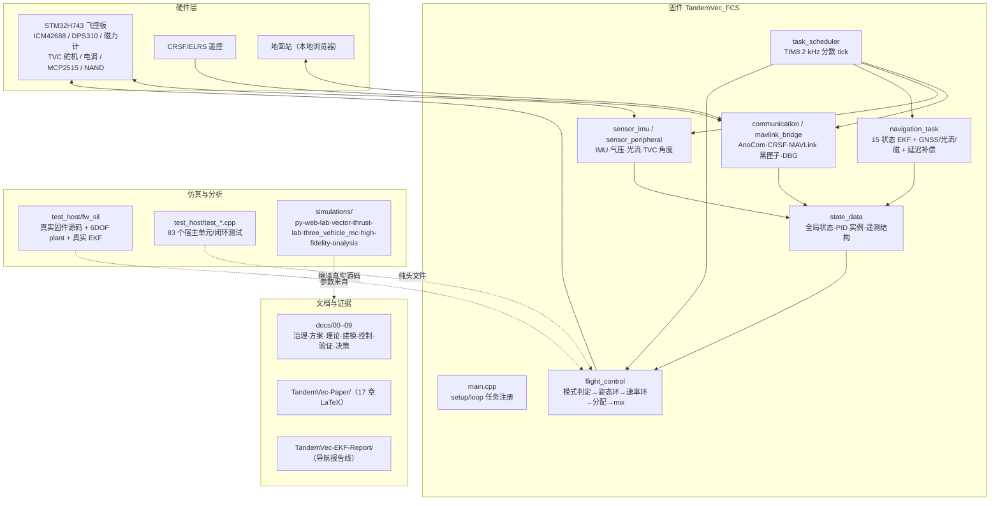

# 项目总览：架构与文件树

> 本文由实际目录扫描生成（2026-11-01），规模数字来自 `find`/`du` 与 `git ls-files`。
> 用途：快速定位"东西在哪、哪些能改、哪些是生成物"。
> 维护：结构变动（新增顶层目录、改变构建产物流向）时同步更新本文。

## 1. 定位与成熟度

纵列双发、正交单轴矢量推力、差速反扭滚转的 VTOL 概念项目，包含**飞控固件、地面站、仿真/分析工具、论文与验证文档**四块。

- 前电机（拉力式）绕机体系 z 轴摆动 → 滚转主控；尾电机（推进式）绕 y 轴摆动 → 俯仰主控；差速反扭 → 偏航主控。
- 固件已进入实机飞行验证阶段（2026-08 首飞）；`models/aircraft-model.json` 参数仍为默认/估算值。
- 规模：`git ls-files` 4411 个跟踪文件、519 次提交；固件 `src/` 16 230 行 C++、`include/` 13 927 行、`test_host/` 19 406 行。

## 2. 架构总览



## 3. 顶层目录

| 目录 | 规模 | 职责 | 性质 |
|---|---|---|---|
| `TandemVec_FCS/` | 2304 文件 / 174 MB | 飞控固件、地面站、宿主测试、固件侧文档 | 源码 |
| `docs/` | 8394 文件 / 548 MB | 编号文档体系（正文 61 篇）+ 参考资料（books 6333 / papers 1834） | 文档 |
| `simulations/` | 551 文件 / 698 MB | 四套仿真：网页实验站、py-web-lab、三机型 MC、高保真分析 | 仿真/产物 |
| `TandemVec-EKF-Report/` | 1668 文件 / 488 MB | 导航/EKF 报告线（章节、图、sim-data） | 文档/证据 |
| `TandemVec-Paper/` | 94 文件 / 76 MB | 17 章 LaTeX 论文与图 | 文档 |
| `models/` | 3 文件 | `aircraft-model.json` + schema：参数单一事实源 | 配置 |
| `tools/` | 13 文件 | 文档构建、参数同步、注释/链接检查、ASCII 盘符包装器 | 工具 |
| `scripts/` | 35 文件 | 自适应/MPC/辨识/配平/论文图脚本 | 研究脚本 |
| `matlab/analysis/` | 1 文件 | `rate_loop_margins.m`：速率环频域裕度复核 | 分析 |
| `assets/` | 19 文件 / 17 MB | AI 生成图与候选插图 | 素材 |
| `blender-test/` | 13 文件 / 25 MB | Blender 渲染试验（动画/静帧） | 素材 |
| `output/` | 32 文件 / 3.6 MB | Playwright 截图、原始 VTVL 参考 | 产物 |
| `视频/` | 1 文件 / 60 MB | 试飞视频 | 素材 |
| `零件打印/` | 9 文件 / 13 MB | 3D 打印 STL（电机座、齿轮、着陆腿等） | 素材 |
| `tmp/` | 82 MB | 临时构建/验证证据（`.gitignore` 忽略） | 临时 |
| `.agents/` `.claude/` `.dsh-ops/` `.reasonix/` `.zcode/` `.playwright-cli/` | — | Agent 工具配置与会话数据 | 环境 |

## 4. 固件 `TandemVec_FCS/`

```text
TandemVec_FCS/
├── platformio.ini              # 三个 env：TandemVec_FCS（飞行）/ CoaxialVTVL（共轴）/ test
├── src/                        # 固件主源码（16 230 行）
│   ├── main.cpp                # setup/loop、任务注册、上电 DETA100/UBX 探测、IWDG
│   ├── task_scheduler.cpp/.h   # TIM8 2 kHz 调度、分数 tick、[TASK]/[LOOP] 统计
│   ├── task_scheduler_interval.h
│   ├── communication.cpp/.h    # AnoCom 遥测、CRSF、MAVLink 切换、黑匣子、DBG 控制台、断链回调
│   ├── mavlink_bridge.cpp/.h   # MAVLink 参数/命令/STATUSTEXT
│   ├── ano_params.cpp/.h       # 164 参数注册表与在线读写
│   ├── ano_vars.cpp/.h         # AnoVars 通用变量上报（0xF2/0xF3/NAMED_VALUE_FLOAT）
│   ├── can_bus.cpp/.h          # MCP2515 CAN（发动机/遥测）
│   ├── flight_control.cpp/.h   # 模式判定、姿态/速率环、控制分配、执行器 mix、故障监测、在线辨识
│   ├── navigation_task.cpp/.h  # 15 状态 EKF、GNSS/光流/磁、延迟补偿、健康门控、重锚
│   ├── sensor_imu.cpp/.h       # ICM42688、磁力计、IMU 健康、轴映射
│   ├── sensor_peripheral.cpp/.h# DPS310、光流、TVC 角度、电池监测
│   ├── state_data.cpp/.h       # 全局状态、PID 实例、gnc_tel 遥测结构
│   ├── ubx_config.cpp/.h       # UBX 接收机自动配置
│   ├── math_utils.h            # 数学工具、getControlMode、CRSF_to_US
│   ├── deta100_types.h         # DETA100 协议类型
│   └── icm45686_ins_fast_covariance_blocks.h  # EKF 协方差块展开加速（Icm45686 是移植前缀，非传感器驱动）
├── include/                    # 平台无关头文件（13 927 行，73 个）
│   ├── 控制与分配/             # TandemVecAllocator、TandemVec_ControlAllocation、TandemVec_Propulsion、
│   │                           # TandemVec_Config、TandemVec_ServoModel、ThrustAllocation、PowerAllocation、
│   │                           # CoaxialAllocator、CoaxialVtvControl、GenericControlAllocation、
│   │                           # AirframeModel、VehicleProfile、ActuatorOutputMap、ControlContracts
│   ├── 控制律/PID/辅助/        # PositionPID、IncrementalPID、ControlUnits、RcCurve、TandemVec_ADRC、
│   │                           # TandemVec_OnlineID、RateLeadPredictor、RateAccelFeedback、RatePhaseLead、
│   │                           # AdaptiveGainDamper、YawOscillationDetector、HeadingAidingGate
│   ├── 导航/EKF/               # ins_*.h（20 个：气圧/IMU 健康/振动/预置/延迟/PPS/一致性/增量选择…）、
│   │                           # ins_static_detector / ins_static_aid_profile / ins_gnss_dynamic_weight
│   │                           #   （导出 Icm45686* 前缀函数：静止检测、ZUPT 档位、GNSS 动态权重）、
│   │                           # mag_measurement_gate、mag_reference、HorizontalKF、VerticalKF、
│   │                           # VerticalKF_2State、ComplementaryFilter、NavAidLossDetector、
│   │                           # NavImuIncrementSelect、imu_range
│   ├── 安全/失效/              # FailsafeLinkLossPlan、ActuatorFaultMonitor、StatusLED、Ws2812AppStatus
│   ├── 数学/工具/              # Quat4f、QuaternionMath、MedianFilter、GeoDisplacement
│   ├── 传感器/协议/            # DETA100_module、AnoVars
│   └── 历史/                  # TVC_Control_Geometric、TVC_Control_3rdOrder_Poly（已弃用）
├── lib/                        # 第三方/本地库（1100+ 文件）
│   ├── MAVLink、eigen、navigation-main、ublox-main、units   # 协议/数学/导航
│   ├── ICM42688、DPS310-Pressure-Sensor、IST8310、QMC5883L、MagSensor、MagCal、
│   │   LQS48_Flow、MTF02P                                   # 传感器
│   ├── ICM45686                # ★自有驱动库 v2.0.0（底层 + FlightAdapter + ImuDevice），
│   │                           #   2026-10-31 入库；**未接入固件**，src/sensor_imu.cpp 仍用 ICM42688
│   ├── AnoComProtocol、CrsfSerial、crsf、crc8、arduino-CAN  # 通信
│   └── W25N01GV、WS2812Driver                               # 存储/灯效
├── test_host/                 # 宿主测试（19 406 行）
│   ├── run_all.sh              # 平台无关回归总入口（BIN_DIR 可覆盖）
│   ├── test_*.cpp              # 83 个单元/闭环测试
│   ├── fw_algo/                # C ABI 测试（fw_algo / fw_ctrl / fw_gnc / fw_nav）
│   ├── fw_sil/                 # 真实固件源码 SIL
│   │   ├── fw_sil_main.cpp     # 定高/手动闭环（flight_control + state_data）
│   │   ├── fw_sil_env_main.cpp # 6DOF + IMU/GNSS/气压/风/地面 + 真实 EKF（--real-nav）
│   │   ├── fw_sil_failsafe_main.cpp / fw_sil_mode_main.cpp  # 断链/模式重入 SIL
│   │   ├── fw_sil_stubs.cpp    # 硬件替身（断链回调与固件共用 FailsafeLinkLossPlan.h）
│   │   ├── build_and_run*.sh、run_*.sh、run_failsafe_matrix.sh
│   │   └── sim-data/           # SIL 证据（coax-*、long-duration 等）
│   ├── stub/、reference/       # Arduino 桩、CCAEGT 参考库
│   └── bin/                    # 默认 BIN_DIR（产物，gitignore）
├── GCS/                        # 地面站（93 文件）
│   ├── server/                 # Python 后端：main.py、params.py、anocom.py、serial_link.py、blackbox.py…
│   ├── web/                    # 前端：index.html + src/*.mjs（dashboard/console/scope/params/blackbox/view3d）+ vendor/three
│   └── tests/
├── docs/                       # 固件侧文档（557 文件）
│   ├── COMM-001、GCS-001、C路径-参数集中与遥测结构化方案、barometric_altitude_optimization…
│   ├── ano_ref/、mavlink-ref/、memory/
│   └── 04-数学建模/代码理论核查/  # FW-CTRL / FW-INFRA / FW-NAV / FW-EKF 等台账
├── tools/                      # 固件工具（38 文件）
│   ├── verify_*.py             # 轴映射/符号/分配/地板一致性等出厂校验
│   ├── plot_blackbox.py、audit_math.py、gen_mag_reference.py
│   ├── dps_profile_parser.js / dps_profile_runner.js
│   └── test_mavlink_bridge.py
├── test/                       # PlatformIO 单元测试入口
├── output/                     # 构建/分析输出（58 文件，产物）
├── sim-data/                   # 固件级仿真证据（coax-mc / liquid-mc / long-duration）
└── .pio/                       # PlatformIO 构建目录（1181 文件，产物，勿手改）
```

## 5. 文档 `docs/`

正文 61 篇（排除参考资料），编号即分层：

```text
docs/
├── 00-项目治理/ (4)      GOV-001 范围与术语 · GOV-002 信息与配置管理 · GOV-003 多Agent协作 · GOV-004 注释与理论对照
├── 01-方案设计/ (3)      CFG-000 概念构型基线 C0 · CFG-001 py-web-lab 统一架构 · CONOPS-001 运行概念
├── 02-需求与验证/ (1)    REQ-001 需求基线
├── 03-理论推导/ (3)      THY-001 姿态数学 · THY-002 推进物理 · THY-003 刚体动力学/控制分配
├── 04-数学建模/ (15)     MOD-001 六自由度模型 · MOD-002 坐标与符号 · MOD-003 配平与稳定性 ·
│                         MOD-004 代码理论对照 · MOD-005 共轴动力学 + 代码理论核查/
├── 05-控制与分配/ (6)    CTL-001 控制架构与 SAS · CTL-002 可控性与失效模式 · CTL-003 多机型与执行器抽象 ·
│                         CTL-004 固件仿真一体化 · CTL-005 无磁航向与运动 EKF · CTL-006 机型解耦契约
├── 06-推进与执行机构/ (1) PROP-001 推进与摆座模型
├── 07-验证与确认/ (6)    SAFE-001 安全计划 · VER-001 验证确认与可信度 · VER-002 三机型兼容性 ·
│                         VER-003 三机型 MC · VER-004/005 共轴原始固件对照（控制/导航）
├── 08-参考资料/ (8185)   README · 参考资料注册表 · books/6333 · papers/1834 · notes/9 · index/4 · scripts/3
├── 09-决策记录/ (3)      DEC-001 参数单一事实源 · DEC-002 六项 P0 修复决策 · 模板
├── memory/ (3)           级联 LMI · 相位裕度 · PIO20/ArduinoCore3 迁移
├── reference/ (155)      外部参考摘录
└── registers/ (9)        templates/ · 假设与局限 · 危害与失效模式 · 参数数据手册 · 模型-代码追溯 ·
                          行为保持红线清单 · 踩坑记录-AGENTS · 需求注册表 · 验证覆盖矩阵
```

## 6. 仿真

```text
simulations/
├── vector-thrust-lab/ (141)  交互式网页仿真站：index.html、src/、css/、docs/（生成物）、tests/、standalone.html
├── py-web-lab/ (109)         README、requirements.txt、server/、web/、tests/
├── three_vehicle_mc/ (256)   三机型蒙特卡洛、fast_mc、ML 代理/主动学习/失效聚类、对比脚本
└── high-fidelity-analysis/ (45)  高保真级联/MPC/估计器对比/配平分析
```

## 7. 报告线与论文

```text
TandemVec-Paper/          ch/01–17 章 tex（intro→propulsion→mapping→dynamics→allocation→stability→
                          control→discussion→INDI→simulation→quaternion→VTOL→LQR→cascade→ADRC→MPC）、
                          fig/、fig-mpc/、fig-sim/、output/、sim-data/
TandemVec-EKF-Report/     ch/、fig/、figs/153、sim/269、sim-data/1194、
                          EKF在线零偏估计可靠性-2026-10-23.md、无磁EKF收敛仿真-2026-10-25.md
```

## 8. 模型、工具与研究脚本

```text
models/          aircraft-model.json（参数单一事实源）· aircraft-model.schema.json · README
tools/           build-docs.py（docs→HTML 站）· build-standalone.py · check-code-comments.py ·
                 check-links.py · sync-params.py（模型→固件参数）· with-ascii-bin.sh（ASCII 盘符包装器）·
                 shell-env.cmd · tvc-cli.cmd
scripts/         adaptive_full/mpc/nmpc · ident_phys/ident_probe · mpc_adv/mpc_proto ·
                 paper_fgm_fig/paper_mpc_figs · trim_solve · verify_att_target
matlab/analysis/ rate_loop_margins.m（速率环频域裕度）
```

## 9. 关键入口

```powershell
# 固件
pio run                                  # 编译 TandemVec_FCS（默认 env）
pio run -e CoaxialVTVL                   # 共轴机型
pio test -e test                         # PlatformIO 单元测试

# 宿主回归（83 个用例）
bash TandemVec_FCS/test_host/run_all.sh

# 真实固件 SIL
bash TandemVec_FCS/test_host/fw_sil/build_and_run.sh          # 定高闭环
bash TandemVec_FCS/test_host/fw_sil/build_and_run_real.sh --real-nav --ekf
bash TandemVec_FCS/test_host/fw_sil/run_failsafe_matrix.sh    # 断链矩阵

# 地面站
python TandemVec_FCS/GCS/server/main.py

# 文档站
py -3.12 tools/build-docs.py
```

> 在中文路径下跑宿主 g++ 时，用 `bash tools/with-ascii-bin.sh -- <命令>` 包一层：
> MinGW 的 `ld` 不能写中文输出路径（`Invalid argument`）。

## 10. 生成物与"不要手改"

| 路径 | 说明 |
|---|---|
| `TandemVec_FCS/.pio/` | PlatformIO 构建产物 |
| `TandemVec_FCS/test_host/bin/` | 默认测试二进制 |
| `TandemVec_FCS/output/`、`simulations/*/output/` | 分析/渲染输出 |
| `simulations/vector-thrust-lab/docs/*.html`、`standalone.html` | 由 `tools/build-docs.py` / `build-standalone.py` 生成 |
| `docs/08-参考资料/{books,papers}/` | 外部资料（PDF），不是本项目源码 |
| `TandemVec-Paper/output/`、`tmp/` | 论文编译产物、临时目录 |
| `tmp/`（根） | 临时构建与验证证据，`.gitignore` 忽略 |

## 11. 规模速览

| 指标 | 数值 |
|---|---|
| Git 跟踪文件 | 4411 |
| 提交数 | 519 |
| 固件源码（src） | 16 230 行 |
| 固件平台无关头（include） | 13 927 行 |
| 宿主测试（test_host） | 19 406 行 / 83 个用例 |
| 文档正文（docs 00–09 + memory + registers） | 61 篇 |
| 参考资料 | books 6333 / papers 1834 文件 |
| 仿真代码与数据 | 551 文件 / 698 MB |
| 报告线证据 | EKF 报告 1668 文件 / 488 MB |

## 12 命名澄清：`icm45686` 前缀不是传感器驱动

实机 IMU 是 **ICM42688**，现役驱动在 `TandemVec_FCS/lib/ICM42688/` + `TandemVec_FCS/src/sensor_imu.cpp`。`lib/` 下另有 `ICM45686/`（自有驱动库 v2.0.0，2026-10-31 入库），**尚未接入固件**——换传感器需要改引脚/SPI/CS/中断/量程并上板验证。

`Icm45686*` 是 2026-07-29 移植提交 `62124e9` 保留下来的**参考实现前缀**（来自某份 ICM45686 参考工程/文献实现），落在导航/INS 辅助模块里，与上述两个传感器驱动库都不互相引用：

| 文件 | 内容 |
|---|---|
| `src/icm45686_ins_fast_covariance_blocks.h` | EKF 15 状态协方差块展开 `Icm45686FirstOrderCovarianceDeltaFromBlocks()` + 结构化过程噪声 `Icm45686StructuredContinuousQc()`；被 `lib/navigation-main/src/ekf_15_state.h:84` include |
| `include/ins_static_detector.h` | 静止检测迟滞状态机 `Icm45686StaticDetectorUpdate()` |
| `include/ins_static_aid_profile.h` | ZUPT 档位、残差自适应噪声、外参照门控 `Icm45686SelectStaticAidProfile()` 等 |
| `include/ins_gnss_dynamic_weight.h` | GNSS 量测噪声 floor/cap/pDOP 缩放 `Icm45686ComputeGnssStd()` |

结论：看到 `icm45686` 先按**导航/AHRS 模块**处理，不要当成 IMU 驱动去找寄存器配置。新增真实传感器驱动放 `lib/<型号>/`，并在 `src/sensor_imu.cpp` 接线，不要沿用该前缀。
